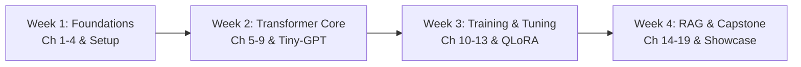
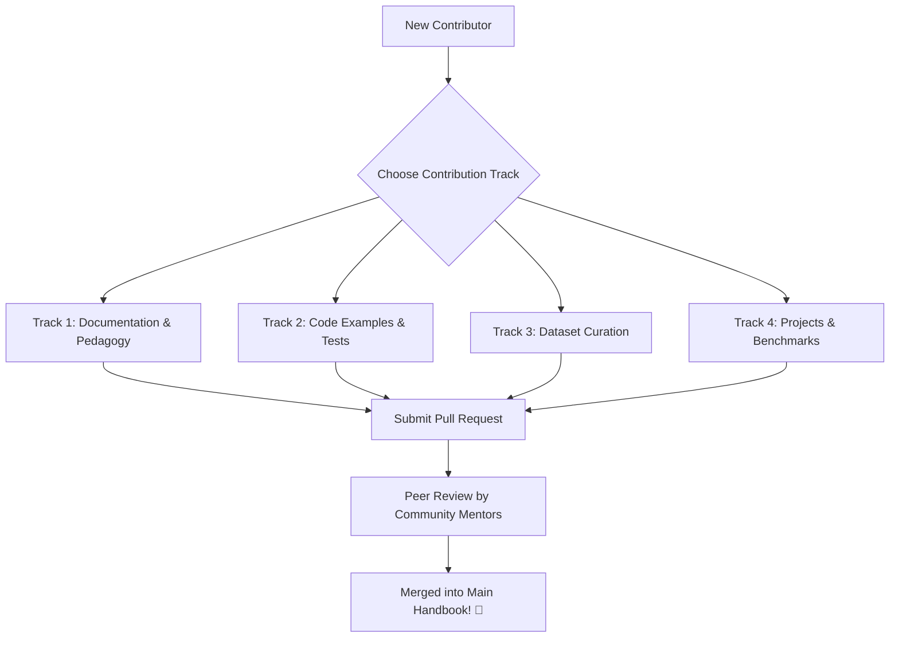

# 🎤 College Community Presentation Pitch & Workshop Kit

> **Complete Presentation Materials, Workshop Blueprint, and 4-Week Learning Roadmap**  
> *Designed for university engineering societies, open-source student clubs, tech fests, and developer communities.*

---

## 📌 Document Overview

This document provides ready-to-deliver presentation materials, speech scripts, slide narratives, a minute-by-minute hands-on workshop agenda, and a 4-week structured curriculum to launch an **Open-Source LLM & Generative AI Initiative** on your campus.

Whether you are addressing a 30-second elevator pitch to a student council president, a 2-minute pitch to a department chair or faculty sponsor, or giving a 5-minute keynote at your college hackathon, use the calibrated materials below.

---

## 1. The 30-Second Hook

*(Target Audience: Students passing by club recruitment booths, Discord/WhatsApp announcements, elevator conversations)*

> "You’ve used ChatGPT. But do you know what actually happens in those 40 milliseconds between pressing `Enter` and seeing the first word appear on your screen? 
>
> Most people are content being passive consumers of AI. We’re building a community of engineers who look under the hood—learning how tokenizers split words into numbers, how multi-head attention calculates context vectors, and how to train and fine-tune language models from pure scratch.
> 
> Stop just prompting AI. Come learn how to build it. Star our GitHub repository and join our kickoff workshop this weekend!"

---

## 2. The 2-Minute Professional Pitch

*(Target Audience: Faculty advisors, student body executives, club pitch sessions, tech fest inaugurals)*

> "Good afternoon, everyone.
>
> Over the past two years, Large Language Models and Generative AI have transformed the global computing landscape. Every company is hiring for AI fluency, yet university computer science curricula are still struggling to bridge the gap between classical theory and modern LLM engineering.
>
> Students know how to ask ChatGPT to write an essay, but very few understand why a model hallucinates, what a context window physically represents in GPU memory, or how Low-Rank Adaptation (LoRA) enables fine-tuning an 8-billion parameter model on a single graphics card.
>
> Today, we are launching **The Open-Source LLM Educational Initiative** right here in our college developer community. 
>
> We have engineered a 20-chapter open-source handbook, complete with working PyTorch implementations, 50+ architecture diagrams, and a fully functional miniature GPT model called **Tiny-GPT** that runs directly on an ordinary laptop without requiring costly cloud servers.
>
> Through this handbook and our accompanying hands-on workshop series, our members will move through four stages:
> 1. **Foundations**: Mastering vector embeddings, tokenization, and self-attention mathematics.
> 2. **Internals**: Understanding the autoregressive transformer pipeline from logits to sampling.
> 3. **Fine-Tuning & RAG**: Building Retrieval-Augmented Generation systems on campus documents.
> 4. **Open-Source Contribution**: Contributing documentation, optimizations, and local AI tools back to the global developer ecosystem.
>
> We invite faculty, student researchers, and developers of all semesters—from first-year beginners to final-year project teams—to join us, clone the repository, and build the future of AI together. Thank you!"

---

## 3. The 5-Minute Detailed Presentation Script

*(Setting: College Auditorium or Developer Meetup. Speaker is on stage with slides.)*

### Slide 1: Title & The Black Box Problem
**[Speaker Action]**: *Walk to center stage. Pause. Click slide showing a simple ChatGPT prompt box vs. an intricate Transformer neural network circuit.*

> "Raise your hand if you used ChatGPT, Claude, or GitHub Copilot in the last 48 hours. 
> 
> *(Pause for hands to go up across the room)*
> 
> Almost every single hand. Now keep your hand up if you can explain what a **Query-Key-Value dot-product attention calculation** is doing mathematically.
>
> *(Pause as almost all hands drop)*
>
> Look around the room. That difference—between the hands that went up and the hands that went down—is what we call the **AI Literacy Divide**.
>
> On one side are 99% of computer users who view AI as magic. On the other side is the tiny fraction of developers who understand the matrix transformations, the probability distributions, and the backpropagation dynamics that make intelligence emerge from silicon."

### Slide 2: Why AI Consumption is a Dead End for Engineers
**[Speaker Action]**: *Advance slide showing a traditional software developer replaced by someone who only types prompts vs. an AI Systems Engineer who builds pipelines.*

> "As engineering students, our future careers cannot be built on merely consuming API endpoints. If your only technical skill is typing 'write a Python function for binary search' into an API, you are competing against every non-programmer on the planet who can do the exact same thing.
>
> Real engineering value lies beneath the abstraction layer. 
> - What do you do when the API is too slow?
> - What do you do when confidential company documents cannot leave the local network?
> - How do you stop a model from hallucinating medical or financial advice?
> - How do you adapt an open-weight model like Llama-3 or Mistral to understand your college's syllabus or local regional languages?
>
> You can't solve those problems with better prompt adjectives. You solve them with **Transformer Architecture, Vector Databases, Quantization, and Supervised Fine-Tuning**."

### Slide 3: Introducing The LLM Educational Handbook
**[Speaker Action]**: *Advance slide showing GitHub repository banner, directory tree of 20 chapters, and Tiny-GPT architecture diagram.*

> "To empower every student in our campus community, our developer group has created **The Complete LLM & Generative AI Educational Handbook**.
>
> This is a zero-prerequisite, rigorously engineered open-source textbook hosted right on GitHub. It spans 20 exhaustive chapters taking you from absolute basics—what is a weight, what is a tensor—all the way to:
> - **The Attention Mechanism**: Step-by-step arithmetic of how tokens attend to each other.
> - **Tiny-GPT**: A complete, working GPT-style language model implemented in pure PyTorch that you can train right on your MacBook or budget Windows laptop in under 15 minutes.
> - **Retrieval-Augmented Generation (RAG)**: Building local semantic search engines using ChromaDB and sentence transformers.
> - **Quantization & Local Inference**: Running models using GGUF and Ollama without sending a single byte over the internet."

### Slide 4: Real Things Our Community Will Build
**[Speaker Action]**: *Advance slide displaying 4 student project screenshots: College Syllabus Assistant, Offline PDF Bot, Code Reviewer, Tiny-GPT.*

> "Here is what our members will be building in the next month:
> 1. An offline campus chatbot that indexes every department's syllabus, exam timetable, and academic regulations using local RAG.
> 2. An interactive Tokenizer Visualizer that demonstrates BPE subword splitting in real time.
> 3. Custom fine-tuned models trained with LoRA on Google Colab for automated code explanation.
> 4. Research contributions to open-source benchmarks through organizations like EleutherAI and Hugging Face."

### Slide 5: The Call to Action
**[Speaker Action]**: *Advance to final slide showing QR Code to repository and Discord/WhatsApp community link.*

> "We are not here to sell a proprietary course or hand out certificates that mean nothing. We are here to build code, read foundational research papers together, break things, and learn by shipping software.
>
> Scan the QR code on the screen. Star the GitHub repository `Enggvault/llm`. Clone it to your machine, read Chapter 1 tonight, and join us this Saturday in CS Lab 3 for our 2-hour hands-on kickoff workshop where everyone leaves with a working local LLM running on their own laptop.
>
> Let's stop being consumers. Let's be creators. Thank you!"

---

## 4. Proposed 2-Hour Introductory Workshop Agenda

| Time Slot | Duration | Segment | Format | Learning Objective & Activity |
|:---|:---:|:---|:---|:---|
| **0:00 – 0:15** | 15 min | **Welcome & The Spark** | Live Demo | • Icebreaker: Run a local 3B model via Ollama in terminal.<br>• Demonstrate zero cloud dependency (turn off Wi-Fi and generate text).<br>• Demystify the "black box". |
| **0:15 – 0:40** | 25 min | **Session 1: Next-Token Prediction** | Interactive Lecture | • Conceptual dive: Text as probabilities.<br>• Live exercise: Predicting the missing word.<br>• Temperature, Top-k, and Top-p explained visually with live terminal sliders. |
| **0:40 – 1:05** | 25 min | **Session 2: Inside the Transformer** | Whiteboard & Slides | • Tokenization: Characters vs. Subwords (BPE).<br>• The Library Analogy: Queries, Keys, and Values.<br>• Scaled dot-product attention calculation on a 3x3 numeric grid. |
| **1:05 – 1:15** | 10 min | **Community Break & Networking** | Social | • Free discussion, laptop troubleshooting, snacks. |
| **1:15 – 1:45** | 30 min | **Session 3: Hands-on Code Lab** | Interactive Coding | • Clone `Enggvault/llm`.<br>• Open `projects/tiny-gpt/data/prepare.py` and inspect tokenization.<br>• Launch `train.py` on Shakespeare dataset and watch loss drop step by step.<br>• Run `generate.py` to sample text from their own trained model. |
| **1:45 – 1:55** | 10 min | **Session 4: Building a Fast RAG App** | Live Demo | • Connect `ChromaDB` with a 3-page college notice PDF.<br>• Query the notice and watch the model cite exact sentences. |
| **1:55 – 2:00** | 5 min | **Wrap-Up & 4-Week Roadmap** | Presentation | • Announce Study Groups and GitHub issue bounty board.<br>• Q&A and next steps. |

---

## 5. 4-Week Structured Learning Roadmap



### 🗓️ Week 1: Foundations & Python Ecosystem (Handbook Chapters 1–4, 12)
- **Concepts**: AI vs. ML vs. DL taxonomy, neural network forward/backward propagation, activation functions (ReLU, Softmax), NLP history (Word2Vec, TF-IDF).
- **Practical Milestone**:
  - Set up a clean Python 3.10+ virtual environment (`venv`).
  - Install PyTorch, Hugging Face `transformers`, and `datasets`.
  - Write a 20-line PyTorch script training a 2-layer perceptron on synthetic data.
- **Deliverable**: Verify environment and push first script to individual GitHub forks.

### 🗓️ Week 2: Transformer Architecture & Tiny-GPT (Handbook Chapters 5–9, 11)
- **Concepts**: Subword tokenization (BPE), token and positional embeddings, Query-Key-Value self-attention, multi-head attention, residual connections, causal masking, autoregressive decoding strategies.
- **Practical Milestone**:
  - Implement a manual single-head scaled dot-product attention function in PyTorch.
  - Clone and explore `projects/tiny-gpt/`.
  - Prepare `input.txt` on a custom text corpus (e.g., college handbook or public domain literature) and train Tiny-GPT for 1,000 steps.
- **Deliverable**: Post generated text samples and training loss curves to the community discussion thread.

### 🗓️ Week 3: LLM Pretraining, PEFT & Fine-Tuning (Handbook Chapters 10, 13)
- **Concepts**: Compute scaling laws (Chinchilla), data cleaning and deduplication, learning rate schedules (warmup + cosine decay), Supervised Fine-Tuning (SFT), LoRA and QLoRA mathematics, RLHF and DPO alignment.
- **Practical Milestone**:
  - Open a free Google Colab notebook with T4 GPU runtime.
  - Use `peft` and `trl` to fine-tune a 1B–3B parameter model (e.g., Llama-3.2-1B or Phi-3-mini) using 4-bit QLoRA on an instruction-following dataset.
- **Deliverable**: Share the exported LoRA adapter weights on Hugging Face Hub.

### 🗓️ Week 4: Retrieval-Augmented Generation & Applications (Handbook Chapters 14–19)
- **Concepts**: RAG architecture, dense embedding models (`all-MiniLM-L6-v2`), vector databases (`ChromaDB`, `FAISS`), recursive text chunking, semantic retrieval, hallucination mitigation, ethical AI and evaluation metrics (ROUGE, BLEU, MMLU).
- **Practical Milestone**:
  - Build a complete Streamlit or CLI application answering questions over campus documents (PDFs, Markdown notes) with verified source citations.
  - Package local inference using Ollama or llama.cpp.
- **Deliverable**: Submit final project repository to the community showcase.

---

## 6. GitHub Community Contribution Plan

Our community is built on the belief that **the best way to understand an algorithm is to explain it, implement it, or improve its documentation**.

Here is how students can contribute directly to `Enggvault/llm`:



### Contribution Tracks
1. **Track 1: Documentation & Clarifications**
   - Identify confusing explanations, mathematical typos, or broken links in any chapter.
   - Add intuitive analogies or visual Mermaid diagrams for complex concepts.
   - Translate key summaries into regional languages for broader accessibility.
2. **Track 2: Code Enhancements & Tests**
   - Add unit tests for `projects/tiny-gpt/model.py` and `train.py`.
   - Optimize PyTorch matrix operations or add FlashAttention support.
   - Implement alternative tokenizers (e.g., Google SentencePiece or Hugging Face Byte-level BPE).
3. **Track 3: Dataset Curation**
   - Create clean, domain-specific instruction datasets formatted in standard JSONL (e.g., engineering course Q&A, syllabus queries).
   - Document dataset licensing, cleaning steps, and contamination filters.
4. **Track 4: Student Projects**
   - Implement one of the 8 projects outlined in Chapter 19.
   - Submit reproducible example notebooks with clean requirements and READMEs.

### Step-by-Step Contribution Workflow
1. **Fork the Repository**: Click the `Fork` button on `https://github.com/Enggvault/llm`.
2. **Clone Locally**:
   ```bash
   git clone https://github.com/<your-username>/llm.git
   cd llm
   git checkout -b feature/chapter-improvement
   ```
3. **Make Your Changes**: Follow the handbook's Markdown styling and ensure any Python code runs cleanly without syntax errors.
4. **Verify Locally**:
   ```bash
   python3 -m py_compile projects/tiny-gpt/*.py
   ```
5. **Submit a Pull Request**: Provide a clear description referencing the relevant chapter and explaining the pedagogical benefit of your update.

---

## 7. Why This Matters: A Closing Statement

> "Computing has undergone a fundamental paradigm shift every twenty years:
> - In the 1980s, it was the personal computer.
> - In the 2000s, it was the World Wide Web.
> - In the 2020s, it is Generative Artificial Intelligence.
>
> In each revolution, those who merely learned to click the buttons became consumers, while those who took the time to study the underlying protocols, compilers, and architectures shaped the next half-century of human progress.
>
> By opening the black box of Large Language Models today, you are not just passing a semester project—you are equipping yourself with the foundational knowledge to build, audit, and direct the most powerful technology of our generation.
>
> Welcome to the community. Let's start building."
