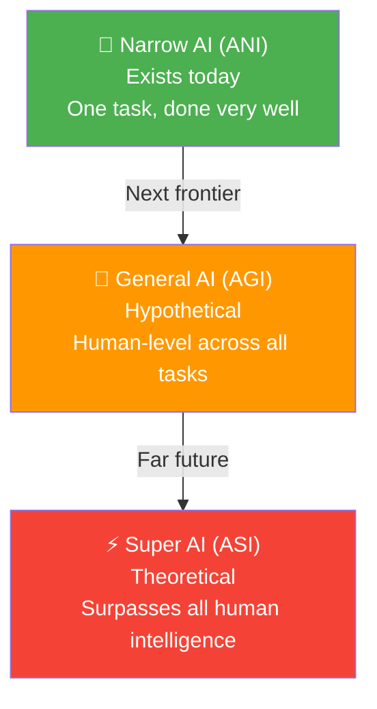
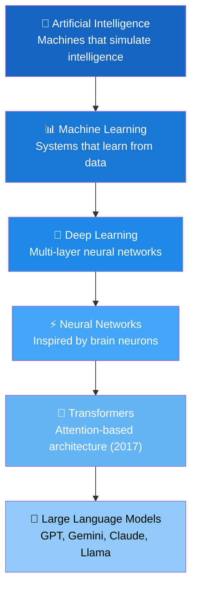
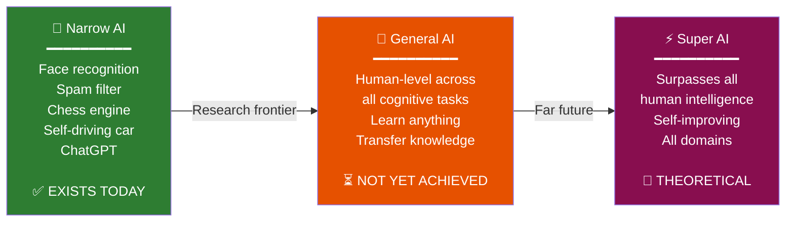
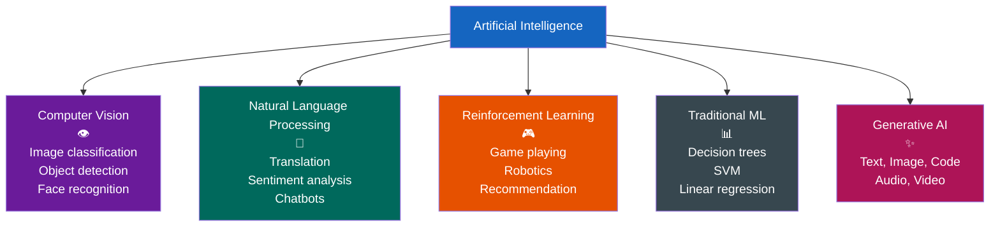

# Chapter 1: Introduction to Artificial Intelligence

> **Part of the LLM Educational Handbook** — A comprehensive guide for college students

## Prerequisites

Before diving into this chapter, you should:
- Have basic familiarity with computers and software
- Be curious! No prior math or programming experience required
- Know what a smartphone app is and have used Google, YouTube, or Spotify

---

## Table of Contents

1. [What is Artificial Intelligence?](#1-what-is-artificial-intelligence)
2. [A Brief History of AI](#2-a-brief-history-of-ai)
3. [Types of AI: Narrow, General, and Super](#3-types-of-ai-narrow-general-and-super)
4. [AI in Your Everyday Life](#4-ai-in-your-everyday-life)
5. [What is Generative AI?](#5-what-is-generative-ai)
6. [What Makes LLMs Different from Traditional ML?](#6-what-makes-llms-different-from-traditional-ml)
7. [Key Terminology](#7-key-terminology)
8. [Training vs Validation vs Inference](#8-training-vs-validation-vs-inference)
9. [The AI Landscape: A Visual Map](#9-the-ai-landscape-a-visual-map)
10. [Summary](#10-summary)
11. [Further Reading](#11-further-reading)

---

## 1. What is Artificial Intelligence?

Artificial Intelligence (AI) is the field of computer science focused on building systems that can perform tasks that **normally require human intelligence**. These tasks include things like:

- Understanding and generating language
- Recognizing faces, objects, or speech
- Making decisions based on complex data
- Learning from experience and improving over time

> **Simple Definition:** AI is teaching machines to *think*, *learn*, and *act* in ways that mimic human intelligence.

### The Core Idea

Humans learn from experience. When you were a child, you touched a hot stove once — and you never did it again. You learned from data (the pain) and adjusted your behavior (avoid hot stoves). AI systems work on a similar principle: they learn from **data** (examples), identify **patterns**, and use those patterns to make **predictions** or **decisions** on new, unseen situations.

The key insight is this: instead of programming every possible rule by hand (e.g., "if the email contains the word 'free money', mark it as spam"), we let the machine **discover the rules itself** by looking at thousands of examples.

---

## 2. A Brief History of AI

AI did not appear overnight. It has evolved through several distinct eras, each building on the last.

### 2.1 The Founding Years: 1940s–1960s

**1943 — McCulloch & Pitts:** Warren McCulloch and Walter Pitts published a paper describing a mathematical model of a neuron. This was the first formal model of how brain cells might compute.

**1950 — The Turing Test:** British mathematician Alan Turing published "Computing Machinery and Intelligence," asking the famous question: *"Can machines think?"* He proposed the **Turing Test** — if a machine can hold a conversation indistinguishable from a human, it could be considered intelligent. This paper launched the entire field.

**1956 — Dartmouth Conference:** John McCarthy coined the term "Artificial Intelligence" at a summer workshop at Dartmouth College. This is considered the official birth of AI as an academic discipline.

**1958 — The Perceptron:** Frank Rosenblatt built the first neural network hardware, called the Perceptron. It could learn to classify simple patterns, like distinguishing circles from squares.

### 2.2 The First AI Winter: 1970s

Early AI researchers were overly optimistic. Marvin Minsky predicted in 1970 that "within a generation... the problem of creating artificial intelligence will be substantially solved." 

When AI systems failed to deliver on these grand promises — struggling with real-world complexity — funding dried up. This period of reduced interest and investment is called an **AI Winter**.

### 2.3 Expert Systems Era: 1980s

AI research pivoted to **Expert Systems** — programs that encoded human expertise as thousands of "if-then" rules.

**Example:** MYCIN (1970s) was an expert system for diagnosing blood infections. It had ~600 rules like:
- IF the infection is bacteremia AND the patient has a fever AND the culture site is blood → THEN suspect Bacteroides

Expert systems worked well in narrow domains but were:
- Brittle (broke when encountering situations outside their rules)
- Expensive to maintain (humans had to write every rule)
- Unable to learn from new data

### 2.4 Statistical Machine Learning: 1990s–2000s

Researchers realized that instead of encoding knowledge as rules, machines could **learn from data**. This shift to **statistical methods** was transformative.

Key milestones:
- **1997:** IBM's Deep Blue defeats chess world champion Garry Kasparov using search algorithms
- **1998:** Yann LeCun applies convolutional neural networks to handwritten digit recognition (MNIST)
- **2002:** Roomba launches — practical AI-powered robotics in consumer products
- **2006:** Geoffrey Hinton revives neural networks with "deep belief nets" — the deep learning renaissance begins

### 2.5 The Deep Learning Revolution: 2012–2017

**2012 — AlexNet Moment:** A deep convolutional neural network called AlexNet, trained on GPUs, won the ImageNet image classification competition by a massive margin. Error rate dropped from ~26% to ~15%. This proved that deep learning + big data + GPUs = breakthrough performance.

**2014 — GANs:** Ian Goodfellow invented Generative Adversarial Networks, enabling AI to generate realistic synthetic images.

**2016 — AlphaGo:** DeepMind's AlphaGo defeated world champion Lee Sedol at the ancient game of Go — a feat previously thought to be decades away. Go has more possible board positions than atoms in the universe.

### 2.6 The Transformer Era: 2017–Present

**2017 — Attention is All You Need:** Google researchers published a paper introducing the **Transformer** architecture. This would become the foundation of every modern LLM.

**2018 — BERT:** Google released BERT (Bidirectional Encoder Representations from Transformers), revolutionizing language understanding tasks.

**2020 — GPT-3:** OpenAI released GPT-3 with 175 billion parameters, demonstrating stunning text generation capabilities.

**2022 — ChatGPT:** OpenAI launched ChatGPT, reaching 100 million users in just 2 months — the fastest-growing consumer application in history.

**2023–2024:** GPT-4, Gemini, Claude, Llama 2/3, Mistral — a Cambrian explosion of powerful language models.

---

## 3. Types of AI: Narrow, General, and Super

AI researchers often classify AI systems by their **breadth of capability**:

### 3.1 Narrow AI (Artificial Narrow Intelligence — ANI)

Also called **Weak AI**. This describes AI systems designed to perform **one specific task** very well.

**Examples:**
| System | What it does | What it cannot do |
|--------|-------------|-------------------|
| Face ID on iPhone | Recognize your face | Play chess |
| Spotify Recommendations | Suggest songs | Drive a car |
| Chess Engine (Stockfish) | Play chess at superhuman level | Understand a poem |
| Google Translate | Translate text | Compose music |
| Email Spam Filter | Classify spam/not-spam | Write code |

> **Key point:** Every AI system that exists today is Narrow AI. Despite impressive capabilities, today's AI systems are specialists, not generalists.

### 3.2 General AI (Artificial General Intelligence — AGI)

AGI would be an AI system with **human-level intelligence across all domains** — able to learn any task a human can, transfer knowledge between domains, and reason about novel situations.

**Characteristics of AGI (hypothetical):**
- Learn from minimal examples (like humans do)
- Apply knowledge from chess to poker strategy
- Understand context, emotions, and nuance
- Form plans over long time horizons
- Be self-aware and introspective

**Current status:** AGI does not exist. Experts disagree wildly on when (or whether) it will be achieved — estimates range from 10 years to never.

### 3.3 Superintelligence (ASI — Artificial Superintelligence)

ASI would be an AI that **surpasses human intelligence in every domain** — creativity, scientific reasoning, social intelligence, etc.

This concept raises profound philosophical and safety questions explored by researchers like Nick Bostrom and organizations like the Alignment Forum.

> **Important:** Discussions of ASI are largely theoretical. Focus on understanding real, existing AI systems first.



---

## 4. AI in Your Everyday Life

You interact with AI **dozens of times per day** without thinking about it. Here are relatable examples:

### 4.1 Phone Keyboard Autocomplete

When you type on your phone, the word suggestion bar predicts your next word. This is a **language model** — trained on billions of sentences — that has learned which words commonly follow which other words.

```
"I'll be there in a" → [few] [minute] [second]
```

The model doesn't know your plans — it's learned statistical patterns in language from massive amounts of text data.

### 4.2 Face Unlock

Your phone's face recognition system uses a **convolutional neural network** (CNN) trained on millions of face images. When you try to unlock your phone:
1. The camera captures your face
2. The CNN extracts ~128 numerical features (a "face embedding")
3. It compares these features to your stored profile
4. If the distance is small enough → unlock

This system works in different lighting, with glasses, with a beard — because the neural network learned to identify you across variations.

### 4.3 Spotify Recommendations

Spotify uses a combination of:
- **Collaborative filtering:** "Users who liked X also liked Y"
- **Audio analysis:** CNNs that listen to songs and identify tempo, energy, key
- **Natural Language Processing:** Analyzing blog posts and playlists to understand a song's vibe

The result: Discover Weekly, a personalized playlist that feels eerily accurate.

### 4.4 Google Translate

Modern Google Translate uses a **neural machine translation** system based on the Transformer architecture. It:
1. Encodes your sentence into a dense numerical representation
2. Decodes it into the target language word by word
3. Uses "attention" to track how words in the source relate to words in the translation

Google Translate handles 100+ languages and processes 100 billion words per day.

### 4.5 Other Examples Students Encounter Daily

| AI Application | Technology Used | Example |
|---------------|----------------|---------|
| YouTube recommendations | Collaborative filtering + deep learning | "Up next" videos |
| Instagram/TikTok feed | Reinforcement learning | Endless scroll |
| Gmail Smart Reply | Sequence-to-sequence models | "Sounds great!" suggestions |
| Snapchat filters | Real-time facial landmark detection | Dog ears filter |
| Siri / Google Assistant | Automatic speech recognition + LLM | "Set a timer for 10 minutes" |
| Netflix thumbnails | A/B testing + computer vision | Different thumbnails for different users |
| Duolingo | Adaptive learning algorithms | Personalized lesson difficulty |

---

## 5. What is Generative AI?

**Generative AI** refers to AI systems that can **create new content** — text, images, audio, video, or code — rather than just classifying or analyzing existing content.

### 5.1 The Key Distinction

| Traditional AI (Discriminative) | Generative AI |
|--------------------------------|---------------|
| Input → Classification/Prediction | Input (prompt) → New Content |
| "Is this email spam?" → Yes/No | "Write a poem about spam email" → 🎵 |
| "What breed is this dog?" → Labrador | "Generate an image of a Labrador" → 🖼️ |
| "Is this transaction fraudulent?" → 0.97 | "Create a fake transaction story" → 📖 |

### 5.2 Types of Generative AI

**Text Generation — Large Language Models**
- ChatGPT, Gemini, Claude, Llama
- Generate essays, code, emails, stories, poetry
- Can answer questions, reason, summarize, translate

**Image Generation — Diffusion Models**
- DALL-E, Midjourney, Stable Diffusion
- Create photorealistic images from text prompts
- Example: "A golden retriever wearing a lab coat in a chemistry lab"

**Code Generation**
- GitHub Copilot, Amazon CodeWhisperer
- Complete functions, suggest implementations, explain code
- Trained on billions of lines of open-source code

**Audio Generation**
- Suno, Udio — generate complete songs from text
- ElevenLabs — clone voices, text-to-speech
- OpenAI Whisper — transcribe speech to text (the reverse)

**Video Generation**
- OpenAI Sora, Runway Gen-3, Google Veo
- Generate video clips from text descriptions
- Still has limitations (physics, consistency)

### 5.3 How Generative AI Works (High Level)

Generative AI learns the **probability distribution** of its training data, then **samples** from that distribution to create new content.

For text: the model learns "given these words, what word comes next?" — and generates text one token at a time.

For images: diffusion models learn to gradually remove noise from images, then generate new images by starting with pure noise and "denoising" it.

---

## 6. What Makes LLMs Different from Traditional ML?

**Large Language Models (LLMs)** like GPT-4, Gemini, and Claude represent a qualitative leap from earlier AI systems. Here's what makes them different:

### 6.1 Scale

| Aspect | Traditional ML Model | Large Language Model |
|--------|---------------------|---------------------|
| Parameters | Thousands to millions | Billions to trillions |
| Training data | Thousands to millions of examples | Trillions of tokens (nearly the entire internet) |
| Training compute | Hours on a CPU | Months on thousands of GPUs |
| Training cost | $0 – $10,000 | $1M – $100M+ |

### 6.2 Generality (One Model, Many Tasks)

Traditional ML: **one model per task**
- Spam classifier: trained only on emails, only classifies spam
- Sentiment analyzer: trained only on reviews, only gives positive/negative

LLMs: **one model, unlimited tasks**
- Same GPT-4 model can: write code, translate French, explain quantum physics, roleplay as a pirate, solve math problems, debug SQL queries, compose music lyrics...

This "task-agnostic" capability emerges from training on **diverse, massive data**.

### 6.3 In-Context Learning (No Retraining Required)

Traditional ML: to teach a new task, you must collect labeled data and **retrain** the model.

LLMs: you can teach a new task by just **showing examples in the prompt** (called few-shot learning):

```
Translate English to French:
English: Hello → French: Bonjour
English: Thank you → French: Merci
English: How are you → French: ?
```

The model infers the pattern from examples — no gradient updates, no retraining.

### 6.4 Emergent Capabilities

As LLMs scale up, they develop capabilities that **were not explicitly trained** and that smaller models don't have:

- Chain-of-thought reasoning ("let me think step by step...")
- Arithmetic (not perfectly, but passably)
- Understanding jokes and irony
- Theory of mind (inferring others' mental states)
- Analogical reasoning

These "emergent" abilities appear suddenly at certain scale thresholds — a phenomenon that surprised even the researchers who built these systems.

### 6.5 Prompt-Based Interface

Traditional ML: interact via APIs with structured inputs (CSV files, images, JSON)

LLMs: interact via **natural language** — just describe what you want in plain English. This democratizes AI — no programming required.

---

## 7. Key Terminology

Before going further, let's nail down the essential vocabulary you'll encounter throughout this handbook.

### 7.1 Parameters

**Parameters** are the internal numerical values that define a model's behavior. They are what gets "learned" during training.

> **Analogy:** Think of a model as a massive mixing board with billions of knobs (parameters). Training adjusts these knobs until the music (output) sounds right.

A model with 7 billion parameters has 7,000,000,000 numbers that collectively determine how it responds to any input.

```python
# A simple example: a model that predicts house price
# price = weight * size + bias
weight = 2500   # parameter 1: how much does each sq ft add to price?
bias = 50000    # parameter 2: base price?

size = 1200     # input (square feet)
price = weight * size + bias  # prediction = 2500 * 1200 + 50000 = $3,050,000
```

### 7.2 Weights

**Weights** are the parameters that multiply the input features. They determine **how much influence** each input has on the output.

> **Analogy:** When you're deciding which restaurant to go to, you might weight "food quality" at 60%, "distance" at 30%, and "price" at 10%. These are your personal weights — they determine how you combine different factors into a decision.

In a neural network:
```
output = w1*input1 + w2*input2 + w3*input3 + bias
```
The `w1`, `w2`, `w3` values are weights.

### 7.3 Bias

**Bias** (the parameter, not prejudice!) is a constant added to the weighted sum. It allows the model to **shift** its output up or down independently of the inputs.

> **Analogy:** Think of bias as the base salary — it's the starting point before any "bonuses" (weights × inputs) are added.

Without bias, a model must always output 0 when all inputs are 0. Bias gives the model more flexibility.

```
# Without bias: when input=0, output=0 (always)
output = 2 * input  # input=0 → output=0

# With bias: when input=0, output=5 (the bias)
output = 2 * input + 5  # input=0 → output=5
```

### 7.4 The Relationship Between Parameters, Weights, and Biases

```
Parameters = Weights + Biases
```

When people say "GPT-3 has 175 billion parameters," they mean it has 175 billion individual numbers (a mix of weights and biases) that define its behavior.

### 7.5 Model Architecture

The **architecture** is the blueprint — it defines how layers are connected, how information flows, what operations happen where. The **parameters** are the learned values within that architecture.

Same architecture + different training data = different parameters = different model behavior.

---

## 8. Training vs Validation vs Inference

One of the most important distinctions in machine learning is understanding the **lifecycle of a model**. Let's use the analogy of a student studying for an exam.

### 8.1 Training Phase — "Studying"

During training, the model sees **training data** and adjusts its parameters to minimize errors.

> **Student Analogy:** You're studying from your textbook and practice problems. Each time you get a problem wrong, you review the material and adjust your understanding.

**What happens:**
1. Model makes a prediction
2. Compare prediction to the correct answer (compute loss)
3. Adjust parameters to reduce error (backpropagation)
4. Repeat millions of times

**Key detail:** The model is literally **not allowed to see the test data** during training. That would be cheating!

### 8.2 Validation Phase — "Practice Tests"

The **validation set** is a separate set of data the model doesn't train on, used to monitor performance during training.

> **Student Analogy:** While studying, you take practice tests from a different book. These help you gauge whether you're actually learning or just memorizing the textbook word-for-word.

**What it's used for:**
- Detecting **overfitting** (model memorizes training data but can't generalize)
- Tuning **hyperparameters** (learning rate, model size, etc.)
- Deciding when to stop training

### 8.3 Testing Phase — "The Final Exam"

The **test set** is held out completely until the very end, used for a final, unbiased evaluation.

> **Student Analogy:** The actual exam you take at the end. You've never seen these exact questions before. This is the true measure of what you learned.

### 8.4 Inference Phase — "Using What You Learned"

**Inference** is when a trained model is deployed and makes predictions on **new, real-world data**.

> **Student Analogy:** You've graduated and are now using your knowledge in your job. When a new situation comes up, you apply what you learned.

**During inference:**
- Parameters are **frozen** (no updating)
- The model just runs forward through the network
- Input goes in → prediction comes out

| Phase | Data Used | Parameters | Purpose |
|-------|-----------|-----------|---------|
| Training | Training set | Being updated | Learn patterns |
| Validation | Validation set | Fixed (monitored) | Tune & check for overfitting |
| Testing | Test set | Fixed | Final unbiased evaluation |
| Inference | New real-world data | Fixed | Make predictions in production |

---

## 9. The AI Landscape: A Visual Map

### 9.1 The AI Hierarchy



> **Reading this diagram:** Every LLM is a Transformer. Every Transformer is a Neural Network. Every Neural Network is Deep Learning. Every Deep Learning system is ML. Every ML system is AI. But not every AI system is an LLM!

### 9.2 Types of AI — Capability Spectrum



### 9.3 AI Branches Overview



---

## 10. Summary

Let's recap the key ideas from this chapter:

| Concept | Key Takeaway |
|---------|-------------|
| **What is AI?** | Systems that mimic human intelligence by learning from data |
| **AI History** | Turing Test (1950) → Expert Systems (80s) → ML (90s) → Deep Learning (2012) → Transformers (2017) → LLMs (2020+) |
| **Narrow AI** | All existing AI — specialist systems (the only kind that exists today) |
| **General AI** | Human-level AI across all tasks — does not yet exist |
| **Generative AI** | AI that creates new content (text, images, code, audio, video) |
| **LLMs vs Traditional ML** | Scale, generality, in-context learning, emergent capabilities |
| **Parameters** | The numbers a model learns; billions of them in LLMs |
| **Weights** | Parameters that determine input influence |
| **Bias** | Constant offset parameter — shifts the output |
| **Training** | Model learns by seeing data and adjusting parameters |
| **Validation** | Monitor training progress, detect overfitting |
| **Inference** | Using a trained model on real-world data |

### Key Equations to Remember

```
Parameters = Weights + Biases

Simple neuron output = Σ(weight_i × input_i) + bias

Training: adjust weights to minimize error
Inference: freeze weights, make predictions
```

---

## 11. Further Reading

### Essential Resources
- 📺 [3Blue1Brown — Neural Networks Series](https://www.youtube.com/playlist?list=PLZHQObOWTQDNU6R1_67000Dx_ZCJB-3pi) — Visual intuition for neural networks
- 📖 [AI: A Modern Approach](https://aima.cs.berkeley.edu/) — Russell & Norvig, the definitive textbook
- 🌐 [Elements of AI](https://www.elementsofai.com/) — Free beginner course

### Historical Papers (Optional Deep Dives)
- Turing, A.M. (1950) — "Computing Machinery and Intelligence"
- McCarthy et al. (1956) — "A Proposal for the Dartmouth Summer Research Project"
- LeCun et al. (1998) — "Gradient-Based Learning Applied to Document Recognition"

### For the Curious
- 📖 [The Alignment Problem](https://brianchristian.org/the-alignment-problem/) — Brian Christian (accessible book on AI safety)
- 🌐 [Stanford CS221: AI](https://stanford-cs221.github.io/) — Full university course, free online

---

> [!NOTE]
> **What's Next:** In Chapter 2, we'll dive deep into Machine Learning fundamentals — the engine that powers all modern AI. You'll learn about training algorithms, loss functions, and how models actually improve through gradient descent.

> [!TIP]
> **Study Tip:** Before moving on, try to identify 5 AI systems you've used today and categorize them: What type of AI are they? What data were they likely trained on?

---

[← Previous Chapter](../README.md) | [🏠 Home](../../README.md) | [Next Chapter →](../02-machine-learning-fundamentals/README.md)
