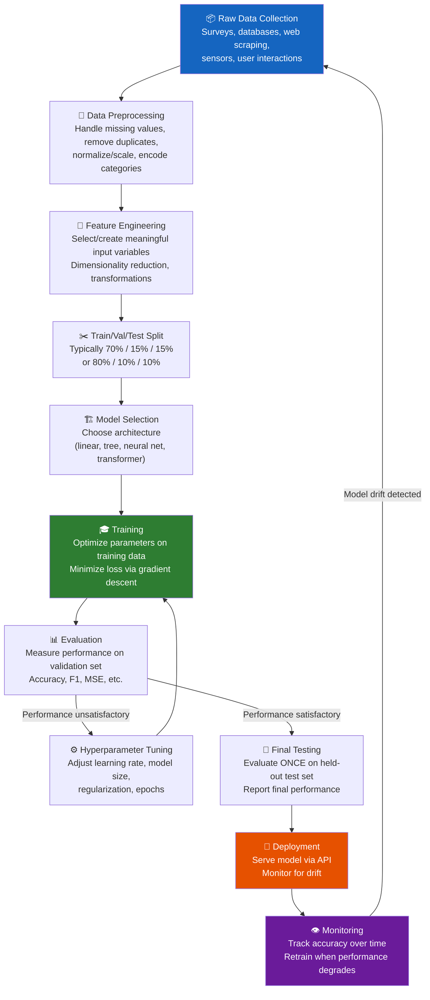
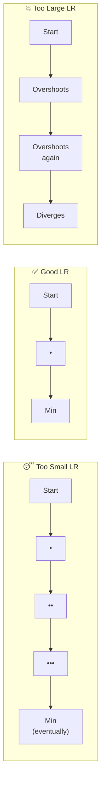
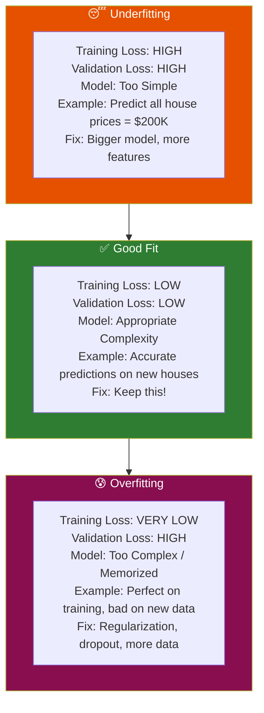

# Chapter 2: Machine Learning Fundamentals

> **Part of the LLM Educational Handbook** — A comprehensive guide for college students

## Prerequisites

Before reading this chapter, ensure you:
- Have read [Chapter 1: Introduction to AI](../01-introduction-to-ai/README.md)
- Understand the basic concept of training vs inference
- Have a general idea of what parameters/weights are
- (Optional) Basic high school algebra helps but is not required

---

## Table of Contents

1. [What is Machine Learning?](#1-what-is-machine-learning)
2. [The Three Types of Machine Learning](#2-the-three-types-of-machine-learning)
3. [The ML Workflow](#3-the-ml-workflow)
4. [Training, Validation, and Test Splits](#4-training-validation-and-test-splits)
5. [Loss Functions — How Wrong is the Model?](#5-loss-functions--how-wrong-is-the-model)
6. [Gradient Descent — Learning by Rolling Downhill](#6-gradient-descent--learning-by-rolling-downhill)
7. [Overfitting vs Underfitting](#7-overfitting-vs-underfitting)
8. [Task Types in Machine Learning](#8-task-types-in-machine-learning)
9. [Traditional ML vs Neural Networks](#9-traditional-ml-vs-neural-networks)
10. [Summary](#10-summary)
11. [Further Reading](#11-further-reading)

---

## 1. What is Machine Learning?

**Machine Learning (ML)** is a subset of AI where systems learn from data *without being explicitly programmed* for each specific task. Instead of a programmer writing rules, the machine **discovers rules automatically** by analyzing examples.

### The Core Difference: Rules vs Learning

```
Traditional Programming:
Input + Rules → Output

Machine Learning:
Input + Output (examples) → Rules (learned automatically)
```

**Example — Email Spam Detection:**

*Old approach (rule-based):*
```python
# A programmer manually writes every rule:
def is_spam(email):
    if "FREE MONEY" in email.upper():
        return True
    if "CLICK HERE NOW" in email.upper():
        return True
    if "NIGERIAN PRINCE" in email.upper():
        return True
    # ... 10,000 more rules ...
    return False
```

*ML approach:*
```python
# Show the model 1 million labeled examples:
# "FREE MONEY offer!!!" → spam ✓
# "Meeting at 3pm tomorrow" → not spam ✓
# "Congratulations! You've won $1,000,000" → spam ✓
# ... 1,000,000 examples ...

# The model learns the rules itself — no programmer needed
model.train(emails, labels)
model.predict("Your account has been selected for a prize!") → spam
```

### Why ML Outperforms Hand-Written Rules

| Challenge | Rule-Based | Machine Learning |
|-----------|------------|-----------------|
| Spammers change wording | Rules break immediately | Model adapts with new data |
| Millions of edge cases | Need millions of rules | Model generalizes from patterns |
| Ambiguous cases | Rules can't handle gray areas | Model learns probabilities |
| New languages/domains | Rewrite all rules | Retrain on new data |

---

## 2. The Three Types of Machine Learning

Machine learning is divided into three main paradigms based on **what kind of data the model learns from**.

### 2.1 Supervised Learning — "Learning with a Teacher"

In **supervised learning**, the training data consists of **input-output pairs**. Every example has a correct label attached.

> **Analogy:** A student learning with a teacher who grades every homework assignment. "Your answer was wrong — here's the correct one." The student adjusts until they get it right.

**How it works:**
1. Show the model an input (e.g., an email)
2. The model makes a prediction (e.g., "spam")
3. Compare to the **ground truth label** (e.g., "not spam")
4. Adjust the model to reduce the error
5. Repeat millions of times

**Real-World Examples:**

| Application | Input (X) | Output (Y) | Label Source |
|-------------|-----------|-----------|-------------|
| Spam filter | Email text | Spam/Not Spam | Human-labeled emails |
| Medical diagnosis | X-ray image | Disease/No Disease | Doctors |
| House price prediction | Size, location, age | Price ($) | Historical sales |
| Image recognition | Pixel values | Object category | Human annotators |
| Sentiment analysis | Movie review text | Positive/Negative | Star ratings |
| Credit scoring | Financial history | Default risk (0–1) | Historical defaults |

**Sub-types:**
- **Classification:** Output is a category (spam/not-spam, cat/dog/bird)
- **Regression:** Output is a continuous number (house price, temperature tomorrow)

### 2.2 Unsupervised Learning — "Learning without a Teacher"

In **unsupervised learning**, there are **no labels**. The model must discover **hidden structure or patterns** in the data on its own.

> **Analogy:** Walking into a library with no catalog. You organize books by yourself — grouping them by cover design, page count, apparent topic. No one tells you the "right" categories.

**How it works:**
The model finds natural groupings, patterns, or compressed representations in the data without any guidance about what's "correct."

**Real-World Examples:**

| Application | Input | Discovery | Use Case |
|-------------|-------|-----------|----------|
| Customer segmentation | Purchase history | Customer groups (budget, luxury, etc.) | Targeted marketing |
| Topic modeling | News articles | Hidden topics ("sports," "politics") | Content organization |
| Anomaly detection | Network traffic | "Normal" vs "abnormal" patterns | Cybersecurity |
| Dimensionality reduction | High-dim data | Low-dim representation | Visualization |
| Recommendation (implicit) | Viewing history | User/item clusters | Netflix, YouTube |
| Gene expression analysis | Gene activity levels | Gene regulatory patterns | Biology research |

**Key Algorithms:**
- **K-Means Clustering:** Groups data into K clusters by minimizing within-cluster distances
- **Principal Component Analysis (PCA):** Finds the directions of maximum variance for data compression
- **Autoencoders:** Neural networks that compress data then reconstruct it

**Customer Clustering Example:**
```
Input data (no labels):
Customer A: spends $500/month, 20 purchases, mostly electronics
Customer B: spends $50/month, 5 purchases, mostly groceries
Customer C: spends $600/month, 25 purchases, mixed categories

After K-Means clustering (K=2):
Cluster 1 (High-value): A, C
Cluster 2 (Budget): B

Marketing team names these clusters → "Premium" and "Budget" shoppers
```

### 2.3 Reinforcement Learning — "Learning by Trial and Error"

In **reinforcement learning (RL)**, an **agent** learns to make decisions by interacting with an **environment**, receiving **rewards** for good actions and **penalties** for bad ones.

> **Analogy:** Training a dog. You don't tell the dog the rules — you give treats when it does something right and say "no" when it does something wrong. Over time, the dog learns which behaviors lead to treats.

**Core Components:**
- **Agent:** The learner/decision-maker (the AI)
- **Environment:** The world the agent interacts with
- **State:** The current situation (what the agent observes)
- **Action:** What the agent can do
- **Reward:** Numerical feedback (+1 for good, -1 for bad)
- **Policy:** The learned strategy (state → action mapping)

**Real-World Examples:**

| Application | Agent | Environment | Actions | Rewards |
|-------------|-------|-------------|---------|---------|
| Game playing (AlphaGo) | AI | Go board | Place stone at position | +1 win, -1 loss |
| Self-driving car | Car | Roads, traffic | Steer, accelerate, brake | +safety, -collision |
| Robot locomotion | Robot | Physics simulation | Joint torques | +distance walked |
| ChatGPT alignment | LLM | User conversations | Generate response | Human preference ratings |
| Stock trading | AI trader | Financial markets | Buy/sell/hold | Profit/loss |
| Data center cooling | AI | Google's data centers | Adjust cooling systems | -energy consumption |

**RL in LLMs — RLHF:**

Modern LLMs use a technique called **Reinforcement Learning from Human Feedback (RLHF)**:
1. Generate multiple responses to a prompt
2. Human rates which response is better
3. Train a "reward model" on human preferences
4. Use RL to fine-tune the LLM to maximize human-preferred responses

This is exactly how ChatGPT was trained to be helpful and harmless.

---

## 3. The ML Workflow

Every ML project follows a standard pipeline, regardless of the specific algorithm or task.



### Key Steps Explained

**Data Collection:** Machine learning is data-hungry. More diverse, representative data → better models. The classic rule: "garbage in, garbage out."

**Feature Engineering:** Transforming raw data into meaningful inputs. For example:
- Raw: `birth_date = "1990-05-15"` 
- Engineered: `age = 34`, `is_millennial = True`

**Model Selection:** Different algorithms work better for different problems. Neural networks for images and text; gradient boosting for tabular data; linear regression for simple relationships.

**Hyperparameter Tuning:** Hyperparameters are settings you choose *before* training (not learned from data). Examples: learning rate, number of layers, batch size. Finding good hyperparameters often involves trying many combinations (grid search, random search, Bayesian optimization).

---

## 4. Training, Validation, and Test Splits

The most important rule in ML: **never evaluate your model on data it was trained on**.

### Why Split the Data?

Imagine studying for a test where you see the exact test questions in advance. You'd score 100% — but you haven't actually *learned* anything. Your score doesn't represent real knowledge.

Similarly, if we evaluate a model on training data, it will score perfectly — not because it's generalized, but because it has **memorized** the examples.

### The Three Splits

| Split | Typical Size | Used For | Rule |
|-------|-------------|----------|------|
| **Training set** | 70–80% | Teaching the model (parameter updates) | Model sees this every training iteration |
| **Validation set** | 10–15% | Hyperparameter tuning, early stopping, model selection | Never used to update parameters |
| **Test set** | 10–15% | Final unbiased evaluation | Used ONCE at the very end — treat like a secret |

### The Test Set is Sacred

> **Golden Rule:** The test set must NEVER be used during development. If you use it to make decisions about your model, you are essentially "peeking at the exam" — your final reported performance will be overoptimistic.

### Cross-Validation

When data is scarce, **k-fold cross-validation** is used:
1. Split data into K equal "folds" (e.g., K=5)
2. Train on K-1 folds, validate on the remaining fold
3. Repeat K times, rotating which fold is validation
4. Average the K validation scores

This uses data more efficiently but is K times more expensive computationally.

```
K=5 Cross-Validation:
Fold 1: [Val] [Tr]  [Tr]  [Tr]  [Tr]  → score 1
Fold 2: [Tr]  [Val] [Tr]  [Tr]  [Tr]  → score 2
Fold 3: [Tr]  [Tr]  [Val] [Tr]  [Tr]  → score 3
Fold 4: [Tr]  [Tr]  [Tr]  [Val] [Tr]  → score 4
Fold 5: [Tr]  [Tr]  [Tr]  [Tr]  [Val] → score 5

Final score = average(score 1 through 5)
```

---

## 5. Loss Functions — "How Wrong is the Model?"

A **loss function** (also called cost function or objective function) measures **how far the model's prediction is from the correct answer**. The goal of training is to minimize this loss.

> **Analogy:** A loss function is like a GPS navigator's "you are X miles from your destination" indicator. Training is like following directions to minimize that distance.

### 5.1 Mean Squared Error (MSE) — For Regression

Used when predicting **continuous values** (house prices, temperatures, stock prices).

**Formula:**
```
MSE = (1/n) × Σ(predicted_i - actual_i)²

Example:
Actual house prices:  [300K, 450K, 200K]
Model predictions:    [280K, 500K, 210K]
Errors:               [-20K, +50K, +10K]
Squared errors:       [400M, 2500M, 100M]
MSE = (400M + 2500M + 100M) / 3 = 1000M
```

**Why square the errors?**
- Squaring makes all errors positive (so -20K and +20K errors don't cancel each other out)
- Squaring penalizes large errors much more than small ones (a 100K error is 10,000x worse than a 1K error — not just 100x)

### 5.2 Cross-Entropy Loss — For Classification

Used when predicting **categories** (spam/not-spam, cat/dog/bird).

**Intuition:** Cross-entropy measures how "surprised" the model is by the correct answer. If the model is very confident about the right answer → low loss. If the model gives low probability to the right answer → high loss.

```
Binary Cross-Entropy:
Loss = -[y × log(p) + (1-y) × log(1-p)]

Where:
  y = actual label (0 or 1)
  p = model's predicted probability of class 1

Example:
Email is spam (y=1), model predicts p=0.9 (90% spam)
Loss = -[1 × log(0.9) + 0 × log(0.1)] = -log(0.9) ≈ 0.105  (small loss ✓)

Email is spam (y=1), model predicts p=0.1 (10% spam — wrong!)
Loss = -[1 × log(0.1) + 0 × log(0.9)] = -log(0.1) ≈ 2.303  (large loss ✗)
```

### 5.3 Common Loss Functions Reference

| Loss Function | Task Type | Use When |
|--------------|-----------|----------|
| Mean Squared Error (MSE) | Regression | Predicting continuous values |
| Mean Absolute Error (MAE) | Regression | When you want to treat all errors equally |
| Binary Cross-Entropy | Binary Classification | Yes/No predictions |
| Categorical Cross-Entropy | Multi-class Classification | Multiple categories |
| Huber Loss | Regression | Robust to outliers |

---

## 6. Gradient Descent — Learning by Rolling Downhill

**Gradient descent** is the core optimization algorithm that trains virtually every neural network. It's how the model minimizes its loss function.

### The Ball-Rolling-Down-Hill Analogy

Imagine you're blindfolded on a hilly landscape. Your goal is to reach the **lowest valley** (minimum loss). You can only feel the slope under your feet.

**Your strategy:**
1. Feel which direction is "downhill" (compute the gradient)
2. Take a step in that direction (update parameters)
3. Repeat until you reach a valley (minimum loss)

```
Landscape = Loss function (billions of dimensions in real models)
Your position = Current parameter values
Valley = Minimum loss (best model performance)
Step = Parameter update
Step size = Learning rate
```

### Mathematically

```
For each parameter θ:
θ_new = θ_old - learning_rate × gradient

Where gradient = dLoss/dθ (how does loss change when θ changes?)

Example:
Current weight w = 2.5
Gradient = 0.4 (loss increases by 0.4 when w increases by 1)
Learning rate = 0.1

New weight = 2.5 - 0.1 × 0.4 = 2.5 - 0.04 = 2.46
```

After this update, the loss should be slightly smaller. Repeat millions of times → model converges.

### The Learning Rate: Step Size Matters

The **learning rate** (η or lr) is how large each step is. Getting it right is crucial:

| Learning Rate | Effect | Problem |
|--------------|--------|---------|
| Too small (0.0001) | Tiny steps, very slow | Takes forever to converge |
| Just right (0.001–0.01) | Smooth convergence | ✓ Ideal |
| Too large (1.0) | Huge steps | Overshoots the valley, may diverge |



> **Practical tip:** Most practitioners start with a learning rate of 0.001 and use **learning rate schedules** that reduce it over time (like reducing it by 10x every 10 epochs).

### Variants of Gradient Descent

| Variant | Updates Per Step | Pros | Cons |
|---------|-----------------|------|------|
| **Batch GD** | Full dataset | Stable gradients | Very slow per update |
| **Stochastic GD (SGD)** | 1 sample | Very fast updates | Noisy/unstable |
| **Mini-batch GD** | 32–256 samples | Balance of both | Most commonly used |

**Adam Optimizer:** Modern practice uses Adam (Adaptive Moment Estimation), which automatically adjusts the learning rate for each parameter. It's the default optimizer for most deep learning tasks.

---

## 7. Overfitting vs Underfitting

Understanding and preventing overfitting is one of the most important skills in ML.

### The Core Problem

We want a model that **generalizes** — performs well on new, unseen data. There are two ways to fail:

### 7.1 Underfitting — "Too Simple"

The model is **too simple** to capture the patterns in the data. It performs poorly on both training data AND new data.

> **Analogy:** A student who barely studies and can only recite the chapter titles, not the content. They fail both the homework and the exam.

**Signs of underfitting:**
- High training loss
- High validation loss
- Model makes obvious errors on simple cases

**Causes:**
- Model architecture is too small/simple
- Not enough training time (too few epochs)
- Features don't capture the relevant information

**Fixes:**
- Use a larger/more complex model
- Train for more epochs
- Add more relevant features
- Reduce regularization

### 7.2 Good Fit — "Just Right"

The model has learned the **true underlying patterns**. It performs well on training data AND generalizes to new data.

> **Analogy:** A student who understands the material deeply. They answer both familiar practice problems AND novel exam questions correctly.

### 7.3 Overfitting — "Too Complex / Memorizing"

The model has **memorized the training data** instead of learning generalizable patterns. It performs perfectly on training data but poorly on new data.

> **Analogy:** A student who memorizes every practice problem word-for-word without understanding the concepts. They ace the homework (which they've seen) but fail the exam (which is new, slightly different questions).

**Signs of overfitting:**
- Very low training loss
- Much higher validation loss
- Model performs worse on each new example type

**Causes:**
- Model is too complex (too many parameters for the amount of data)
- Training too long
- Insufficient training data

**Fixes:**
- **Regularization (L1/L2):** Add penalty for large weights
- **Dropout:** Randomly disable neurons during training (forces redundancy)
- **Early stopping:** Stop training when validation loss stops improving
- **Data augmentation:** Artificially increase training data size
- **More data:** The best fix when possible

### Visual Comparison



### The Bias-Variance Tradeoff

This concept underlies overfitting/underfitting:

| | Underfitting | Good Fit | Overfitting |
|--|--|--|--|
| **Bias** | High (systematic error) | Low | Low |
| **Variance** | Low (consistent, but consistently wrong) | Low | High (sensitive to training data) |
| **Training Error** | High | Low | Very Low |
| **Validation Error** | High | Low | High |

> **Key insight:** Total error = Bias² + Variance + Irreducible Noise. You can't minimize both simultaneously — reducing one tends to increase the other. The goal is to find the sweet spot.

---

## 8. Task Types in Machine Learning

ML models can be built for many different types of tasks. Here's how they compare:

### 8.1 Classification vs Regression vs Generation

| Task Type | Output | Example | Algorithm |
|-----------|--------|---------|-----------|
| **Binary Classification** | 0 or 1 | Spam/Not spam, Yes/No | Logistic regression, SVM, neural net |
| **Multiclass Classification** | One of N classes | Dog/Cat/Bird, Language ID | Softmax neural net |
| **Multi-label Classification** | Multiple of N classes | Tags on a blog post (may have several) | Sigmoid multi-output |
| **Regression** | Continuous number | House price, temperature | Linear regression, neural net |
| **Ranking** | Ordered list | Search results, recommendations | LambdaMART, neural ranking |
| **Sequence Labeling** | Label per token | Named entity recognition, POS tagging | CRF, LSTM, Transformer |
| **Generation** | New sequence | Translation, summarization, chat | Seq2seq, Transformer |
| **Clustering** | Group assignments | Customer segments | K-means, DBSCAN |
| **Density Estimation** | Probability | Generate realistic images | GANs, VAEs, Diffusion |

### 8.2 Metrics per Task Type

Different tasks use different evaluation metrics:

| Task | Key Metrics | Why |
|------|-------------|-----|
| Classification | Accuracy, Precision, Recall, F1, AUC-ROC | Accuracy alone misleading on imbalanced data |
| Regression | MSE, RMSE, MAE, R² | MSE penalizes outliers more |
| Generation | BLEU, ROUGE, Perplexity, Human eval | Automated metrics don't capture quality well |
| Clustering | Silhouette score, Davies-Bouldin | No ground truth labels |
| Ranking | NDCG, MRR, Precision@K | Cares about order |

---

## 9. Traditional ML vs Neural Networks

Modern ML spans two eras: classical algorithms and neural networks. Understanding both helps you choose the right tool.

### 9.1 Comparison Table

| Aspect | Traditional ML | Neural Networks |
|--------|---------------|----------------|
| **Feature engineering** | Manual (requires domain expertise) | Automatic (learned from raw data) |
| **Data requirements** | Works with 100s to 1000s of examples | Needs 1,000s to millions of examples |
| **Interpretability** | High (decision trees, linear models) | Low ("black box") |
| **Training speed** | Fast (minutes to hours) | Slow (hours to months) |
| **Inference speed** | Very fast | Fast to slow depending on size |
| **Best for** | Tabular/structured data | Images, text, audio, video |
| **Hardware needs** | CPU is sufficient | GPUs/TPUs often required |
| **Hyperparameters** | Few, easy to tune | Many, complex to tune |

### 9.2 When to Use What

```
📊 Use Traditional ML when:
  ✓ Data is structured/tabular (spreadsheet-like)
  ✓ Limited data (< 10,000 examples)
  ✓ Interpretability is required (medical, legal)
  ✓ Fast training/iteration needed
  ✓ Examples: credit scoring, churn prediction, inventory forecasting

🧠 Use Neural Networks when:
  ✓ Data is unstructured (images, text, audio, video)
  ✓ Large amounts of data available
  ✓ State-of-the-art performance is paramount
  ✓ Pattern complexity is very high
  ✓ Examples: image recognition, NLP, speech, protein folding
```

### 9.3 Key Traditional ML Algorithms

| Algorithm | Type | Strength | Example Use |
|-----------|------|----------|-------------|
| Linear Regression | Supervised/Regression | Simple, interpretable | House price prediction |
| Logistic Regression | Supervised/Classification | Probabilistic output | Medical diagnosis |
| Decision Trees | Supervised | Interpretable | Credit decisions |
| Random Forests | Supervised | Robust, handles noise | Fraud detection |
| Gradient Boosting (XGBoost) | Supervised | Often best on tabular data | Kaggle competitions |
| Support Vector Machines | Supervised | Effective in high dimensions | Text classification |
| K-Means | Unsupervised | Simple clustering | Customer segmentation |
| PCA | Unsupervised | Dimensionality reduction | Data visualization |

---

## 10. Summary

Here are the key concepts from Chapter 2:

### Quick Reference

| Concept | Definition | Key Insight |
|---------|-----------|-------------|
| **Supervised Learning** | Learn from labeled input-output pairs | Needs human-labeled data |
| **Unsupervised Learning** | Find patterns without labels | Discovers hidden structure |
| **Reinforcement Learning** | Learn through rewards/penalties | Trial and error |
| **Training set** | Data model learns from | 70-80% of your data |
| **Validation set** | Monitor training progress | Never update params from this |
| **Test set** | Final honest evaluation | Use ONCE at the very end |
| **Loss function** | Measures prediction error | Minimize this during training |
| **MSE** | Loss for regression | Penalizes large errors heavily |
| **Cross-entropy** | Loss for classification | Measures probability calibration |
| **Gradient descent** | Optimization algorithm | Roll downhill to minimize loss |
| **Learning rate** | Step size for gradient descent | Too big = unstable, too small = slow |
| **Overfitting** | Memorizing training data | High train accuracy, low test accuracy |
| **Underfitting** | Model too simple | Poor performance everywhere |

### The ML Mindset

```
1. Start with the data — understand it deeply
2. Choose a simple baseline — don't start with a neural network
3. Measure everything — always have a validation loop
4. Improve systematically — change one thing at a time
5. Generalize — training accuracy is meaningless; test accuracy is everything
```

---

## 11. Further Reading

### Textbooks
- 📖 [Hands-On Machine Learning with Scikit-Learn, Keras & TensorFlow](https://www.oreilly.com/library/view/hands-on-machine-learning/9781492032632/) — Aurélien Géron (the best practical ML book)
- 📖 [Pattern Recognition and Machine Learning](https://www.microsoft.com/en-us/research/uploads/prod/2006/01/Bishop-Pattern-Recognition-and-Machine-Learning-2006.pdf) — Bishop (mathematical depth)
- 📖 [The Elements of Statistical Learning](https://hastie.su.domains/ElemStatLearn/) — Free PDF, rigorous treatment

### Interactive Learning
- 🌐 [Google Machine Learning Crash Course](https://developers.google.com/machine-learning/crash-course) — Free, with code exercises
- 🌐 [fast.ai Practical Deep Learning](https://www.fast.ai/) — Code-first approach
- 🌐 [Kaggle Learn](https://www.kaggle.com/learn) — Free micro-courses with competition practice

### Videos
- 📺 [StatQuest with Josh Starmer](https://www.youtube.com/c/joshstarmer) — Exceptional explanations of ML concepts
- 📺 [Andrej Karpathy — Neural Networks: Zero to Hero](https://www.youtube.com/playlist?list=PLAqhIrjkxbuWI23v9cThsA9GvCAUhRvKZ) — Build everything from scratch

---

> [!NOTE]
> **What's Next:** Chapter 3 dives into Deep Learning — understanding how neural networks work at the neuron level, what forward and backward propagation mean, and how to build one in PyTorch.

> [!TIP]
> **Practice Idea:** Implement a simple spam classifier using scikit-learn. The UCI SMS Spam Collection dataset is free and perfect for this. Try to get > 95% accuracy on the test set without using a neural network.

> [!IMPORTANT]
> **Key Habit:** Always split your data before looking at it. If you explore the test set, you've already introduced bias. The test set must be truly unseen.

---

[← Previous Chapter](../01-introduction-to-ai/README.md) | [🏠 Home](../../README.md) | [Next Chapter →](../03-deep-learning-fundamentals/README.md)
