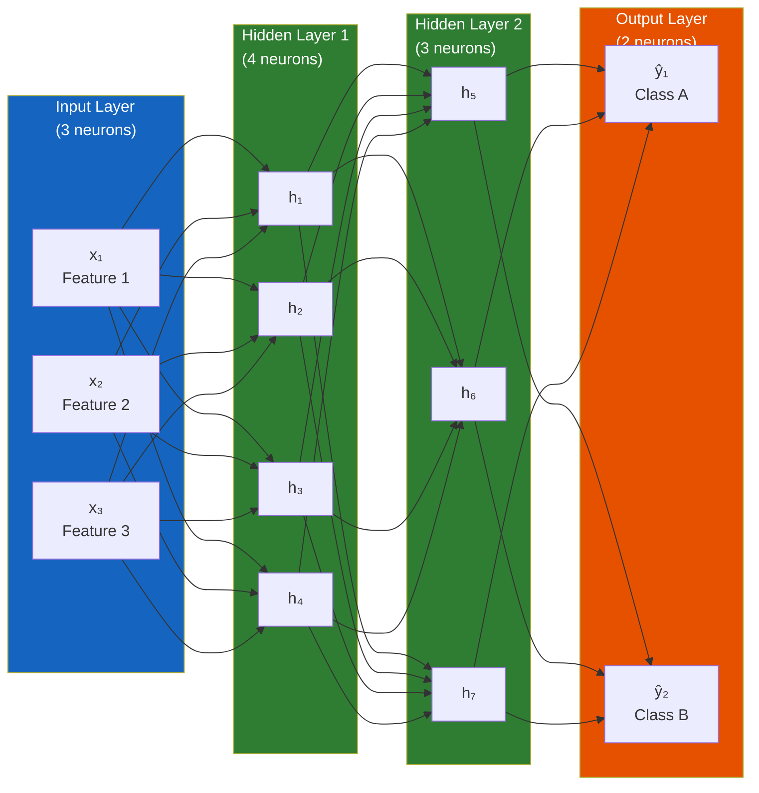
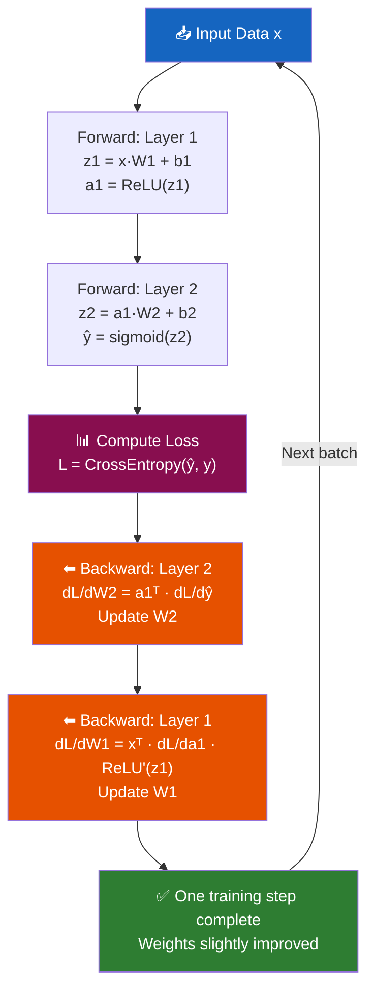

# Chapter 3: Deep Learning Fundamentals

> **Part of the LLM Educational Handbook** — A comprehensive guide for college students

## Prerequisites

Before reading this chapter, ensure you:
- Have read [Chapter 1: Introduction to AI](../01-introduction-to-ai/README.md) and [Chapter 2: ML Fundamentals](../02-machine-learning-fundamentals/README.md)
- Understand what parameters, weights, and biases are
- Know the difference between training and inference
- Have Python installed (for the code examples)

---

## Table of Contents

1. [From Biology to Math: The Neuron Analogy](#1-from-biology-to-math-the-neuron-analogy)
2. [Neural Network Architecture](#2-neural-network-architecture)
3. [Weights, Biases, and Transformations](#3-weights-biases-and-transformations)
4. [Forward Propagation: Step-by-Step](#4-forward-propagation-step-by-step)
5. [Activation Functions](#5-activation-functions)
6. [Backpropagation: Assigning Blame](#6-backpropagation-assigning-blame)
7. [Why Depth Helps: Deep Networks](#7-why-depth-helps-deep-networks)
8. [PyTorch Working Example: Neural Network from Scratch](#8-pytorch-working-example-neural-network-from-scratch)
9. [Summary](#9-summary)
10. [Further Reading](#10-further-reading)

---

## 1. From Biology to Math: The Neuron Analogy

Deep learning is **loosely inspired** by how biological brains work. Understanding the analogy helps build intuition — but don't take it too literally. Artificial neural networks are mathematical tools, not brain simulations.

### 1.1 The Biological Neuron

A biological neuron has three key parts:

- **Dendrites:** Receive electrical signals from other neurons
- **Cell body (soma):** Integrates all incoming signals; "fires" if the total signal exceeds a threshold
- **Axon:** Transmits the output signal to the next neurons

```
         [Dendrites] ←── signals from many neurons
              ↓
         [Cell Body] ← if total input > threshold → FIRE!
              ↓
           [Axon] ──→ sends signal to next neurons
```

**Key behavior:** A neuron either fires (sends signal) or doesn't. The strength of the connections (synapses) determines how much influence each input neuron has.

### 1.2 The Artificial Neuron (Perceptron)

An **artificial neuron** (also called a node or unit) mimics this:

| Biological | Artificial |
|-----------|-----------|
| Dendrites (receive inputs) | Input values: x₁, x₂, x₃ |
| Synapse strength | Weights: w₁, w₂, w₃ |
| Cell body accumulation | Weighted sum: Σ(wᵢ · xᵢ) + bias |
| Firing threshold | Activation function |
| Axon output | Output: a = f(Σwᵢxᵢ + b) |

**The artificial neuron formula:**
```
z = w₁·x₁ + w₂·x₂ + w₃·x₃ + b     ← "pre-activation" (weighted sum + bias)
a = f(z)                              ← "activation" (apply activation function)
```

Where:
- `x₁, x₂, x₃` = inputs
- `w₁, w₂, w₃` = learned weights
- `b` = learned bias
- `f()` = activation function (e.g., ReLU)
- `a` = the neuron's output, passed to the next layer

### 1.3 Concrete Example

Imagine a neuron deciding: **"Is this email important?"**

```
Inputs:
  x₁ = 1 (email is from your manager)
  x₂ = 0 (not marked urgent)
  x₃ = 1 (contains "deadline")

Weights (learned):
  w₁ = 0.8   (manager emails are very important)
  w₂ = 0.6   (urgency flag matters a lot)
  w₃ = 0.4   (keyword "deadline" somewhat relevant)
  bias = -0.5 (starting threshold)

Weighted sum:
  z = 0.8×1 + 0.6×0 + 0.4×1 + (-0.5)
  z = 0.8 + 0 + 0.4 - 0.5
  z = 0.7

Activation (sigmoid):
  a = 1/(1 + e^(-0.7)) ≈ 0.668

Output: 66.8% probability that this email is important ✓
```

---

## 2. Neural Network Architecture

A **neural network** is simply many neurons connected together in **layers**.

### 2.1 Layer Types

| Layer | Position | Role |
|-------|---------|------|
| **Input layer** | First | Receives raw data (pixels, word vectors, numbers) |
| **Hidden layers** | Middle | Transform and extract features; can be 1 to thousands of layers |
| **Output layer** | Last | Produces final prediction (class probabilities, regression value) |



### 2.2 Fully Connected (Dense) Layers

In a **fully connected** (or **dense**) layer, every neuron in one layer connects to every neuron in the next layer. If Layer 1 has 4 neurons and Layer 2 has 3 neurons:
- Number of weights = 4 × 3 = 12
- Number of biases = 3 (one per neuron in Layer 2)
- Total parameters = 15

**Scaling up:** GPT-3 has 96 layers and 175 billion parameters. The same math, but at an incomprehensible scale.

### 2.3 Why Multiple Layers?

Each layer learns increasingly **abstract representations**:

```
Image Classification Network:
  Layer 1: Detects edges (horizontal, vertical, diagonal)
  Layer 2: Detects shapes (circles, corners, curves)
  Layer 3: Detects parts (eyes, wheels, legs)
  Layer 4: Detects objects (face, car, dog)

Text Understanding Network:
  Layer 1: Character patterns, common subwords
  Layer 2: Words and simple phrases
  Layer 3: Syntax, sentence structure
  Layer 4: Semantics, meaning, entities
  Layer 5+: Abstract reasoning, context
```

This hierarchical feature extraction is why deep networks are so powerful.

---

## 3. Weights, Biases, and Transformations

Let's make the math concrete.

### 3.1 The Weight Matrix

For a layer with `n_in` inputs and `n_out` neurons, the weights form a matrix **W** of shape (n_in × n_out):

```
Example: 3 inputs → 4 neurons

      neuron1  neuron2  neuron3  neuron4
x₁ [  w₁₁     w₁₂     w₁₃     w₁₄  ]
x₂ [  w₂₁     w₂₂     w₂₃     w₂₄  ]
x₃ [  w₃₁     w₃₂     w₃₃     w₃₄  ]

Layer output = X · W + b
where X is shape (1×3), W is shape (3×4), b is shape (1×4)
```

This matrix multiplication computes all 4 neurons simultaneously — which is why GPUs (designed for matrix math) are essential for deep learning.

### 3.2 What Weights Encode

After training, weights encode learned relationships:

- **Large positive weight (w = 2.5):** This input strongly predicts a high output — positive relationship
- **Large negative weight (w = -1.8):** This input strongly predicts a low output — negative relationship  
- **Small weight (w = 0.03):** This input is mostly irrelevant to this neuron
- **Weight near zero:** The neuron has learned to ignore this input

### 3.3 What Bias Does

The bias shifts the entire activation function left or right, allowing the model to fit data that doesn't pass through the origin.

```python
import numpy as np
import matplotlib.pyplot as plt

x = np.linspace(-3, 3, 100)

# Without bias (b=0): ReLU activates at exactly x=0
# With positive bias (b=1): ReLU activates earlier (at x=-1)
# With negative bias (b=-1): ReLU activates later (at x=1)

relu_no_bias = np.maximum(0, x + 0)
relu_pos_bias = np.maximum(0, x + 1)
relu_neg_bias = np.maximum(0, x - 1)
```

---

## 4. Forward Propagation: Step-by-Step

**Forward propagation** is the process of passing input data through the network layer by layer to produce a prediction. Let's trace through a small example completely.

### 4.1 Network Setup

We'll build a tiny network:
- **Input:** 2 features (e.g., study hours, sleep hours)
- **Hidden layer:** 3 neurons
- **Output:** 1 neuron (exam pass probability)

**Given weights and biases (normally learned, here we set them manually):**

```
Layer 1 Weights W1 (shape 2×3):
       h1    h2    h3
x1 [ 0.5   0.3  -0.2 ]
x2 [ 0.4  -0.1   0.8 ]

Layer 1 Biases b1 (shape 1×3):
[ 0.1  -0.2   0.3 ]

Layer 2 Weights W2 (shape 3×1):
       out
h1 [ 0.6 ]
h2 [ 0.7 ]
h3 [-0.3 ]

Layer 2 Bias b2 (shape 1×1):
[ 0.1 ]
```

### 4.2 Step-by-Step Calculation

**Input:** x = [2.0, 7.0] (studied 2 hours, slept 7 hours)

**Step 1: Compute Layer 1 pre-activations (z1)**
```
z1 = x · W1 + b1

z1[h1] = 2.0×0.5 + 7.0×0.4 + 0.1 = 1.0 + 2.8 + 0.1 = 3.9
z1[h2] = 2.0×0.3 + 7.0×(-0.1) + (-0.2) = 0.6 - 0.7 - 0.2 = -0.3
z1[h3] = 2.0×(-0.2) + 7.0×0.8 + 0.3 = -0.4 + 5.6 + 0.3 = 5.5

z1 = [3.9, -0.3, 5.5]
```

**Step 2: Apply activation function (ReLU) to get a1**
```
ReLU(x) = max(0, x)

a1[h1] = max(0, 3.9) = 3.9   ✓ positive, passes through
a1[h2] = max(0, -0.3) = 0.0  ✗ negative, becomes 0
a1[h3] = max(0, 5.5) = 5.5   ✓ positive, passes through

a1 = [3.9, 0.0, 5.5]
```

**Step 3: Compute output pre-activation (z2)**
```
z2 = a1 · W2 + b2

z2 = 3.9×0.6 + 0.0×0.7 + 5.5×(-0.3) + 0.1
z2 = 2.34 + 0 - 1.65 + 0.1
z2 = 0.79
```

**Step 4: Apply output activation (Sigmoid for probability)**
```
sigmoid(0.79) = 1 / (1 + e^(-0.79)) = 1 / (1 + 0.454) ≈ 0.688

Prediction: 68.8% probability of passing the exam
```

This entire process — from raw input to final prediction — is **forward propagation**.

### 4.3 In Matrix Form (How Real Code Works)

```python
import numpy as np

# Weights and biases
W1 = np.array([[0.5, 0.3, -0.2],
               [0.4, -0.1, 0.8]])
b1 = np.array([0.1, -0.2, 0.3])

W2 = np.array([[0.6], [0.7], [-0.3]])
b2 = np.array([0.1])

# Input
x = np.array([2.0, 7.0])

# Forward pass
z1 = x @ W1 + b1                     # Layer 1 pre-activation
a1 = np.maximum(0, z1)               # ReLU activation
z2 = a1 @ W2 + b2                    # Layer 2 pre-activation
output = 1 / (1 + np.exp(-z2))       # Sigmoid activation

print(f"z1 = {z1}")          # [3.9, -0.3, 5.5]
print(f"a1 = {a1}")          # [3.9, 0.0, 5.5]
print(f"z2 = {z2}")          # [0.79]
print(f"P(pass) = {output[0]:.3f}")  # 0.688
```

---

## 5. Activation Functions

**Activation functions** introduce **non-linearity** into the network. Without them, stacking linear transformations (W·x + b) would still produce a linear function — no matter how many layers you add. Non-linearity is what allows neural networks to learn complex patterns.

### 5.1 ReLU (Rectified Linear Unit) — The Workhorse

```
ReLU(x) = max(0, x)

x < 0 → output = 0  (neuron "dead")
x ≥ 0 → output = x  (neuron "active")
```

**Visual:**
```
Output
  |            /
  |           /
  |          /
  |         /
──|────────/──────── Input
  |       0
```

**Why ReLU is dominant:**
- Computationally cheap (just a comparison + clip)
- Avoids the vanishing gradient problem (gradient is exactly 1 for positive inputs)
- Sparse activation (many neurons output 0) — efficient and sometimes helpful
- Works well in practice across most architectures

**Limitation:** "Dead ReLU" problem — neurons stuck at 0 never recover because gradient is 0 for negative inputs.

**Variants to know:**
- **Leaky ReLU:** Allows small negative output (0.01×x) instead of 0 — avoids dead neurons
- **GELU (Gaussian Error Linear Unit):** Used in BERT and GPT models; smoother version of ReLU
- **SiLU/Swish:** Used in LLaMA; performs well in modern transformers

### 5.2 Sigmoid — Probabilities

```
σ(x) = 1 / (1 + e^(-x))

Output range: (0, 1)
σ(-∞) → 0
σ(0)  → 0.5
σ(+∞) → 1
```

**When to use:**
- **Output layer of binary classifiers** — output directly interpretable as probability
- Gates in LSTM (recurrent neural networks)

**Problem:** Vanishing gradients — for large |x|, gradient ≈ 0, so early layers stop learning. This is why sigmoid is rarely used in hidden layers of modern networks.

### 5.3 Softmax — Multi-Class Probabilities

```
softmax(zᵢ) = e^(zᵢ) / Σⱼ e^(zⱼ)

Properties:
- All outputs sum to 1.0
- Each output is in (0, 1)
- Largest input gets highest probability
```

**Example:**
```python
import numpy as np

logits = np.array([2.0, 1.0, 0.1])  # Raw scores for 3 classes
exp_logits = np.exp(logits)          # [7.39, 2.72, 1.11]
softmax = exp_logits / exp_logits.sum()  # [0.659, 0.242, 0.099]

print(softmax)        # [0.659, 0.242, 0.099]
print(softmax.sum())  # 1.0  ← always sums to 1
```

**When to use:** Always at the output layer for multi-class classification.

### 5.4 Tanh — Centered Sigmoid

```
tanh(x) = (e^x - e^(-x)) / (e^x + e^(-x))

Output range: (-1, 1)
tanh(-∞) → -1
tanh(0)  → 0
tanh(+∞) → 1
```

**Advantage over sigmoid:** Zero-centered output helps optimization by reducing zig-zagging in gradient descent. Used in LSTM gates and some RNN architectures.

### 5.5 Activation Function Comparison Table

| Activation | Formula | Output Range | Use In | Pros | Cons |
|-----------|---------|-------------|--------|------|------|
| **ReLU** | max(0, x) | [0, ∞) | Hidden layers | Fast, avoids vanishing gradients | Dead neurons |
| **Leaky ReLU** | max(0.01x, x) | (-∞, ∞) | Hidden layers | No dead neurons | Slight complexity |
| **GELU** | x·Φ(x) | (-∞, ∞) | Transformer hidden | Smooth, state-of-art | Slower to compute |
| **Sigmoid** | 1/(1+e^(-x)) | (0, 1) | Binary output layer | Probability output | Vanishing gradients |
| **Softmax** | eˣ/Σeˣ | (0, 1), sum=1 | Multi-class output | Probability distribution | Expensive for large vocab |
| **Tanh** | (eˣ-e⁻ˣ)/(eˣ+e⁻ˣ) | (-1, 1) | LSTM gates, RNNs | Zero-centered | Vanishing gradients |

### 5.6 When to Use Which (Quick Guide)

```
Is this the output layer?
  ├── Binary classification (yes/no, spam/not) → Sigmoid
  ├── Multi-class classification (3+ classes) → Softmax
  └── Regression (predict a number) → None (linear)

Is this a hidden layer?
  ├── Default choice → ReLU
  ├── Transformer / modern LLM → GELU or SiLU
  ├── Dead neurons are a problem → Leaky ReLU
  └── Recurrent network gate → Sigmoid or Tanh
```

---

## 6. Backpropagation: Assigning Blame

**Backpropagation** is the algorithm that trains neural networks. It answers: *"Which weights caused the error, and by how much?"*

### 6.1 The Core Idea: Blame Assignment

After forward propagation produces a wrong answer, we need to adjust the weights. But which ones? By how much? In which direction?

> **Analogy:** A bakery produces a terrible cake. We want to find out who's responsible:
> - Was it the flour (too much)? → Reduce flour weight
> - Was it the oven temperature (too high)? → Reduce temperature weight
> - Was it the baker (wrong technique)? → Adjust baking technique weight
>
> Backpropagation traces the error backward through the network to assign blame (gradient) to each weight.

### 6.2 The Chain Rule — Without Heavy Calculus

The chain rule from calculus tells us: if A affects B, and B affects C, then A affects C through B.

```
Loss depends on output (z2)
z2 depends on weights W2 and hidden activations (a1)
a1 depends on z1
z1 depends on W1 and input x

Chain:  Loss ← z2 ← W2
                   ← a1 ← z1 ← W1
                                ← x (input, doesn't change)
```

**To find how W1 affects Loss:**
```
dLoss/dW1 = (dLoss/dz2) × (dz2/da1) × (da1/dz1) × (dz1/dW1)
```

This chain of multiplications is computed **backward** through the network — hence "backpropagation."

### 6.3 Step-by-Step Intuition

```
Forward pass:
x → [Layer 1] → a1 → [Layer 2] → ŷ → Loss

Backward pass:
Loss → ∂Loss/∂ŷ → [Layer 2 backward] → ∂Loss/∂a1 → [Layer 1 backward] → ∂Loss/∂W1
```

The gradient tells us:
- **Positive gradient:** Increasing this weight increases the loss → decrease the weight
- **Negative gradient:** Increasing this weight decreases the loss → increase the weight
- **Zero gradient:** This weight doesn't affect the loss → no change needed

### 6.4 The Update Rule

After computing gradients, every weight is updated:

```
W = W - learning_rate × gradient
```

This is applied to **every weight in every layer simultaneously** in one backward pass. Modern frameworks (PyTorch, JAX) compute this automatically using **automatic differentiation (autograd)** — you just define the forward pass, and the framework handles backprop.



### 6.5 The Vanishing Gradient Problem

During backpropagation, gradients are multiplied together as they travel backward. If these values are small (< 1), the product shrinks exponentially:

```
Gradient at layer 1 ≈ 0.5 × 0.5 × 0.5 × 0.5 × ... (10 layers) ≈ 0.001

Early layers receive near-zero gradients → barely update → barely learn
```

This is why sigmoid and tanh (which saturate at ±1) are problematic in deep networks. ReLU (gradient = 1 for positive inputs) largely solves this.

---

## 7. Why Depth Helps: Deep Networks

A **deep network** is one with many hidden layers (typically 3+). Why does depth matter?

### 7.1 Hierarchy of Features

Each layer learns features based on the previous layer's output. Depth enables hierarchical abstraction:

```
Shallow network (1 hidden layer):
  → Can only learn simple combinations of raw features

Deep network (many hidden layers):
  → Layer 1: Simple patterns (edges in images, word pairs in text)
  → Layer 2: Combinations of simple patterns (shapes, phrases)
  → Layer 3: Combinations of combinations (objects, sentences)
  → Layer N: High-level concepts (scenes, meanings, intentions)
```

### 7.2 Parameter Efficiency

A deep network can represent functions that would require exponentially more parameters in a shallow network. Depth is essentially "free" representations — each layer builds on the last.

### 7.3 Compositionality

Language, vision, and reasoning are fundamentally **compositional** — complex things are built from simpler parts. Deep networks match this structure naturally.

### 7.4 Practical Considerations

| Depth | Capability | Challenges |
|-------|-----------|-----------|
| 1–2 layers | Simple patterns, XOR-like | Limited representation |
| 3–10 layers | Good for most ML tasks | Relatively stable to train |
| 10–100 layers (ResNet, etc.) | Complex vision, language | Vanishing gradients → need residual connections |
| 100–1000 layers (Transformers) | LLMs, state of the art | Requires careful architecture (LayerNorm, attention) |

---

## 8. PyTorch Working Example: Neural Network from Scratch

Let's build a working neural network in PyTorch that learns the XOR function — a classic problem that requires at least one hidden layer.

### 8.1 The XOR Problem

```
XOR truth table:
  Input A | Input B | Output
  --------|---------|-------
     0    |    0    |   0
     0    |    1    |   1
     1    |    0    |   1
     1    |    1    |   0
```

XOR is **not linearly separable** — you can't draw a straight line to separate the two classes. This is exactly why we need a hidden layer with non-linear activations.

### 8.2 Full PyTorch Implementation

```python
# Install PyTorch if needed:
# pip install torch

import torch
import torch.nn as nn
import torch.optim as optim
import numpy as np

# ─────────────────────────────────────────
# 1. PREPARE DATA
# ─────────────────────────────────────────
# XOR training data
X = torch.tensor([
    [0.0, 0.0],
    [0.0, 1.0],
    [1.0, 0.0],
    [1.0, 1.0]
], dtype=torch.float32)

y = torch.tensor([
    [0.0],
    [1.0],
    [1.0],
    [0.0]
], dtype=torch.float32)

print("Input shape:", X.shape)   # [4, 2]
print("Target shape:", y.shape)  # [4, 1]

# ─────────────────────────────────────────
# 2. DEFINE THE MODEL
# ─────────────────────────────────────────
class XORNet(nn.Module):
    """
    A simple 2-layer neural network for XOR classification.
    
    Architecture:
      Input (2) → Hidden (4, ReLU) → Output (1, Sigmoid)
    """
    def __init__(self):
        super(XORNet, self).__init__()
        
        # Layer 1: 2 inputs → 4 hidden neurons
        self.hidden = nn.Linear(in_features=2, out_features=4)
        
        # Layer 2: 4 hidden neurons → 1 output
        self.output = nn.Linear(in_features=4, out_features=1)
        
        # Activation functions
        self.relu = nn.ReLU()
        self.sigmoid = nn.Sigmoid()
    
    def forward(self, x):
        """Forward pass: x → hidden → output."""
        # Hidden layer: linear transformation + ReLU
        z1 = self.hidden(x)         # shape: (batch, 4)
        a1 = self.relu(z1)          # shape: (batch, 4)
        
        # Output layer: linear transformation + Sigmoid
        z2 = self.output(a1)        # shape: (batch, 1)
        y_hat = self.sigmoid(z2)    # shape: (batch, 1)
        
        return y_hat


# Instantiate the model
model = XORNet()
print("\nModel architecture:")
print(model)
print(f"\nTotal parameters: {sum(p.numel() for p in model.parameters())}")
# Total parameters: 2*4 + 4 + 4*1 + 1 = 8+4+4+1 = 17

# ─────────────────────────────────────────
# 3. SET UP LOSS AND OPTIMIZER
# ─────────────────────────────────────────
# Binary cross-entropy loss (standard for binary classification)
criterion = nn.BCELoss()

# Adam optimizer (adaptive learning rate, usually better than plain SGD)
optimizer = optim.Adam(model.parameters(), lr=0.01)

# ─────────────────────────────────────────
# 4. TRAINING LOOP
# ─────────────────────────────────────────
print("\nTraining...")
n_epochs = 2000
losses = []

for epoch in range(n_epochs):
    # --- Forward pass ---
    y_pred = model(X)                  # Get predictions
    loss = criterion(y_pred, y)        # Compute loss
    
    # --- Backward pass ---
    optimizer.zero_grad()              # Clear old gradients!
    loss.backward()                    # Compute gradients (backprop)
    optimizer.step()                   # Update weights
    
    losses.append(loss.item())
    
    # Print progress every 500 epochs
    if (epoch + 1) % 500 == 0:
        print(f"Epoch {epoch+1:4d}/{n_epochs} | Loss: {loss.item():.6f}")

# ─────────────────────────────────────────
# 5. EVALUATE
# ─────────────────────────────────────────
print("\n--- Final Predictions ---")
model.eval()  # Set to evaluation mode (disables dropout, etc.)
with torch.no_grad():  # Don't compute gradients during inference
    predictions = model(X)
    rounded = (predictions > 0.5).float()
    
    print(f"{'Input':<20} {'Raw Prob':<12} {'Predicted':<10} {'Actual':<8} {'Correct?'}")
    print("-" * 60)
    for i in range(len(X)):
        inp = X[i].numpy()
        prob = predictions[i].item()
        pred = int(rounded[i].item())
        actual = int(y[i].item())
        correct = "✓" if pred == actual else "✗"
        print(f"[{inp[0]:.0f}, {inp[1]:.0f}]{'':<13} {prob:.4f}{'':<6} {pred:<10} {actual:<8} {correct}")

# Calculate accuracy
accuracy = (rounded == y).float().mean().item()
print(f"\nAccuracy: {accuracy:.1%}")
```

**Expected output:**
```
Training...
Epoch  500/2000 | Loss: 0.142361
Epoch 1000/2000 | Loss: 0.023847
Epoch 1500/2000 | Loss: 0.009234
Epoch 2000/2000 | Loss: 0.004812

--- Final Predictions ---
Input                Raw Prob     Predicted  Actual   Correct?
------------------------------------------------------------
[0, 0]               0.0231       0          0        ✓
[0, 1]               0.9821       1          1        ✓
[1, 0]               0.9834       1          1        ✓
[1, 1]               0.0198       0          0        ✓

Accuracy: 100.0%
```

### 8.3 Key PyTorch Concepts Demonstrated

| Concept | Code | Explanation |
|---------|------|-------------|
| **Model class** | `class XORNet(nn.Module)` | All PyTorch models subclass `nn.Module` |
| **Layers** | `nn.Linear(in, out)` | Fully connected layer (creates W and b automatically) |
| **Forward pass** | `def forward(self, x)` | Define how data flows through the network |
| **Loss** | `nn.BCELoss()` | Binary cross-entropy |
| **Optimizer** | `optim.Adam(...)` | Manages parameter updates |
| **Zero gradients** | `optimizer.zero_grad()` | MUST do before each backward pass |
| **Backward pass** | `loss.backward()` | Computes gradients via autograd |
| **Weight update** | `optimizer.step()` | Applies gradient descent update |
| **Inference mode** | `torch.no_grad()` | Saves memory, speeds up prediction |

---

## 9. Summary

| Concept | Key Takeaway |
|---------|-------------|
| **Biological neuron** | Inspired artificial neurons: inputs × weights + bias → activation |
| **Network architecture** | Input → Hidden layers → Output; each layer is more abstract |
| **Weights** | Learn how much each input matters; stored in matrices |
| **Bias** | Offset term; allows shifting activation independently of input |
| **Forward propagation** | Data flows left-to-right: z = Wx+b, a = f(z) |
| **ReLU** | max(0,x); default hidden layer activation; avoids vanishing gradients |
| **Sigmoid** | Squashes to (0,1); binary output layer |
| **Softmax** | Outputs sum to 1; multi-class output layer |
| **Tanh** | Squashes to (-1,1); LSTM gates |
| **Backpropagation** | Chain rule applied backward; assigns gradient to each weight |
| **Gradient descent** | Move weights opposite to gradient; minimizes loss |
| **Depth** | More layers → more abstraction → better performance on complex tasks |
| **Vanishing gradients** | Gradients shrink through layers; solved by ReLU, residual connections |

---

## 10. Further Reading

### Code Resources
- 🌐 [PyTorch Official Tutorials](https://pytorch.org/tutorials/) — The best place to start with PyTorch
- 🌐 [Andrej Karpathy — micrograd](https://github.com/karpathy/micrograd) — Build backprop from scratch in 100 lines
- 🌐 [cs231n Stanford — Neural Networks](https://cs231n.github.io/neural-networks-1/) — Exceptional notes with visuals

### Videos
- 📺 [3Blue1Brown — What is a neural network?](https://www.youtube.com/watch?v=aircAruvnKk) — Best visual intro ever made
- 📺 [3Blue1Brown — Backpropagation](https://www.youtube.com/watch?v=Ilg3gGewQ5U) — Visual intuition for backprop
- 📺 [Andrej Karpathy — Backprop Ninja](https://www.youtube.com/watch?v=q8SA3rM6ckI) — Implement backprop manually

### Books
- 📖 [Deep Learning](https://www.deeplearningbook.org/) — Goodfellow, Bengio, Courville — Free online, rigorous
- 📖 [Dive into Deep Learning](https://d2l.ai/) — Interactive, code-first, free

---

> [!NOTE]
> **What's Next:** Chapter 4 covers Natural Language Processing — how computers work with human language before the transformer era. Understanding NLP history (tokenization, bag of words, word embeddings) is essential context for understanding why transformers were such a revolution.

> [!TIP]
> **Challenge:** Modify the XOR example to solve a 3-class classification problem. Try the Iris dataset from scikit-learn (`sklearn.datasets.load_iris()`). Can you get > 95% accuracy?

> [!WARNING]
> **Common Mistake:** Forgetting `optimizer.zero_grad()` before `loss.backward()` is one of the most common PyTorch bugs. Gradients accumulate by default — always zero them before each backward pass!

---

[← Previous Chapter](../02-machine-learning-fundamentals/README.md) | [🏠 Home](../../README.md) | [Next Chapter →](../04-natural-language-processing/README.md)
