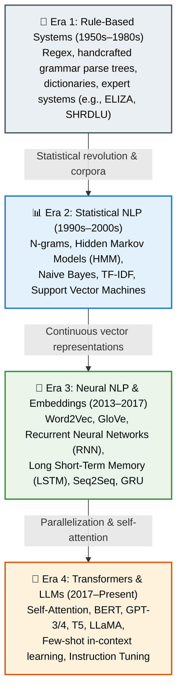
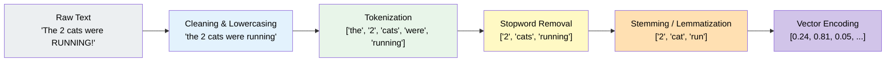
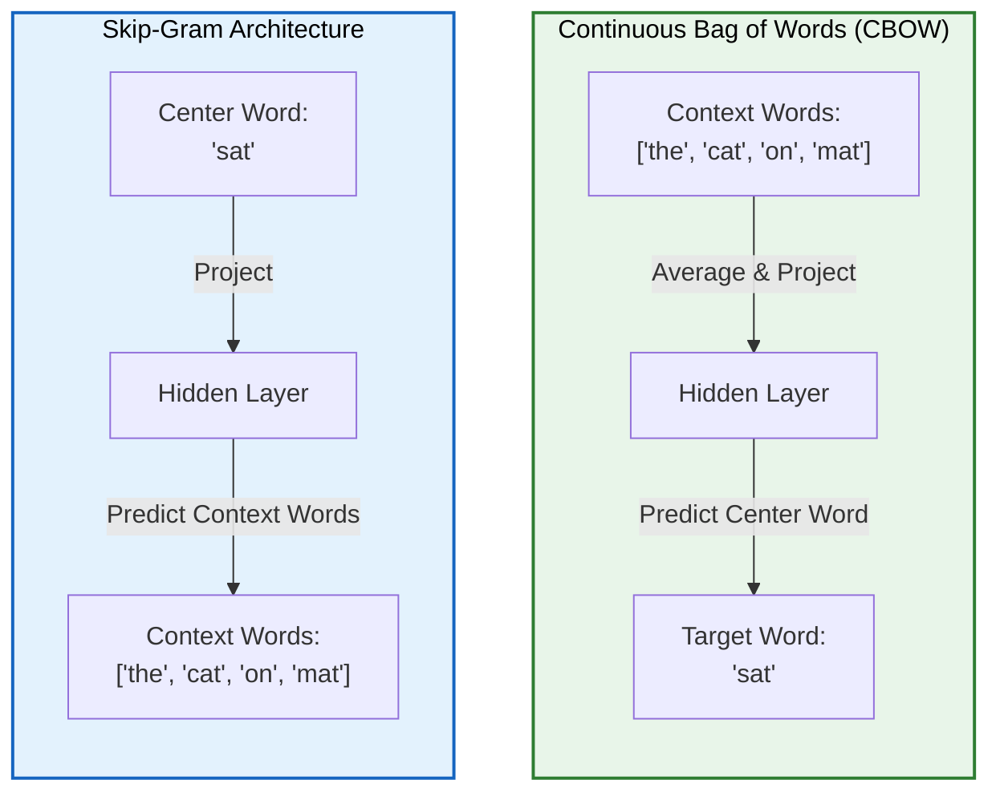
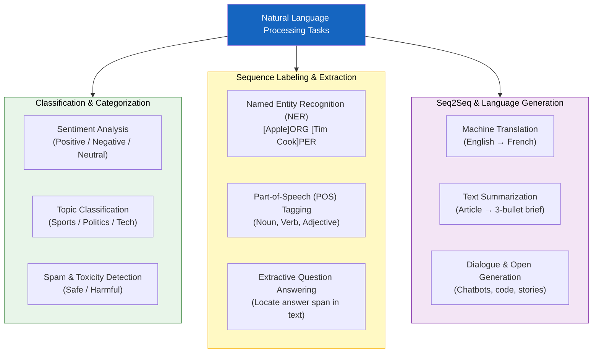

# Chapter 4: Natural Language Processing Fundamentals

> **Part of the LLM Educational Handbook** — A comprehensive guide for college students

## Prerequisites

Before reading this chapter, ensure you:
- Have read [Chapter 1: Introduction to AI](../01-introduction-to-ai/README.md), [Chapter 2: ML Fundamentals](../02-machine-learning-fundamentals/README.md), and [Chapter 3: Deep Learning Fundamentals](../03-deep-learning-fundamentals/README.md)
- Understand basic vector operations and dot products
- Know how neural networks take numerical inputs and produce outputs
- Have basic familiarity with Python (strings, lists, dictionaries)

---

## Table of Contents

1. [What is Natural Language Processing?](#1-what-is-natural-language-processing)
2. [A Brief History of NLP](#2-a-brief-history-of-nlp)
3. [The Text Preprocessing Pipeline](#3-the-text-preprocessing-pipeline)
4. [Representing Words as Numbers: Bag of Words (BoW)](#4-representing-words-as-numbers-bag-of-words-bow)
5. [TF-IDF: Term Frequency-Inverse Document Frequency](#5-tf-idf-term-frequency-inverse-document-frequency)
6. [Dense Word Embeddings: Word2Vec and GloVe](#6-dense-word-embeddings-word2vec-and-glove)
7. [Vector Arithmetic: The Famous King - Man + Woman ≈ Queen](#7-vector-arithmetic-the-famous-king---man--woman--queen)
8. [Taxonomy of NLP Tasks](#8-taxonomy-of-nlp-tasks)
9. [Why Traditional NLP Hit a Wall](#9-why-traditional-nlp-hit-a-wall)
10. [Hands-On Python: Preprocessing and Text Analysis with NLTK](#10-hands-on-python-preprocessing-and-text-analysis-with-nltk)
11. [Summary](#11-summary)
12. [Further Reading](#12-further-reading)

---

## 1. What is Natural Language Processing?

**Natural Language Processing (NLP)** is the subfield of artificial intelligence, linguistics, and computer science concerned with enabling computers to understand, interpret, manipulate, and generate human language.

Human language is notoriously messy, ambiguous, and context-dependent. Consider these everyday sentences:

```
"I saw a bat in the cave."     (Animal: flying mammal)
"He swung the baseball bat."   (Sports equipment: wooden club)

"The chicken is ready to eat." (Is the chicken eating, or being eaten?)

"Time flies like an arrow; fruit flies like a banana."
(First "flies" is a verb; second "flies" is a noun!)
```

Computers natively operate on deterministic numbers (bits, integers, floating-point vectors). Humans communicate in nuanced cultural symbols governed by grammar, slang, idioms, sarcasm, and situational context.

> **The Central Challenge of NLP:** How do we convert messy, variable-length, symbolic human text into structured numerical representations that algorithms can learn from, without losing semantic meaning?

---

## 2. A Brief History of NLP

The evolution of NLP can be understood in four distinct eras, moving from human-crafted rules to massive neural representations.



### 2.1 Era 1: Rule-Based & Symbolic NLP (1950s–1980s)
Linguists like Noam Chomsky proposed formal syntactic grammars. Researchers believed that if we could write down every grammatical rule and dictionary entry, machines could parse sentences into tree structures and understand them.
- **ELIZA (1966):** A psychotherapist chatbot that used simple pattern-matching scripts to bounce back user input.
- **Limitation:** Language has too many exceptions. Rules contradicted each other, couldn't handle typos, and failed completely on unseen slang or domain changes.

### 2.2 Era 2: Statistical NLP (1990s–2000s)
With the advent of digital text corpora and cheaper computing, NLP shifted to probability and statistics.
- Instead of asking "Does this sentence follow rule #4,821?", models computed: *"What is the probability $P(w_t \mid w_{t-1}, w_{t-2})$ of word $w_t$ occurring after the previous words?"*
- Algorithms: Hidden Markov Models for Part-of-Speech tagging, Naive Bayes for spam detection, and N-gram language models for speech recognition.
- **Limitation:** High sparsity. If a 3-word sequence never appeared in the training set, its probability was estimated as zero (requiring smoothing hacks).

### 2.3 Era 3: Word Embeddings & Recurrent Neural Networks (2013–2017)
- **Word2Vec (2013):** Mikolov et al. showed words could be projected into a continuous vector space where distance equals semantic similarity.
- **RNNs and LSTMs:** Processed sequences one word at a time, keeping a memory vector of the past.
- **Limitation:** Sequential processing was slow, and RNNs struggled to remember words from 50 steps ago ("catastrophic forgetting" or vanishing gradients).

### 2.4 Era 4: The Transformer & Large Language Models (2017–Present)
- Vaswani et al. (2017) introduced **Self-Attention** in "Attention Is All You Need".
- Eliminated sequential bottlenecks: entire sentences could be processed in parallel on GPUs.
- Models scaled from millions of parameters (BERT, 110M) to hundreds of billions (GPT-4, Claude, Gemini, LLaMA).

---

## 3. The Text Preprocessing Pipeline

Before text can be ingested by statistical or classical models, it undergoes a structured pipeline of cleaning and normalization.



### 3.1 Tokenization
Tokenization is the task of breaking a stream of characters into discrete meaningful units called **tokens** (typically words, subwords, or punctuation symbols).

```python
text = "Don't leave, we're studying AI!"
# Word tokenization:
tokens = ["Do", "n't", "leave", ",", "we", "'re", "studying", "AI", "!"]
```

### 3.2 Lowercasing & Punctuation Stripping
- Standardizes cases so that `"Apple"` (fruit/company), `"apple"`, and `"APPLE"` map to the same vocabulary index when case distinction is not critical.
- Removes extraneous punctuation (periods, commas, hyphens) unless punctuation carries emotional or syntactic value (e.g., in sentiment analysis where `"!!!"` indicates strong emotion).

### 3.3 Stopword Removal
**Stopwords** are extremely common words (e.g., `"the"`, `"is"`, `"at"`, `"which"`, `"on"`) that carry little topical information in search engines or topic classifiers.
- Filtering them reduces vocabulary size and computational overhead.
- *Caveat in modern LLMs:* Transformer models do **NOT** remove stopwords because words like `"not"` or `"and"` change the logical meaning of a prompt completely.

### 3.4 Stemming vs. Lemmatization
Both techniques aim to reduce inflectional forms of a word to a common base form.

| Feature | Stemming (e.g., Porter Stemmer) | Lemmatization (e.g., WordNet) |
| :--- | :--- | :--- |
| **Method** | Heuristic rule-based chopping of prefixes/suffixes | Full morphological analysis using vocabulary and grammar rules |
| **Speed** | Extremely fast, low memory | Slower, requires dictionary lookup and POS context |
| **Output** | May produce non-words (stems) | Always produces a valid dictionary base word (lemma) |
| **Example 1** | `"running"` → `"run"` | `"running"` (verb) → `"run"` |
| **Example 2** | `"flies"` → `"fli"` | `"flies"` (verb) → `"fly"`, `"flies"` (noun) → `"fly"` |
| **Example 3** | `"better"` → `"better"` | `"better"` (adjective) → `"good"` |

---

## 4. Representing Words as Numbers: Bag of Words (BoW)

Computers cannot perform arithmetic directly on strings. The simplest statistical representation is the **Bag of Words (BoW)** model.

### 4.1 How Bag of Words Works

Imagine you have a collection of documents (a **corpus**):

```
Doc 1: "the cat sat on the mat"
Doc 2: "the dog sat on the rug"
Doc 3: "the cat chased the dog"
```

1. **Build a Vocabulary:** Extract all unique words across all documents:
   $$\mathcal{V} = \{\text{"cat"}, \text{"chased"}, \text{"dog"}, \text{"mat"}, \text{"on"}, \text{"rug"}, \text{"sat"}, \text{"the"}\}$$
   Vocabulary size ($|\mathcal{V}|$) = 8 words.

2. **Count Word Occurrences per Document:** Represent each document as a vector where the $i$-th entry is the count of the $i$-th vocabulary word:

| Document | `"cat"` | `"chased"` | `"dog"` | `"mat"` | `"on"` | `"rug"` | `"sat"` | `"the"` | Vector |
| :--- | :---: | :---: | :---: | :---: | :---: | :---: | :---: | :---: | :--- |
| **Doc 1** | 1 | 0 | 0 | 1 | 1 | 0 | 1 | 2 | `[1, 0, 0, 1, 1, 0, 1, 2]` |
| **Doc 2** | 0 | 0 | 1 | 0 | 1 | 1 | 1 | 2 | `[0, 0, 1, 0, 1, 1, 1, 2]` |
| **Doc 3** | 1 | 1 | 1 | 0 | 0 | 0 | 0 | 2 | `[1, 1, 1, 0, 0, 0, 0, 2]` |

### 4.2 Fatal Limitations of Bag of Words

1. **Complete Loss of Word Order:** 
   `"Dog bites man"` and `"Man bites dog"` produce the exact same BoW vector `[1, 1, 1]`, despite having completely different real-world meanings!
2. **Extreme Sparsity:**
   In real corpora, $|\mathcal{V}|$ is easily 50,000 to 100,000 words. A typical 20-word sentence vector is 99.98% zeros. Storing and computing over massive sparse matrices wastes memory.
3. **No Semantic Relationship:**
   The words `"cat"`, `"kitten"`, and `"feline"` are represented as completely orthogonal indices. The dot product between `"cat"` and `"kitten"` is 0! The model has no idea they mean almost the same thing.
4. **Frequency Bias:**
   Longer documents naturally have higher counts, and common words like `"the"` dominate vector magnitudes without providing informative signal.

---

## 5. TF-IDF: Term Frequency-Inverse Document Frequency

To fix the problem of frequent words dominating vector representations, **TF-IDF** was developed. It penalizes words that appear everywhere while boosting words that are unique and distinctive to a specific document.

### 5.1 The Two Components

#### 1. Term Frequency ($TF$)
How frequently does term $t$ appear inside document $d$?
$$TF(t, d) = \frac{\text{Count of } t \text{ in } d}{\text{Total number of words in } d}$$

#### 2. Inverse Document Frequency ($IDF$)
How rare is term $t$ across the entire collection of $N$ documents?
$$IDF(t, D) = \log\left(\frac{N}{|\{d \in D : t \in d\}|}\right)$$
*(A small constant $+1$ is often added to the denominator to prevent division by zero).*

- If word $t$ appears in **every single document**, $\frac{N}{N} = 1$, and $\log(1) = 0$. Its $IDF$ score collapses to **0** (e.g., words like `"the"`, `"is"`).
- If word $t$ appears in only **1 out of 1,000,000 documents**, its $IDF$ score is $\log(1,000,000) \approx 13.8$ (e.g., technical terms like `"deoxyribonucleic"`).

#### 3. The Combined TF-IDF Formula
$$\text{TF-IDF}(t, d, D) = TF(t, d) \times IDF(t, D)$$

### 5.2 Concrete Example

Suppose we have $N = 3$ documents about computer science:
- Doc A: *"The algorithm optimizes memory."* (4 words)
- Doc B: *"The quick brown fox jumps."* (5 words)
- Doc C: *"The database algorithm indexes records."* (5 words)

Let's evaluate the word `"algorithm"` for **Doc A**:
1. $TF(\text{"algorithm"}, \text{Doc A}) = \frac{1}{4} = 0.25$
2. Word `"algorithm"` appears in 2 documents (Doc A, Doc C). 
   $IDF(\text{"algorithm"}) = \log\left(\frac{3}{2}\right) \approx 0.405$
3. $\text{TF-IDF} = 0.25 \times 0.405 = \mathbf{0.101}$

Now let's evaluate the word `"the"` for **Doc A**:
1. $TF(\text{"the"}, \text{Doc A}) = \frac{1}{4} = 0.25$
2. Word `"the"` appears in all 3 documents.
   $IDF(\text{"the"}) = \log\left(\frac{3}{3}\right) = \log(1) = \mathbf{0}$
3. $\text{TF-IDF} = 0.25 \times 0 = \mathbf{0.0}$

**Result:** The ubiquitous word `"the"` is automatically silenced, while the content-bearing word `"algorithm"` receives a strong positive signal.

---

## 6. Dense Word Embeddings: Word2Vec and GloVe

While TF-IDF helps with weighting, vectors are still high-dimensional, sparse, and lack semantic understanding. The breakthrough arrived in 2013 with **dense word embeddings**.

> **Firth's Famous Distributional Hypothesis (1957):**
> *"You shall know a word by the company it keeps."*
> Words that occur in similar contexts tend to have similar meanings.

Instead of representing words as 50,000-dimensional sparse vectors, word embeddings represent each word as a **dense continuous vector** of typical dimension $D \in [100, 300]$.

```
Sparse 1-Hot Vector (dim=10,000):
"cat"    = [0, 0, 0, 1, 0, 0, 0, 0, ..., 0]
"kitten" = [0, 0, 0, 0, 0, 1, 0, 0, ..., 0]
Dot product: 0.0 (Orthogonal — no relationship!)

Dense Embedding Vector (dim=4 for illustration):
            [Feline,  Pet,   Size,  Royal]
"cat"    =  [ 0.92,   0.85, -0.40,  0.01 ]
"kitten" =  [ 0.90,   0.88, -0.85,  0.02 ]
"lion"   =  [ 0.95,  -0.70,  0.80,  0.15 ]
"king"   =  [-0.05,  -0.10,  0.20,  0.96 ]

Cosine similarity between "cat" and "kitten" ≈ 0.96 (Extremely close!)
```

### 6.1 Word2Vec Architectures: CBOW vs. Skip-Gram

Tomas Mikolov and his Google team proposed two complementary neural architectures to train embeddings from unannotated text:



1. **Continuous Bag of Words (CBOW):**
   - **Goal:** Predict the center target word from surrounding context words.
   - Example: Given `["The", "playful", ___, "chased", "mice"]`, predict `"kitten"`.
   - **Characteristics:** Faster to train, slightly better on frequent words.

2. **Continuous Skip-Gram:**
   - **Goal:** Given a single center word, predict the distribution of context words within a window size $k$.
   - Example: Given `"kitten"`, predict `["playful", "chased", "cat", "furry"]`.
   - **Characteristics:** Slower than CBOW, but excels on rare words and captures subtle nuances better.

### 6.2 GloVe: Global Vectors for Word Representation
Developed at Stanford by Pennington et al. (2014), **GloVe** combined the advantages of global matrix factorization (like LSA) and local context window methods (like Word2Vec).
- GloVe constructs a massive global co-occurrence matrix $X$, where $X_{ij}$ counts how many times word $i$ appears in the context of word $j$ across the entire corpus.
- The model minimizes a weighted least squares objective:
  $$J = \sum_{i,j=1}^{V} f(X_{ij}) \left( w_i^T \tilde{w}_j + b_i + \tilde{b}_j - \log X_{ij} \right)^2$$
- This guarantees that the dot product of two word vectors directly approximates the log-probability of their co-occurrence.

---

## 7. Vector Arithmetic: The Famous King - Man + Woman ≈ Queen

The most captivating property of dense word embeddings is that **linear algebraic operations mirror human analogical reasoning**.

Because semantic concepts correspond to directions in vector space:
- The vector direction from $\vec{v}_{\text{man}}$ to $\vec{v}_{\text{woman}}$ encodes the abstract concept of **gender**.
- The vector direction from $\vec{v}_{\text{king}}$ to $\vec{v}_{\text{palace}}$ encodes **regal residence**.
- The vector direction from $\vec{v}_{\text{Paris}}$ to $\vec{v}_{\text{France}}$ encodes **capital-of**.

### The Geometry of Semantic Analogy

$$\vec{v}_{\text{king}} - \vec{v}_{\text{man}} + \vec{v}_{\text{woman}} \approx \vec{v}_{\text{queen}}$$

```
Vector components intuition:
  Concept          "King"    "Man"    "Woman"   King - Man + Woman   Target: "Queen"
  ─────────────────────────────────────────────────────────────────────────────────
  Royalty          +0.95     +0.05    +0.05     0.95 - 0.05 + 0.05       +0.95
  Masculinity      +0.85     +0.90    -0.85     0.85 - 0.90 + (-0.85)    -0.90
  Femininity       -0.80     -0.85    +0.90    -0.80 - (-0.85) + 0.90    +0.95
  Human            +0.98     +0.99    +0.99     0.98 - 0.99 + 0.99       +0.98
```

Other remarkable analogies discovered automatically by Word2Vec:
- $\vec{v}_{\text{Paris}} - \vec{v}_{\text{France}} + \vec{v}_{\text{Japan}} \approx \vec{v}_{\text{Tokyo}}$ (Capital cities)
- $\vec{v}_{\text{walked}} - \vec{v}_{\text{walking}} + \vec{v}_{\text{swimming}} \approx \vec{v}_{\text{swam}}$ (Verb tenses)
- $\vec{v}_{\text{bigger}} - \vec{v}_{\text{big}} + \vec{v}_{\text{small}} \approx \vec{v}_{\text{smaller}}$ (Comparative adjectives)

---

## 8. Taxonomy of NLP Tasks

Natural Language Processing encompasses dozens of specialized tasks, organized from token-level understanding to document-level generation.



### Detailed Breakdown of Core Tasks

| Task | Input | Output | Real-World Application |
| :--- | :--- | :--- | :--- |
| **Sentiment Analysis** | Review: *"The battery died within an hour."* | Negative (0.98 prob) | Customer support routing, stock sentiment |
| **Named Entity Recognition (NER)** | *"Elon Musk visited Berlin for Tesla."* | `Elon Musk` (PER), `Berlin` (LOC), `Tesla` (ORG) | Financial news extraction, legal contract analysis |
| **Part-of-Speech (POS)** | *"She booked a flight."* | `She` (PRON), `booked` (VERB), `a` (DET), `flight` (NOUN) | Grammar checkers, speech synthesizers |
| **Machine Translation** | *"Knowledge is power."* | *"Le savoir est une force."* | Google Translate, DeepL |
| **Text Summarization** | 10-page research paper | 150-word abstract | Legal brief generation, news digests |
| **Question Answering (QA)** | Context passage + question | Direct factual answer | Virtual assistants, search engines |

---

## 9. Why Traditional NLP Hit a Wall

Despite the success of Word2Vec and recurrent architectures (RNNs and LSTMs), classical NLP hit fundamental bottlenecks when scaling to complex reasoning and document-level tasks.

### 9.1 The Polysemy Problem (Static vs. Contextual Embeddings)
Word2Vec and GloVe assign **exactly one fixed vector** to every word in the dictionary:
- In Word2Vec, the vector for `"bank"` is identical whether it appears in:
  1. *"I deposited money in the river **bank**."*
  2. *"I walked along the grassy **bank** of the river."*
- The model forces these two conflicting concepts (financial institution vs. muddy riverbank) to average into a single ambiguous point in space.
- *What was needed:* **Contextual embeddings**, where a word's vector changes depending on the words around it (solved later by ELMo, BERT, and Transformers).

### 9.2 The Information Bottleneck in RNNs / LSTMs
Recurrent networks process tokens sequentially left-to-right, packing the entire sentence's meaning into a single hidden state vector:

```
Token 1 ──→ [RNN] 
              ↓
Token 2 ──→ [RNN] 
              ↓
             ...
Token 100 ──→ [RNN] ──→ [Final State Vector: only 512 numbers!]
```

Attempting to compress a 500-word paragraph into 512 floating-point numbers causes severe loss of detail. By the time the RNN reaches word 100, the precise details of word 2 have faded away.

### 9.3 Sequential Computation Prevents GPU Scaling
Because token $t$ cannot be computed until token $t-1$ has finished passing through the hidden state, training an RNN cannot be parallelized across the time dimension:
- Training on a billion web pages took months.
- GPUs sat idle waiting for sequential loop iterations to finish.

These three bottlenecks paved the way for the **Transformer revolution** in 2017.

---

## 10. Hands-On Python: Preprocessing and Text Analysis with NLTK

Here is a fully runnable Python script demonstrating tokenization, stopword removal, stemming, lemmatization, and TF-IDF computation using standard NLP libraries.

```python
# ==============================================================================
# Traditional NLP Preprocessing and Feature Extraction
# Install required libraries:
# pip install nltk scikit-learn
# ==============================================================================

import re
import nltk
from nltk.corpus import stopwords
from nltk.tokenize import word_tokenize
from nltk.stem import PorterStemmer, WordNetLemmatizer
from sklearn.feature_extraction.text import TfidfVectorizer

# Download required NLTK corpora datasets
nltk.download('punkt', quiet=True)
nltk.download('punkt_tab', quiet=True)
nltk.download('stopwords', quiet=True)
nltk.download('wordnet', quiet=True)
nltk.download('omw-1.4', quiet=True)

# ------------------------------------------------------------------------------
# 1. Sample Raw Document Collection
# ------------------------------------------------------------------------------
documents = [
    "Artificial Intelligence and Machine Learning are transforming modern technology!",
    "Learning machines can discover patterns from raw digital data.",
    "Natural language processing allows computers to comprehend human language effectively."
]

print("=== RAW DOCUMENTS ===")
for i, doc in enumerate(documents):
    print(f"[{i+1}] {doc}")
print()

# ------------------------------------------------------------------------------
# 2. Text Preprocessing Pipeline Function
# ------------------------------------------------------------------------------
def clean_and_preprocess(text, use_lemmatizer=True):
    """
    Standard classical NLP pipeline:
    1. Lowercase
    2. Strip punctuation & special characters
    3. Tokenize
    4. Remove English stopwords
    5. Stem or Lemmatize tokens
    """
    # Step 1 & 2: Lowercase and strip punctuation
    text = text.lower()
    text = re.sub(r'[^a-z\s]', '', text)
    
    # Step 3: Tokenization
    tokens = word_tokenize(text)
    
    # Step 4: Stopword removal
    stop_words = set(stopwords.words('english'))
    filtered_tokens = [w for w in tokens if w not in stop_words]
    
    # Step 5: Normalization
    if use_lemmatizer:
        lemmatizer = WordNetLemmatizer()
        normalized = [lemmatizer.lemmatize(w) for w in filtered_tokens]
    else:
        stemmer = PorterStemmer()
        normalized = [stemmer.stem(w) for w in filtered_tokens]
        
    return normalized

print("=== PREPROCESSING STEP DEMO ===")
sample = "The smart students were studying and flying kites in the windy skies!"
print(f"Original Text: '{sample}'")

stemmed = clean_and_preprocess(sample, use_lemmatizer=False)
print(f"After Stemming:    {stemmed}")

lemmatized = clean_and_preprocess(sample, use_lemmatizer=True)
print(f"After Lemmatizing: {lemmatized}")
print("-" * 70)

# ------------------------------------------------------------------------------
# 3. TF-IDF Feature Extraction with Scikit-Learn
# ------------------------------------------------------------------------------
print("\n=== TF-IDF VECTORIZATION ===")

# Initialize vectorizer with custom preprocessing
vectorizer = TfidfVectorizer(
    stop_words='english',
    lowercase=True,
    token_pattern=r'(?u)\b\w+\b'
)

# Fit vocabulary and transform corpus into TF-IDF matrix
tfidf_matrix = vectorizer.fit_transform(documents)
feature_names = vectorizer.get_feature_names_out()

print(f"Discovered Vocabulary Size: {len(feature_names)} words")
print(f"Vocabulary: {list(feature_names)}\n")

# Display TF-IDF scores for Document 1
doc_1_vector = tfidf_matrix[0].toarray().flatten()
print("Top distinctive words in Document 1 based on TF-IDF:")
word_scores = [
    (feature_names[idx], doc_1_vector[idx])
    for idx in range(len(feature_names))
    if doc_1_vector[idx] > 0
]
word_scores.sort(key=lambda x: x[1], reverse=True)

for word, score in word_scores:
    print(f"  • {word:<18} : TF-IDF Score = {score:.4f}")
```

### Expected Output

```
=== RAW DOCUMENTS ===
[1] Artificial Intelligence and Machine Learning are transforming modern technology!
[2] Learning machines can discover patterns from raw digital data.
[3] Natural language processing allows computers to comprehend human language effectively.

=== PREPROCESSING STEP DEMO ===
Original Text: 'The smart students were studying and flying kites in the windy skies!'
After Stemming:    ['smart', 'student', 'studi', 'fli', 'kite', 'windi', 'ski']
After Lemmatizing: ['smart', 'student', 'studying', 'flying', 'kite', 'windy', 'sky']
----------------------------------------------------------------------

=== TF-IDF VECTORIZATION ===
Discovered Vocabulary Size: 17 words
Vocabulary: ['allows', 'artificial', 'comprehend', 'computers', 'data', 'digital', 'discover', 'effectively', 'human', 'intelligence', 'language', 'learning', 'machine', 'machines', 'modern', 'natural', 'patterns', 'processing', 'raw', 'technology', 'transforming']

Top distinctive words in Document 1 based on TF-IDF:
  • artificial         : TF-IDF Score = 0.4216
  • intelligence       : TF-IDF Score = 0.4216
  • modern             : TF-IDF Score = 0.4216
  • technology         : TF-IDF Score = 0.4216
  • transforming       : TF-IDF Score = 0.4216
  • machine            : TF-IDF Score = 0.4216
  • learning           : TF-IDF Score = 0.3207
```

---

## 11. Summary

| Concept | Key Takeaway |
| :--- | :--- |
| **NLP Definition** | Bridging human language and computer arithmetic |
| **Tokenization** | Chopping raw character strings into discrete token units |
| **Stemming vs Lemmatization** | Stemming = fast heuristic chopping; Lemmatization = dictionary base words |
| **Bag of Words (BoW)** | Word frequency vectors; loses all word order and semantic relationships |
| **TF-IDF** | Term Frequency $\times$ Inverse Document Frequency; silences common words, highlights distinctive terms |
| **Word Embeddings** | Continuous dense vectors (100–300 dimensions); geometry reflects semantic similarity |
| **Word2Vec (CBOW / Skip-Gram)** | Predicts target from context (CBOW) or context from target (Skip-Gram) |
| **GloVe** | Factorizes global log-co-occurrence matrix across the entire corpus |
| **Vector Arithmetic** | Directional vectors capture linguistic relationships ($\text{King} - \text{Man} + \text{Woman} \approx \text{Queen}$) |
| **Limits of Classical NLP** | Fixed vectors cannot represent polysemy; RNNs suffer catastrophic forgetting |

---

## 12. Further Reading

### Seminal Research Papers
- Mikolov, T., et al. (2013). *"Efficient Estimation of Word Representations in Vector Space"* (The Word2Vec paper).
- Pennington, J., Socher, R., & Manning, C. (2014). *"GloVe: Global Vectors for Word Representation"*.
- Vaswani, A., et al. (2017). *"Attention Is All You Need"* (The breakthrough paper that launched the modern era).

### High-Quality Courses & Interactive Guides
- 🌐 [Stanford CS224N: Natural Language Processing with Deep Learning](https://web.stanford.edu/class/cs224n/) — Free lecture videos and notes by Chris Manning.
- 📖 [Speech and Language Processing](https://web.stanford.edu/~jurafsky/slp3/) — Dan Jurafsky & James H. Martin (the definitive academic textbook, free draft online).
- 🌐 [Jay Alammar — The Illustrated Word2Vec](https://jalammar.github.io/illustrated-word2vec/) — Beautiful interactive visuals explaining embedding vectors.

---

[← Previous Chapter](../03-deep-learning-fundamentals/README.md) | [🏠 Home](../../README.md) | [Next Chapter →](../05-tokenization-and-embeddings/README.md)
