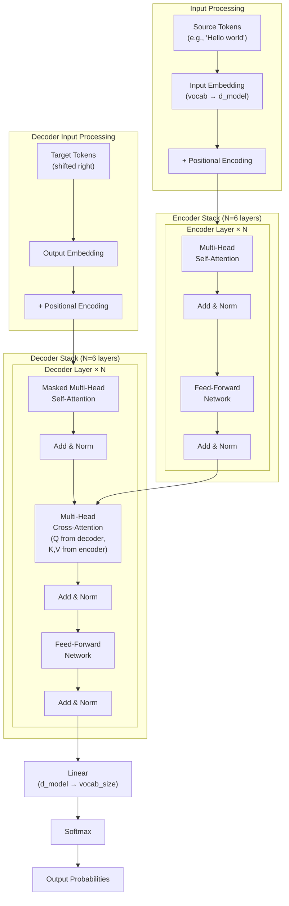
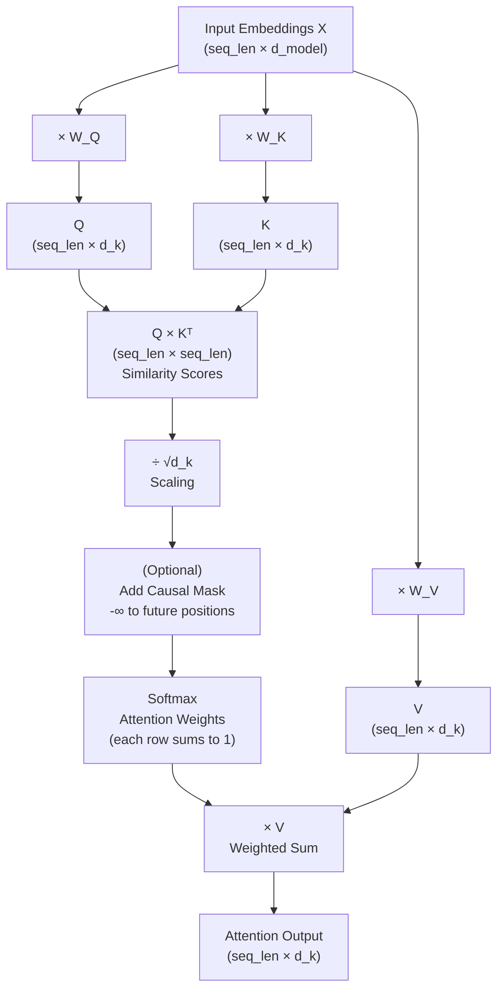
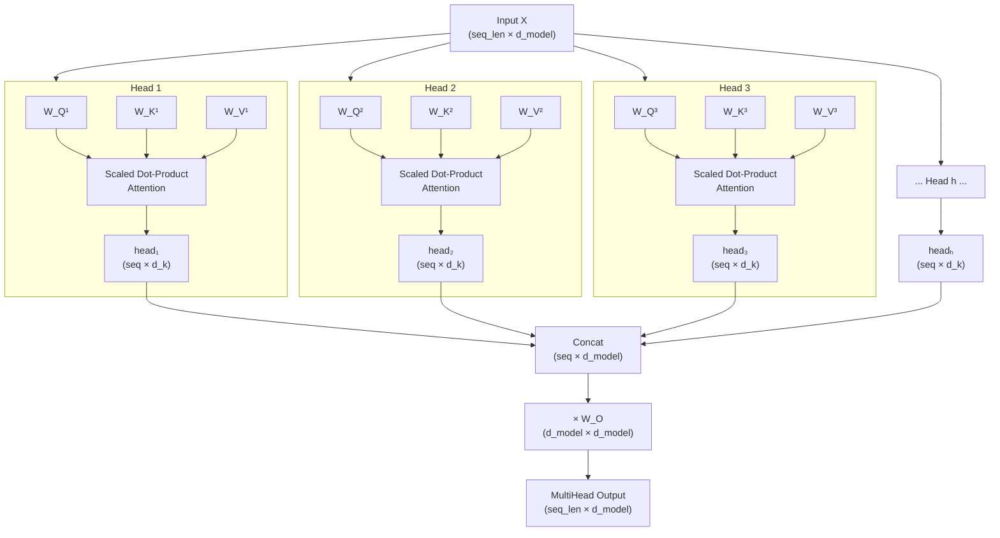
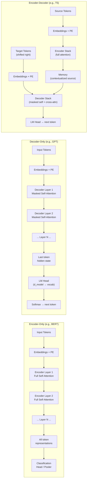

# Chapter 6: Transformer Architecture

> **Prerequisites:** Chapter 5 (Understanding LLMs), Chapter 3 (Deep Learning Fundamentals). You should know what embeddings are and how neural networks do forward passes.

---

## Table of Contents

1. [Why Transformers? The Problem with RNNs](#1-why-transformers-the-problem-with-rnns)
2. [Attention Is All You Need — The Paper](#2-attention-is-all-you-need--the-paper)
3. [Full Transformer Architecture Overview](#3-full-transformer-architecture-overview)
4. [Input Embeddings](#4-input-embeddings)
5. [Positional Encoding](#5-positional-encoding)
6. [Self-Attention — Full Math](#6-self-attention--full-math)
7. [Multi-Head Attention](#7-multi-head-attention)
8. [Feed-Forward Sublayer](#8-feed-forward-sublayer)
9. [Residual Connections and Layer Normalization](#9-residual-connections-and-layer-normalization)
10. [Encoder Stack](#10-encoder-stack)
11. [Decoder Stack](#11-decoder-stack)
12. [Causal Masking](#12-causal-masking)
13. [Output Projection](#13-output-projection)
14. [Encoder vs Decoder vs Encoder-Decoder](#14-encoder-vs-decoder-vs-encoder-decoder)
15. [PyTorch Implementations](#15-pytorch-implementations)
16. [Key Takeaways](#16-key-takeaways)

---

## 1. Why Transformers? The Problem with RNNs

Before transformers, the dominant architectures for sequence modeling were **Recurrent Neural Networks (RNNs)** and their improved variant **LSTMs (Long Short-Term Memory)** networks.

### How RNNs Work

RNNs process sequences **one token at a time**, maintaining a hidden state `h_t` that summarizes everything seen so far:

```
h_t = tanh(W_h * h_{t-1} + W_x * x_t + b)
```

For the sentence "The cat sat on the mat":
```
h_1 = f("The")
h_2 = f("cat", h_1)
h_3 = f("sat", h_2)
...
h_6 = f("mat", h_5)   ← must encode the entire sentence
```

### Critical Limitations of RNNs / LSTMs

| Problem | Description | Impact |
|---|---|---|
| **Sequential processing** | Token `t` must wait for token `t-1` to finish | Cannot parallelize; GPUs sit idle |
| **Vanishing gradients** | Gradients shrink exponentially through long sequences | Early tokens "forgotten" in long text |
| **Fixed hidden state** | All past context compressed into one vector | Information bottleneck |
| **Long-range dependencies** | Hard to relate word at position 1 to word at position 100 | Coreference, grammar fail |
| **Training speed** | Sequential computation = slow training | 10-100× slower than transformers |

> [!IMPORTANT]
> The vanishing gradient problem: when backpropagating through 100 time steps, gradients are multiplied by a weight ~100 times. If that weight is < 1, gradients → 0. The model literally cannot learn relationships between distant tokens.

### The Transformer Solution

Transformers replace recurrence with **attention** — every token can directly attend to every other token in a single operation, regardless of distance. This provides:

- **Full parallelization**: All tokens processed simultaneously
- **Direct long-range connections**: Token 1 to token 100 is the same cost as token 1 to token 2
- **No vanishing gradients** (over sequence length)
- **Scalability**: Easy to make deeper/wider

---

## 2. Attention Is All You Need — The Paper

**"Attention Is All You Need"** — Vaswani et al., Google Brain / Google Research, 2017.

This paper introduced the **Transformer** architecture and eliminated recurrence entirely. Key contributions:

| Contribution | Description |
|---|---|
| **Scaled Dot-Product Attention** | The core attention mechanism with 1/√d_k scaling |
| **Multi-Head Attention** | Run h attention heads in parallel, concatenate results |
| **Positional Encoding** | Sinusoidal functions to inject position information |
| **Encoder-Decoder structure** | 6+6 layer stack for machine translation |
| **Training efficiency** | Parallelizable → trained 100× faster than RNN-based models |

The original model achieved **state-of-the-art on WMT 2014 English-German translation** (28.4 BLEU) and trained in **12 hours on 8 GPUs**, while equivalent RNN models took days.

> [!NOTE]
> Since 2017, virtually every state-of-the-art NLP model (BERT, GPT-2/3/4, T5, Llama, Claude, PaLM) is built on the transformer architecture. It is arguably the most influential deep learning paper of the decade.

---

## 3. Full Transformer Architecture Overview



### The Big Picture

The original transformer was designed for **sequence-to-sequence** tasks (translation). It has two stacks:

- **Encoder**: Reads and understands the input sequence (bidirectional attention)
- **Decoder**: Generates the output sequence token by token (causal + cross-attention to encoder)

Modern LLMs use only the **decoder** stack (GPT family) or only the **encoder** stack (BERT family). The full encoder-decoder is used by T5, BART, etc.

---

## 4. Input Embeddings

### Token → Vector

Every token in the vocabulary is mapped to a **d_model-dimensional vector** via an embedding matrix `E` of shape `(vocab_size, d_model)`:

```
"cat" → token_id: 3797
embedding = E[3797] = [0.12, -0.34, 0.87, ..., 0.21]  # d_model=768 numbers
```

This embedding matrix is **learned during training** — it starts random and gradually encodes semantic meaning.

### Embedding Dimensions by Model

| Model | d_model | Vocab Size | Params in Embedding |
|---|---|---|---|
| BERT-base | 768 | 30,522 | 23.4M |
| GPT-2 small | 768 | 50,257 | 38.6M |
| GPT-3 | 12,288 | 50,257 | 617M |
| Llama 3 70B | 8,192 | 128,256 | 1.05B |

> [!NOTE]
> The embedding matrix is typically tied with the final linear output layer (the same matrix used in both directions), saving parameters and improving training.

---

## 5. Positional Encoding

### The Problem

Transformers process all tokens **in parallel** (unlike RNNs which process sequentially). This means the model has no inherent sense of order: without help, "cat sat mat" and "mat sat cat" look identical to the model.

### Sinusoidal Positional Encoding (Original Paper)

The original transformer adds a **deterministic sinusoidal signal** to each embedding:

```
PE(pos, 2i)   = sin(pos / 10000^(2i/d_model))
PE(pos, 2i+1) = cos(pos / 10000^(2i/d_model))
```

Where:
- `pos` = position in sequence (0, 1, 2, ...)
- `i` = dimension index (0, 1, 2, ..., d_model/2 - 1)
- `d_model` = embedding dimension

**Why sinusoidal?**
- Each position gets a unique encoding
- The encoding allows the model to generalize to longer sequences than seen in training
- Relative positions can be computed easily from these values
- No learnable parameters needed

**Visualization (d_model=4, positions 0–9):**

```
Position 0: [sin(0/1),    cos(0/1),    sin(0/100),    cos(0/100)]
           = [0.000, 1.000, 0.000, 1.000]

Position 1: [sin(1/1),    cos(1/1),    sin(1/100),    cos(1/100)]
           = [0.841, 0.540, 0.010, 1.000]

Position 2: [sin(2/1),    cos(2/1),    sin(2/100),    cos(2/100)]
           = [0.909, -0.416, 0.020, 1.000]
```

Low dimensions oscillate rapidly (fine-grained local position), high dimensions oscillate slowly (global structure).

### Modern Variants

| Method | Used By | Key Idea |
|---|---|---|
| **Sinusoidal** | Original Transformer | Fixed, math formula |
| **Learned absolute** | BERT, GPT-2 | Learned position embedding matrix |
| **RoPE** (Rotary) | Llama, PaLM, Falcon | Rotate Q/K vectors in attention by angle based on position |
| **ALiBi** | BLOOM, MPT | Bias attention scores by relative position |
| **NoPE** | Some recent models | No positional encoding — position from attention patterns |

**RoPE** is now the most popular for LLMs as it generalizes well to longer sequences than seen during training.

---

## 6. Self-Attention — Full Math

Self-attention is the core innovation of the transformer. It lets each token **look at all other tokens** and decide how much to attend to each one.

### The Three Projections: Q, K, V

For each token embedding `x` (shape: `d_model`), we create three vectors:

```
Q = x · W_Q    (Query:  "What am I looking for?")
K = x · W_K    (Key:    "What do I offer / advertise?")
V = x · W_V    (Value:  "What information do I actually give?")
```

Where `W_Q, W_K, W_V` are learned weight matrices of shape `(d_model, d_k)`.

### The Library Analogy

Imagine you're in a library:
- **Query (Q):** Your search query — "I want books about machine learning"
- **Key (K):** The index keyword on the spine of each book — "Python", "Deep Learning", "Recipes"
- **Value (V):** The actual content inside each book

The **dot product Q·K** tells you how relevant each book is to your search. You read more from highly relevant books (high attention weight) and less from irrelevant ones.

### The Attention Formula

```
Attention(Q, K, V) = softmax(Q·Kᵀ / √d_k) · V
```

**Step by step:**

1. **Compute similarity scores:** `scores = Q · Kᵀ`  → shape `(seq_len, seq_len)`
2. **Scale:** Divide by `√d_k` to prevent vanishingly small gradients from large dot products
3. **Softmax:** Convert scores to probabilities (rows sum to 1) → **attention weights**
4. **Weighted sum:** Multiply attention weights by Values → output

### Worked Example — 3-Token Sequence

Suppose we have 3 tokens: "I", "love", "AI" with `d_k = 3`.

**Input Query, Key, Value matrices (already projected):**

```
Q = [[1, 0, 1],    K = [[1, 1, 0],    V = [[1, 2, 0],
     [0, 1, 1],         [0, 1, 0],         [0, 1, 3],
     [1, 1, 0]]         [1, 0, 1]]         [2, 0, 1]]

     (token: I)         (token: I)         (token: I)
     (token: love)      (token: love)      (token: love)
     (token: AI)        (token: AI)        (token: AI)
```

**Step 1 — Scores = Q × Kᵀ:**

```
Kᵀ = [[1, 0, 1],
      [1, 1, 0],
      [0, 0, 1]]

scores = Q × Kᵀ
       = [[1*1+0*1+1*0, 1*1+0*1+1*0, 1*0+0*0+1*1],   = [[1, 1, 1],
          [0*1+1*1+1*0, 0*1+1*1+1*0, 0*0+1*0+1*1],      [1, 1, 1],
          [1*1+1*1+0*0, 1*1+1*1+0*0, 1*0+1*0+0*1]]      [2, 2, 0]]
```

**Step 2 — Scale by √d_k = √3 ≈ 1.732:**

```
scaled = [[0.577, 0.577, 0.577],
          [0.577, 0.577, 0.577],
          [1.155, 1.155, 0.000]]
```

**Step 3 — Softmax (row-wise):**

```
weights ≈ [[0.333, 0.333, 0.333],
           [0.333, 0.333, 0.333],
           [0.422, 0.422, 0.155]]
```

**Step 4 — Output = weights × V:**

```
output = weights × V
       ≈ [[1.0, 1.0, 1.333],
          [1.0, 1.0, 1.333],
          [1.0, 1.26, 0.930]]
```

Each row of the output is a **context-aware representation** of that token, blended from all tokens weighted by relevance.

### Mermaid: Single Attention Head



---

## 7. Multi-Head Attention

### Why Multiple Heads?

A single attention head can only capture one type of relationship at a time. With **h heads**, the model can simultaneously attend to:
- **Head 1:** Syntactic relationships (verb → subject)
- **Head 2:** Coreference (pronoun → noun it refers to)
- **Head 3:** Positional relationships (nearby tokens)
- **Head 4:** Semantic similarity
- ... and so on

### The Math

For the original transformer: `h=8, d_model=512, d_k = d_model/h = 64`

Each head `i` has its own projection matrices `W_Q^i, W_K^i, W_V^i` of shape `(d_model, d_k)`:

```
head_i = Attention(Q·W_Q^i, K·W_K^i, V·W_V^i)    # shape: (seq_len, d_k)
```

Concatenate all heads:
```
MultiHead = Concat(head_1, head_2, ..., head_h)    # shape: (seq_len, h×d_k = d_model)
```

Project back to d_model:
```
MultiHead(Q,K,V) = Concat(head_1,...,head_h) · W_O  # shape: (seq_len, d_model)
```

Where `W_O` is shape `(h·d_k, d_model) = (d_model, d_model)`.

### Parameter Count

For 1 multi-head attention layer with `d_model=512, h=8, d_k=64`:
- `W_Q, W_K, W_V` per head: `512 × 64 = 32,768` params each
- 8 heads × 3 matrices: `8 × 3 × 32,768 = 786,432`
- Output projection `W_O`: `512 × 512 = 262,144`
- **Total per MHA layer: ~1.05M parameters**



---

## 8. Feed-Forward Sublayer

After multi-head attention, each transformer layer applies a **position-wise feed-forward network** (FFN) independently to each token:

```
FFN(x) = max(0, x·W₁ + b₁) · W₂ + b₂
```

Where:
- `W₁` has shape `(d_model, d_ff)` — typically `d_ff = 4 × d_model`
- `W₂` has shape `(d_ff, d_model)` — projects back down
- `max(0, ...)` is the **ReLU activation** (modern models use GELU or SiLU)

### Why an FFN After Attention?

Attention is a **linear** operation (weighted sum of Values). The FFN adds **non-linearity**, allowing the model to learn complex, non-linear transformations.

Think of attention as "gathering information from relevant tokens" and FFN as "processing that information."

### FFN Dimensions by Model

| Model | d_model | d_ff | FFN Ratio |
|---|---|---|---|
| Original Transformer | 512 | 2,048 | 4× |
| BERT-base | 768 | 3,072 | 4× |
| GPT-2 small | 768 | 3,072 | 4× |
| GPT-3 | 12,288 | 49,152 | 4× |
| Llama 3 70B | 8,192 | 28,672 | 3.5× |

### Mixture of Experts (MoE) FFN

Modern models like Mixtral and GPT-4 (estimated) use **Mixture of Experts** for the FFN:
- Instead of one FFN, have `N` expert FFNs (e.g., 8 experts)
- A **router** selects the top-k experts for each token
- Only k experts activate per token → huge model, but cheap inference

---

## 9. Residual Connections and Layer Normalization

### Residual Connections (Skip Connections)

Each sublayer (attention and FFN) wraps its output in a **residual connection**:

```
output = LayerNorm(x + Sublayer(x))
```

The input `x` is **added back** to the sublayer's output before normalization.

**Why residuals?**
- Create a **gradient highway**: gradients flow directly through the skip connection, bypassing the sublayer
- Prevents vanishing gradients in deep networks (GPT-3 has 96 layers!)
- Allows the sublayer to learn **residual corrections** rather than full transformations
- Without residuals, training networks deeper than ~20 layers was nearly impossible (pre-ResNet, 2015)

```
Before residuals:    x → Layer → 0 (gradient vanished)
With residuals:      x → Layer → δ, then x + δ flows forward
                              gradient flows through x directly
```

### Layer Normalization

```
LayerNorm(x) = γ · (x - μ) / (σ + ε) + β
```

Where:
- `μ` = mean over features (not batch!)
- `σ` = standard deviation over features
- `γ, β` = learned scale and shift parameters
- `ε` = small constant for numerical stability (1e-6)

**Why layer norm?**
- Keeps activations in a stable range, preventing exploding/vanishing during forward pass
- **Layer norm** (normalize over feature dim) is used instead of **batch norm** (normalize over batch dim) because:
  - Batch norm requires consistent batch sizes — impractical for variable-length sequences
  - Layer norm works on a single sample, stable for any sequence length

### Pre-LN vs Post-LN

| Variant | Formula | Used By |
|---|---|---|
| **Post-LN** (original) | `LN(x + Sublayer(x))` | Original transformer |
| **Pre-LN** | `x + Sublayer(LN(x))` | GPT-2, GPT-3, Llama |

Pre-LN has become standard in modern LLMs because it trains more stably without learning rate warmup.

---

## 10. Encoder Stack

The encoder consists of `N` identical layers stacked on top of each other (N=6 in the original paper, N=12 to 96 in modern models).

### Single Encoder Layer

```
Input: x  (shape: seq_len × d_model)

# Sublayer 1: Multi-Head Self-Attention
attn_out = MultiHeadAttention(x, x, x)      # Q=K=V=x (self-attention)
x = LayerNorm(x + attn_out)                 # Add & Norm

# Sublayer 2: Feed-Forward Network
ffn_out = FFN(x)
x = LayerNorm(x + ffn_out)                  # Add & Norm

Output: x  (shape: seq_len × d_model, same shape as input)
```

**Key property:** The encoder is **bidirectional** — every token attends to every other token (past and future). This is why BERT (encoder-only) is so good at understanding tasks.

### How Layers Deepen Representations

| Layer | What it learns (approximately) |
|---|---|
| Layer 1-2 | Surface features: syntax, parts of speech |
| Layer 3-6 | Semantic features: word sense, entity types |
| Layer 7-12 | Task-specific features: coreference, reasoning |
| Layer 12+ (deep) | Abstract reasoning, world knowledge |

This is why fine-tuning the last few layers is often enough for simple tasks, while complex tasks benefit from fine-tuning all layers.

---

## 11. Decoder Stack

The decoder is similar to the encoder but has **three sublayers** per layer instead of two:

```
Input: y  (previous output tokens, shape: tgt_len × d_model)
Encoder output: memory  (shape: src_len × d_model)

# Sublayer 1: Masked Multi-Head Self-Attention
# Causal mask: position i can only see positions ≤ i
masked_attn = MaskedMultiHeadAttention(y, y, y)
y = LayerNorm(y + masked_attn)

# Sublayer 2: Cross-Attention (encoder-decoder attention)
# Q from decoder, K and V from encoder output
cross_attn = MultiHeadAttention(Q=y, K=memory, V=memory)
y = LayerNorm(y + cross_attn)

# Sublayer 3: Feed-Forward Network
ffn_out = FFN(y)
y = LayerNorm(y + ffn_out)
```

### Cross-Attention: The Bridge

Cross-attention lets each decoder position ask: *"Which parts of the encoded input are most relevant to what I'm generating right now?"*

For machine translation (English → French):
- When generating the French word "chat" (cat), the decoder attends strongly to the English word "cat" in the encoder output.
- This is the mechanism that makes sequence-to-sequence models work.

> [!NOTE]
> GPT-style decoder-only LLMs **don't have cross-attention** — there's no encoder. They simply use masked self-attention and the entire prompt is treated as the "input" in a single sequence.

---

## 12. Causal Masking

In the decoder, we don't want position `i` to look at future positions `j > i` during training (otherwise it would just copy the answer).

### The Mask Matrix

For a 4-token sequence, the causal mask (applied before softmax) is:

```
       pos 0   pos 1   pos 2   pos 3
pos 0 [  0,     -∞,     -∞,     -∞  ]
pos 1 [  0,      0,     -∞,     -∞  ]
pos 2 [  0,      0,      0,     -∞  ]
pos 3 [  0,      0,      0,      0  ]
```

Values of `-∞` become `0` after softmax (e`^-∞ = 0`), so those positions contribute nothing to the weighted sum.

This is an **upper-triangular mask** — only the lower triangle (including diagonal) is unmasked.

```python
import torch

def causal_mask(seq_len):
    # Upper triangular matrix of -inf (excluding diagonal)
    mask = torch.triu(torch.ones(seq_len, seq_len), diagonal=1)
    return mask.masked_fill(mask == 1, float('-inf'))

print(causal_mask(4))
# tensor([[0., -inf, -inf, -inf],
#         [0.,   0., -inf, -inf],
#         [0.,   0.,   0., -inf],
#         [0.,   0.,   0.,   0.]])
```

---

## 13. Output Projection

After the final transformer layer, we have a hidden state of shape `(seq_len, d_model)`.

For **generation**, we take the hidden state at the **last position** and project it to vocabulary size:

```
logits = hidden_state[-1] @ W_lm_head    # (d_model,) @ (d_model, vocab_size) → (vocab_size,)
probs  = softmax(logits)                  # (vocab_size,) — probabilities over all tokens
next_token = sample(probs)                # or argmax for greedy
```

**Weight tying**: `W_lm_head` is often **the same matrix** as the input embedding table (transposed). This reduces parameters by `vocab_size × d_model` and helps training because:
- Tokens with similar meanings have similar embeddings
- Those same similar tokens should have similar output logits

---

## 14. Encoder vs Decoder vs Encoder-Decoder



---

## 15. PyTorch Implementations

### Scaled Dot-Product Attention

```python
# pip install torch
import torch
import torch.nn as nn
import torch.nn.functional as F
import math


class ScaledDotProductAttention(nn.Module):
    """
    Implements Attention(Q, K, V) = softmax(QK^T / sqrt(d_k)) * V
    
    Args:
        dropout: dropout probability on attention weights (0.0 = no dropout)
    """

    def __init__(self, dropout: float = 0.0):
        super().__init__()
        self.dropout = nn.Dropout(dropout)

    def forward(
        self,
        Q: torch.Tensor,          # (batch, heads, seq_q, d_k)
        K: torch.Tensor,          # (batch, heads, seq_k, d_k)
        V: torch.Tensor,          # (batch, heads, seq_k, d_v)
        mask: torch.Tensor = None # (batch, 1, seq_q, seq_k) or None
    ) -> tuple[torch.Tensor, torch.Tensor]:
        """
        Returns:
            output: (batch, heads, seq_q, d_v)
            attn_weights: (batch, heads, seq_q, seq_k)
        """
        d_k = Q.size(-1)  # dimension per head

        # Step 1: Compute similarity scores via dot product
        # Q: (B, H, Sq, dk), K: (B, H, Sk, dk) → scores: (B, H, Sq, Sk)
        scores = torch.matmul(Q, K.transpose(-2, -1))  # (B, H, Sq, Sk)

        # Step 2: Scale to prevent large dot products (which saturate softmax)
        scores = scores / math.sqrt(d_k)

        # Step 3: Apply causal / padding mask (optional)
        # mask has 0 where attention is allowed, -inf where it is blocked
        if mask is not None:
            scores = scores + mask  # -inf entries → 0 after softmax

        # Step 4: Softmax over last dimension (key positions)
        attn_weights = F.softmax(scores, dim=-1)  # (B, H, Sq, Sk)
        attn_weights = self.dropout(attn_weights)

        # Step 5: Weighted sum of values
        output = torch.matmul(attn_weights, V)  # (B, H, Sq, dv)

        return output, attn_weights


# --- Quick test ---
if __name__ == "__main__":
    B, H, S, dk = 2, 8, 10, 64   # batch=2, heads=8, seq=10, d_k=64
    Q = torch.randn(B, H, S, dk)
    K = torch.randn(B, H, S, dk)
    V = torch.randn(B, H, S, dk)

    attn = ScaledDotProductAttention(dropout=0.1)
    out, weights = attn(Q, K, V)
    print(f"Output shape:  {out.shape}")      # (2, 8, 10, 64)
    print(f"Weights shape: {weights.shape}")  # (2, 8, 10, 10)
    print(f"Weights sum (should be 1): {weights[0,0,0].sum():.4f}")
```

---

### Multi-Head Attention

```python
class MultiHeadAttention(nn.Module):
    """
    Multi-Head Attention as described in 'Attention Is All You Need'.

    MultiHead(Q,K,V) = Concat(head_1,...,head_h) * W_O
    where head_i = Attention(Q*W_Q_i, K*W_K_i, V*W_V_i)

    Args:
        d_model: dimension of the model (e.g., 512)
        num_heads: number of attention heads (e.g., 8)
        dropout: dropout probability on attention weights
    """

    def __init__(self, d_model: int, num_heads: int, dropout: float = 0.0):
        super().__init__()
        assert d_model % num_heads == 0, "d_model must be divisible by num_heads"

        self.d_model = d_model
        self.num_heads = num_heads
        self.d_k = d_model // num_heads  # dimension per head (e.g., 64)

        # Projection matrices for Q, K, V — applied to the FULL d_model
        # (equivalent to h separate (d_model, d_k) matrices stacked)
        self.W_Q = nn.Linear(d_model, d_model, bias=False)  # (d_model → d_model)
        self.W_K = nn.Linear(d_model, d_model, bias=False)
        self.W_V = nn.Linear(d_model, d_model, bias=False)

        # Output projection W_O: maps concatenated heads back to d_model
        self.W_O = nn.Linear(d_model, d_model, bias=False)

        self.attention = ScaledDotProductAttention(dropout=dropout)
        self.dropout = nn.Dropout(dropout)

    def split_heads(self, x: torch.Tensor) -> torch.Tensor:
        """
        Split the last dimension into (num_heads, d_k) and transpose for attention.

        Input:  (batch, seq_len, d_model)
        Output: (batch, num_heads, seq_len, d_k)
        """
        B, S, _ = x.shape
        # Reshape: (B, S, d_model) → (B, S, h, d_k)
        x = x.view(B, S, self.num_heads, self.d_k)
        # Transpose: (B, S, h, d_k) → (B, h, S, d_k)
        return x.transpose(1, 2)

    def combine_heads(self, x: torch.Tensor) -> torch.Tensor:
        """
        Reverse split_heads: concatenate head outputs.

        Input:  (batch, num_heads, seq_len, d_k)
        Output: (batch, seq_len, d_model)
        """
        B, H, S, dk = x.shape
        # Transpose back: (B, h, S, d_k) → (B, S, h, d_k)
        x = x.transpose(1, 2).contiguous()
        # Merge last two dims: (B, S, h*d_k) = (B, S, d_model)
        return x.view(B, S, self.d_model)

    def forward(
        self,
        query: torch.Tensor,       # (batch, seq_q, d_model)
        key: torch.Tensor,         # (batch, seq_k, d_model)
        value: torch.Tensor,       # (batch, seq_k, d_model)
        mask: torch.Tensor = None  # (batch, 1, seq_q, seq_k) broadcastable
    ) -> tuple[torch.Tensor, torch.Tensor]:
        """
        Returns:
            output: (batch, seq_q, d_model)
            attn_weights: (batch, num_heads, seq_q, seq_k)
        """
        # 1. Linear projections: (B, S, d_model) → (B, S, d_model)
        Q = self.W_Q(query)
        K = self.W_K(key)
        V = self.W_V(value)

        # 2. Split into heads: (B, S, d_model) → (B, h, S, d_k)
        Q = self.split_heads(Q)
        K = self.split_heads(K)
        V = self.split_heads(V)

        # 3. Scaled dot-product attention per head
        # attn_out: (B, h, Sq, d_k), weights: (B, h, Sq, Sk)
        attn_out, attn_weights = self.attention(Q, K, V, mask=mask)

        # 4. Combine heads: (B, h, S, d_k) → (B, S, d_model)
        attn_out = self.combine_heads(attn_out)

        # 5. Final linear projection W_O
        output = self.W_O(attn_out)  # (B, S, d_model)

        return output, attn_weights


# --- Quick test ---
if __name__ == "__main__":
    B, S, d_model, h = 2, 10, 512, 8
    mha = MultiHeadAttention(d_model=d_model, num_heads=h, dropout=0.1)

    x = torch.randn(B, S, d_model)
    out, weights = mha(x, x, x)  # self-attention: Q=K=V=x
    print(f"MHA output shape: {out.shape}")      # (2, 10, 512)
    print(f"Attn weights:     {weights.shape}")  # (2, 8, 10, 10)
    print(f"Parameters: {sum(p.numel() for p in mha.parameters()):,}")
```

---

### Full Transformer Block

```python
class TransformerBlock(nn.Module):
    """
    A single Transformer encoder layer (Pre-LN variant, as used in GPT-2/Llama).

    Structure (Pre-LN):
        x = x + MultiHeadAttention(LayerNorm(x))
        x = x + FFN(LayerNorm(x))

    Args:
        d_model:   model dimension (e.g., 512 or 768)
        num_heads: number of attention heads (e.g., 8)
        d_ff:      feed-forward hidden dimension (e.g., 2048 = 4 * d_model)
        dropout:   dropout probability (e.g., 0.1)
    """

    def __init__(
        self,
        d_model: int,
        num_heads: int,
        d_ff: int,
        dropout: float = 0.1
    ):
        super().__init__()

        # --- Sublayer 1: Multi-Head Self-Attention ---
        self.self_attn = MultiHeadAttention(d_model, num_heads, dropout)
        self.norm1 = nn.LayerNorm(d_model)

        # --- Sublayer 2: Position-wise Feed-Forward Network ---
        # FFN(x) = max(0, x*W1 + b1) * W2 + b2
        self.ffn = nn.Sequential(
            nn.Linear(d_model, d_ff),    # Expand: d_model → d_ff (4×)
            nn.GELU(),                   # GELU activation (smoother than ReLU)
            nn.Dropout(dropout),
            nn.Linear(d_ff, d_model),    # Contract: d_ff → d_model
        )
        self.norm2 = nn.LayerNorm(d_model)

        self.dropout = nn.Dropout(dropout)

    def forward(
        self,
        x: torch.Tensor,           # (batch, seq_len, d_model)
        mask: torch.Tensor = None  # (batch, 1, seq_len, seq_len) or None
    ) -> torch.Tensor:
        """
        Returns:
            x: (batch, seq_len, d_model) — same shape as input
        """
        # --- Sublayer 1: Self-Attention with Residual ---
        # Pre-LN: normalize BEFORE attention
        normed = self.norm1(x)
        attn_out, _ = self.self_attn(normed, normed, normed, mask=mask)
        x = x + self.dropout(attn_out)   # Residual connection

        # --- Sublayer 2: FFN with Residual ---
        # Pre-LN: normalize BEFORE FFN
        normed = self.norm2(x)
        ffn_out = self.ffn(normed)
        x = x + self.dropout(ffn_out)    # Residual connection

        return x


class MiniTransformer(nn.Module):
    """
    A minimal but complete transformer encoder (decoder-only style, like GPT).
    Stacks N TransformerBlocks with an embedding layer and LM head.
    """

    def __init__(
        self,
        vocab_size: int,
        d_model: int,
        num_heads: int,
        num_layers: int,
        d_ff: int,
        max_seq_len: int = 512,
        dropout: float = 0.1
    ):
        super().__init__()

        # Token embeddings
        self.token_emb = nn.Embedding(vocab_size, d_model)

        # Learned positional embeddings (simpler than sinusoidal for small models)
        self.pos_emb = nn.Embedding(max_seq_len, d_model)

        self.dropout = nn.Dropout(dropout)

        # Stack of N transformer blocks
        self.layers = nn.ModuleList([
            TransformerBlock(d_model, num_heads, d_ff, dropout)
            for _ in range(num_layers)
        ])

        # Final layer norm (Pre-LN style needs one at the end)
        self.norm = nn.LayerNorm(d_model)

        # Language model head: project d_model → vocab_size
        self.lm_head = nn.Linear(d_model, vocab_size, bias=False)

        # Weight tying: input embeddings = output embedding (saves params)
        self.lm_head.weight = self.token_emb.weight

        self._init_weights()

    def _init_weights(self):
        """Standard initialization: normal for embeddings, zeros for biases."""
        nn.init.normal_(self.token_emb.weight, std=0.02)
        nn.init.normal_(self.pos_emb.weight, std=0.02)
        for module in self.modules():
            if isinstance(module, nn.Linear):
                nn.init.normal_(module.weight, std=0.02)
                if module.bias is not None:
                    nn.init.zeros_(module.bias)

    def make_causal_mask(self, seq_len: int, device: torch.device) -> torch.Tensor:
        """Create upper-triangular causal mask of shape (1, 1, seq_len, seq_len)."""
        mask = torch.triu(
            torch.full((seq_len, seq_len), float('-inf'), device=device),
            diagonal=1
        )
        return mask.unsqueeze(0).unsqueeze(0)  # (1, 1, S, S) — broadcastable

    def forward(self, input_ids: torch.Tensor) -> torch.Tensor:
        """
        Args:
            input_ids: (batch, seq_len) token IDs

        Returns:
            logits: (batch, seq_len, vocab_size)
        """
        B, S = input_ids.shape
        device = input_ids.device

        # 1. Token embeddings
        tok_emb = self.token_emb(input_ids)   # (B, S, d_model)

        # 2. Positional embeddings
        positions = torch.arange(S, device=device).unsqueeze(0)  # (1, S)
        pos_emb = self.pos_emb(positions)      # (1, S, d_model)

        # 3. Combine and apply dropout
        x = self.dropout(tok_emb + pos_emb)   # (B, S, d_model)

        # 4. Causal mask (upper-triangular -inf)
        mask = self.make_causal_mask(S, device)

        # 5. Pass through N transformer layers
        for layer in self.layers:
            x = layer(x, mask=mask)

        # 6. Final layer norm
        x = self.norm(x)                       # (B, S, d_model)

        # 7. Project to vocabulary
        logits = self.lm_head(x)               # (B, S, vocab_size)

        return logits


# --- Full end-to-end test ---
if __name__ == "__main__":
    # Build a small GPT-like model
    model = MiniTransformer(
        vocab_size=1000,
        d_model=128,
        num_heads=4,
        num_layers=3,
        d_ff=512,
        max_seq_len=64,
        dropout=0.0  # 0 for inference test
    )
    model.eval()

    # Fake batch: 2 sequences, each 20 tokens long
    input_ids = torch.randint(0, 1000, (2, 20))

    with torch.no_grad():
        logits = model(input_ids)

    print(f"Input shape:  {input_ids.shape}")  # (2, 20)
    print(f"Output shape: {logits.shape}")     # (2, 20, 1000)
    print(f"Total params: {sum(p.numel() for p in model.parameters()):,}")

    # Sample next token (greedy)
    next_token_logits = logits[:, -1, :]                    # (2, 1000)
    next_token = torch.argmax(next_token_logits, dim=-1)    # (2,)
    print(f"Predicted next token IDs: {next_token.tolist()}")
```

---

## 16. Key Takeaways

| Concept | One-Line Summary |
|---|---|
| **Why transformers** | Parallelizable, no vanishing gradient across sequence, direct long-range attention |
| **Self-attention** | Each token queries all others: `softmax(QKᵀ/√d_k)V` |
| **Q / K / V** | Query = what I want, Key = what I offer, Value = what I give |
| **Multi-head attention** | h parallel attention heads → capture diverse relationship types |
| **Positional encoding** | Sinusoidal or RoPE signal injected so model knows token order |
| **FFN** | 2-layer MLP per position, adds non-linearity: `max(0,xW₁+b₁)W₂+b₂` |
| **Residual connections** | Skip connections = gradient highway through deep networks |
| **Layer norm** | Normalize over feature dim — stable training for variable lengths |
| **Causal mask** | Upper triangular -inf block future positions in decoder |
| **Encoder-only** | Full attention, great for understanding (BERT) |
| **Decoder-only** | Causal attention, great for generation (GPT, Llama) |
| **Encoder-decoder** | Full enc + causal dec with cross-attention (T5, BART) |

---

## Further Reading

- [Attention Is All You Need (arxiv 1706.03762)](https://arxiv.org/abs/1706.03762)
- [The Illustrated Transformer — Jay Alammar](https://jalammar.github.io/illustrated-transformer/)
- [BERT: Pre-training of Deep Bidirectional Transformers (arxiv 1810.04805)](https://arxiv.org/abs/1810.04805)
- [RoPE: Rotary Position Embedding (arxiv 2104.09864)](https://arxiv.org/abs/2104.09864)
- [FlashAttention (arxiv 2205.14135)](https://arxiv.org/abs/2205.14135)

---

[← Chapter 5: Understanding LLMs](../05-understanding-llms/README.md) | [🏠 Home](../../README.md) | [Chapter 7: Tokenization & Embeddings →](../07-tokenization-and-embeddings/README.md)
