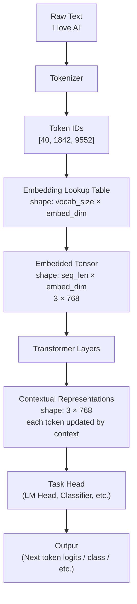
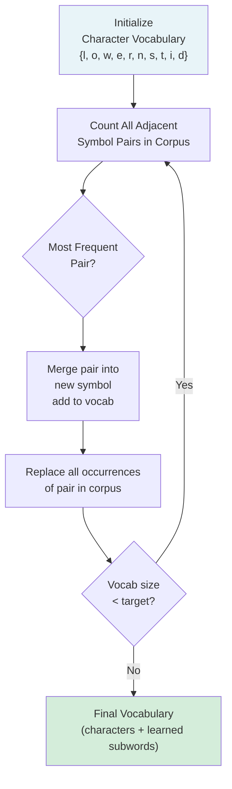
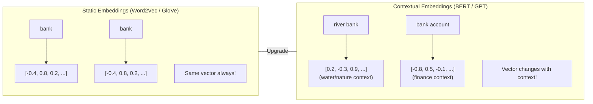

# Chapter 7: Tokenization and Embeddings

> **Prerequisites:** Chapters 1–6 — particularly Chapter 4 (NLP Fundamentals) and Chapter 3 (Deep Learning). You should be comfortable with the idea of neural networks, vectors, and basic Python.

---

## Table of Contents

1. [Section 1 — Tokenization](#section-1--tokenization)
   - [What is a Token?](#11-what-is-a-token)
   - [Character-Level Tokenization](#12-character-level-tokenization)
   - [Word-Level Tokenization](#13-word-level-tokenization)
   - [Subword Tokenization](#14-subword-tokenization)
   - [Byte-Pair Encoding (BPE)](#15-byte-pair-encoding-bpe)
   - [WordPiece](#16-wordpiece)
   - [Unigram Language Model](#17-unigram-language-model)
   - [Byte-Level BPE](#18-byte-level-bpe)
   - [Vocabulary Size Trade-offs](#19-vocabulary-size-trade-offs)
   - [Special Tokens](#110-special-tokens)
   - [Python: Using AutoTokenizer](#111-python-using-autotokenizer)
2. [Section 2 — Embeddings](#section-2--embeddings)
   - [What is a Vector?](#21-what-is-a-vector)
   - [The Embedding Table](#22-the-embedding-table)
   - [Semantic Similarity](#23-semantic-similarity)
   - [Context Matters](#24-context-matters)
   - [Static vs. Contextual Embeddings](#25-static-vs-contextual-embeddings)
   - [Python: torch.nn.Embedding](#26-python-torchnnemembedding)
   - [Python: BERT Embeddings and Cosine Similarity](#27-python-bert-embeddings-and-cosine-similarity)
   - [Diagrams](#28-diagrams)

---

## Section 1 — Tokenization

### 1.1 What is a Token?

Before an LLM can process any text, it needs to convert that text into numbers. The fundamental unit it works with is called a **token**.

A **token** is a chunk of text — it could be a character, a word, or (most commonly in modern LLMs) a **subword piece**.

Consider the word `"unbelievable"`. A subword tokenizer breaks it into:

```
"unbelievable" → ["un", "##believ", "##able"]
```

The `##` prefix (used in BERT-style tokenizers) signals that this piece continues directly from the previous token without a space.

**Why not just use whole words?**

There are three major strategies for tokenization, each with trade-offs:

| Strategy | Unit | Vocabulary Size | Sequence Length | OOV Issue |
|----------|------|-----------------|-----------------|-----------|
| Character | Single character | ~256 | Very long | None |
| Word | Whole word | 100K+ | Short | Yes |
| Subword | Word fragment | 32K–100K | Medium | Rare |

> [!NOTE]
> OOV = Out-Of-Vocabulary. When a model encounters a word it has never seen, it can't process it properly with word-level tokenization. Subword methods largely solve this by composing unknown words from known pieces.

---

### 1.2 Character-Level Tokenization

**Idea:** Each character is its own token.

```
"hello" → ['h', 'e', 'l', 'l', 'o']
```

**Vocabulary:** Just the alphabet, digits, punctuation — typically ~256 tokens.

**Pros:**
- Tiny vocabulary (memory efficient per embedding)
- Never has unknown tokens
- Works for any language or even code

**Cons:**
- Very long sequences (5× longer for English on average)
- No semantic meaning in individual characters — the model must learn everything from scratch
- Computationally expensive due to long sequences (attention scales quadratically)

Character-level models are rarely used for general-purpose LLMs today, though they appear in specialized applications.

---

### 1.3 Word-Level Tokenization

**Idea:** Each word (separated by spaces/punctuation) is its own token.

```
"I love machine learning!" → ['I', 'love', 'machine', 'learning', '!']
```

**Vocabulary:** All unique words in your training corpus — easily 100,000+ for English.

**Pros:**
- Short sequences
- Tokens have clear semantic meaning

**Cons:**
- Huge vocabulary means a huge embedding table (memory expensive)
- **OOV problem:** "ChatGPT" wasn't a word before 2022 — a 2021-trained word-level model can't handle it
- Morphological variations treated as completely different words: "run", "runs", "running", "runner" each get separate entries
- Multilingual becomes impractical (billions of word forms)

---

### 1.4 Subword Tokenization

Subword tokenization is the **best-of-both-worlds** compromise used by virtually all modern LLMs.

**Core idea:**
- Keep common words as single tokens: "the", "is", "AI"
- Break rare or complex words into meaningful pieces: "tokenization" → ["token", "ization"]
- Use a fixed, manageable vocabulary size (32K–100K)

**Benefits:**
- Moderate sequence lengths
- Handles new/rare words gracefully by composing them
- Morphological relationships captured (the model sees "##ing" across many words)
- Multilingual possible with shared subword vocabulary

There are three major subword algorithms: **BPE**, **WordPiece**, and **Unigram**. Let's dive into each.

---

### 1.5 Byte-Pair Encoding (BPE)

BPE was originally a data-compression algorithm adapted for NLP by Sennrich et al. (2016). It is used by **GPT-2, GPT-3, GPT-4, and Llama**.

#### The Algorithm

1. **Initialize:** Split every word into individual characters. Each character is a token. Add a special end-of-word marker (often `</w>`) to distinguish word boundaries.
2. **Count pairs:** Count all adjacent symbol pairs in the corpus.
3. **Merge best pair:** Find the most frequent pair, merge them into a new token, add it to the vocabulary.
4. **Repeat** steps 2–3 until vocabulary reaches target size (e.g., 32,768 tokens).

#### Worked Example

**Corpus:**
```
["low", "low", "lower", "newest", "widest"]
```

After frequency count: `low` appears 2×, `lower` 1×, `newest` 1×, `widest` 1×

**Initial representation** (characters + end-of-word marker `</w>`):

```
l o w </w>      (×2)
l o w e r </w>  (×1)
n e w e s t </w>(×1)
w i d e s t </w>(×1)
```

**Step 0 — Initial pair counts:**

| Pair | Count |
|------|-------|
| `l o` | 3 (appears in "low"×2 + "lower"×1) |
| `o w` | 3 |
| `w </w>` | 2 |
| `w e` | 2 (in "lower", "newest") |
| `e s` | 2 (in "newest", "widest") |
| `s t` | 2 |
| `t </w>` | 2 |
| `e r` | 1 |
| ... | ... |

---

**Merge Step 1:** Most frequent: `l o` (count=3) → merge into `lo`

```
lo w </w>      (×2)
lo w e r </w>  (×1)
n e w e s t </w>(×1)
w i d e s t </w>(×1)
```

Vocab adds: **`lo`**

---

**Merge Step 2:** Recount. Now `lo w` appears 3 times → merge into `low`

```
low </w>      (×2)
low e r </w>  (×1)
n e w e s t </w>(×1)
w i d e s t </w>(×1)
```

Vocab adds: **`low`**

---

**Merge Step 3:** Count again. `e s` appears 2×, `s t` appears 2×, `t </w>` appears 2×. Let's say `e s` wins (or `s t`, tie-breaking by first occurrence). Merge `e s` → `es`

```
low </w>       (×2)
low e r </w>   (×1)
n e w es t </w>(×1)
w i d es t </w>(×1)
```

Vocab adds: **`es`**

---

**Merge Step 4:** `es t` now appears 2×. Merge into `est`

```
low </w>        (×2)
low e r </w>    (×1)
n e w est </w>  (×1)
w i d est </w>  (×1)
```

Vocab adds: **`est`**

---

**Merge Step 5:** `est </w>` appears 2×. Merge into `est</w>`

```
low </w>          (×2)
low e r </w>      (×1)
n e w est</w>     (×1)
w i d est</w>     (×1)
```

Vocab adds: **`est</w>`**

---

After these 5 steps, our vocabulary has grown from individual characters to include useful subwords: `lo`, `low`, `es`, `est`, `est</w>`. Given enough merges, common words become single tokens while rare words are composed from learned pieces.

> [!TIP]
> GPT-2 uses 50,257 BPE merges starting from 256 byte-level tokens. Each merge operation creates one new vocabulary entry.

**Used by:** GPT-2, GPT-3, GPT-4, Llama 1/2 (via byte-level BPE), RoBERTa

---

### 1.6 WordPiece

WordPiece is used by **BERT, DistilBERT, and ELECTRA**. It is similar to BPE but uses a different merge criterion.

**Key difference from BPE:**
- BPE merges the **most frequent** pair.
- WordPiece merges the pair that **maximizes the likelihood** of the training data.

Formally, it scores each candidate merge by:

```
score(A, B) = freq(AB) / (freq(A) × freq(B))
```

This prefers merging pairs that are more "surprising" together — i.e., pairs where the combination is much more common than expected by chance.

**Output format:**
- Whole-word-start tokens: `un`, `believe`, `able`
- Continuation tokens marked with `##`: `##believ`, `##able`

**Example:**
```
"unbelievable" → ["un", "##believ", "##able"]
"playing"      → ["play", "##ing"]
"tokenization" → ["token", "##ization"]
```

This `##` prefix tells the model that this piece is attached to the previous token (no space between them).

**Used by:** BERT, DistilBERT, ELECTRA, MobileBERT

---

### 1.7 Unigram Language Model

The Unigram method (used by **SentencePiece**, which powers **T5, ALBERT, and Llama**) takes the opposite approach from BPE:

**BPE:** Start small, grow by merging.
**Unigram:** Start large, shrink by pruning.

#### Algorithm

1. **Initialize** with a large vocabulary (all substrings up to some length, or characters + frequent words)
2. **Assign probabilities** to each token using a unigram language model (each token independent)
3. **Compute loss:** For the current vocabulary, how well does the model explain the training corpus?
4. **Remove tokens** whose removal increases loss the least (they contribute least)
5. **Repeat** until target vocabulary size reached

The probability of a tokenization is:

```
P(tokenization) = ∏ P(token_i)
```

The model finds the most probable segmentation of each word (using the Viterbi algorithm).

**Example:**
- "newest" could be `["newest"]` or `["new", "est"]` or `["n", "e", "w", "e", "s", "t"]`
- The model assigns a probability to each; highest-probability wins

**Used by:** T5, ALBERT, XLNet, Llama (via SentencePiece library)

---

### 1.8 Byte-Level BPE

Standard BPE works on Unicode characters, but some Unicode characters are rare (e.g., emoji, rare scripts). Byte-Level BPE solves this elegantly.

**Idea:** Treat the input as raw bytes (0–255), not characters.

- **Initial vocabulary:** 256 byte values (guaranteed to cover everything)
- **Merges:** Same BPE algorithm on bytes
- **Result:** Never out-of-vocabulary — any input can be encoded

This is what GPT-2, GPT-3, GPT-4, and Llama use. The model never fails on emoji, math symbols, or languages it's never seen because every string decomposes to bytes.

```python
# Any string can be encoded!
"🦄 → [240, 159, 166, 132]"  # Four bytes for this emoji
```

---

### 1.9 Vocabulary Size Trade-offs

| Model | Tokenizer | Vocab Size | Notes |
|-------|-----------|-----------|-------|
| GPT-2 | Byte-level BPE | 50,257 | First major byte-level BPE model |
| GPT-3/4 | Byte-level BPE (cl100k) | 100,277 | Larger vocab → shorter sequences |
| BERT | WordPiece | 30,522 | English-focused |
| mBERT | WordPiece | 119,547 | Multilingual |
| Llama 1/2 | BPE (SentencePiece) | 32,000 | Compact, efficient |
| Llama 3 | BPE (tiktoken) | 128,256 | Huge vocab for multilingual |
| Gemma | SentencePiece | 256,128 | Very large vocab |
| T5 | SentencePiece Unigram | 32,100 | Encoder-decoder |

**Trade-offs:**

| Smaller Vocab (32K) | Larger Vocab (100K+) |
|---------------------|----------------------|
| Smaller embedding table | Larger embedding table |
| Longer sequences (more tokens) | Shorter sequences (fewer tokens) |
| More compute per sequence | Less compute per sequence |
| Works well for English | Better for multilingual |

> [!IMPORTANT]
> Vocabulary size directly affects the embedding table size. With `vocab=128K` and `embed_dim=4096` (Llama 3), the embedding table alone is `128K × 4096 × 2 bytes ≈ 1 GB`. This is why vocabulary size is a significant architectural decision.

---

### 1.10 Special Tokens

Different model families use different special tokens. These tokens signal important structural boundaries to the model.

#### BERT-style (Encoder models)

| Token | Meaning | Usage |
|-------|---------|-------|
| `[CLS]` | Classification | Prepended to every input; its final embedding used for classification |
| `[SEP]` | Separator | Between two sentences; at end of input |
| `[PAD]` | Padding | Pads shorter sequences in a batch to equal length |
| `[MASK]` | Mask | Replaces tokens during masked language model training |
| `[UNK]` | Unknown | Replaces tokens not in vocabulary |

**BERT input format:**
```
[CLS] The cat sat [SEP] The dog ran [SEP]
```

#### GPT-style (Decoder models)

| Token | Meaning | Usage |
|-------|---------|-------|
| `<\|endoftext\|>` | End of document | Marks document boundaries in GPT-2 |
| `<s>` | Start of sequence | Used by Llama, T5 |
| `</s>` | End of sequence | Used by Llama, T5 |
| `<unk>` | Unknown | Fallback for unknown tokens |
| `<pad>` | Padding | Batch padding |

**GPT-style format:**
```
<s> Tell me about AI </s>
```

Special tokens are added to the vocabulary and have learned embeddings just like regular tokens, but they carry semantic meaning by convention of training.

---

### 1.11 Python: Using AutoTokenizer

```python
# pip install transformers
from transformers import AutoTokenizer

# ----- Load GPT-2 tokenizer -----
tokenizer = AutoTokenizer.from_pretrained("gpt2")

# ----- Tokenize a sentence -----
text = "Large language models are transforming AI."
encoding = tokenizer(text, return_tensors="pt")

# ----- Show token strings -----
token_ids = encoding["input_ids"][0].tolist()
token_strings = tokenizer.convert_ids_to_tokens(token_ids)

print("Token strings:", token_strings)
# ['Large', 'Ġlanguage', 'Ġmodels', 'Ġare', 'Ġtransforming', 'ĠAI', '.']
# Note: Ġ (capital G with cedilla) = space before word (byte-level BPE artifact)

print("Token IDs:", token_ids)
# [24919, 3303, 4981, 389, 25449, 7054, 13]

# ----- Decode back -----
decoded = tokenizer.decode(token_ids)
print("Decoded:", decoded)
# 'Large language models are transforming AI.'

# ----- Show how "unbelievable" is split -----
word = "unbelievable"
word_tokens = tokenizer.tokenize(word)
word_ids = tokenizer.convert_tokens_to_ids(word_tokens)
print(f"\n'{word}' → tokens: {word_tokens}")
print(f"'{word}' → IDs: {word_ids}")
# 'unbelievable' → tokens: ['un', 'believ', 'able']
# (GPT-2 BPE splits it into these subword units)

# ----- Try BERT tokenizer for comparison -----
bert_tokenizer = AutoTokenizer.from_pretrained("bert-base-uncased")
bert_tokens = bert_tokenizer.tokenize("unbelievable")
print(f"\nBERT: 'unbelievable' → {bert_tokens}")
# ['un', '##believ', '##able']
# Note the ## prefix for continuation pieces

# ----- Special tokens in BERT -----
bert_encoded = bert_tokenizer.encode(
    "Hello world", 
    add_special_tokens=True
)
bert_decoded = bert_tokenizer.convert_ids_to_tokens(bert_encoded)
print("\nBERT with special tokens:", bert_decoded)
# ['[CLS]', 'hello', 'world', '[SEP]']

# ----- Vocabulary size -----
print(f"\nGPT-2 vocab size: {tokenizer.vocab_size}")   # 50257
print(f"BERT vocab size:  {bert_tokenizer.vocab_size}") # 30522
```

**Expected output:**
```
Token strings: ['Large', 'Ġlanguage', 'Ġmodels', 'Ġare', 'Ġtransforming', 'ĠAI', '.']
Token IDs: [24919, 3303, 4981, 389, 25449, 7054, 13]
Decoded: Large language models are transforming AI.

'unbelievable' → tokens: ['un', 'believ', 'able']
'unbelievable' → IDs: [403, 6381, 540]

BERT: 'unbelievable' → ['un', '##believ', '##able']
BERT with special tokens: ['[CLS]', 'hello', 'world', '[SEP]']

GPT-2 vocab size: 50257
BERT vocab size:  30522
```

---

## Section 2 — Embeddings

### 2.1 What is a Vector?

A **vector** is just an ordered list of numbers. It represents a point in multi-dimensional space.

**Building intuition:**

**2D:** You can describe any city with just 2 numbers (latitude, longitude):
```
New York: [40.71, -74.01]
London:   [51.51, -0.13]
Paris:    [48.86,  2.35]
```

**3D:** Add altitude. Now you're describing a point in 3D space:
```
Airplane position: [40.71, -74.01, 10000]  # lat, lon, altitude
```

**768D (BERT's embedding size):** Each token is represented as a point in 768-dimensional space. We can't visualize it, but mathematically it works the same way. The 768 numbers encode everything the model has learned about that token's meaning and grammatical role.

**Why high dimensions?**
- More dimensions = richer representations
- Each dimension *can* loosely correspond to some feature (though in practice they're not human-interpretable)
- Dimensionality is a hyperparameter: GPT-2 uses 768, GPT-3 uses 12288, Llama 3 70B uses 8192

---

### 2.2 The Embedding Table

When a tokenizer produces token IDs, the model needs to convert those IDs into vectors. This is done via an **embedding table** (also called an embedding matrix or lookup table).

```
Embedding Table shape: (vocab_size, embed_dim)

For BERT-base: (30522, 768)
For GPT-2:     (50257, 768)
For GPT-3:     (50257, 12288)
```

**How it works:**

```
Token ID: 1234
Embedding Table Row 1234: [0.21, -0.84, 0.03, ..., 1.42]  ← 768 numbers
                                                            ← This IS the embedding
```

It's literally just a lookup: given an integer index, return the corresponding row from the matrix.

```python
import torch
import torch.nn as nn

vocab_size = 10
embed_dim = 4
embedding_table = nn.Embedding(vocab_size, embed_dim)

token_id = torch.tensor([3])
vector = embedding_table(token_id)
print(vector)  # tensor([[ 0.21, -0.84,  0.03,  1.42]])
```

**Learned during training:**
- Initially, the embedding table is filled with random numbers
- During training, backpropagation adjusts every embedding so that tokens with similar roles end up with similar vectors
- After training on billions of tokens, the embeddings encode rich semantic knowledge

---

### 2.3 Semantic Similarity

After training, **similar meanings → nearby vectors** in embedding space.

**The Famous King - Man + Woman ≈ Queen Example:**

Word2Vec (Mikolov et al., 2013) famously demonstrated that vector arithmetic works:

```
vec("King") - vec("Man") + vec("Woman") ≈ vec("Queen")
```

This works because the embedding space learns to encode relationships geometrically:
- The vector from "Man" to "King" (royalty + masculine) is similar to "Woman" to "Queen"
- Subtracting "Man" and adding "Woman" navigates along the gender dimension

**Measuring similarity: Cosine Similarity**

The standard way to measure how similar two vectors are:

```
cos(θ) = (A · B) / (|A| × |B|)
```

Where:
- `A · B` = dot product = Σ(a_i × b_i)
- `|A|` = magnitude of A = √(Σ a_i²)
- Result ranges from -1 (opposite) to +1 (identical direction)

```python
import numpy as np

def cosine_similarity(a, b):
    dot = np.dot(a, b)
    norm_a = np.linalg.norm(a)
    norm_b = np.linalg.norm(b)
    return dot / (norm_a * norm_b)

# Example with 3D vectors
vec_king  = np.array([0.9, 0.2, 0.8])
vec_queen = np.array([0.8, 0.9, 0.7])
vec_rock  = np.array([-0.3, 0.1, -0.5])

print(cosine_similarity(vec_king, vec_queen))  # ~0.95 (very similar)
print(cosine_similarity(vec_king, vec_rock))   # ~0.1  (not similar)
```

**Example similarities in a trained word embedding space:**

| Word Pair | Cosine Similarity |
|-----------|------------------|
| king / queen | ~0.85 |
| cat / dog | ~0.80 |
| cat / piano | ~0.15 |
| happy / joyful | ~0.90 |
| bank / river | ~0.60 (ambiguous!) |

---

### 2.4 Context Matters

**Static embeddings** (Word2Vec, GloVe) give every word a *single* vector regardless of context.

**Problem:** The word "bank" has very different meanings:
- "I sat on the **bank** of the river" → riverbank
- "I deposited money at the **bank**" → financial institution

With static embeddings, "bank" always has the same vector, so the model can't distinguish these meanings.

**Contextual embeddings** (BERT, GPT) solve this. After passing through transformer layers, the vector for "bank" is different depending on surrounding words:

```
"river bank" → bank embedding shifts towards [water, nature, terrain]
"bank account" → bank embedding shifts towards [finance, money, institution]
```

This is one of the key innovations of transformer-based language models. The token's initial embedding (from the lookup table) is just the starting point — transformer layers continuously refine it using information from surrounding tokens.

---

### 2.5 Static vs. Contextual Embeddings

| Feature | Static (Word2Vec, GloVe) | Contextual (BERT, GPT) |
|---------|--------------------------|------------------------|
| One vector per word? | ✅ Yes | ❌ No — depends on context |
| Polysemy (multiple meanings) | ❌ Struggles | ✅ Handles well |
| Training method | Predict neighbors | Masked LM / next-token prediction |
| Computation at inference | Fast (lookup) | Slow (full model forward pass) |
| Year introduced | 2013 (Word2Vec) | 2018 (BERT) |
| Use today | Legacy / lightweight apps | Standard for modern NLP |

**Word2Vec** (Mikolov et al., 2013): Two training methods:
- **CBOW** (Continuous Bag of Words): predict center word from context
- **Skip-gram**: predict context words from center word

**GloVe** (Pennington et al., 2014): Uses global word co-occurrence statistics from entire corpus.

Both produce fixed 50D–300D vectors. Revolutionary in 2013–2017, now mostly superseded by contextual embeddings.

---

### 2.6 Python: torch.nn.Embedding

```python
import torch
import torch.nn as nn

# Small vocabulary example
vocab_size = 6     # 6 tokens in our tiny vocabulary
embed_dim = 4      # each token → 4-dimensional vector

# Create embedding table (randomly initialized)
embedding = nn.Embedding(vocab_size, embed_dim)

print("Embedding table shape:", embedding.weight.shape)
# torch.Size([6, 4])

print("\nAll embeddings (one row per token):")
print(embedding.weight.data)
# tensor([[ 0.3367,  0.1288,  0.2345,  0.2303],   ← token 0
#         [-1.1229, -0.1863,  2.2082, -0.6380],    ← token 1
#         [ 0.4617,  0.2674,  0.5349,  0.8094],    ← token 2
#         [ 1.1103, -1.6898, -0.9890,  0.9580],    ← token 3
#         [ 0.7050, -1.1479,  1.6487,  2.1475],    ← token 4
#         [ 0.0000, -0.1988, -1.5699, -0.9516]])   ← token 5

# Look up a single token
token_id = torch.tensor(2)
vec = embedding(token_id)
print(f"\nEmbedding for token 2: {vec.data}")
# tensor([0.4617, 0.2674, 0.5349, 0.8094])

# Look up a sequence of tokens
sequence = torch.tensor([0, 3, 1, 5])  # a 4-token sequence
embedded_sequence = embedding(sequence)
print(f"\nSequence shape: {sequence.shape}")          # torch.Size([4])
print(f"Embedded shape: {embedded_sequence.shape}")   # torch.Size([4, 4])
print(f"\nEmbedded sequence:\n{embedded_sequence.data}")

# Batch of sequences (what models actually process)
batch = torch.tensor([[0, 1, 2], [3, 4, 5]])  # 2 sequences, 3 tokens each
embedded_batch = embedding(batch)
print(f"\nBatch shape: {batch.shape}")               # torch.Size([2, 3])
print(f"Embedded batch shape: {embedded_batch.shape}") # torch.Size([2, 3, 4])
```

---

### 2.7 Python: BERT Embeddings and Cosine Similarity

```python
# pip install transformers torch
import torch
from transformers import AutoTokenizer, AutoModel
import torch.nn.functional as F

def get_token_embeddings(text, tokenizer, model):
    """Get contextual embeddings for each token in text."""
    inputs = tokenizer(text, return_tensors="pt")
    with torch.no_grad():
        outputs = model(**inputs)
    # Last hidden state: (1, seq_len, hidden_size)
    return outputs.last_hidden_state[0], inputs

def get_sentence_embedding(text, tokenizer, model):
    """Mean-pool token embeddings to get a sentence embedding."""
    inputs = tokenizer(text, return_tensors="pt", padding=True, truncation=True)
    with torch.no_grad():
        outputs = model(**inputs)
    # Mean over token dimension (excluding padding)
    attention_mask = inputs["attention_mask"]
    token_embeddings = outputs.last_hidden_state
    mask = attention_mask.unsqueeze(-1).expand(token_embeddings.size()).float()
    sentence_embedding = torch.sum(token_embeddings * mask, 1) / torch.clamp(mask.sum(1), min=1e-9)
    return sentence_embedding[0]

# Load model
tokenizer = AutoTokenizer.from_pretrained("bert-base-uncased")
model = AutoModel.from_pretrained("bert-base-uncased")
model.eval()

# ----- Demonstrate contextual embeddings -----
# "bank" in two different contexts
river_text = "I sat on the bank of the river."
money_text = "I deposited money at the bank."

river_embeddings, river_inputs = get_token_embeddings(river_text, tokenizer, model)
money_embeddings, money_inputs = get_token_embeddings(money_text, tokenizer, model)

# Find "bank" token position
river_tokens = tokenizer.convert_ids_to_tokens(river_inputs["input_ids"][0])
money_tokens = tokenizer.convert_ids_to_tokens(money_inputs["input_ids"][0])

print("River sentence tokens:", river_tokens)
print("Money sentence tokens:", money_tokens)

# Get bank embedding from each sentence
# [CLS] I sat on the bank of the river . [SEP]
#  0    1  2  3  4   5   6  7  8     9   10
river_bank_idx = river_tokens.index("bank")
money_bank_idx = money_tokens.index("bank")

river_bank_vec = river_embeddings[river_bank_idx]  # shape: (768,)
money_bank_vec = money_embeddings[money_bank_idx]  # shape: (768,)

sim_bank = F.cosine_similarity(river_bank_vec.unsqueeze(0), 
                                money_bank_vec.unsqueeze(0)).item()
print(f"\nCosine similarity between 'bank' in two contexts: {sim_bank:.4f}")
# ~0.73 — same word but embeddings differ due to context!

# ----- Compare sentence-level embeddings -----
sentences = [
    "The cat sat on the mat.",
    "A feline rested on the rug.",   # similar meaning
    "Machine learning is fascinating.", # unrelated
]

embeddings = [get_sentence_embedding(s, tokenizer, model) for s in sentences]

for i in range(len(sentences)):
    for j in range(i+1, len(sentences)):
        sim = F.cosine_similarity(embeddings[i].unsqueeze(0), 
                                  embeddings[j].unsqueeze(0)).item()
        print(f"\nSimilarity between:")
        print(f"  '{sentences[i]}'")
        print(f"  '{sentences[j]}'")
        print(f"  → {sim:.4f}")
# cat/mat vs feline/rug: ~0.92 (high — semantically similar)
# cat/mat vs ML: ~0.45 (low — unrelated topics)
```

---

### 2.8 Diagrams

#### Diagram 1: Text → Token IDs → Embeddings → Model



---

#### Diagram 2: BPE Merge Process



---

#### Diagram 3: Static vs Contextual Embeddings



---

## Summary

| Concept | Key Takeaway |
|---------|-------------|
| Token | Basic unit of text the model processes (usually a subword) |
| BPE | Build vocab by iteratively merging most frequent character pairs |
| WordPiece | Like BPE but maximizes training data likelihood; uses `##` prefix |
| Unigram | Start large, prune least-useful tokens; probabilistic selection |
| Byte-level BPE | Operates on raw bytes; never OOV |
| Embedding | A vector of floats representing a token's meaning |
| Embedding table | Matrix of shape (vocab_size, embed_dim); each row is one token |
| Static embedding | One fixed vector per word (Word2Vec, GloVe) |
| Contextual embedding | Vector depends on surrounding context (BERT, GPT) |
| Cosine similarity | Measures angle between vectors to quantify semantic similarity |

---

[← Previous Chapter](../06-transformer-architecture/README.md) | [🏠 Home](../../README.md) | [Next Chapter →](../08-attention-mechanism/README.md)
