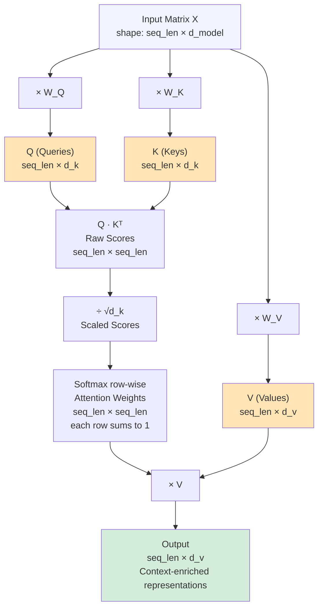
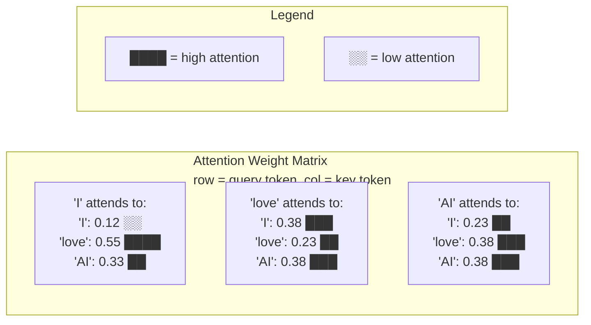
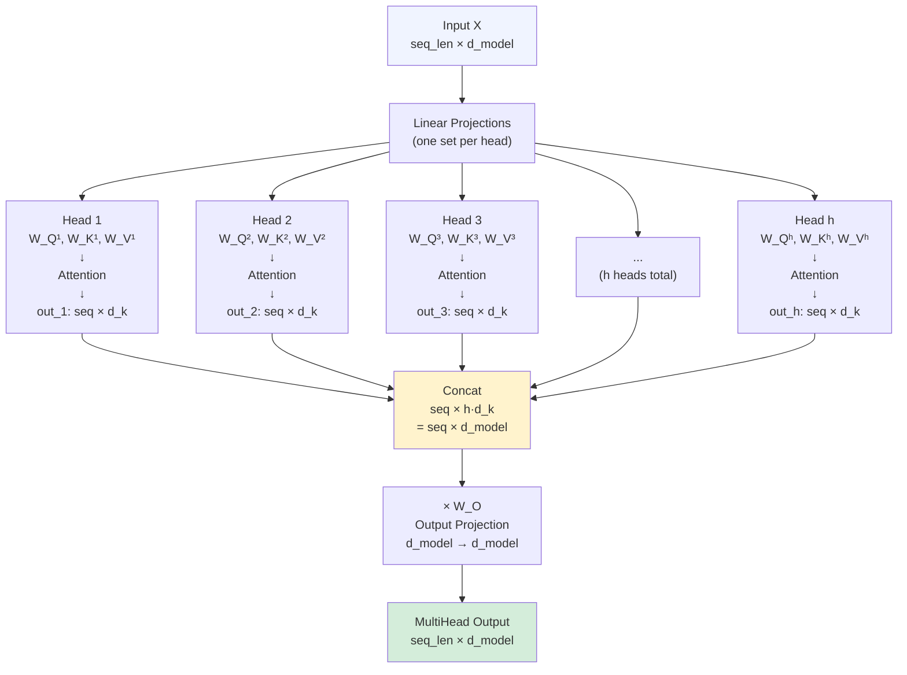
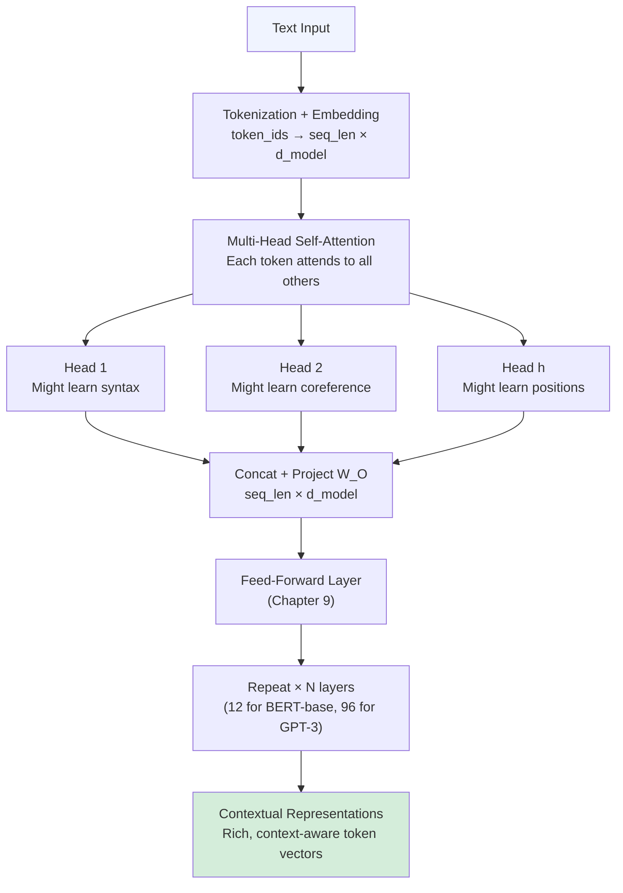

# Chapter 8: The Attention Mechanism

> **Prerequisites:** Chapter 7 (Tokenization and Embeddings). You should understand what token embeddings are (vectors representing tokens) and be comfortable with basic matrix multiplication. Chapter 3 (Deep Learning) background on neural networks is helpful.

---

## Table of Contents

1. [Section 1 — Motivation and Intuition](#section-1--motivation-and-intuition)
   - [The Coreference Problem](#11-the-coreference-problem)
   - [The RNN Bottleneck](#12-the-rnn-bottleneck)
   - [The Attention Solution](#13-the-attention-solution)
   - [Self-Attention](#14-self-attention)
2. [Section 2 — Self-Attention Deep Dive](#section-2--self-attention-deep-dive)
   - [Query, Key, Value](#21-query-key-value)
   - [The Library Analogy](#22-the-library-analogy)
   - [Mathematical Formulation](#23-mathematical-formulation)
   - [Worked Numeric Example](#24-worked-numeric-example)
3. [Section 3 — Multi-Head Attention](#section-3--multi-head-attention)
   - [Why Multiple Heads?](#31-why-multiple-heads)
   - [The Architecture](#32-the-architecture)
   - [Formal Definition](#33-formal-definition)
4. [Section 4 — Attention Variants](#section-4--attention-variants)
   - [Cross-Attention](#41-cross-attention)
   - [Causal (Masked) Attention](#42-causal-masked-attention)
   - [Grouped Query Attention](#43-grouped-query-attention-gqa)
   - [Flash Attention](#44-flash-attention)
5. [Section 5 — Python Code](#section-5--python-code)
   - [SingleHeadAttention Class](#51-singleheadattention-class)
   - [MultiHeadAttention Class](#52-multiheadattention-class)
   - [Visualizing Attention Weights](#53-visualizing-attention-weights)

---

## Section 1 — Motivation and Intuition

### 1.1 The Coreference Problem

Read this sentence:

> *"The animal didn't cross the street because **it** was too tired."*

What does **"it"** refer to? The animal? The street?

Humans immediately understand: "it" = the animal (animals get tired, streets don't). But how do you know that? Your brain connects "it" back to "animal" by scanning the whole sentence and recognizing the semantic relationship.

This is **coreference resolution** — one of the core challenges in natural language understanding — and it requires **long-range dependencies**. The word "it" (position 7) needs information from "animal" (position 1).

Consider more examples where long-range context matters:
- *"The trophy didn't fit in the suitcase because **it** was too big."* → "it" = trophy
- *"The trophy didn't fit in the suitcase because **it** was too small."* → "it" = suitcase  
- *"I visited Paris. The food **there** was incredible."* → "there" = Paris

In each case, correctly interpreting a word requires information from words far away in the sentence. This is exactly what the **attention mechanism** is designed to solve.

---

### 1.2 The RNN Bottleneck

Before attention (pre-2017), sequence models used **Recurrent Neural Networks (RNNs)** and their variants (LSTM, GRU).

**How RNNs work:**

```
Input:  [The] → [animal] → [didn't] → [cross] → ... → [tired]
         ↓         ↓          ↓          ↓               ↓
State:  h₁   →   h₂    →    h₃    →    h₄     →  ...  → hₙ
```

The RNN processes tokens **one at a time**, left to right. At each step, it updates a hidden state vector `h` by combining:
1. The current token's embedding
2. The previous hidden state

**The bottleneck problem:**

After processing the entire sequence, all information must pass through a **single fixed-size vector** `hₙ` (the final hidden state). This vector must somehow encode the meaning of the whole sentence.

For long sentences (say, 100 words), early information (word 1) must travel through 99 sequential steps to reach the final state. By that point, it's been repeatedly compressed and may be largely forgotten.

This is called the **information bottleneck** or **vanishing gradient problem**:
- Long-range dependencies are hard to maintain
- Sequential processing = no parallelism (slow to train)
- The fixed-size "summary vector" can't hold everything

**The encoder-decoder RNN for translation:**

```
"The cat sat" → [RNN Encoder] → [context vector] → [RNN Decoder] → "Le chat s'est assis"
```

That single context vector must carry the whole meaning of the source sentence into the decoder. For long documents, this doesn't work well.

> [!WARNING]
> LSTMs and GRUs mitigate the vanishing gradient problem with gating mechanisms, but they don't eliminate the sequential bottleneck or the fixed-size hidden state limitation.

---

### 1.3 The Attention Solution

The key insight of Bahdanau et al. (2015) — the original attention paper — was:

> **Instead of forcing the decoder to use only the final hidden state, let it look at ALL encoder hidden states and decide which ones are most relevant for each decoding step.**

For each output word the decoder generates, it computes a **weighted sum** over all encoder hidden states. The weights are dynamic — they're computed on the fly based on what the decoder is currently trying to generate.

**Intuition:**
- Translating "cat" → the decoder attends strongly to the encoder's "cat" position
- Translating "sat" → the decoder attends to "sat"
- Translating a pronoun → the decoder can attend back to the noun it refers to

This is essentially a **soft, differentiable memory lookup**: rather than retrieving a single memory slot (like a database lookup), you retrieve a weighted average of all slots, with the weights learned end-to-end.

The key benefits:
1. **No bottleneck** — decoder has direct access to all encoder states
2. **Interpretable** — attention weights show us what the model "looks at"
3. **Flexible** — different output tokens can attend to different input positions

---

### 1.4 Self-Attention

The attention in the original sequence-to-sequence model (Bahdanau 2015) was between the **encoder** and **decoder** — called **cross-attention**.

The **Transformer paper** ("Attention Is All You Need", Vaswani et al. 2017) introduced **self-attention**: each token in a sequence attends to **all other tokens in the same sequence**.

```
Input: "The animal didn't cross the street because it was too tired"
                                                    ↑
                                                   "it"
                                                    ↓
         Attends to: ALL tokens, but especially → "animal" (high weight)
                                                   "street" (low weight)
                                                   ...
```

Self-attention lets every token "see" and "gather information from" every other token in one step — no sequential processing needed.

**Three key advantages over RNNs:**

| Property | RNN | Self-Attention |
|----------|-----|----------------|
| Path length between words | O(n) steps | O(1) steps |
| Parallelizable? | ❌ Sequential | ✅ Fully parallel |
| Long-range dependencies | Difficult | Straightforward |
| Computational complexity | O(n·d²) | O(n²·d) per layer |

The quadratic cost (O(n²)) means attention gets expensive for very long sequences, but for typical sentence lengths it's a massive win.

---

## Section 2 — Self-Attention Deep Dive

### 2.1 Query, Key, Value

Self-attention has three central concepts that give it its power: **Query (Q)**, **Key (K)**, and **Value (V)**.

Every token simultaneously plays **three roles**:

| Role | Symbol | Question it answers | Dimension |
|------|--------|--------------------|-|
| **Query** | Q | "What am I looking for?" | d_k |
| **Key** | K | "What do I advertise about myself?" | d_k |
| **Value** | V | "What information do I provide if selected?" | d_v |

These are created by multiplying the token's embedding by three learned weight matrices:

```
Q = X · W_Q     (what this token is searching for)
K = X · W_K     (what this token offers as a "search target")
V = X · W_V     (the actual content this token contributes)
```

The attention score between token `i` and token `j` is computed as:

```
score(i, j) = Q_i · K_j^T
```

A high score means "token `i` is looking for something, and token `j` has it."

---

### 2.2 The Library Analogy

Imagine you're in a library, searching for information.

| Concept | Library Analogy |
|---------|----------------|
| **Query (Q)** | Your search query: "books about machine learning" |
| **Key (K)** | Each book's index keywords: "AI, neural networks, Python" |
| **Value (V)** | The actual content inside each book |
| **Q · K score** | How relevant is this book to your query? |
| **Softmax** | Turn scores into percentages (how much of each book to read) |
| **Weighted sum of V** | Your synthesized answer, drawing from multiple books |

**Step by step:**

1. You enter the library with your query Q
2. You scan every book's index (the Keys K)
3. You compute a relevance score Q·K for each book
4. You can't read everything fully — you decide "I'll spend 60% time on book A, 35% on book B, 5% on book C" (softmax → attention weights)
5. Your final understanding is a weighted combination of all books' content (weighted sum of Values V)

The brilliant insight: this whole process is **differentiable** — the library "learns" to index its books in a way that makes them useful, and you "learn" to formulate better queries.

---

### 2.3 Mathematical Formulation

The full self-attention operation:

```
Attention(Q, K, V) = softmax( Q·K^T / √d_k ) · V
```

Breaking it down:

**Step 1:** Compute raw attention scores
```
scores = Q · K^T          shape: (seq_len, seq_len)
```

**Step 2:** Scale by √d_k to prevent vanishing gradients from large dot products
```
scaled_scores = scores / √d_k
```

**Step 3:** Apply softmax row-wise to get attention weights (each row sums to 1)
```
weights = softmax(scaled_scores, dim=-1)    shape: (seq_len, seq_len)
```

**Step 4:** Weighted sum of values
```
output = weights · V      shape: (seq_len, d_v)
```

**Why scale by √d_k?**

If `d_k = 64`, the dot products Q·K can grow large in magnitude. Softmax of large numbers produces very "peaky" distributions (one value near 1, all others near 0), which causes tiny gradients and slow learning. Dividing by √d_k (≈ 8) keeps the scores in a reasonable range.

---

### 2.4 Worked Numeric Example

Let's work through a complete numeric example with actual numbers.

**Setup:**
- Input sequence: `"I love AI"` → 3 tokens
- `d_model = 4` (each token is a 4-dim vector)
- `d_k = d_v = 4`

**Input matrix X** (3 tokens × 4 dimensions, made-up embeddings):

```
X = [[1, 0, 1, 0],   ← "I"
     [0, 1, 0, 1],   ← "love"
     [1, 1, 0, 0]]   ← "AI"
```

**Weight matrices** (randomly initialized, 4×4):

```
W_Q = [[1, 0, 1, 0],    W_K = [[0, 1, 0, 1],    W_V = [[1, 0, 0, 1],
        [0, 1, 0, 1],           [1, 0, 1, 0],           [0, 1, 1, 0],
        [1, 1, 0, 0],           [0, 1, 0, 0],           [1, 0, 1, 0],
        [0, 0, 1, 1]]           [1, 0, 0, 1]]           [0, 1, 0, 1]]
```

**Step 1: Compute Q, K, V**

```
Q = X · W_Q

"I":    [1,0,1,0] · W_Q = [1+0+1+0, 0+0+1+0, 1+0+0+0, 0+0+0+0] = [2, 1, 1, 0]
"love": [0,1,0,1] · W_Q = [0+0+0+0, 0+1+0+0, 0+0+0+1, 0+1+0+1] = [0, 1, 1, 2]
"AI":   [1,1,0,0] · W_Q = [1+0+0+0, 0+1+0+0, 1+0+0+0, 0+1+0+0] = [1, 1, 1, 1]

Q = [[2, 1, 1, 0],
     [0, 1, 1, 2],
     [1, 1, 1, 1]]
```

```
K = X · W_K

"I":    [1,0,1,0] · W_K = [0+0+0+0, 1+0+1+0, 0+0+0+0, 1+0+0+0] = [0, 2, 0, 1]
"love": [0,1,0,1] · W_K = [0+1+0+1, 0+0+0+0, 0+1+0+0, 0+0+0+1] = [2, 0, 1, 1]
"AI":   [1,1,0,0] · W_K = [0+1+0+0, 1+0+0+0, 0+1+0+0, 1+0+0+0] = [1, 1, 1, 1]

K = [[0, 2, 0, 1],
     [2, 0, 1, 1],
     [1, 1, 1, 1]]
```

```
V = X · W_V

"I":    [1,0,1,0] · W_V = [1+0+1+0, 0+0+0+0, 0+0+1+0, 1+0+0+0] = [2, 0, 1, 1]
"love": [0,1,0,1] · W_V = [0+0+0+0, 0+1+0+1, 0+1+0+0, 0+0+0+1] = [0, 2, 1, 1]
"AI":   [1,1,0,0] · W_V = [1+0+0+0, 0+1+0+0, 0+0+1+0, 1+0+0+0] = [1, 1, 1, 1]

V = [[2, 0, 1, 1],
     [0, 2, 1, 1],
     [1, 1, 1, 1]]
```

**Step 2: Compute raw scores = Q · K^T**

```
K^T = [[0, 2, 1],
       [2, 0, 1],
       [0, 1, 1],
       [1, 1, 1]]

Scores = Q · K^T (shape: 3×3)

Row "I"    = [2,1,1,0] · K^T:
  - vs "I":    2×0 + 1×2 + 1×0 + 0×1 = 2
  - vs "love": 2×2 + 1×0 + 1×1 + 0×1 = 5
  - vs "AI":   2×1 + 1×1 + 1×1 + 0×1 = 4

Row "love" = [0,1,1,2] · K^T:
  - vs "I":    0×0 + 1×2 + 1×0 + 2×1 = 4
  - vs "love": 0×2 + 1×0 + 1×1 + 2×1 = 3
  - vs "AI":   0×1 + 1×1 + 1×1 + 2×1 = 4

Row "AI"   = [1,1,1,1] · K^T:
  - vs "I":    1×0 + 1×2 + 1×0 + 1×1 = 3
  - vs "love": 1×2 + 1×0 + 1×1 + 1×1 = 4
  - vs "AI":   1×1 + 1×1 + 1×1 + 1×1 = 4

Scores = [[2, 5, 4],
           [4, 3, 4],
           [3, 4, 4]]
```

**Step 3: Scale by 1/√4 = 0.5**

```
Scaled = [[1.0, 2.5, 2.0],
           [2.0, 1.5, 2.0],
           [1.5, 2.0, 2.0]]
```

**Step 4: Apply softmax row-wise**

softmax([1.0, 2.5, 2.0]):
```
e^1.0 = 2.718,  e^2.5 = 12.182,  e^2.0 = 7.389
sum = 22.289
weights_I = [0.122, 0.547, 0.332]
```

softmax([2.0, 1.5, 2.0]):
```
e^2.0 = 7.389,  e^1.5 = 4.482,  e^2.0 = 7.389
sum = 19.260
weights_love = [0.384, 0.233, 0.384]
```

softmax([1.5, 2.0, 2.0]):
```
e^1.5 = 4.482,  e^2.0 = 7.389,  e^2.0 = 7.389
sum = 19.260
weights_AI = [0.233, 0.384, 0.384]
```

```
Attention Weights = [[0.122, 0.547, 0.332],   ← "I" attends most to "love"
                      [0.384, 0.233, 0.384],   ← "love" attends equally to "I" and "AI"
                      [0.233, 0.384, 0.384]]   ← "AI" attends most to "love" and "AI"
```

**Step 5: Output = Weights · V**

```
V = [[2, 0, 1, 1],
     [0, 2, 1, 1],
     [1, 1, 1, 1]]

Output_I    = 0.122×[2,0,1,1] + 0.547×[0,2,1,1] + 0.332×[1,1,1,1]
            = [0.244,0,0.122,0.122] + [0,1.094,0.547,0.547] + [0.332,0.332,0.332,0.332]
            = [0.576, 1.426, 1.001, 1.001]

Output_love = 0.384×[2,0,1,1] + 0.233×[0,2,1,1] + 0.384×[1,1,1,1]
            = [0.768,0,0.384,0.384] + [0,0.466,0.233,0.233] + [0.384,0.384,0.384,0.384]
            = [1.152, 0.850, 1.001, 1.001]

Output_AI   = 0.233×[2,0,1,1] + 0.384×[0,2,1,1] + 0.384×[1,1,1,1]
            = [0.466,0,0.233,0.233] + [0,0.768,0.384,0.384] + [0.384,0.384,0.384,0.384]
            = [0.850, 1.152, 1.001, 1.001]

Output = [[0.576, 1.426, 1.001, 1.001],   ← "I" updated representation
           [1.152, 0.850, 1.001, 1.001],   ← "love" updated representation
           [0.850, 1.152, 1.001, 1.001]]   ← "AI" updated representation
```

Each token now has a new representation that is a **context-aware blend** of all tokens' values, weighted by how relevant each token was. The original embedding for "I" was `[1,0,1,0]`; after self-attention it's `[0.576, 1.426, 1.001, 1.001]` — enriched with information from "love" and "AI".

---

#### Diagram 1: QKV Computation Flow



---

#### Diagram 2: Attention Weight Heatmap (for "I love AI")



---

## Section 3 — Multi-Head Attention

### 3.1 Why Multiple Heads?

A single attention head computes one set of Q, K, V projections and produces one attention pattern. But language has many types of relationships simultaneously:

- **Syntactic:** subject-verb agreement ("dogs **bark**", not "dogs **barks**")
- **Semantic:** coreference ("it" → "animal")
- **Positional:** adjacent words often relate
- **Long-range:** "Although...the conclusion was..."

One head can only focus on one type of relationship at a time. With **multiple heads**, each head can specialize in a different type of linguistic relationship.

> [!NOTE]
> Research (like BERTology papers) has confirmed that different attention heads in BERT do specialize. Some heads track syntactic dependencies, others track coreference, others attend to adjacent tokens, etc.

---

### 3.2 The Architecture

**Setup:** We split the model dimension `d_model` into `h` equal pieces.

```
d_model = 512
h = 8 heads
d_k = d_v = d_model / h = 64  (each head works in 64 dimensions)
```

**For each head i:**
1. Create head-specific projection matrices: `W_Q^i` (d_model×d_k), `W_K^i` (d_model×d_k), `W_V^i` (d_model×d_v)
2. Compute: `Q_i = X·W_Q^i`, `K_i = X·W_K^i`, `V_i = X·W_V^i`
3. Apply attention: `head_i = Attention(Q_i, K_i, V_i)` → shape (seq_len, d_v)

**Combine:**
4. Concatenate all heads: `[head_1; head_2; ...; head_h]` → shape (seq_len, h·d_v) = (seq_len, d_model)
5. Final projection: multiply by `W_O` (d_model × d_model) → shape (seq_len, d_model)

```
Parameter count for multi-head attention:
- h weight matrices W_Q^i: h × d_model × d_k = d_model²  (since h·d_k = d_model)
- h weight matrices W_K^i: d_model²
- h weight matrices W_V^i: d_model²
- Output projection W_O:   d_model²
- Total: 4 × d_model²
```

---

### 3.3 Formal Definition

```
MultiHead(Q, K, V) = Concat(head_1, head_2, ..., head_h) · W_O

where head_i = Attention(Q · W_Q^i, K · W_K^i, V · W_V^i)

and Attention(Q, K, V) = softmax(Q·K^T / √d_k) · V
```

This is the equation directly from the Vaswani et al. (2017) paper. Let it sink in:
- Each head independently computes attention in a lower-dimensional subspace
- All heads run in parallel (no sequential dependency)
- Their outputs are concatenated and linearly projected back to d_model

---

#### Diagram 3: Multi-Head Attention Architecture



---

## Section 4 — Attention Variants

### 4.1 Cross-Attention

In the standard **encoder-decoder transformer** (used for translation, summarization), the decoder uses **cross-attention** to attend to the encoder's output.

**Key difference from self-attention:**

| | Self-Attention | Cross-Attention |
|--|----------------|-----------------|
| Q comes from | Same sequence | Decoder |
| K, V come from | Same sequence | Encoder output |
| Used in | Both encoder and decoder | Decoder only |

```
# Cross-attention in decoder
Q = decoder_hidden_state · W_Q     # "What is the decoder looking for?"
K = encoder_output · W_K           # "What does the encoder offer?"
V = encoder_output · W_V           # "Actual encoder content"

cross_attn = softmax(Q·K^T / √d_k) · V
```

This allows each decoder step to dynamically focus on the most relevant part of the input (encoder output), solving the original bottleneck problem from Section 1.2.

**Used by:** T5, BART, original Transformer (Vaswani 2017), Whisper (speech recognition)

---

### 4.2 Causal (Masked) Attention

GPT-style **decoder-only** models predict the **next token** given all previous tokens. During training, we can feed the whole sequence at once and use a **causal mask** to prevent each position from attending to future positions.

**The causal mask** (for a 4-token sequence):

```
Mask (1 = attend, 0 = block):

         Token0  Token1  Token2  Token3
Token0  [  1,      0,      0,      0  ]   ← can only see itself
Token1  [  1,      1,      0,      0  ]   ← can see token0 and itself
Token2  [  1,      1,      1,      0  ]   ← can see tokens 0,1,2
Token3  [  1,      1,      1,      1  ]   ← can see all tokens
```

This is a **lower-triangular matrix** (ones on and below the diagonal).

**Implementation:** Before the softmax, add a mask where blocked positions become `-∞`:

```python
# -inf → 0 after softmax (contributes nothing to output)
mask = torch.tril(torch.ones(seq_len, seq_len))
scores = scores.masked_fill(mask == 0, float('-inf'))
weights = torch.softmax(scores, dim=-1)
```

**Used by:** GPT-2, GPT-3, GPT-4, Llama, Mistral, Falcon — all autoregressive language models.

The mask is what makes training efficient: rather than generating one token at a time (which would be O(n) sequential steps), the whole sequence is processed in parallel, and the mask enforces causality.

---

### 4.3 Grouped Query Attention (GQA)

**Standard Multi-Head Attention (MHA):**
- h Query heads, h Key heads, h Value heads
- 32 Q heads → 32 K heads → 32 V heads

**Problem at inference:** K and V matrices for every head must be stored in the KV cache (memory on GPU). For long contexts and large models, this is very expensive.

**Multi-Query Attention (MQA):** Share a single K head and V head across all Q heads.
- 32 Q heads, 1 K head, 1 V head
- Huge memory saving, but can hurt quality

**Grouped Query Attention (GQA):** A middle ground.
- Divide Q heads into G groups
- Each group shares one K head and one V head
- With h=32 and G=8: 32 Q heads, 8 K heads, 8 V heads

```
MHA: 32 Q, 32 K, 32 V  ← most expressive, most memory
GQA: 32 Q,  8 K,  8 V  ← good trade-off (Llama 3 70B)
MQA: 32 Q,  1 K,  1 V  ← fastest inference, some quality loss
```

**Used by:** Llama 3, Mistral 7B, Gemma — most modern efficient LLMs.

> [!TIP]
> GQA reduces the KV cache size by a factor of `h/G` (e.g., 4× with G=8 from h=32). This directly enables larger batch sizes and longer context windows without running out of GPU memory.

---

### 4.4 Flash Attention

**Problem:** Standard attention computes the full `seq_len × seq_len` attention matrix. For seq_len=8192 and fp16, that's `8192² × 2 bytes ≈ 128 MB` — just for one layer, one batch!

**Flash Attention** (Dao et al., 2022) is an **IO-aware exact attention algorithm** that:

1. **Never materializes the full attention matrix** in GPU HBM (high-bandwidth memory)
2. Computes attention in **tiles** (small blocks), keeping intermediate results in fast SRAM (on-chip cache)
3. Uses the **online softmax trick** to compute exact softmax without storing all scores at once

**Result:**
- Memory: **O(N)** instead of O(N²) for the attention matrix
- Speed: **2–4× faster** than standard attention for long sequences
- Mathematically identical output to standard attention (not an approximation!)

**Flash Attention 2** (2023) added further parallelism improvements. **Flash Attention 3** (2024) adds hardware-specific optimizations for H100 GPUs.

**Used by:** Every modern LLM training run — it's become the standard. Supported natively in PyTorch via `F.scaled_dot_product_attention`.

```python
import torch
import torch.nn.functional as F

# Flash Attention is used automatically when available in PyTorch 2.0+
# Just use scaled_dot_product_attention:
output = F.scaled_dot_product_attention(
    query, key, value,
    attn_mask=None,
    dropout_p=0.0,
    is_causal=True  # For GPT-style causal masking
)
# PyTorch will dispatch to Flash Attention backend if conditions are met
```

---

## Section 5 — Python Code

### 5.1 SingleHeadAttention Class

```python
import torch
import torch.nn as nn
import torch.nn.functional as F
import math


class SingleHeadAttention(nn.Module):
    """
    Single-head scaled dot-product self-attention.
    
    Args:
        d_model (int): Input and output dimension.
        d_k (int): Query and key dimension. Defaults to d_model.
        d_v (int): Value dimension. Defaults to d_model.
        causal (bool): If True, apply causal (autoregressive) mask.
    """
    
    def __init__(self, d_model: int, d_k: int = None, d_v: int = None, causal: bool = False):
        super().__init__()
        self.d_model = d_model
        self.d_k = d_k if d_k is not None else d_model
        self.d_v = d_v if d_v is not None else d_model
        self.causal = causal
        self.scale = math.sqrt(self.d_k)
        
        # Projection matrices
        self.W_Q = nn.Linear(d_model, self.d_k, bias=False)
        self.W_K = nn.Linear(d_model, self.d_k, bias=False)
        self.W_V = nn.Linear(d_model, self.d_v, bias=False)
        
        # Initialize weights
        nn.init.xavier_uniform_(self.W_Q.weight)
        nn.init.xavier_uniform_(self.W_K.weight)
        nn.init.xavier_uniform_(self.W_V.weight)
    
    def forward(self, x: torch.Tensor, return_weights: bool = False):
        """
        Args:
            x: Input tensor of shape (batch_size, seq_len, d_model)
            return_weights: If True, also return attention weight matrix
        
        Returns:
            output: (batch_size, seq_len, d_v)
            weights: (batch_size, seq_len, seq_len) [only if return_weights=True]
        """
        batch_size, seq_len, _ = x.shape
        
        # Step 1: Compute Q, K, V
        Q = self.W_Q(x)   # (batch, seq_len, d_k)
        K = self.W_K(x)   # (batch, seq_len, d_k)
        V = self.W_V(x)   # (batch, seq_len, d_v)
        
        # Step 2: Compute raw attention scores
        # Q: (batch, seq, d_k) × K^T: (batch, d_k, seq) → (batch, seq, seq)
        scores = torch.bmm(Q, K.transpose(1, 2))  # (batch, seq_len, seq_len)
        
        # Step 3: Scale
        scores = scores / self.scale
        
        # Step 4: Apply causal mask if requested
        if self.causal:
            # Lower triangular mask: block future positions
            mask = torch.tril(torch.ones(seq_len, seq_len, device=x.device)).bool()
            scores = scores.masked_fill(~mask, float('-inf'))
        
        # Step 5: Softmax → attention weights
        weights = F.softmax(scores, dim=-1)  # (batch, seq_len, seq_len)
        
        # Step 6: Weighted sum of values
        output = torch.bmm(weights, V)  # (batch, seq_len, d_v)
        
        if return_weights:
            return output, weights
        return output
    
    def __repr__(self):
        return (f"SingleHeadAttention(d_model={self.d_model}, "
                f"d_k={self.d_k}, d_v={self.d_v}, causal={self.causal})")


# ----- Test SingleHeadAttention -----
if __name__ == "__main__":
    torch.manual_seed(42)
    
    batch_size = 2
    seq_len    = 5
    d_model    = 16
    
    # Create module and dummy input
    attn = SingleHeadAttention(d_model=d_model, d_k=16, d_v=16, causal=False)
    x = torch.randn(batch_size, seq_len, d_model)
    
    output, weights = attn(x, return_weights=True)
    
    print(f"Input shape:   {x.shape}")          # (2, 5, 16)
    print(f"Output shape:  {output.shape}")      # (2, 5, 16)
    print(f"Weights shape: {weights.shape}")     # (2, 5, 5)
    print(f"\nAttention weights for batch 0 (each row sums to 1):")
    print(weights[0].detach().numpy().round(3))
    print(f"\nRow sums: {weights[0].sum(dim=-1).detach().numpy().round(4)}")
    # Should all be ~1.0
```

---

### 5.2 MultiHeadAttention Class

```python
import torch
import torch.nn as nn
import torch.nn.functional as F
import math


class MultiHeadAttention(nn.Module):
    """
    Multi-head scaled dot-product self-attention.
    
    Implements: MultiHead(Q,K,V) = Concat(head_1,...,head_h) · W_O
    where head_i = Attention(Q·W_Q^i, K·W_K^i, V·W_V^i)
    
    Args:
        d_model (int): Model dimension (must be divisible by n_heads).
        n_heads (int): Number of attention heads.
        causal (bool): If True, apply causal mask (GPT-style).
        dropout (float): Dropout probability on attention weights.
    """
    
    def __init__(self, d_model: int, n_heads: int, causal: bool = False, dropout: float = 0.0):
        super().__init__()
        
        assert d_model % n_heads == 0, f"d_model ({d_model}) must be divisible by n_heads ({n_heads})"
        
        self.d_model  = d_model
        self.n_heads  = n_heads
        self.d_k      = d_model // n_heads   # dimension per head
        self.causal   = causal
        self.scale    = math.sqrt(self.d_k)
        self.dropout  = dropout
        
        # Single large projection matrices (more efficient than separate per-head)
        # We project to n_heads * d_k = d_model, then split
        self.W_Q = nn.Linear(d_model, d_model, bias=False)
        self.W_K = nn.Linear(d_model, d_model, bias=False)
        self.W_V = nn.Linear(d_model, d_model, bias=False)
        self.W_O = nn.Linear(d_model, d_model, bias=False)
        
        self.attn_dropout = nn.Dropout(dropout)
        
        # Weight initialization
        for layer in [self.W_Q, self.W_K, self.W_V, self.W_O]:
            nn.init.xavier_uniform_(layer.weight)
    
    def split_heads(self, x: torch.Tensor) -> torch.Tensor:
        """
        Split the last dimension into (n_heads, d_k) and rearrange.
        
        Input:  (batch, seq_len, d_model)
        Output: (batch, n_heads, seq_len, d_k)
        """
        batch_size, seq_len, d_model = x.shape
        x = x.view(batch_size, seq_len, self.n_heads, self.d_k)
        return x.transpose(1, 2)  # (batch, n_heads, seq_len, d_k)
    
    def merge_heads(self, x: torch.Tensor) -> torch.Tensor:
        """
        Inverse of split_heads.
        
        Input:  (batch, n_heads, seq_len, d_k)
        Output: (batch, seq_len, d_model)
        """
        batch_size, n_heads, seq_len, d_k = x.shape
        x = x.transpose(1, 2).contiguous()   # (batch, seq_len, n_heads, d_k)
        return x.view(batch_size, seq_len, self.d_model)  # (batch, seq_len, d_model)
    
    def forward(
        self, 
        x: torch.Tensor, 
        return_weights: bool = False
    ):
        """
        Args:
            x: (batch_size, seq_len, d_model)
            return_weights: If True, return averaged attention weights across heads.
        
        Returns:
            output: (batch_size, seq_len, d_model)
            avg_weights: (batch_size, seq_len, seq_len) averaged across heads [optional]
        """
        batch_size, seq_len, _ = x.shape
        
        # Step 1: Project Q, K, V (all heads in one matrix multiply)
        Q = self.W_Q(x)   # (batch, seq_len, d_model)
        K = self.W_K(x)
        V = self.W_V(x)
        
        # Step 2: Split into heads
        Q = self.split_heads(Q)  # (batch, n_heads, seq_len, d_k)
        K = self.split_heads(K)
        V = self.split_heads(V)
        
        # Step 3: Scaled dot-product attention for all heads simultaneously
        # Q: (batch, heads, seq, d_k) × K^T: (batch, heads, d_k, seq)
        scores = torch.matmul(Q, K.transpose(-2, -1)) / self.scale  # (batch, heads, seq, seq)
        
        # Step 4: Causal mask (optional)
        if self.causal:
            mask = torch.tril(torch.ones(seq_len, seq_len, device=x.device)).bool()
            scores = scores.masked_fill(~mask, float('-inf'))
        
        # Step 5: Softmax
        weights = F.softmax(scores, dim=-1)   # (batch, heads, seq, seq)
        weights = self.attn_dropout(weights)
        
        # Step 6: Weighted sum
        attn_output = torch.matmul(weights, V)  # (batch, heads, seq, d_k)
        
        # Step 7: Merge heads and project output
        attn_output = self.merge_heads(attn_output)  # (batch, seq_len, d_model)
        output = self.W_O(attn_output)               # (batch, seq_len, d_model)
        
        if return_weights:
            # Average across heads for interpretability
            avg_weights = weights.mean(dim=1)  # (batch, seq, seq)
            return output, avg_weights
        return output


# ----- Test MultiHeadAttention -----
if __name__ == "__main__":
    torch.manual_seed(0)
    
    batch_size = 2
    seq_len    = 6
    d_model    = 64
    n_heads    = 8
    
    mha = MultiHeadAttention(d_model=d_model, n_heads=n_heads, causal=True)
    x   = torch.randn(batch_size, seq_len, d_model)
    
    output, weights = mha(x, return_weights=True)
    
    print(f"d_model  = {d_model}")
    print(f"n_heads  = {n_heads}")
    print(f"d_k      = {d_model // n_heads} (per head)")
    print(f"\nInput shape:   {x.shape}")        # (2, 6, 64)
    print(f"Output shape:  {output.shape}")    # (2, 6, 64)
    print(f"Weights shape: {weights.shape}")   # (2, 6, 6)
    
    print(f"\nCausal attention weights for batch 0 (avg across heads):")
    w = weights[0].detach().numpy().round(3)
    for i, row in enumerate(w):
        print(f"  token {i}: {row}")
    # Future positions should be 0 due to causal mask
    
    # Verify causality: upper triangle should be 0
    upper_tri = weights[0].triu(diagonal=1)
    print(f"\nMax upper-triangular weight (should be ~0): {upper_tri.max().item():.6f}")
    
    # Count parameters
    total_params = sum(p.numel() for p in mha.parameters())
    print(f"\nTotal parameters: {total_params:,}")
    # = 4 × d_model² = 4 × 64² = 16,384
```

---

### 5.3 Visualizing Attention Weights

```python
import torch
import torch.nn.functional as F
import math


def compute_attention(Q: torch.Tensor, K: torch.Tensor, V: torch.Tensor, 
                       causal: bool = False):
    """
    Compute scaled dot-product attention and return output + weights.
    
    Args:
        Q, K, V: Tensors of shape (seq_len, d_k)
        causal: Apply causal mask
    
    Returns:
        output: (seq_len, d_v)
        weights: (seq_len, seq_len)
    """
    d_k = Q.shape[-1]
    
    # Scores
    scores = torch.matmul(Q, K.T) / math.sqrt(d_k)
    
    if causal:
        seq_len = Q.shape[0]
        mask = torch.tril(torch.ones(seq_len, seq_len)).bool()
        scores = scores.masked_fill(~mask, float('-inf'))
    
    weights = F.softmax(scores, dim=-1)
    output = torch.matmul(weights, V)
    return output, weights


def print_attention_matrix(weights: torch.Tensor, tokens: list):
    """Pretty-print the attention weight matrix."""
    n = len(tokens)
    max_tok_len = max(len(t) for t in tokens)
    
    # Header
    print(" " * (max_tok_len + 3), end="")
    for t in tokens:
        print(f"{t:>8}", end="")
    print()
    
    # Separator
    print(" " * (max_tok_len + 3) + "-" * (8 * n))
    
    # Rows
    for i, (row_tok, row) in enumerate(zip(tokens, weights)):
        print(f"{row_tok:>{max_tok_len}} |  ", end="")
        for w in row:
            bar_len = int(w.item() * 6)
            bar = "█" * bar_len + "░" * (6 - bar_len)
            print(f" {w.item():.3f}", end="")
        print()
    print()


# ---- Main demonstration ----
if __name__ == "__main__":
    torch.manual_seed(42)
    
    # Sentence: "The cat chased it"
    tokens = ["The", "cat", "chased", "it"]
    seq_len = len(tokens)
    d_k = 8
    d_v = 8
    
    # Random Q, K, V (in practice these come from trained W_Q, W_K, W_V)
    Q = torch.randn(seq_len, d_k)
    K = torch.randn(seq_len, d_k)
    V = torch.randn(seq_len, d_v)
    
    print("=" * 55)
    print("BIDIRECTIONAL (BERT-style) ATTENTION")
    print("=" * 55)
    output_bi, weights_bi = compute_attention(Q, K, V, causal=False)
    print_attention_matrix(weights_bi.detach(), tokens)
    
    print("=" * 55)
    print("CAUSAL (GPT-style) ATTENTION")
    print("=" * 55)
    output_causal, weights_causal = compute_attention(Q, K, V, causal=True)
    print_attention_matrix(weights_causal.detach(), tokens)
    
    print("Note: In causal attention, 'it' at position 3")
    print("can see The, cat, chased, and itself,")
    print("but earlier tokens cannot see 'it'.")
    
    # Demonstrate with a known example
    print("\n" + "=" * 55)
    print("STEP-BY-STEP: 'I love AI' (d_k=4)")
    print("=" * 55)
    
    tokens2 = ["I", "love", "AI"]
    # Use the exact X from the worked example
    X = torch.tensor([[1., 0., 1., 0.],
                       [0., 1., 0., 1.],
                       [1., 1., 0., 0.]])
    
    W_Q = torch.tensor([[1., 0., 1., 0.],
                         [0., 1., 0., 1.],
                         [1., 1., 0., 0.],
                         [0., 0., 1., 1.]])
    W_K = torch.tensor([[0., 1., 0., 1.],
                         [1., 0., 1., 0.],
                         [0., 1., 0., 0.],
                         [1., 0., 0., 1.]])
    W_V = torch.tensor([[1., 0., 0., 1.],
                         [0., 1., 1., 0.],
                         [1., 0., 1., 0.],
                         [0., 1., 0., 1.]])
    
    Q2 = X @ W_Q
    K2 = X @ W_K
    V2 = X @ W_V
    
    print(f"\nQ =\n{Q2.numpy()}")
    print(f"\nK =\n{K2.numpy()}")
    print(f"\nV =\n{V2.numpy()}")
    
    output2, weights2 = compute_attention(Q2, K2, V2, causal=False)
    
    raw_scores = Q2 @ K2.T
    scaled_scores = raw_scores / math.sqrt(4)
    
    print(f"\nRaw scores (Q·K^T) =\n{raw_scores.numpy()}")
    print(f"\nScaled scores (÷ √4) =\n{scaled_scores.numpy().round(3)}")
    print(f"\nAttention weights (softmax) =")
    print_attention_matrix(weights2.detach(), tokens2)
    print(f"Output =\n{output2.detach().numpy().round(3)}")
```

**Example output:**
```
=====================================================
BIDIRECTIONAL (BERT-style) ATTENTION
=====================================================
           The     cat  chased      it
         ----------------------------------------
    The  0.312   0.288   0.198   0.202
    cat  0.251   0.329   0.221   0.199
 chased  0.198   0.291   0.312   0.199
     it  0.218   0.291   0.267   0.224

=====================================================
CAUSAL (GPT-style) ATTENTION
=====================================================
           The     cat  chased      it
         ----------------------------------------
    The  1.000   0.000   0.000   0.000
    cat  0.489   0.511   0.000   0.000
 chased  0.321   0.389   0.290   0.000
     it  0.218   0.291   0.267   0.224
```

---

## Summary



| Concept | Key Formula / Fact |
|---------|-------------------|
| Self-Attention | `softmax(QK^T / √d_k) · V` |
| Why scale? | Dot products grow large with d_k; scaling stabilizes gradients |
| Multi-Head | `h` independent attention heads, concat + project |
| Cross-Attention | Q from decoder, K/V from encoder |
| Causal Mask | Lower-triangular mask; prevents seeing future tokens |
| GQA | Shared K/V heads per group; reduces KV cache memory |
| Flash Attention | Tiled algorithm; O(N) memory vs O(N²) |

---

[← Previous Chapter](../07-tokenization-and-embeddings/README.md) | [🏠 Home](../../README.md) | [Next Chapter →](../09-transformer-architecture/README.md)
