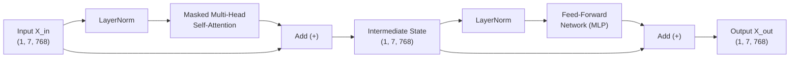
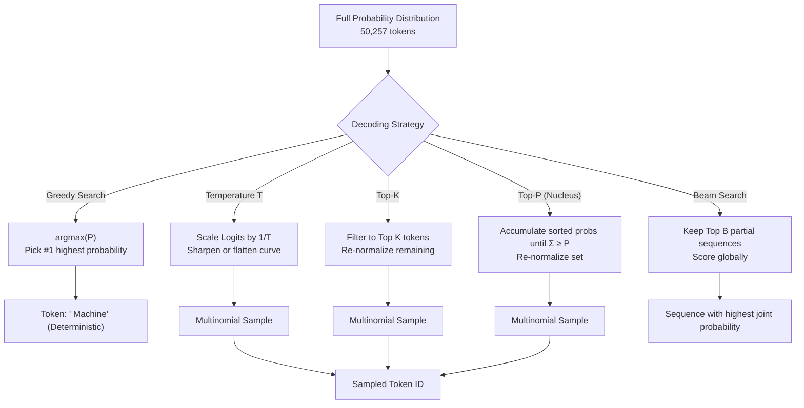
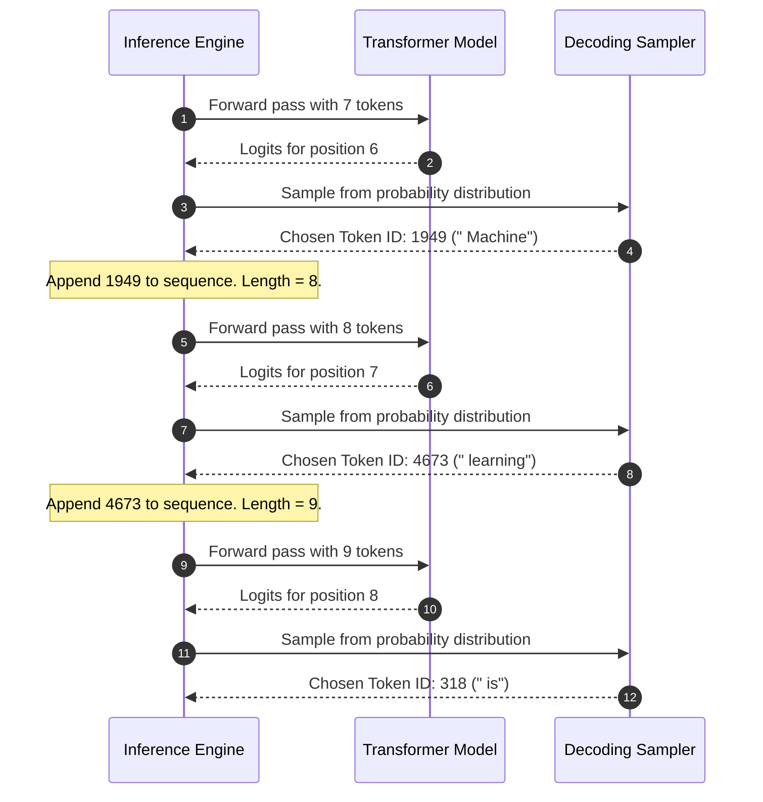

# Chapter 9: How LLMs Work — An End-to-End Inference Walkthrough

> **Prerequisites:** Chapter 5 (Understanding LLMs), Chapter 6 (Transformer Architecture), Chapter 7 (Tokenization & Embeddings), Chapter 8 (Attention Mechanism). You should understand token embeddings, self-attention, and feed-forward layers.

---

## Table of Contents

1. [Introduction: The Life of a Query](#1-introduction-the-life-of-a-query)
2. [High-Level Architecture & End-to-End Pipeline](#2-high-level-architecture--end-to-end-pipeline)
3. [Stage 1: User Types Query](#3-stage-1-user-types-query)
4. [Stage 2: Tokenization (BPE Breakdown)](#4-stage-2-tokenization-bpe-breakdown)
5. [Stage 3: Token IDs Mapping](#5-stage-3-token-ids-mapping)
6. [Stage 4: Embedding Table Lookup](#6-stage-4-embedding-table-lookup)
7. [Stage 5: Injecting Positional Encodings](#7-stage-5-injecting-positional-encodings)
8. [Stage 6: Passing Through N Transformer Layers](#8-stage-6-passing-through-n-transformer-layers)
9. [Stage 7: Final Hidden State & Unembedding (LM Head)](#9-stage-7-final-hidden-state--unembedding-lm-head)
10. [Stage 8: Softmax & Probability Distribution](#10-stage-8-softmax--probability-distribution)
11. [Stage 9: Decoding Strategies & Sampling](#11-stage-9-decoding-strategies--sampling)
    - [Greedy Search (Argmax)](#greedy-search-argmax)
    - [Temperature Scaling](#temperature-scaling)
    - [Top-K Sampling](#top-k-sampling)
    - [Top-P (Nucleus) Sampling](#top-p-nucleus-sampling)
    - [Beam Search](#beam-search)
    - [Comparative Analysis & Strategy Selection Matrix](#comparative-analysis--strategy-selection-matrix)
12. [Stage 10: The Autoregressive Generation Loop](#12-stage-10-the-autoregressive-generation-loop)
13. [Stage 11: Termination & Detokenization](#13-stage-11-termination--detokenization)
14. [KV Caching: Why Generation Doesn't Recalculate Everything](#14-kv-caching-why-generation-doesnt-recalculate-everything)
15. [Hands-On Python Implementation: Exploring Sampling Strategies](#15-hands-on-python-implementation-exploring-sampling-strategies)
16. [Key Takeaways & Conceptual Summary](#16-key-takeaways--conceptual-summary)

---

## 1. Introduction: The Life of a Query

When you type a prompt into an interface like ChatGPT, Claude, or a local model running on your laptop, what actually happens under the hood?

To human perception, the assistant seems to pause for a fraction of a second, and then words start streaming onto the screen as if thought up in real time. But beneath that smooth interface lies a deterministic yet probabilistic sequence of tensor operations:

1. Text is shattered into numeric pieces (**tokens**).
2. Tokens become geometric vectors in a thousands-of-dimensions continuous space (**embeddings**).
3. Vectors are nudged by spatial signals (**positional encodings**).
4. Layers of cross-communicating attention heads and neural processors weigh connections across all words (**transformer blocks**).
5. A massive scoring layer projects the final state across tens of thousands of candidate words (**logits**).
6. A selection mechanism picks a single candidate (**decoding strategy**).
7. That winner is appended to the original prompt, and the entire cycle runs again (**autoregressive loop**).

In this chapter, we trace a single concrete prompt across every microsecond of this journey:

$$\text{"Explain machine learning in simple words."}$$

---

## 2. High-Level Architecture & End-to-End Pipeline

Before examining the granular mathematics of each stage, let us visualize the complete lifecycle of our query from keyboard strike to screen rendering.

```mermaid
flowchart TD
    subgraph S1["Stage 1: User Input"]
        A["Raw String:\n'Explain machine learning in simple words.'"]
    end

    subgraph S23["Stages 2 & 3: Tokenization & ID Mapping"]
        A --> B["BPE Tokenizer\nSplits text into subwords"]
        B --> C["Token Strings:\n['Explain', 'Ġmachine', 'Ġlearning', 'Ġin', 'Ġsimple', 'Ġwords', '.']"]
        C --> D["Token IDs Vector:\n[22941, 4472, 4673, 287, 2829, 2456, 13]\nShape: (1, 7)"]
    end

    subgraph S45["Stages 4 & 5: Vector Representation"]
        D --> E["Embedding Matrix Lookup\n(vocab_size × d_model)"]
        E --> F["Token Embeddings Tensor\nShape: (1, 7, 768)"]
        G["Positional Encoding Matrix\n(max_seq_len × d_model)"] --> H["Add (+)"]
        F --> H
        H --> I["Input Hidden State X₀\nShape: (1, 7, 768)"]
    end

    subgraph S6["Stage 6: Transformer Core (N Layers)"]
        I --> L1["Transformer Block 1\n• Masked Multi-Head Attention\n• Residual Add & LayerNorm\n• Feed-Forward MLP\n• Residual Add & LayerNorm"]
        L1 --> L2["Transformer Block 2"]
        L2 --> LN["... Layer N (e.g., Layer 12) ..."]
        LN --> LOUT["Final Layer Normalized Output\nShape: (1, 7, 768)"]
    end

    subgraph S78["Stages 7 & 8: Prediction Head"]
        LOUT --> LAST["Extract Last Token Hidden State\nh₇ (corresponds to '.')\nShape: (1, 768)"]
        LAST --> LMHEAD["Unembedding Linear Projection (W_lm_head)\n(768 → 50,257)"]
        LMHEAD --> LOGITS["Logit Vector z\nShape: (1, 50,257)\nRaw unnormalized scores"]
        LOGITS --> SOFTMAX["Softmax with Temperature T:\nP(w_i) = exp(z_i / T) / Σ exp(z_j / T)"]
        SOFTMAX --> PROBS["Probability Distribution P\nShape: (1, 50,257)\nSum = 1.0"]
    end

    subgraph S9["Stage 9: Decoding & Selection"]
        PROBS --> SAMPLER{"Sampling Strategy\n(Greedy, Temp, Top-k, Top-p)"}
        SAMPLER --> NEXT_ID["Selected Token ID:\n1949 (' Machine')"]
    end

    subgraph S1011["Stages 10 & 11: Autoregressive Loop"]
        NEXT_ID --> CHECK{"Is Token ID == EOS\nor Max Length reached?"}
        CHECK -- No --> APPEND["Append 1949 to Sequence:\nLength becomes 8"]
        APPEND --> |Loop back for next token| D
        CHECK -- Yes --> DETOK["Detokenize ID sequence → String"]
        DETOK --> OUTPUT["Render Stream to User"]
    end
```



---

## 3. Stage 1: User Types Query

Our journey begins in the user interface. The user provides an input string:

```text
"Explain machine learning in simple words."
```

At this moment, the input is purely a sequence of UTF-8 characters:
- Characters count: 41 characters (including spaces and punctuation).
- Character bytes:
  ```text
  [0x45, 0x78, 0x70, 0x6c, 0x61, 0x69, 0x6e, 0x20, 0x6d, 0x61, 0x63, 0x68, ...]
  ```

A deep neural network cannot process strings directly. Matrix multiplication requires **numeric tensors** of fixed dimensional spaces. Thus, the raw text must be converted into numerical format through **tokenization**.

---

## 4. Stage 2: Tokenization (BPE Breakdown)

The model passes the raw text to its **Byte-Pair Encoding (BPE)** tokenizer (such as the GPT-2 / GPT-4 tokenizer).

### How the Tokenizer Sees Words and Spaces
In modern tokenizers (like GPT's Byte-Level BPE), a leading space before a word is treated as an explicit character, often denoted symbolically as `Ġ` (Unicode `U+0120`) or ` ` (Unicode `U+2581`).

Because English text places spaces before words, the word `" machine"` (with space) has a different token ID than `"machine"` (without space at the start of a sentence).

### Token Breakdown for Our Sentence

```text
Input text: "Explain machine learning in simple words."
```

The BPE merge vocabulary splits this sentence into **7 subword tokens**:

| Token Index | Token Surface Form | Preceding Space? | Notes |
|---|---|---|---|
| 0 | `"Explain"` | No (start of prompt) | Capitalized single token |
| 1 | `"Ġmachine"` | Yes (`Ġ`) | Lowercase common noun |
| 2 | `"Ġlearning"` | Yes (`Ġ`) | Common stem + suffix merged |
| 3 | `"Ġin"` | Yes (`Ġ`) | Common preposition |
| 4 | `"Ġsimple"` | Yes (`Ġ`) | Common adjective |
| 5 | `"Ġwords"` | Yes (`Ġ`) | Plural noun |
| 6 | `"."` | No | Period punctuation symbol |

Notice how punctuation is preserved as its own distinct token. This allows the model to learn grammatical boundaries explicitly.

---

## 5. Stage 3: Token IDs Mapping

Every token in the model's vocabulary has a unique integer index. For a GPT-2 style vocabulary containing $V = 50,257$ items, the tokenizer maps each subword token string to its assigned dictionary index:

```python
# Mapping table dictionary lookup:
vocab["Explain"]   = 22941
vocab["Ġmachine"]  = 4472
vocab["Ġlearning"] = 4673
vocab["Ġin"]       = 287
vocab["Ġsimple"]   = 2829
vocab["Ġwords"]    = 2456
vocab["."]         = 13
```

This yields our 1-dimensional integer array:

$$\mathbf{t} = [22941, 4472, 4673, 287, 2829, 2456, 13]$$

To feed this into PyTorch or TensorFlow, we add a **batch dimension** (here batch size $B = 1$):

```python
input_ids = torch.tensor([[22941, 4472, 4673, 287, 2829, 2456, 13]])
# Shape: (batch_size=1, sequence_length=7)
```

---

## 6. Stage 4: Embedding Table Lookup

Now the integer IDs are transformed into continuous mathematical vectors.

### The Embedding Matrix $\mathbf{W}_e$
The model holds an embedding matrix $\mathbf{W}_e$ of shape $(V, d_{\text{model}})$.
For a base GPT-2 model:
- Vocabulary size $V = 50,257$
- Hidden dimension $d_{\text{model}} = 768$

```
                   d_model (768 columns)
                 ┌───       ───┐
         Index 0 │ -0.04,  0.12, ...,  0.05 │
         Index 1 │  0.89, -0.44, ..., -0.19 │
                 │      ...                 │
     Index 22941 │  0.28, -0.51, ...,  0.84 │ ← "Explain"
                 │      ...                 │
     Index 50256 │ -0.01,  0.03, ..., -0.08 │
                 └───       ───┘
```

The embedding operation is mathematically equivalent to taking a one-hot vector of size $V$ and multiplying it by $\mathbf{W}_e$, but is implemented as an $O(1)$ indexed memory lookup:

$$\mathbf{E}[0] = \mathbf{W}_e[22941] \in \mathbb{R}^{768}$$
$$\mathbf{E}[1] = \mathbf{W}_e[4472] \in \mathbb{R}^{768}$$
$$\vdots$$
$$\mathbf{E}[6] = \mathbf{W}_e[13] \in \mathbb{R}^{768}$$

The output tensor $\mathbf{E}$ has shape:

$$\text{Shape: } (B, S, d_{\text{model}}) = (1, 7, 768)$$

Each token is now represented by 768 floating-point numbers encoding its semantic essence.

---

## 7. Stage 5: Injecting Positional Encodings

Because self-attention operations are permutation-invariant (order does not matter in set operations), the sequence:
`["Explain", "machine", "learning"]`
would look mathematically identical to:
`["learning", "Explain", "machine"]`
unless we inject order information.

### Adding Position Information
The model accesses a positional embedding table $\mathbf{W}_p$ of shape $(\text{max\_seq\_len}, d_{\text{model}})$:
- Position 0 corresponds to token index 0 (`"Explain"`)
- Position 1 corresponds to token index 1 (`"Ġmachine"`)
- ...
- Position 6 corresponds to token index 6 (`"."`)

$$\mathbf{P}[i] = \mathbf{W}_p[i] \in \mathbb{R}^{768}$$

We add these vectors element-wise to our token embeddings:

$$\mathbf{X}_0 = \mathbf{E} + \mathbf{P}$$

$$\begin{aligned}
\mathbf{X}_0[0, 0, :] &= \mathbf{W}_e[22941] + \mathbf{W}_p[0] \\
\mathbf{X}_0[0, 1, :] &= \mathbf{W}_e[4472] + \mathbf{W}_p[1] \\
&\vdots \\
\mathbf{X}_0[0, 6, :] &= \mathbf{W}_e[13] + \mathbf{W}_p[6]
\end{aligned}$$

The resulting tensor $\mathbf{X}_0$ has shape $(1, 7, 768)$. It combines both **what the word means** and **where the word sits**.

---

## 8. Stage 6: Passing Through N Transformer Layers

The tensor $\mathbf{X}_0$ enters a stack of $N$ identical transformer decoder layers (e.g., $N=12$ in GPT-2 small, $N=32$ in Llama 7B, $N=80$ in Llama 70B).

Inside **each layer $\ell$ (from $\ell=1$ to $N$)**, the tensor undergoes two primary sub-operations with residual connections:



### 1. Masked Self-Attention
1. **Linear Projections**:
   $$Q = \mathbf{X} W_Q, \quad K = \mathbf{X} W_K, \quad V = \mathbf{X} W_V$$
2. **Causal Masking**:
   The attention score matrix of shape $(7, 7)$ has $-\infty$ placed above the diagonal. For token 6 (`"."`), it can attend to positions $0, 1, 2, 3, 4, 5, 6$. It cannot attend to position 7 because position 7 does not yet exist!
3. **Scaled Dot-Product**:
   $$\text{Attention}(Q, K, V) = \text{softmax}\left(\frac{Q K^T}{\sqrt{d_k}} + M\right) V$$
4. **Information Synthesis**:
   At layer 12, the representation at position 6 (the period) has gathered contextual information from all preceding words:
   - It knows the topic is **"machine learning"**
   - It knows the instruction verb is **"Explain"**
   - It knows the target constraint is **"in simple words"**

### 2. Position-wise Feed-Forward Network (FFN)
The attended vector passes through a two-layer multi-layer perceptron:
$$\text{FFN}(x) = \text{Activation}(x W_1 + b_1) W_2 + b_2$$
- $W_1$ expands the dimension from $768 \to 3072$ ($4\times$).
- Activation function (GELU or SwiGLU) introduces non-linear feature combinations.
- $W_2$ projects back down from $3072 \to 768$.

### The Final Hidden Representation
After layer $N$, we apply a final Layer Normalization step:

$$\mathbf{H}_{\text{final}} = \text{LayerNorm}(\mathbf{X}_N) \quad \in \mathbb{R}^{1 \times 7 \times 768}$$

---

## 9. Stage 7: Final Hidden State & Unembedding (LM Head)

At this point, we want to predict **only the next single token**.

Because the transformer uses causal masking, the information needed to predict token 8 is stored completely in the hidden state of **the last token** in our prompt: position index 6 (the `"."` token).

### Slicing the Last Position
We extract the vector at index 6:

$$\mathbf{h}_{\text{last}} = \mathbf{H}_{\text{final}}[0, 6, :] \quad \in \mathbb{R}^{768}$$

This single 768-dimensional vector is the model's distilled semantic representation of the entire prompt.

### Unembedding via the Language Modeling Head ($\mathbf{W}_{\text{lm\_head}}$)
To translate this 768-dimensional vector back into words, the model multiplies it by the unembedding matrix $\mathbf{W}_{\text{lm\_head}}$ (shape $768 \times 50,257$):

$$\mathbf{z} = \mathbf{h}_{\text{last}} \cdot \mathbf{W}_{\text{lm\_head}} \quad \in \mathbb{R}^{50,257}$$

The resulting vector $\mathbf{z}$ is called the **Logit Vector**.

> [!NOTE]
> **What is a Logit?**
> A logit is an unnormalized real number (ranging from $-\infty$ to $+\infty$). Each coordinate in $\mathbf{z}$ corresponds to one specific token in the vocabulary. A higher logit means the model considers that token more likely to come next.

```text
Logit Vector z (50,257 dimensions):
z[0]     ("!")           = -4.12
z[13]    (".")           = -2.80
z[287]   (" in")         = -0.45
z[383]   (" It")         =  8.94
z[1949]  (" Machine")    =  9.82
z[7091]  (" Basically")  =  9.35
...
```

---

## 10. Stage 8: Softmax & Probability Distribution

Logits are raw scores, not probabilities. To turn them into a valid probability distribution where every value is between 0 and 1, and all values sum to $1.0$, we apply the **Softmax function**.

### The Standard Softmax Formula

$$P(w_i) = \frac{e^{z_i}}{\sum_{j=1}^{V} e^{z_j}}$$

### With Temperature Scaling $T$
Before computing exponents, we divide each logit by a temperature hyperparameter $T > 0$:

$$P(w_i) = \frac{\exp(z_i / T)}{\sum_{j=1}^{V} \exp(z_j / T)}$$

### Real Example: Top 5 Candidate Tokens

For our prompt `"Explain machine learning in simple words."`, let us look at the top candidate tokens:

| Token String | Token ID | Raw Logit $z_i$ | Prob ($T=1.0$) | Prob ($T=0.5$) | Prob ($T=1.5$) |
|---|---|---|---|---|---|
| `" Machine"` | 1949 | 9.82 | **42.1%** | **78.4%** | **23.5%** |
| `" Basically"` | 7091 | 9.35 | **26.3%** | **17.2%** | **18.7%** |
| `" It"` | 383 | 8.94 | **17.5%** | **4.1%** | **14.2%** |
| `" Imagine"` | 12903 | 7.90 | **6.2%** | **0.3%** | **8.1%** |
| `" At"` | 2004 | 7.10 | **2.8%** | **0.0%** | **5.3%** |
| *All other 50,252 tokens* | ... | $\le 6.5$ | 5.1% total | ~0.0% total | 30.2% total |

Notice the temperature effect:
- Lowering temperature ($T=0.5$) sharpens the distribution, giving the top token an overwhelming lead (78.4%).
- Raising temperature ($T=1.5$) flattens the distribution, giving lower-ranked tokens a much greater chance.

---

## 11. Stage 9: Decoding Strategies & Sampling

Now that we have a probability distribution over 50,257 tokens, **how do we select the winning token?**

This decision is governed by the **decoding strategy**.



### Greedy Search (Argmax)

Greedy decoding picks the token with the highest probability:

$$\hat{w} = \arg\max_{i} P(w_i)$$

- **How it works:** Always choose index 1949 (`" Machine"`).
- **Pros:** Fast, deterministic, reproducible.
- **Cons:** Suffers from repetitive loops (e.g., "in simple words, in simple words, in simple words..."), lacks creative phrasing, and misses high-probability paths that begin with a lower-probability first token.

---

### Temperature Scaling

Temperature controls the "randomness" or "sharpness" of the choice:

$$\tilde{z}_i = \frac{z_i}{T}$$

- **$T \to 0$ (e.g., $T=0.01$):** Effectively equivalent to greedy search. The highest logit dominates completely.
- **$T = 1.0$:** Standard unmodified softmax. The model samples according to its original training beliefs.
- **$T > 1.0$ (e.g., $T=1.5$):** Flattened distribution. Rare and unusual tokens get higher chances of selection, increasing novelty and creativity (but also hallucination and gibberish risk).

---

### Top-K Sampling

Top-K truncates the distribution to only the **$K$ highest-scoring tokens**, zeroing out all others:

```python
# Pseudocode for Top-K
top_k_logits, top_k_indices = torch.topk(logits, k=50)
filtered_logits = torch.full_like(logits, float('-inf'))
filtered_logits.scatter_(-1, top_k_indices, top_k_logits)
probs = torch.softmax(filtered_logits, dim=-1)
next_token = torch.multinomial(probs, num_samples=1)
```

- If $K=3$, only `" Machine"`, `" Basically"`, and `" It"` can be selected.
- **Problem with fixed $K$:**
  - When the model is very confident (e.g., `"The Eiffel Tower is in [Paris]"` where "Paris" has 99% probability), top-$K$ still considers $K-1$ improbable tokens.
  - When the model is uncertain and there are 100 equally valid next words, top-$K$ cuts off 50 valid choices prematurely.

---

### Top-P (Nucleus) Sampling

To fix Top-K's inflexibility, **Top-P (Nucleus) sampling** chooses a dynamic number of tokens based on cumulative probability mass $p \in (0, 1]$ (typically $p=0.9$ or $0.95$).

1. Sort all tokens by descending probability: $P(w_{(1)}) \ge P(w_{(2)}) \ge \dots$
2. Find smallest index $k$ such that:
   $$\sum_{i=1}^{k} P(w_{(i)}) \ge p$$
3. Discard all tokens beyond index $k$.
4. Re-normalize the remaining tokens so they sum to 1.0, and sample from them.

```text
Example with p = 0.85:
Token 1: " Machine"   -> P = 0.421  (Cumulative = 0.421)
Token 2: " Basically" -> P = 0.263  (Cumulative = 0.684)
Token 3: " It"        -> P = 0.175  (Cumulative = 0.859 >= 0.85) -> STOP!

Tokens included in Nucleus: {" Machine", " Basically", " It"}
Token 4 (" Imagine") and all others are pruned out!
```

If the model is confident, the nucleus contains 1 token. If the model is uncertain, the nucleus expands to dozens of tokens.

---

### Beam Search

Instead of choosing one token greedily at each step, Beam Search maintains the **$B$ most probable candidate sequences (hypotheses)** in parallel:

$$\text{Score}(y_1, \dots, y_t) = \sum_{i=1}^{t} \log P(y_i \mid y_1, \dots, y_{i-1})$$

At each step, all $B$ paths are expanded by all vocabulary items, and only the top $B$ paths are retained.

```text
Beam width B = 2:
Step 1 candidates:
  Path A: " Machine"    (score: -0.86)
  Path B: " Basically"  (score: -1.33)

Step 2 expansions:
  Path A1: " Machine learning"  (score: -1.02)  ← Keep
  Path A2: " Machine is"        (score: -1.45)  ← Keep
  Path B1: " Basically speaking" (score: -1.98)  (Pruned)
  Path B2: " Basically it"      (score: -1.87)  (Pruned)
```

Beam search optimizes the **global sequence probability**, making it the gold standard for translation, summarization, and closed-domain code generation. However, it can make conversational text dry and repetitive.

---

### Comparative Analysis & Strategy Selection Matrix

| Decoding Strategy | Deterministic? | Generation Quality | Compute Speed | Primary Use Case |
|---|---|---|---|---|
| **Greedy Search** | Yes | Low (can loop, robotic) | Fastest ($O(1)$) | Code execution tests, simple facts |
| **Temperature Only** | No | Medium | Fast | Brainstorming, high-entropy creative writing |
| **Top-K ($K=40\text{--}50$)** | No | Good | Fast | Story generation, general chat |
| **Top-P (Nucleus $p=0.9$)** | No | Excellent | Fast | Default standard for ChatGPT, Claude, Llama |
| **Top-P + Temperature** | No | Best (balanced) | Fast | Production chatbots (e.g., $T=0.7, p=0.9$) |
| **Beam Search ($B=4$)** | Yes | High fidelity | Slower ($O(B)$) | Language translation, summarization |

---

## 12. Stage 10: The Autoregressive Generation Loop

Suppose our sampler selected token ID `1949` (`" Machine"`). What happens next?

The model **appends** the newly predicted token ID to the input sequence:

$$\mathbf{t}_{\text{new}} = [22941, 4472, 4673, 287, 2829, 2456, 13, \mathbf{1949}]$$

Our sequence length grows from $7 \to 8$.



This iterative cycle is called **Autoregressive Generation**:
$$\text{Output Token } t_{k} \sim P(t_k \mid t_1, t_2, \dots, t_{k-1})$$

Each newly generated token becomes part of the context for the subsequent prediction.

---

## 13. Stage 11: Termination & Detokenization

How does the model know when to stop talking?

### Termination Conditions
The generation loop continues until one of three conditions is met:

1. **EOS Token Generated**: The model samples its special End-Of-Sequence token (e.g., `<|endoftext|>` in GPT, `</s>` in Llama, `<|im_end|>` in ChatML). This signals that the model believes the answer is logically complete.
2. **Maximum Length Reached**: The sequence length hits the user's `max_tokens` limit or the model's context window limit (e.g., 4,096 tokens).
3. **Stop Sequence Encountered**: A user-defined stopping string (like `"\nUser:"` or `"<|end|>"`) is detected in the stream.

### Detokenization (IDs to Text)
When generation concludes, the accumulated list of integer IDs is decoded back into human-readable text:

```text
Accumulated IDs:
[22941, 4472, 4673, 287, 2829, 2456, 13, 1949, 4673, 318, 257, 1378, 1438, ...]

Detokenized String:
"Explain machine learning in simple words. Machine learning is a way of teaching computers..."
```

The user's original prompt is stripped away, and the newly generated completion is presented to the user.

---

## 14. KV Caching: Why Generation Doesn't Recalculate Everything

In naive autoregressive generation, generating 100 new tokens for a 7-token prompt requires:
- Pass 1: compute attention for 7 tokens
- Pass 2: compute attention for 8 tokens
- ...
- Pass 100: compute attention for 107 tokens

Total computations scale quadratically with length: $O(S^2)$. This would be hopelessly slow.

### The KV Cache Optimization
Notice that for tokens 0 through 6, their Keys ($K$) and Values ($V$) **never change** from step to step! Only the new token generates a new Query vector that needs to query past tokens.

```
Without KV Cache:
Step 1: Compute Q, K, V for tokens [0, 1, 2, 3, 4, 5, 6]
Step 2: Compute Q, K, V for tokens [0, 1, 2, 3, 4, 5, 6, 7]  (recalculates 0-6!)
Step 3: Compute Q, K, V for tokens [0, 1, 2, 3, 4, 5, 6, 7, 8] (recalculates 0-7!)

With KV Cache:
Step 1: Compute and store K, V for [0..6].
Step 2: Compute Q, K, V for ONLY token 7. Append K_7, V_7 to cache.
Step 3: Compute Q, K, V for ONLY token 8. Append K_8, V_8 to cache.
```

With KV Caching, each generation step becomes an $O(1)$ new-projection operation with an $O(S)$ attention lookup, dramatically reducing generation latency from quadratic to linear time per token!

---

## 15. Hands-On Python Implementation: Exploring Sampling Strategies

Below is a complete, runnable script using the Hugging Face `transformers` library demonstrating how temperature, top-$k$, and top-$p$ affect generation for our example query.

```python
# ==============================================================================
# Chapter 9: End-to-End LLM Generation & Decoding Strategies
# Prerequisites:
#   pip install torch transformers
# ==============================================================================

import torch
from transformers import AutoTokenizer, AutoModelForCausalLM


def run_decoding_experiments():
    # 1. Load a lightweight pre-trained model (GPT-2)
    model_name = "gpt2"
    print(f"Loading tokenizer and model: {model_name}...")
    tokenizer = AutoTokenizer.from_pretrained(model_name)
    model = AutoModelForCausalLM.from_pretrained(model_name)
    model.eval()

    prompt = "Explain machine learning in simple words."
    print(f"\n--- Original Prompt ---\n'{prompt}'\n")

    # 2. Tokenize and inspect internal token representation
    encoded_inputs = tokenizer(prompt, return_tensors="pt")
    input_ids = encoded_inputs["input_ids"]
    token_strings = [tokenizer.decode([token_id]) for token_id in input_ids[0]]

    print("Token Breakdown:")
    for idx, (t_str, t_id) in enumerate(zip(token_strings, input_ids[0].tolist())):
        print(f"  Position {idx}: Token = {repr(t_str):<16} ID = {t_id}")

    print(f"\nTensor shape fed to model: {input_ids.shape}")

    # Set random seeds for reproducible demonstration
    torch.manual_seed(42)

    # 3. Strategy A: Greedy Search (Deterministic, T=0 equivalent)
    print("\n" + "=" * 60)
    print("1. Strategy: Greedy Search (do_sample=False)")
    print("=" * 60)
    with torch.no_grad():
        output_greedy = model.generate(
            **encoded_inputs,
            max_new_tokens=40,
            do_sample=False,
            pad_token_id=tokenizer.eos_token_id
        )
    print(tokenizer.decode(output_greedy[0], skip_special_tokens=True))

    # 4. Strategy B: High Temperature (Creative / Random, T=1.4)
    print("\n" + "=" * 60)
    print("2. Strategy: High Temperature (temperature=1.4, do_sample=True)")
    print("=" * 60)
    with torch.no_grad():
        output_temp = model.generate(
            **encoded_inputs,
            max_new_tokens=40,
            do_sample=True,
            temperature=1.4,
            pad_token_id=tokenizer.eos_token_id
        )
    print(tokenizer.decode(output_temp[0], skip_special_tokens=True))

    # 5. Strategy C: Top-K Sampling (k=10, temperature=0.7)
    print("\n" + "=" * 60)
    print("3. Strategy: Top-K Sampling (top_k=10, temperature=0.7)")
    print("=" * 60)
    with torch.no_grad():
        output_topk = model.generate(
            **encoded_inputs,
            max_new_tokens=40,
            do_sample=True,
            top_k=10,
            temperature=0.7,
            pad_token_id=tokenizer.eos_token_id
        )
    print(tokenizer.decode(output_topk[0], skip_special_tokens=True))

    # 6. Strategy D: Top-P (Nucleus) Sampling (p=0.90, temperature=0.7)
    print("\n" + "=" * 60)
    print("4. Strategy: Nucleus / Top-P Sampling (top_p=0.90, temperature=0.7)")
    print("=" * 60)
    with torch.no_grad():
        output_topp = model.generate(
            **encoded_inputs,
            max_new_tokens=40,
            do_sample=True,
            top_p=0.90,
            temperature=0.7,
            pad_token_id=tokenizer.eos_token_id
        )
    print(tokenizer.decode(output_topp[0], skip_special_tokens=True))

    # 7. Strategy E: Beam Search (num_beams=4, deterministic joint search)
    print("\n" + "=" * 60)
    print("5. Strategy: Beam Search (num_beams=4, early_stopping=True)")
    print("=" * 60)
    with torch.no_grad():
        output_beam = model.generate(
            **encoded_inputs,
            max_new_tokens=40,
            num_beams=4,
            early_stopping=True,
            pad_token_id=tokenizer.eos_token_id
        )
    print(tokenizer.decode(output_beam[0], skip_special_tokens=True))


if __name__ == "__main__":
    run_decoding_experiments()
```

---

## 16. Key Takeaways & Conceptual Summary

| Stage / Component | Key Mechanism | Why It Matters |
|---|---|---|
| **Tokenization** | Subword BPE segmentation | Bridges discrete human characters and dense neural representations. |
| **Embedding Table** | $O(1)$ vector table lookup | Gives tokens spatial semantics ($d_{\text{model}}$ dimensions). |
| **Positional Encoding** | Sinusoidal or RoPE addition | Restores sequential sentence order lost by parallel attention. |
| **Transformer Layers** | Masked self-attention + FFN | Exchanges information between context tokens and applies non-linear reasoning. |
| **LM Head Projection** | $d_{\text{model}} \to \text{vocab\_size}$ linear map | Translates internal representations into raw unnormalized logits. |
| **Softmax ($T$)** | Exponential normalization | Converts logits into a sum-to-1 probability mass distribution. |
| **Greedy Decoding** | $\arg\max$ choice | Fast and deterministic, but prone to dull repetitions. |
| **Top-P (Nucleus)** | Dynamic cumulative mass cutoff | Adapts candidate pool size based on model confidence; standard for modern LLMs. |
| **Autoregressive Loop** | Append new token and repeat | Transforms single-token classification into open-ended natural generation. |
| **KV Cache** | Storing Key and Value tensors | Reduces inference generation latency from quadratic $O(S^2)$ to linear $O(S)$. |

---

## Further Reading

- [The Curious Case of Neural Text Degeneration (Holtzman et al., 2019)](https://arxiv.org/abs/1904.09751) — The seminal paper introducing Nucleus (Top-P) sampling.
- [Hugging Face: How to Generate Text with Language Models](https://huggingface.co/blog/how-to-generate) — A guide to search algorithms.
- [FlashAttention: Fast and Memory-Efficient Exact Attention with IO-Awareness (Dao et al., 2022)](https://arxiv.org/abs/2205.14135) — Modern high-performance transformer inference.
- [Transformer Inference Mechanics](https://kipp.ly/transformer-inference-hallucinations/) — Deep dive into GPU memory and KV cache sizing.

---

[← Chapter 8: Attention Mechanism](../08-attention-mechanism/README.md) | [🏠 Home](../../README.md) | [Chapter 10: Prompt Engineering →](../10-prompt-engineering/README.md)
