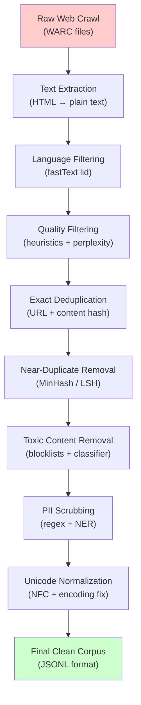
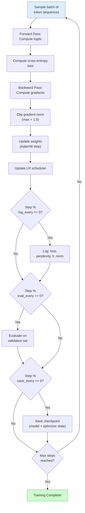
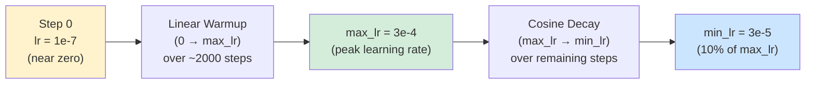

# Chapter 10: Training LLMs from Scratch

> **Prerequisites:** Chapters 1–9 — especially transformer architecture (Ch. 5), tokenization (Ch. 6), and attention mechanisms (Ch. 7).

This chapter takes you inside the full pipeline that creates a large language model — from raw internet text to a trained network. By the end you will understand every step a team like OpenAI, Meta, or Google follows, and you will be able to run a small version yourself.

---

## Table of Contents

1. [Part A — Data Collection](#part-a--data-collection)
2. [Part B — Data Cleaning Pipeline](#part-b--data-cleaning-pipeline)
3. [Part C — Tokenization for Training](#part-c--tokenization-for-training)
4. [Part D — Model Architecture Choices](#part-d--model-architecture-choices)
5. [Part E — Training Process](#part-e--training-process)
6. [Part F — Evaluation During Training](#part-f--evaluation-during-training)
7. [Part G — Compute Requirements](#part-g--compute-requirements)
8. [Summary](#summary)

---

## Part A — Data Collection

### Where does training data come from?

LLMs are statistical models of language. The richer and more diverse their training corpus, the more competent they become. Modern models train on hundreds of billions — sometimes trillions — of tokens drawn from many source types.

#### Major Data Sources

| Source | Examples | Approximate Scale | Strengths |
|--------|----------|-------------------|-----------|
| **Web crawls** | Common Crawl, C4, FineWeb | Petabytes raw | Enormous scale, diverse topics |
| **Books** | Books3, Project Gutenberg | Tens of billions tokens | Long-form coherence, style diversity |
| **Code** | GitHub, The Stack, StarCoder data | Hundreds of billions tokens | Reasoning, structured syntax |
| **Wikipedia** | English + multilingual dumps | ~4B tokens (English) | Factual, encyclopedic |
| **Academic papers** | arXiv, PubMed, Semantic Scholar | Tens of billions tokens | Technical depth, scientific reasoning |
| **Forums / Q&A** | Reddit (Pushshift), StackExchange | Hundreds of billions tokens | Dialogue, real questions |
| **News** | RealNews, CC-News | Tens of billions tokens | Current events, journalism style |

#### Common Crawl

[Common Crawl](https://commoncrawl.org/) is a non-profit that has been crawling the web since 2008. Each monthly snapshot is ~300–400 TB of compressed WARC (Web ARChive) files. Almost every major LLM uses it:

- **GPT-3** used a filtered subset — 410B tokens from Common Crawl alone out of ~300B training tokens after quality filtering
- **LLaMA 2** trained on 2T tokens, with Common Crawl as the dominant source
- **FineWeb** (HuggingFace, 2024) is 15T tokens of carefully filtered Common Crawl

> [!NOTE]
> Raw Common Crawl is very noisy — spam, duplicate content, adult material, encoding errors. The cleaning pipeline (Part B) exists entirely because raw crawl data is unusable as-is.

#### Books

- **Books3** — ~196K books scraped from Bibliotik; legally grey, used by The Pile (EleutherAI)  
- **Project Gutenberg** — ~70K public-domain books; fully legal, clean text  
- **BookCorpus** — 11K self-published books used in original BERT; distribution now restricted  

Books provide long-form coherent text that helps the model learn narrative structure, argument building, and consistent voice — things hard to learn from short web snippets.

#### Code

Code is remarkably important even for general language models. It improves:
- Structured reasoning and planning
- Following precise instructions
- Multi-step problem solving

GitHub is the main source. The Stack (BigCode) contains 358GB of permissively licensed code across 30+ programming languages.

### Dataset Scale: How Many Tokens?

| Model | Org | Training Tokens | Context Length |
|-------|-----|----------------|----------------|
| GPT-2 | OpenAI | 40B | 1024 |
| GPT-3 | OpenAI | 300B | 2048 |
| LLaMA 1 | Meta | 1T | 2048 |
| LLaMA 2 | Meta | 2T | 4096 |
| LLaMA 3 | Meta | 15T | 8192 |
| Mistral 7B | Mistral AI | Unknown (~1T est.) | 32768 |
| Falcon 180B | TII | 3.5T | 2048 |
| Gemma 2 | Google | 13T | 8192 |

> [!IMPORTANT]
> **1 token ≈ 0.75 words** in English for BPE tokenizers. 300B tokens ≈ 225B words ≈ roughly 1.5 million average novels. The scale is staggering.

### Licensing: Why It Matters

Training data licensing determines what you can legally do with your model — especially whether you can release it publicly.

| License Type | Examples | Commercial Use | Model Release | Notes |
|---|---|---|---|---|
| **CC0 / Public Domain** | Project Gutenberg, some Wikipedia | ✅ Yes | ✅ Open | No restrictions |
| **CC-BY** | Most Wikipedia content | ✅ Yes | ✅ Open | Must attribute source |
| **CC-BY-SA** | Wikipedia (English) | ✅ Yes | ⚠️ Copyleft | Derivatives must share alike |
| **MIT / Apache 2** | Most open-source code | ✅ Yes | ✅ Open | Permissive |
| **GPL** | Linux kernel, some GitHub code | ⚠️ Limited | ⚠️ Viral | Strong copyleft |
| **Proprietary** | Books3, news articles | ❌ No | ❌ Restricted | May violate copyright |
| **Terms of Service** | Twitter, Reddit | ❌ Restricted | Varies | ToS may prohibit scraping |

The legal status of training on copyrighted data is actively litigated (e.g., *New York Times v. OpenAI*, authors suing Meta). Many open models now use only permissively licensed data.

### Data Quality vs. Quantity: The Chinchilla Insight

For years the field assumed "more data = better." The 2022 DeepMind paper *Training Compute-Optimal Large Language Models* (Hoffmann et al.) — nicknamed "Chinchilla" — showed this was wrong.

**Key finding:** For a given compute budget, you should scale model size *and* training tokens together. The optimal ratio is approximately:

```
N_tokens ≈ 20 × N_parameters
```

A 7B parameter model should train on ~140B tokens minimum. If you have more compute, grow both together.

**Practical implication:** 1B high-quality, well-filtered tokens can outperform 100B noisy tokens because:
- Noisy data corrupts learned distributions
- The model wastes capacity memorizing garbage
- Quality signals (coherent sentences, correct facts) are diluted

This is why data cleaning (Part B) is considered as important as model architecture.

### Privacy Concerns: PII in Training Data

Web-crawled data contains vast amounts of **Personally Identifiable Information (PII)**:
- Full names combined with addresses or phone numbers
- Email addresses
- Medical information from forums
- Passwords accidentally posted to GitHub

**Problems this causes:**
1. **Memorization**: LLMs can memorize and regurgitate exact strings from training data
2. **Privacy violations**: Model may output real people's private information
3. **Regulatory risk**: GDPR, CCPA compliance issues

**Mitigation strategies:**
- **Name replacement**: Replace detected names with `[NAME]` or synthetic names
- **Email/phone redaction**: Regex-based detection and replacement
- **Deduplication** (see Part B): Memorization is worse for repeated data
- **Differential privacy**: Add noise during training (rarely used due to accuracy cost)
- **PII detection models**: Fine-tuned NER models specialized for PII

---

## Part B — Data Cleaning Pipeline

Raw text from the internet is not suitable for training. A typical cleaning pipeline removes 70–90% of raw crawl content while retaining the highest-quality text.



### Deduplication

Duplicated content is harmful: the model over-learns repeated phrases and memorizes them more readily. There are two levels:

#### Exact Deduplication (Hash-based)

```python
import hashlib
from pathlib import Path

def deduplicate_exact(documents: list[str]) -> list[str]:
    """Remove exact duplicate documents using SHA-256 hashing."""
    seen_hashes = set()
    unique_docs = []
    
    for doc in documents:
        # Normalize whitespace before hashing
        normalized = " ".join(doc.split())
        doc_hash = hashlib.sha256(normalized.encode("utf-8")).hexdigest()
        
        if doc_hash not in seen_hashes:
            seen_hashes.add(doc_hash)
            unique_docs.append(doc)
    
    removed = len(documents) - len(unique_docs)
    print(f"Exact dedup: removed {removed}/{len(documents)} documents "
          f"({100*removed/max(len(documents),1):.1f}%)")
    return unique_docs

# Example usage
docs = [
    "The quick brown fox jumps over the lazy dog.",
    "Machine learning is a subset of artificial intelligence.",
    "The quick brown fox jumps over the lazy dog.",  # exact duplicate
    "Deep learning uses neural networks with many layers.",
]
clean_docs = deduplicate_exact(docs)
```

#### Near-Duplicate Removal (MinHash / LSH)

Exact hashing misses documents that differ by only whitespace, punctuation, or a few words. MinHash with Locality Sensitive Hashing (LSH) detects near-duplicates efficiently.

```python
# pip install datasketch
from datasketch import MinHash, MinHashLSH

def compute_minhash(text: str, num_perm: int = 128) -> MinHash:
    """Compute MinHash signature for a document."""
    m = MinHash(num_perm=num_perm)
    # Shingle the text into 5-character n-grams
    for i in range(len(text) - 4):
        shingle = text[i:i+5].encode("utf8")
        m.update(shingle)
    return m

def deduplicate_near(documents: list[str], threshold: float = 0.8) -> list[str]:
    """Remove near-duplicate documents using MinHash LSH.
    
    threshold: Jaccard similarity threshold (0.8 = 80% similar → duplicate)
    """
    lsh = MinHashLSH(threshold=threshold, num_perm=128)
    unique_docs = []
    
    for idx, doc in enumerate(documents):
        mh = compute_minhash(doc)
        key = f"doc_{idx}"
        
        # Query for similar documents already in the index
        result = lsh.query(mh)
        
        if not result:  # No near-duplicates found
            lsh.insert(key, mh)
            unique_docs.append(doc)
    
    return unique_docs
```

> [!TIP]
> MinHash is O(n) in document length and O(1) in query time (amortized). For a corpus of 100M documents, this is orders of magnitude faster than pairwise comparison (which would be O(n²)).

### Language Filtering

Most LLM training targets English (or specific languages). fastText's language identification model classifies 176 languages with ~99% accuracy.

```python
# pip install fasttext-wheel
import fasttext
import urllib.request

def setup_lid_model(model_path: str = "lid.176.bin"):
    """Download and load fastText language ID model."""
    if not Path(model_path).exists():
        url = "https://dl.fbaipublicfiles.com/fasttext/supervised-models/lid.176.bin"
        print(f"Downloading language ID model...")
        urllib.request.urlretrieve(url, model_path)
    return fasttext.load_model(model_path)

def filter_by_language(
    documents: list[str],
    target_lang: str = "en",
    min_confidence: float = 0.65,
    model=None
) -> list[str]:
    """Keep only documents in the target language."""
    filtered = []
    for doc in documents:
        # fastText expects single-line text
        clean_doc = doc.replace("\n", " ")
        predictions = model.predict(clean_doc, k=1)
        lang = predictions[0][0].replace("__label__", "")
        confidence = predictions[1][0]
        
        if lang == target_lang and confidence >= min_confidence:
            filtered.append(doc)
    
    print(f"Language filter: kept {len(filtered)}/{len(documents)} documents")
    return filtered
```

### Quality Filtering

After language filtering, many documents are still low quality: keyword spam, navigation menus extracted from HTML, SEO-stuffed pages, etc.

```python
import re
import statistics

def quality_filter(documents: list[str]) -> list[str]:
    """Apply heuristic quality filters to documents."""
    filtered = []
    
    for doc in documents:
        words = doc.split()
        
        if len(words) < 50:  # Too short
            continue
        
        # --- Heuristic 1: Average word length ---
        avg_word_len = sum(len(w) for w in words) / max(len(words), 1)
        if avg_word_len < 3 or avg_word_len > 10:
            # Too short avg = likely keyword spam; too long = encoding errors
            continue
        
        # --- Heuristic 2: Punctuation ratio ---
        punct_chars = sum(1 for c in doc if c in ".,!?;:")
        punct_ratio = punct_chars / max(len(doc), 1)
        if punct_ratio < 0.005 or punct_ratio > 0.15:
            continue
        
        # --- Heuristic 3: Symbol ratio ---
        symbol_chars = sum(1 for c in doc if not c.isalnum() and c not in " \n\t.,!?;:'\"()-")
        symbol_ratio = symbol_chars / max(len(doc), 1)
        if symbol_ratio > 0.1:  # More than 10% symbols → likely code/spam
            continue
        
        # --- Heuristic 4: Duplicate line ratio ---
        lines = [l.strip() for l in doc.split("\n") if l.strip()]
        if lines:
            unique_lines = set(lines)
            dup_ratio = 1 - len(unique_lines) / len(lines)
            if dup_ratio > 0.3:  # More than 30% duplicate lines
                continue
        
        # --- Heuristic 5: Alphabetic word ratio ---
        alpha_words = sum(1 for w in words if any(c.isalpha() for c in w))
        if alpha_words / max(len(words), 1) < 0.7:
            continue
        
        filtered.append(doc)
    
    print(f"Quality filter: kept {len(filtered)}/{len(documents)} documents")
    return filtered
```

### Toxic Content Removal

```python
# Two-stage approach: blocklist → classifier

TOXIC_PATTERNS = [
    # Simple keyword blocklist (abbreviated for illustration)
    r"\b(hate\s+speech|racial\s+slur)\b",
    # Add domain-specific blocklist patterns here
]

def blocklist_filter(documents: list[str]) -> list[str]:
    """Fast first-pass: remove documents matching toxic patterns."""
    patterns = [re.compile(p, re.IGNORECASE) for p in TOXIC_PATTERNS]
    
    return [
        doc for doc in documents
        if not any(p.search(doc) for p in patterns)
    ]

# For classifier-based filtering, use a pre-trained toxicity model:
# from transformers import pipeline
# classifier = pipeline("text-classification", model="unitary/toxic-bert")
# Then filter documents where classifier predicts "toxic" with high confidence
```

### Unicode Normalization and Encoding Fixes

```python
import unicodedata

def normalize_text(text: str) -> str:
    """Apply Unicode NFC normalization and fix common encoding issues."""
    
    # 1. NFC normalization: canonical decomposition then canonical composition
    #    "café" (e + combining accent) → "café" (single precomposed char)
    text = unicodedata.normalize("NFC", text)
    
    # 2. Fix common encoding errors (mojibake)
    # E.g., "’" is UTF-8 apostrophe decoded as Latin-1
    try:
        text = text.encode("latin-1").decode("utf-8")
    except (UnicodeDecodeError, UnicodeEncodeError):
        pass  # Text is already correctly encoded
    
    # 3. Normalize whitespace
    text = re.sub(r"\r\n|\r", "\n", text)       # Normalize line endings
    text = re.sub(r"[ \t]+", " ", text)          # Collapse multiple spaces
    text = re.sub(r"\n{3,}", "\n\n", text)        # Max 2 consecutive newlines
    text = text.strip()
    
    # 4. Remove null bytes and other control characters
    text = re.sub(r"[\x00-\x08\x0b\x0c\x0e-\x1f\x7f]", "", text)
    
    return text

def strip_html(text: str) -> str:
    """Remove HTML tags (simple regex approach; use BeautifulSoup for production)."""
    text = re.sub(r"<[^>]+>", " ", text)        # Remove tags
    text = re.sub(r"&amp;", "&", text)
    text = re.sub(r"&lt;", "<", text)
    text = re.sub(r"&gt;", ">", text)
    text = re.sub(r"&nbsp;", " ", text)
    text = re.sub(r"&#\d+;", "", text)           # Numeric HTML entities
    return text
```

### Putting It All Together: A Simple Pipeline

```python
# pip install datasketch fasttext-wheel
import json
from pathlib import Path

def run_cleaning_pipeline(
    input_path: str,
    output_path: str,
    target_lang: str = "en"
) -> None:
    """Run the full data cleaning pipeline on a JSONL file.
    
    Input format:  {"text": "...", "url": "..."}  (one per line)
    Output format: {"text": "..."}                 (one per line, cleaned)
    """
    
    # Load all documents
    documents = []
    with open(input_path, "r", encoding="utf-8") as f:
        for line in f:
            obj = json.loads(line.strip())
            if "text" in obj:
                documents.append(obj["text"])
    
    print(f"Loaded {len(documents)} documents")
    
    # Pipeline steps
    documents = [strip_html(d) for d in documents]        # Step 1: strip HTML
    documents = [normalize_text(d) for d in documents]    # Step 2: normalize
    documents = [d for d in documents if d.strip()]        # Step 3: remove empty
    documents = deduplicate_exact(documents)               # Step 4: exact dedup
    documents = quality_filter(documents)                  # Step 5: quality
    documents = blocklist_filter(documents)                # Step 6: toxic removal
    
    # Write output
    with open(output_path, "w", encoding="utf-8") as f:
        for doc in documents:
            f.write(json.dumps({"text": doc}, ensure_ascii=False) + "\n")
    
    print(f"Pipeline complete. Wrote {len(documents)} clean documents to {output_path}")

# Example usage:
# run_cleaning_pipeline("raw_crawl.jsonl", "clean_corpus.jsonl")
```

---

## Part C — Tokenization for Training

### Training a BPE Tokenizer

Rather than using a pre-built tokenizer, production pipelines train a tokenizer from scratch on the target corpus. This ensures the vocabulary is optimized for your specific data distribution.

```python
# pip install tokenizers
from tokenizers import Tokenizer
from tokenizers.models import BPE
from tokenizers.trainers import BpeTrainer
from tokenizers.pre_tokenizers import ByteLevel
from tokenizers.decoders import ByteLevel as ByteLevelDecoder
from tokenizers.normalizers import NFC, Sequence as NormalizerSequence
import json

def train_bpe_tokenizer(
    corpus_files: list[str],
    vocab_size: int = 32000,
    output_path: str = "tokenizer.json",
    special_tokens: list[str] = None
) -> Tokenizer:
    """Train a Byte-Pair Encoding tokenizer on a corpus.
    
    Args:
        corpus_files: List of paths to plain text or JSONL files
        vocab_size: Target vocabulary size (GPT-2: 50257, LLaMA: 32000)
        output_path: Where to save the trained tokenizer
        special_tokens: Special tokens like ["<pad>", "<eos>", "<bos>", "<unk>"]
    """
    if special_tokens is None:
        special_tokens = ["<pad>", "<eos>", "<bos>", "<unk>"]
    
    # Initialize BPE model
    tokenizer = Tokenizer(BPE(unk_token="<unk>"))
    
    # Byte-level pre-tokenization: treat every byte as a base character
    # This means the tokenizer is never out-of-vocabulary (handles any Unicode)
    tokenizer.pre_tokenizer = ByteLevel(add_prefix_space=False)
    tokenizer.decoder = ByteLevelDecoder()
    tokenizer.normalizer = NormalizerSequence([NFC()])
    
    # Configure the BPE trainer
    trainer = BpeTrainer(
        vocab_size=vocab_size,
        min_frequency=2,              # Merge pairs seen < 2 times are skipped
        special_tokens=special_tokens,
        show_progress=True,
        initial_alphabet=list(range(256)),  # All byte values as initial alphabet
    )
    
    # Create an iterator over the corpus text
    def corpus_iterator():
        for file_path in corpus_files:
            with open(file_path, "r", encoding="utf-8") as f:
                for line in f:
                    try:
                        obj = json.loads(line.strip())
                        yield obj.get("text", "")
                    except json.JSONDecodeError:
                        yield line.strip()
    
    # Train
    print(f"Training BPE tokenizer with vocab_size={vocab_size}...")
    tokenizer.train_from_iterator(corpus_iterator(), trainer=trainer)
    
    # Save
    tokenizer.save(output_path)
    print(f"Tokenizer saved to {output_path}")
    print(f"Actual vocab size: {tokenizer.get_vocab_size()}")
    
    return tokenizer

def demo_tokenizer(tokenizer_path: str = "tokenizer.json"):
    """Demonstrate the trained tokenizer."""
    tokenizer = Tokenizer.from_file(tokenizer_path)
    
    test_sentences = [
        "Hello, world! This is a test.",
        "Machine learning is fascinating.",
        "def fibonacci(n): return n if n <= 1 else fibonacci(n-1) + fibonacci(n-2)",
    ]
    
    for sentence in test_sentences:
        encoding = tokenizer.encode(sentence)
        print(f"\nInput:  {sentence}")
        print(f"Tokens: {encoding.tokens}")
        print(f"IDs:    {encoding.ids}")
        print(f"Count:  {len(encoding.ids)} tokens")

# Usage:
# tokenizer = train_bpe_tokenizer(
#     corpus_files=["clean_corpus.jsonl"],
#     vocab_size=32000,
#     output_path="my_tokenizer.json"
# )
# demo_tokenizer("my_tokenizer.json")
```

### Creating Fixed-Length Training Sequences

LLMs require all inputs to be the same length. We pack multiple documents together (separated by `<eos>` tokens) and split into blocks of exactly `context_length` tokens.

```python
import torch
from tokenizers import Tokenizer

def create_training_sequences(
    corpus_path: str,
    tokenizer_path: str,
    context_length: int = 1024,
    output_path: str = "training_sequences.pt",
    stride: int = None,  # None = no overlap (pure packing)
) -> torch.Tensor:
    """Convert a cleaned corpus into fixed-length token sequences for training.
    
    Strategy: Concatenate all tokens with <eos> separators, then split into
    non-overlapping blocks of context_length. This maximizes data efficiency.
    
    Args:
        stride: If set, use sliding window with this step size (creates overlap).
                stride=context_length means no overlap (default behavior).
    """
    if stride is None:
        stride = context_length
    
    tokenizer = Tokenizer.from_file(tokenizer_path)
    eos_id = tokenizer.token_to_id("<eos>")
    
    # Tokenize entire corpus into one long sequence
    all_tokens = []
    
    with open(corpus_path, "r", encoding="utf-8") as f:
        for i, line in enumerate(f):
            try:
                import json
                obj = json.loads(line.strip())
                text = obj.get("text", "")
            except json.JSONDecodeError:
                text = line.strip()
            
            if not text:
                continue
            
            token_ids = tokenizer.encode(text).ids
            all_tokens.extend(token_ids)
            all_tokens.append(eos_id)  # Document separator
            
            if i % 10000 == 0:
                print(f"Tokenized {i} documents ({len(all_tokens):,} tokens so far)...")
    
    print(f"Total tokens: {len(all_tokens):,}")
    
    # Create blocks
    blocks = []
    for start in range(0, len(all_tokens) - context_length, stride):
        block = all_tokens[start : start + context_length]
        blocks.append(block)
    
    # Convert to tensor: shape (num_sequences, context_length)
    sequences = torch.tensor(blocks, dtype=torch.long)
    torch.save(sequences, output_path)
    
    print(f"Created {len(blocks):,} sequences of length {context_length}")
    print(f"Saved to {output_path} — shape: {sequences.shape}")
    
    return sequences

# Stride/overlap considerations:
# - stride = context_length: pure packing, no overlap, max data efficiency
# - stride = context_length // 2: 50% overlap, each token appears in ~2 sequences
# - Smaller stride = more sequences but more redundancy; useful for very small corpora
```

---

## Part D — Model Architecture Choices

### Key Hyperparameters

Every LLM architecture is defined by a small set of numbers:

| Hyperparameter | Symbol | Description | Typical Range |
|---|---|---|---|
| Vocabulary size | `V` | Number of unique tokens | 32K – 128K |
| Context length | `T` | Max sequence length | 1024 – 128K+ |
| Embedding dimension | `d_model` | Width of every hidden vector | 256 – 8192 |
| Number of layers | `n_layers` | Depth of transformer stack | 6 – 96 |
| Attention heads | `n_heads` | Parallel attention streams | 8 – 96 |
| Head dimension | `d_head` | Dimension per head (= d_model/n_heads) | 64 – 128 |
| FFN dimension | `d_ff` | Inner dim of feed-forward (= 4×d_model) | 1024 – 32768 |
| Dropout | `p` | Regularization dropout probability | 0.0 – 0.1 |

### Architecture Decision Table

| Model Size | `d_model` | `n_heads` | `n_layers` | `d_ff` | Approx. Params |
|---|---|---|---|---|---|
| **Tiny** (tutorial) | 256 | 4 | 4 | 1024 | ~10M |
| **Small** | 512 | 8 | 6 | 2048 | ~50M |
| **Medium** (GPT-2 small) | 768 | 12 | 12 | 3072 | ~117M |
| **Large** (GPT-2 XL) | 1600 | 25 | 48 | 6400 | ~1.5B |
| **XL** (LLaMA 7B) | 4096 | 32 | 32 | 11008 | ~7B |
| **XXL** (LLaMA 65B) | 8192 | 64 | 80 | 22016 | ~65B |
| **GPT-3** | 12288 | 96 | 96 | 49152 | ~175B |

### Parameter Count Calculation

Understanding where parameters live helps you plan memory budgets.

```python
def calculate_params(
    vocab_size: int,
    context_length: int,
    d_model: int,
    n_layers: int,
    n_heads: int,
    d_ff: int = None,
) -> dict:
    """Calculate parameter counts for a GPT-style transformer.
    
    Returns breakdown by component.
    """
    if d_ff is None:
        d_ff = 4 * d_model
    
    d_head = d_model // n_heads
    
    # Token embedding table
    token_embed = vocab_size * d_model
    
    # Positional embedding (learned absolute positions)
    pos_embed = context_length * d_model
    
    # Per-layer parameters
    # 1. Self-attention: Q, K, V projections + output projection
    attn_qkv = 3 * d_model * d_model  # Q, K, V matrices
    attn_out = d_model * d_model       # Output projection
    
    # 2. Feed-forward network: two linear layers
    ffn_up   = d_model * d_ff
    ffn_down = d_ff * d_model
    
    # 3. Layer norms (2 per layer): only scale (gamma) and shift (beta)
    layer_norm = 2 * 2 * d_model      # 2 norms × (gamma + beta)
    
    params_per_layer = attn_qkv + attn_out + ffn_up + ffn_down + layer_norm
    
    # Final layer norm
    final_norm = 2 * d_model
    
    # Language model head (often tied with token embeddings)
    lm_head_tied = 0           # If weight-tied to embedding: free
    lm_head_untied = vocab_size * d_model  # If separate: expensive
    
    total_no_head = token_embed + pos_embed + (n_layers * params_per_layer) + final_norm
    total_with_head = total_no_head + lm_head_untied
    total_tied = total_no_head  # Weight tying is common (GPT-2 does this)
    
    return {
        "token_embedding": token_embed,
        "positional_embedding": pos_embed,
        "per_layer": params_per_layer,
        "total_transformer_layers": n_layers * params_per_layer,
        "final_norm": final_norm,
        "total_params_weight_tied": total_tied,
        "total_params_separate_head": total_with_head,
    }

# Example: GPT-2 Small
params = calculate_params(
    vocab_size=50257, context_length=1024,
    d_model=768, n_layers=12, n_heads=12
)
for name, count in params.items():
    print(f"{name:40s}: {count:>15,}")

# Output (abbreviated):
# token_embedding                         :      38,597,376
# total_transformer_layers                :      85,054,464
# total_params_weight_tied                :     124,337,664  (~124M ✓)
```

> [!NOTE]
> GPT-2 Small is officially 117M parameters because it uses separate (not weight-tied) LM head. Weight tying — using the same matrix for input embeddings and output projection — saves `vocab_size × d_model` parameters and often improves perplexity slightly.

### Context Length Evolution

```
GPT-1 (2018):       512 tokens
GPT-2 (2019):      1024 tokens
GPT-3 (2020):      2048 tokens
GPT-3.5 (2022):    4096 tokens
LLaMA 2 (2023):    4096 tokens
Mistral (2023):   32768 tokens  (sliding window attention)
LLaMA 3 (2024):   128K tokens  (RoPE + grouped query attention)
Gemini 1.5 (2024): 1M tokens   (ring attention)
```

Increasing context length increases memory quadratically for standard attention (O(T²)). Modern techniques — **Rotary Positional Embeddings (RoPE)**, **Grouped Query Attention (GQA)**, **Flash Attention** — make long contexts tractable.

---

## Part E — Training Process

### The Training Loop: High Level



### Forward Pass and Loss

The language model's training objective is **next-token prediction** (causal language modeling):

For a sequence `x₁, x₂, ..., x_T`, the model predicts each token given all preceding tokens. The loss is cross-entropy averaged over all positions:

```
L = -(1/T) × Σᵢ log P(xᵢ | x₁, ..., xᵢ₋₁)
```

```python
import torch
import torch.nn as nn
import torch.nn.functional as F

def compute_loss(logits: torch.Tensor, targets: torch.Tensor) -> torch.Tensor:
    """Compute cross-entropy loss for next-token prediction.
    
    Args:
        logits:  (batch_size, seq_len, vocab_size) — raw model outputs
        targets: (batch_size, seq_len) — ground truth token IDs
        
    The target for position i is the token at position i+1 (next token).
    Convention: inputs are tokens [0..T-1], targets are tokens [1..T].
    """
    batch_size, seq_len, vocab_size = logits.shape
    
    # Reshape for F.cross_entropy which expects (N, C) and (N,)
    logits_flat  = logits.reshape(-1, vocab_size)   # (batch*seq, vocab)
    targets_flat = targets.reshape(-1)               # (batch*seq,)
    
    loss = F.cross_entropy(logits_flat, targets_flat, ignore_index=-1)
    return loss

# In the training loop:
# inputs  = batch[:, :-1]   tokens 0 to T-2 (fed into model)
# targets = batch[:, 1:]    tokens 1 to T-1 (what model should predict)
# logits  = model(inputs)   shape: (B, T-1, V)
# loss    = compute_loss(logits, targets)
```

### Optimizers: From SGD to AdamW

#### Stochastic Gradient Descent (SGD)
```
w ← w - η × ∇L(w)
```
- **Problem**: Same learning rate for all parameters; slow convergence; sensitive to curvature.

#### SGD with Momentum
```
v ← β × v + ∇L(w)
w ← w - η × v
```
- Accumulates gradient direction; avoids oscillation.

#### Adam (Adaptive Moment Estimation)
Adam tracks per-parameter statistics:
- **m** (first moment): exponential moving average of gradients (direction)
- **v** (second moment): exponential moving average of gradient² (magnitude)

```
mₜ = β₁ × mₜ₋₁ + (1-β₁) × gₜ          # Gradient moving average
vₜ = β₂ × vₜ₋₁ + (1-β₂) × gₜ²          # Squared gradient moving average
m̂ₜ = mₜ / (1 - β₁ᵗ)                     # Bias correction
v̂ₜ = vₜ / (1 - β₂ᵗ)                     # Bias correction
wₜ = wₜ₋₁ - η × m̂ₜ / (√v̂ₜ + ε)         # Parameter update
```

Typical hyperparameters: β₁=0.9, β₂=0.95 (or 0.999), ε=1e-8

#### AdamW (Adam with Decoupled Weight Decay)

The key difference from Adam: weight decay is applied **directly to weights** rather than through the gradient. This correctly implements L2 regularization:

```
wₜ = wₜ₋₁ - η × (m̂ₜ / (√v̂ₜ + ε) + λ × wₜ₋₁)
```

> [!IMPORTANT]
> AdamW is the **standard optimizer for LLM training**. Apply weight decay only to weights — NOT to bias parameters, LayerNorm scale/shift parameters, or embedding tables.

```python
def configure_adamw_optimizer(model: nn.Module, lr: float, weight_decay: float):
    """Configure AdamW with weight decay applied only to appropriate parameters."""
    
    # Separate parameters: decay vs no-decay
    decay_params = []
    no_decay_params = []
    
    for name, param in model.named_parameters():
        if not param.requires_grad:
            continue
        
        # Don't decay: 1D params (biases, LayerNorm gamma/beta), embeddings
        if param.ndim == 1 or "embedding" in name or "norm" in name:
            no_decay_params.append(param)
        else:
            decay_params.append(param)
    
    param_groups = [
        {"params": decay_params,    "weight_decay": weight_decay},
        {"params": no_decay_params, "weight_decay": 0.0},
    ]
    
    optimizer = torch.optim.AdamW(
        param_groups,
        lr=lr,
        betas=(0.9, 0.95),
        eps=1e-8,
    )
    
    decay_count = sum(p.numel() for p in decay_params)
    no_decay_count = sum(p.numel() for p in no_decay_params)
    print(f"Optimizer param groups:")
    print(f"  Decay:    {decay_count:,} params")
    print(f"  No decay: {no_decay_count:,} params")
    
    return optimizer
```

### Learning Rate Schedule: Warmup + Cosine Decay



```python
import math

def get_lr(
    step: int,
    warmup_steps: int,
    max_steps: int,
    max_lr: float = 3e-4,
    min_lr: float = 3e-5,
) -> float:
    """Compute learning rate at a given step (warmup + cosine decay).
    
    Phase 1 (steps 0 → warmup_steps): Linear warmup from ~0 to max_lr
    Phase 2 (steps warmup_steps → max_steps): Cosine decay to min_lr
    """
    
    # Phase 1: Linear warmup
    if step < warmup_steps:
        return max_lr * (step + 1) / warmup_steps
    
    # Phase 3: After training (shouldn't happen, but handle gracefully)
    if step > max_steps:
        return min_lr
    
    # Phase 2: Cosine decay
    decay_ratio = (step - warmup_steps) / (max_steps - warmup_steps)
    # decay_ratio goes from 0.0 → 1.0 over the decay phase
    cosine_coeff = 0.5 * (1.0 + math.cos(math.pi * decay_ratio))
    # cosine_coeff goes from 1.0 → 0.0 (cosine curve, starts high)
    
    return min_lr + cosine_coeff * (max_lr - min_lr)

# Example: visualize the schedule
steps = list(range(0, 10000, 100))
lrs = [get_lr(s, warmup_steps=400, max_steps=10000) for s in steps]
print("Step 0:    lr =", get_lr(0,    400, 10000))
print("Step 400:  lr =", get_lr(400,  400, 10000))
print("Step 5000: lr =", get_lr(5000, 400, 10000))
print("Step 9900: lr =", get_lr(9900, 400, 10000))
```

### Gradient Clipping

Gradient explosion can derail training in a single step. Clipping the global gradient norm prevents this:

```python
def clip_gradients(model: nn.Module, max_norm: float = 1.0) -> float:
    """Clip gradient norm and return the norm before clipping."""
    # Compute global L2 norm across all parameter gradients
    total_norm = torch.nn.utils.clip_grad_norm_(
        model.parameters(),
        max_norm=max_norm,
        norm_type=2.0
    )
    return total_norm.item()

# In training loop:
# optimizer.zero_grad()
# loss.backward()
# grad_norm = clip_gradients(model, max_norm=1.0)
# optimizer.step()
```

If you see `grad_norm` consistently >> 1.0, your learning rate may be too high or your model is in a bad region of loss landscape.

### Batch Size and Gradient Accumulation

Modern LLMs use very large effective batch sizes (0.5M – 4M tokens). A single GPU may only fit a small batch, so **gradient accumulation** simulates a larger batch by summing gradients over multiple micro-batches:

```python
def training_step_with_accumulation(
    model: nn.Module,
    optimizer: torch.optim.Optimizer,
    data_loader,
    grad_accum_steps: int = 8,
    max_norm: float = 1.0
) -> dict:
    """One 'logical' training step with gradient accumulation.
    
    effective_batch_size = micro_batch_size × grad_accum_steps
    """
    model.train()
    optimizer.zero_grad()
    
    total_loss = 0.0
    
    for micro_step in range(grad_accum_steps):
        batch = next(iter(data_loader))
        inputs  = batch[:, :-1]
        targets = batch[:, 1:]
        
        # Forward pass
        logits = model(inputs)
        loss = compute_loss(logits, targets)
        
        # Scale loss so gradients are averaged across accumulation steps
        loss = loss / grad_accum_steps
        
        # Backward pass (accumulates into .grad)
        loss.backward()
        
        total_loss += loss.item()
    
    # Clip after accumulating all gradients
    grad_norm = clip_gradients(model, max_norm)
    
    # Single optimizer step
    optimizer.step()
    
    return {
        "loss": total_loss,
        "perplexity": math.exp(total_loss),
        "grad_norm": grad_norm,
    }
```

### Mixed Precision Training (fp16 / bf16)

```python
# Using PyTorch's automatic mixed precision (AMP)
from torch.cuda.amp import GradScaler, autocast

def train_with_mixed_precision(model, optimizer, batch):
    """Train one step with bf16 mixed precision.
    
    bfloat16 (bf16):
    - Same exponent range as float32 (less likely to overflow/underflow)
    - Less precision than fp16 but more numerically stable
    - Supported on A100, H100, TPUs; preferred for LLM training
    
    float16 (fp16):
    - Narrower exponent range → needs GradScaler to prevent underflow
    - Supported on older GPUs (V100, RTX series)
    """
    
    dtype = torch.bfloat16  # Use torch.float16 + GradScaler on older GPUs
    
    with autocast(device_type="cuda", dtype=dtype):
        inputs  = batch[:, :-1]
        targets = batch[:, 1:]
        logits  = model(inputs)
        loss    = compute_loss(logits, targets)
    
    loss.backward()
    # (gradient clipping and optimizer step follow)
    return loss.item()

# bf16 benefits:
# - 2× memory reduction vs fp32
# - 2–4× throughput on modern GPUs with Tensor Cores
# - Minimal accuracy degradation for LLM training
```

### Checkpointing

```python
def save_checkpoint(
    model: nn.Module,
    optimizer: torch.optim.Optimizer,
    scheduler,
    step: int,
    loss: float,
    checkpoint_dir: str = "checkpoints/",
) -> str:
    """Save full training checkpoint (model + optimizer + scheduler state)."""
    import os
    os.makedirs(checkpoint_dir, exist_ok=True)
    
    checkpoint_path = os.path.join(checkpoint_dir, f"ckpt_step_{step:06d}.pt")
    
    torch.save({
        "step": step,
        "model_state_dict": model.state_dict(),
        "optimizer_state_dict": optimizer.state_dict(),
        "scheduler_state_dict": scheduler.state_dict() if scheduler else None,
        "loss": loss,
    }, checkpoint_path)
    
    print(f"Saved checkpoint: {checkpoint_path} (step={step}, loss={loss:.4f})")
    return checkpoint_path

def load_checkpoint(
    model: nn.Module,
    optimizer: torch.optim.Optimizer,
    checkpoint_path: str,
) -> int:
    """Load checkpoint and return the step number to resume from."""
    checkpoint = torch.load(checkpoint_path, map_location="cpu")
    
    model.load_state_dict(checkpoint["model_state_dict"])
    optimizer.load_state_dict(checkpoint["optimizer_state_dict"])
    
    start_step = checkpoint["step"] + 1
    print(f"Resumed from {checkpoint_path} at step {checkpoint['step']}")
    return start_step
```

> [!TIP]
> Save checkpoints every 500–2000 steps. Keep the last N (e.g., 5) and always keep milestone checkpoints (25%, 50%, 75%, 100% of training). Training runs crash — always checkpoint.

---

## Part F — Evaluation During Training

### Validation Loss

Hold out 1–5% of your data as a **validation set** (never trained on). Every `eval_every` steps, run inference on the validation set:

```python
@torch.no_grad()
def evaluate(model: nn.Module, val_loader, eval_batches: int = 50) -> dict:
    """Evaluate model on validation data."""
    model.eval()
    total_loss = 0.0
    
    for i, batch in enumerate(val_loader):
        if i >= eval_batches:
            break
        inputs  = batch[:, :-1]
        targets = batch[:, 1:]
        logits  = model(inputs)
        loss    = compute_loss(logits, targets)
        total_loss += loss.item()
    
    avg_loss = total_loss / min(eval_batches, len(val_loader))
    perplexity = math.exp(avg_loss)
    
    model.train()
    return {"val_loss": avg_loss, "val_perplexity": perplexity}
```

### Perplexity

**Perplexity** is the standard LM evaluation metric. Intuitively: "how many words is the model equally confused between at each step?"

```
Perplexity = exp(cross_entropy_loss)

If loss = 0.0  → PPL = 1.0   (perfect, model is certain)
If loss = 2.3  → PPL ≈ 10    (confused between ~10 options)
If loss = 11.5 → PPL ≈ 100K  (nearly random)
```

| Model | Validation PPL (WikiText-103) |
|-------|-------------------------------|
| Random baseline | ~200,000 |
| n-gram model | ~200–500 |
| Small GPT (117M) | ~20–40 |
| GPT-3 (175B) | ~12–18 |
| State-of-the-art | ~8–12 |

### Overfitting Detection

```
If val_loss >> train_loss → overfitting (model memorized training data)
If both losses are high   → underfitting (model capacity too small)
If losses track closely   → healthy training
```

For LLMs training on massive data, significant overfitting is rare (the dataset is usually far larger than model capacity). But watch for:
- Train/val loss diverging after a sudden drop (learning rate too high)
- Val loss increasing while train loss decreases (definite overfitting)

### Downstream Benchmarks

Track these periodically during training to verify capabilities emerge:

| Benchmark | Task | Metric | Notes |
|---|---|---|---|
| **MMLU** | 57-subject multiple choice | Accuracy | Tests knowledge breadth |
| **HellaSwag** | Sentence completion | Accuracy | Tests commonsense reasoning |
| **ARC** | Science QA | Accuracy | Tests elementary science |
| **WinoGrande** | Pronoun disambiguation | Accuracy | Tests coreference |
| **TruthfulQA** | Factual accuracy | % truthful | Tests hallucination |

---

## Part G — Compute Requirements

### Why Training Large LLMs Costs Millions

The basic equation: `FLOPs = 6 × N_params × N_tokens`

For GPT-3 (175B params, 300B tokens):
```
FLOPs ≈ 6 × 175×10⁹ × 300×10⁹ = 3.14 × 10²³ floating point operations
```

An A100 GPU delivers ~312 TFLOPS (fp16) in theory, ~200 TFLOPS in practice.

```
Time = 3.14×10²³ / (200×10¹² FLOPS/s) = 1.57×10⁹ seconds ÷ one GPU
     = ~18,170 GPU-days ÷ 1024 GPUs
     ≈ 17.7 days wall-clock (with 1024 A100s)
```

At ~$2–3/hour per A100:
```
Cost ≈ 1024 × 24 × 17.7 × $2.50 ≈ $1,087,872 ≈ $1M
```

Official estimates for GPT-3 range $4–12M accounting for failed runs, experimentation, and infrastructure.

| Model | Estimated Cost | GPU Hours |
|-------|---------------|-----------|
| GPT-3 (175B) | $4–12M | 285,000 |
| LLaMA 1 (65B) | ~$2M | 100,000+ |
| LLaMA 2 (70B) | ~$3–5M | ~180,000 |
| Falcon 180B | Unknown | 400,000+ est. |

### Student Context: What's Feasible?

You don't need millions of dollars to learn. Small models train on a laptop:

| Model Size | Params | Training Data | Hardware | Time |
|---|---|---|---|---|
| **Toy** | 1M | 10M tokens | CPU (laptop) | 10–30 min |
| **Small** | 10M | 100M tokens | 1× GPU (8GB) | 1–4 hours |
| **Medium** | 50M | 500M tokens | 1× GPU (24GB) | 8–24 hours |
| **GPT-2 scale** | 117M | 1–10B tokens | 1–4× GPU | Days |

Libraries like `nanoGPT` (Andrej Karpathy) let you train a GPT-2-class model on a single GPU. The educational value is equivalent regardless of scale.

### Chinchilla Scaling Laws

The 2022 Chinchilla paper derived **compute-optimal training** rules:

```
For compute budget C (in FLOPs):
  N_optimal ≈ 0.17 × C^0.5   (parameters)
  D_optimal ≈ 2.9  × C^0.5   (tokens)
  
  Ratio: D/N ≈ 20 tokens per parameter
```

**Practical implications:**
- GPT-3 (175B params, 300B tokens) was **under-trained** — it had ~1.7 tokens/param
- LLaMA models train 20× longer on purpose (compute-optimal or beyond)
- **More data with a smaller model often beats a larger undertrained model**

This is why LLaMA-7B (trained on 1T+ tokens) often outperforms GPT-3 (175B, 300B tokens) on many benchmarks.

---

## Summary

Training an LLM from scratch involves a chain of carefully designed stages:

| Stage | Key Decisions | Common Mistakes |
|-------|--------------|-----------------|
| **Data collection** | Source diversity, licensing, scale | Using proprietary/copyrighted data |
| **Cleaning** | Dedup aggressiveness, quality thresholds | Under-cleaning (garbage in) or over-filtering (too little data) |
| **Tokenization** | Vocab size, BPE vs Unigram | Using wrong tokenizer for your domain |
| **Architecture** | d_model, n_layers, context length | Ignoring compute budget |
| **Training** | Optimizer, LR schedule, batch size | No warmup, too-high LR, forgetting checkpoints |
| **Evaluation** | Val loss, PPL, benchmarks | Only tracking train loss |
| **Compute** | FP16/BF16, grad accumulation | Underestimating memory requirements |

Understanding each piece prepares you to implement, debug, and improve language models at any scale — from a 10M parameter toy model on your laptop to a 70B model cluster run.

---

## Navigation

---
[← Chapter 9: Fine-tuning and Alignment](../09-fine-tuning-and-alignment/README.md) | [🏠 Home](../../README.md) | [Chapter 11: Datasets and Data Processing →](../11-datasets-and-data-processing/README.md)
