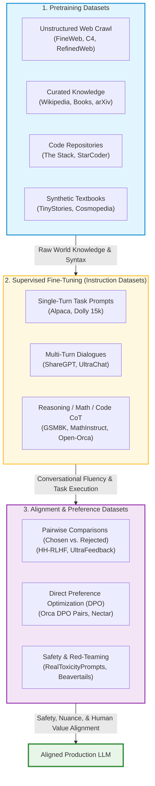
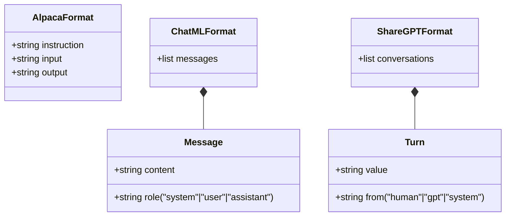
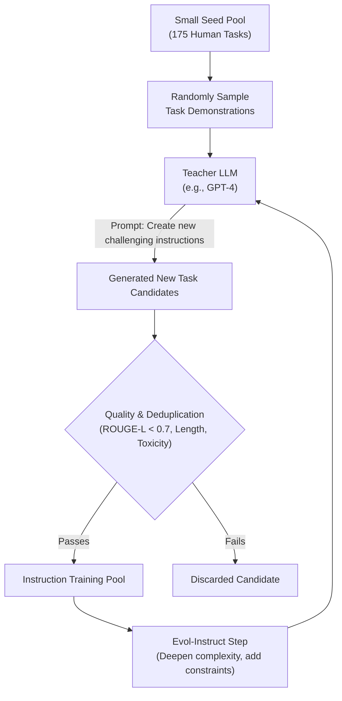

# Chapter 11: Datasets and Data Processing

> **Prerequisites:** Chapter 6 (Tokenization) and Chapter 10 (Training LLMs from Scratch). Familiarity with basic Python and data manipulation (dictionaries, JSON, lists) is recommended.

Modern Large Language Models are defined as much by the data they ingest as by the neural architectures that process them. An old computing adage, *"Garbage in, garbage out"*, has never been more relevant than in generative AI: feeding billions of poorly filtered, repetitive, or biased tokens into an LLM produces an unreliable, hallucination-prone model. Conversely, high-quality, diverse, and well-structured datasets allow compact models to outperform models ten times their size.

This chapter explores the datasets behind today's foundation models, how to acquire and process them using industry-standard tooling like Hugging Face `datasets`, how to craft custom pretraining and instruction-tuning corpora, and how to safeguard evaluation benchmarks against dataset contamination.

---

## Table of Contents

1. [Dataset Taxonomy](#1-dataset-taxonomy)
2. [Major Public Datasets for LLM Training](#2-major-public-datasets-for-llm-training)
   - [Pretraining Datasets (Web & General Knowledge)](#pretraining-datasets-web--general-knowledge)
   - [Synthetic & Small-Scale Pretraining Corpora](#synthetic--small-scale-pretraining-corpora)
   - [Instruction-Tuning Datasets](#instruction-tuning-datasets)
   - [Code Corpora](#code-corpora)
   - [Comparative Summary Table](#comparative-summary-table)
3. [Loading and Processing Data with Hugging Face `datasets`](#3-loading-and-processing-data-with-hugging-face-datasets)
   - [Basic Dataset Loading](#basic-dataset-loading)
   - [Streaming Multi-Gigabyte Datasets](#streaming-multi-gigabyte-datasets)
   - [Transformations: Filter, Map, and Batched Operations](#transformations-filter-map-and-batched-operations)
4. [Building a Custom Pretraining Dataset in JSONL Format](#4-building-a-custom-pretraining-dataset-in-jsonl-format)
5. [Crafting Instruction-Tuning Datasets](#5-crafting-instruction-tuning-datasets)
   - [Popular Formats: Alpaca, ChatML, and ShareGPT](#popular-formats-alpaca-chatml-and-sharegpt)
   - [Format Conversion Utility](#format-conversion-utility)
6. [Dataset Contamination and Benchmark Leakage](#6-dataset-contamination-and-benchmark-leakage)
   - [Why Contamination Invalidates Evaluations](#why-contamination-invalidates-evaluations)
   - [Detection Techniques (N-gram Overlap and Exact Matching)](#detection-techniques)
   - [Contamination Detection in Python](#contamination-detection-in-python)
7. [Synthetic Data: LLMs Generating Training Data](#7-synthetic-data-llms-generating-training-data)
   - [The Self-Instruct & Evol-Instruct Paradigms](#the-self-instruct--evol-instruct-paradigms)
   - [Textbooks Are All You Need (Phi Models)](#textbooks-are-all-you-need-phi-models)
   - [Advantages and Pitfalls: Model Collapse & Bias Amplification](#advantages-and-pitfalls)
8. [End-to-End Data Processing Pipeline](#8-end-to-end-data-processing-pipeline)
9. [Summary](#summary)
10. [Navigation](#navigation)

---

## 1. Dataset Taxonomy

Training a modern conversational assistant is not a monolithic single-stage process. Different stages of model maturation require fundamentally different types of data.



1. **Pretraining Corpora**: Massive, unstructured text datasets measured in billions or trillions of tokens. Objective: next-token prediction ($P(x_t \mid x_{<t})$). The model learns grammar, world facts, commonsense reasoning, and vocabulary distributions.
2. **Instruction-Tuning Datasets (SFT)**: Structured (prompt, response) pairs that teach the raw completion engine to act as an assistant that responds politely, follows formatting instructions, and answers questions.
3. **Preference & Alignment Datasets**: Pairs of responses tagged with human or automated rankings ($y_{\text{chosen}} \succ y_{\text{rejected}}$). Used with RLHF (PPO) or Direct Preference Optimization (DPO) to suppress harmful answers and prioritize helpful, truthful responses.

---

## 2. Major Public Datasets for LLM Training

### Pretraining Datasets (Web & General Knowledge)

#### 1. FineWeb
- **Developer / Organization**: Hugging Face (2024)
- **Scale**: 15 Trillion tokens (approx. 44 TB of compressed parquet files). A curated sub-version, `FineWeb-Edu` (1.3T tokens), focuses on educational content.
- **Source**: 96 Common Crawl snapshots from 2013 to 2024.
- **License**: Open Data Commons Attribution License (ODC-By v1.0).
- **Format**: Parquet files partitioned by crawl dump.
- **Use Case**: State-of-the-art open pretraining corpus. Outperforms older corpora like RefinedWeb, C4, and RedPajama on academic benchmarks (MMLU, ARC, HellaSwag).

#### 2. C4 (Colossal Clean Crawled Corpus)
- **Developer / Organization**: Google Research (2020, released with T5).
- **Scale**: ~750 GB uncompressed plain text; approximately 156 Billion tokens.
- **Source**: April 2019 Common Crawl dump.
- **License**: ODC-By.
- **Format**: Gzipped JSONL files.
- **Pipeline Highlights**: Stringent heuristic filters (removed lines without end punctuation, stripped lines containing "JavaScript", eliminated placeholder text like "lorem ipsum", filtered pages containing bad words via a 400+ term list).
- **Use Case**: Historically significant pretraining baseline used to train T5, Switch Transformer, and early open LLMs.

#### 3. OpenWebText & OpenWebText2
- **Developer / Organization**: Skylion007 / EleutherAI (2019–2020).
- **Scale**: ~38 GB compressed (~8 million web pages, ~9 Billion tokens).
- **Source**: Outgoing URLs from Reddit submissions with an upvote score of at least 3.
- **License**: MIT (code) / Open data.
- **Use Case**: Open-source reproduction of OpenAI's closed WebText corpus (the data used to train GPT-2).

#### 4. The Pile
- **Developer / Organization**: EleutherAI (2020).
- **Scale**: 825 GB uncompressed; ~300 Billion tokens across 22 diverse sub-components.
- **Source Components**: PubMed Central, arXiv, GitHub, FreeLaw, StackExchange, Wikipedia (English), Books3, OpenSubtitles, Enron Emails.
- **License**: Mixed/Academic (note: portions like Books3 faced copyright challenges and were removed in newer mirrors).
- **Use Case**: Used to pretrain GPT-J-6B, GPT-NeoX-20B, and Pythia models. Showed that domain diversity improves cross-task generalization.

#### 5. Wikipedia Dumps & WikiText-103
- **Developer / Organization**: Wikimedia Foundation / Salesforce Research (Stephen Merity et al.).
- **Scale**: 
  - English Wikipedia dump: ~4 Billion tokens (~21 GB compressed text).
  - WikiText-103: 103 Million tokens (a curated collection of Good and Featured articles).
- **License**: Creative Commons Attribution-ShareAlike 3.0/4.0 (CC-BY-SA).
- **Format**: Raw XML/Wikitext dumps (processed into text via tools like `wikiextractor`).
- **Use Case**: Standard benchmark for language modeling perplexity and high-quality factual ground truth in pretraining mixtures.

---

### Synthetic & Small-Scale Pretraining Corpora

#### TinyStories
- **Developer / Organization**: Microsoft Research (Ronen Eldan & Yuanzhi Li, 2023).
- **Scale**: 2.1 Million very short stories (~460M tokens) composed with a vocabulary accessible to a 3- to 4-year-old child.
- **Source**: Synthetically generated by querying OpenAI GPT-3.5 and GPT-4 with combinations of random English words and story concepts.
- **License**: CDLA-Permissive-2.0.
- **Significance**: Proved that small models (1M to 33M parameters) can generate grammatically flawless English with reasoning abilities if the training corpus is synthetically dense and constrained in linguistic complexity.

---

### Instruction-Tuning Datasets

#### 1. Stanford Alpaca
- **Developer / Organization**: Stanford University (Taori et al., March 2023).
- **Scale**: 52,000 instruction-following examples.
- **Source**: Generated using OpenAI's `text-davinci-003` via the *Self-Instruct* pipeline starting from 175 seed tasks. Cost under $500 to produce.
- **License**: CC-BY-NC 4.0 (Non-commercial, due to OpenAI terms forbidding training competing models).
- **Format**: JSON list of objects containing `instruction`, `input`, and `output`.

#### 2. Databricks Dolly-15k
- **Developer / Organization**: Databricks (April 2023).
- **Scale**: 15,011 high-quality instruction-response pairs.
- **Source**: 100% human-authored by over 5,000 Databricks employees across 7 task categories (Open Q&A, Closed Q&A, Information Extraction, Summarization, Brainstorming, Classification, Creative Writing).
- **License**: Creative Commons Attribution-ShareAlike 3.0 (CC-BY-SA 3.0) — **commercially usable**.
- **Significance**: The first completely open, commercially viable human instruction dataset that broke reliance on OpenAI-derived synthetic outputs.

---

### Code Corpora

#### 1. The Stack & The Stack v2
- **Developer / Organization**: BigCode Consortium (Hugging Face & ServiceNow).
- **Scale**:
  - The Stack v1: 6 TB+ of permissively licensed code files across 300+ programming languages.
  - The Stack v2: 60+ TB containing 3+ Billion files, including commit histories and Jupyter notebooks.
- **License**: Filtered strictly to permissive open-source licenses (MIT, Apache 2.0, BSD). Includes an "Am I in The Stack?" opt-out portal for developers.
- **Use Case**: Trained StarCoder, StarCoder2, and CodeLlama.

#### 2. CodeParrot
- **Developer / Organization**: Hugging Face (2022).
- **Scale**: ~180 GB of Python source files scraped from public GitHub repositories.
- **License**: Open / Permissive GitHub licenses.
- **Use Case**: Educational and reproducible benchmark for studying autoregressive code generation on a single programming language.

---

### Comparative Summary Table

| Dataset Name | Domain / Type | Approx. Size / Tokens | Primary License | Permissive for Commercial Use? | Distinctive Strength |
| :--- | :--- | :--- | :--- | :--- | :--- |
| **FineWeb** | Web crawl | 15 Trillion tokens | ODC-By 1.0 | Yes | Modern filtering, massive scale, highest benchmark scores |
| **C4** | Web crawl | ~156 Billion tokens | ODC-By 1.0 | Yes | Cleaned 2019 Common Crawl, standardized benchmark |
| **OpenWebText** | Reddit outgoing URLs | ~9 Billion tokens | MIT / Open | Yes | High engagement filter, faithful GPT-2 reproduction |
| **The Pile** | Multi-domain aggregate | ~300 Billion tokens | Mixed | Varies by split | Extraordinary academic/code/scientific diversity |
| **WikiText-103** | Curated Wikipedia | ~103 Million tokens | CC-BY-SA | Yes (with attribution) | Coherent long-form articles, standard LM benchmark |
| **TinyStories** | Synthetic children stories | ~460 Million tokens | CDLA-Permissive | Yes | Extreme quality density; trains 10M models effectively |
| **Dolly-15k** | Human instruction pairs | 15,011 examples | CC-BY-SA 3.0 | Yes | 100% human-written, free of synthetic distillation restrictions |
| **Stanford Alpaca**| Synthetic instructions | 52,000 examples | CC-BY-NC 4.0 | No (Academic only) | Sparked open-source instruction tuning revolution |
| **The Stack v2** | Multi-language Code | 3+ Billion files | Permissive licenses | Yes | Granular license filtering and developer opt-out mechanism |

---

## 3. Loading and Processing Data with Hugging Face `datasets`

The Hugging Face `datasets` library is the de facto standard tool for downloading, transforming, and streaming pretraining and instruction-tuning corpora. It uses Apache Arrow under the hood, providing zero-copy memory mapping so you can manipulate 100 GB+ datasets without exhausting system RAM.

### Basic Dataset Loading

First, install the library:
```bash
pip install datasets pyarrow
```

Here is how you load popular public datasets with single lines of code:

```python
from datasets import load_dataset

# 1. Load standard Wikipedia (English split)
# Downloads processed articles ready for language modeling
wiki_dataset = load_dataset("wikitext", "wikitext-103-v1", split="train")
print(f"WikiText-103 train samples: {len(wiki_dataset):,}")
print("Sample text preview:", wiki_dataset[0]["text"][:120])

# 2. Load synthetic story dataset (TinyStories)
tiny_stories = load_dataset("roneneldan/TinyStories", split="train")
print(f"TinyStories total samples: {len(tiny_stories):,}")
print("Story sample:", tiny_stories[5]["text"][:150])

# 3. Load instruction-tuning dataset (Databricks Dolly 15k)
dolly = load_dataset("databricks/databricks-dolly-15k", split="train")
print(f"Dolly instruction pairs: {len(dolly):,}")
print("Instruction keys:", dolly[0].keys())
```

---

### Streaming Multi-Gigabyte Datasets

Pretraining datasets like FineWeb (44 TB) or C4 (750 GB) are far too massive to download to a local laptop or small server hard drive. By setting `streaming=True`, the dataset behaves as an `IterableDataset`: it streams items over HTTP on demand without storing the full archive locally.

```python
from datasets import load_dataset

print("Connecting to FineWeb stream...")

# We load the educational subset of FineWeb in streaming mode
fineweb_stream = load_dataset(
    "HuggingFaceFW/fineweb-edu",
    name="sample-10BT",  # 10 Billion token sample slice
    split="train",
    streaming=True
)

# Inspect the first 3 documents on the fly
for idx, sample in enumerate(fineweb_stream):
    print(f"\n--- Document {idx + 1} (Score: {sample.get('educational_score', 'N/A')}) ---")
    print(f"URL: {sample['url']}")
    print(f"Text snippet: {sample['text'][:200]}...")
    if idx >= 2:
        break
```

> [!TIP]
> When training on streamed datasets, use `.shuffle(buffer_size=10_000)` to mix incoming examples across shard boundaries so the model does not encounter long runs of consecutive web pages from the same top-level domain.

---

### Transformations: Filter, Map, and Batched Operations

The `datasets` API offers vectorized transformations via `.filter()` and `.map()`. Batched mapping processes chunks in parallel using C++ Arrow arrays, accelerating tokenization and text normalization.

```python
from datasets import Dataset

# Construct an illustrative dataset
raw_records = {
    "doc_id": [101, 102, 103, 104, 105],
    "raw_text": [
        "Artificial Intelligence is transforming medical diagnostics.",
        "short",  # Noise: too brief
        "CLICK HERE TO WIN FREE MONEY NOW!!!!! http://spam.xyz",  # Spam
        "Transformers rely heavily on multi-head scaled dot-product attention mechanisms.",
        "   "  # Whitespace only
    ]
}
ds = Dataset.from_dict(raw_records)

# 1. FILTER: Eliminate empty, tiny, or obvious spam records
def is_valid_document(example: dict) -> bool:
    text = example["raw_text"].strip()
    # Require at least 25 characters and exclude blatant spam keywords
    if len(text) < 25:
        return False
    if "CLICK HERE" in text or "FREE MONEY" in text:
        return False
    return True

filtered_ds = ds.filter(is_valid_document)
print(f"Filtered {len(ds)} down to {len(filtered_ds)} quality documents.")

# 2. MAP (Batched): Normalize text and calculate character counts
def clean_and_augment(batch: dict) -> dict:
    cleaned_texts = [text.strip().lower() for text in batch["raw_text"]]
    char_counts = [len(text) for text in cleaned_texts]
    return {
        "clean_text": cleaned_texts,
        "char_count": char_counts
    }

transformed_ds = filtered_ds.map(
    clean_and_augment,
    batched=True,
    batch_size=2
)

for row in transformed_ds:
    print(f"ID {row['doc_id']} | Length: {row['char_count']} | Text: {row['clean_text']}")
```

---

## 4. Building a Custom Pretraining Dataset in JSONL Format

Pretraining pipelines ingest data packaged in **JSON Lines (JSONL)** format, where each line of a `.jsonl` file is an independent, valid JSON object containing a `"text"` key. Optional metadata keys (e.g., `"source"`, `"timestamp"`, `"license"`) can be included.

```json
{"text": "Photosynthesis is the biochemical process by which plants convert sunlight into chemical energy.", "source": "biology_textbook", "id": 1}
{"text": "Quantum entanglement occurs when pairs of particles interact such that quantum states cannot be described independently.", "source": "physics_paper", "id": 2}
```

### Python Script: Generating and Validating a Custom JSONL Dataset

```python
import json
import os
from typing import List, Dict

def create_synthetic_pretrain_corpus(output_filepath: str):
    """Generates an illustrative pretraining corpus written in JSONL format."""
    articles: List[Dict[str, str]] = [
        {
            "text": (
                "The solar system consists of the Sun and the astronomical objects bound to it "
                "by gravity. Of the eight planets, Mercury, Venus, Earth, and Mars are terrestrial "
                "planets composed primarily of rock and metal."
            ),
            "source": "astronomy_primer",
            "license": "CC0"
        },
        {
            "text": (
                "Sorting algorithms are foundational to computer science. Quicksort uses a "
                "divide-and-conquer strategy, selecting a pivot element and partitioning the array "
                "such that elements smaller than the pivot appear before it."
            ),
            "source": "algorithms_handbook",
            "license": "MIT"
        },
        {
            "text": (
                "Deep learning models require careful hyperparameter tuning. The learning rate "
                "determines the step size taken during gradient descent updates. If set too high, "
                "training diverges; if set too low, convergence takes impractically long."
            ),
            "source": "ml_notes",
            "license": "CC-BY-4.0"
        }
    ]

    os.makedirs(os.path.dirname(output_filepath) or ".", exist_ok=True)
    with open(output_filepath, "w", encoding="utf-8") as f:
        for article in articles:
            json_line = json.dumps(article, ensure_ascii=False)
            f.write(json_line + "\n")

    print(f"Successfully generated custom pretraining JSONL file at: {output_filepath}")

# Generate the file
corpus_path = "custom_pretrain_data.jsonl"
create_synthetic_pretrain_corpus(corpus_path)
```

### Loading Custom JSONL Files with Hugging Face `datasets`

```python
from datasets import load_dataset

# Load your local JSONL file into an Apache Arrow table
local_ds = load_dataset("json", data_files=corpus_path, split="train")

print(f"Loaded {len(local_ds)} documents from disk.")
print("Schema features:", local_ds.features)
print("First entry text:", local_ds[0]["text"])
```

---

## 5. Crafting Instruction-Tuning Datasets

Supervised Fine-Tuning (SFT) transforms a raw auto-completer into an interactive assistant. However, open-source models and training frameworks expect instruction data in specific conversational schemas.

### Popular Formats: Alpaca, ChatML, and ShareGPT



#### Comparison of Instruction Schemas

| Format | Representation Style | Roles / Participants | Best Suited For | Typical Frameworks |
| :--- | :--- | :--- | :--- | :--- |
| **Alpaca** | Flat dictionary with 3 distinct keys (`instruction`, `input`, `output`) | Implicit user command (`instruction` + `input`) and model output (`output`) | Single-turn Q&A, prompt-to-response generation | Hugging Face TRL, Stanford Alpaca |
| **ChatML** (OpenAI / Hugging Face) | List of nested message objects: `[{"role": "...", "content": "..."}]` | Standardized roles: `system`, `user`, `assistant`, `tool` | Multi-turn dialogues, tool calling, system prompts | vLLM, Hugging Face Tokenizers (`apply_chat_template`), Axolotl |
| **ShareGPT** | List of speaker turn objects: `[{"from": "...", "value": "..."}]` | Roles: `human` / `gpt` (or `system`) | Multi-turn conversational scrapes, chat fine-tuning | FastChat, Vicuna, Unsloth, LLaMA-Factory |

---

### Format Conversion Utility

In practice, you will frequently download a dataset formatted for Alpaca or ShareGPT and need to convert it into standardized ChatML format to use with modern tokenizers and the `apply_chat_template` API.

Below is an end-to-end Python conversion utility:

```python
from typing import List, Dict, Any

# 1. Sample Alpaca-formatted record
alpaca_sample = {
    "instruction": "Summarize the key benefit of gradient checkpointing.",
    "input": "Gradient checkpointing trades computation time for GPU VRAM during the backward pass.",
    "output": "It drastically saves GPU memory by recomputing intermediate activations instead of caching them all."
}

# 2. Sample ShareGPT-formatted record
sharegpt_sample = {
    "id": "conv_42",
    "conversations": [
        {"from": "system", "value": "You are a concise computer science professor."},
        {"from": "human", "value": "What is the time complexity of binary search?"},
        {"from": "gpt", "value": "Binary search runs in O(log n) time complexity."}
    ]
}

def convert_alpaca_to_chatml(record: Dict[str, str]) -> Dict[str, Any]:
    """Converts an Alpaca single-turn dictionary into a standardized ChatML record."""
    instruction = record.get("instruction", "").strip()
    extra_input = record.get("input", "").strip()
    response = record.get("output", "").strip()

    # If extra context exists, append it to the user instruction
    if extra_input:
        full_user_content = f"{instruction}\n\nContext / Input:\n{extra_input}"
    else:
        full_user_content = instruction

    messages = [
        {"role": "user", "content": full_user_content},
        {"role": "assistant", "content": response}
    ]
    return {"messages": messages}

def convert_sharegpt_to_chatml(record: Dict[str, Any]) -> Dict[str, Any]:
    """Converts a ShareGPT conversation history into standard ChatML format."""
    role_mapping = {
        "human": "user",
        "gpt": "assistant",
        "chatgpt": "assistant",
        "system": "system"
    }
    
    transformed_messages = []
    for turn in record.get("conversations", []):
        speaker = turn.get("from", "human")
        text = turn.get("value", "")
        standard_role = role_mapping.get(speaker, "user")
        transformed_messages.append({
            "role": standard_role,
            "content": text
        })
        
    return {"id": record.get("id", ""), "messages": transformed_messages}

# Test conversions
chatml_from_alpaca = convert_alpaca_to_chatml(alpaca_sample)
chatml_from_sharegpt = convert_sharegpt_to_chatml(sharegpt_sample)

print("Alpaca to ChatML output:")
for m in chatml_from_alpaca["messages"]:
    print(f"  [{m['role']}]: {m['content']}")

print("\nShareGPT to ChatML output:")
for m in chatml_from_sharegpt["messages"]:
    print(f"  [{m['role']}]: {m['content']}")
```

---

## 6. Dataset Contamination and Benchmark Leakage

### Why Contamination Invalidates Evaluations

**Dataset contamination** occurs when questions, choices, or answers from evaluation benchmarks (such as MMLU, GSM8K, HumanEval, or ARC) leak into the pretraining or fine-tuning corpus.

```
       Training Corpus (15 Trillion Tokens)
┌────────────────────────────────────────────────────────┐
│ ... Common Crawl snapshot 2024 ...                     │
│ "Question: If a car travels 60 miles in 1 hour ...     │  <-- Exact test sample
│  Answer: The speed is 60 mph."                         │      from GSM8K leaked!
└────────────────────────────────────────────────────────┘
                           │
                           ▼
                  LLM Memorizes String
                           │
                           ▼
                  Evaluation on GSM8K
            Result: 99.4% Accuracy (Fraudulent)
  Real Capability: Model cannot solve slightly modified math!
```

When test data leaks into training data:
1. **Memorization Masquerades as Generalization**: The model regurgitates exact answers via associative lookup rather than computing multi-step reasoning.
2. **Fragility Under Minor Perturbations**: When a variable in the leaked question is altered (e.g., changing "60 miles" to "75 miles"), accuracy collapses.
3. **Violation of Scientific Integrity**: Academic leaderboards become distorted, rewarding models that overfit leaked benchmarks over those with genuine reasoning abilities.

---

### Detection Techniques

Research groups use three primary layers of contamination detection:

1. **Exact Substring Matching**: Searching the corpus for exact matches of test question strings longer than a threshold (e.g., 30+ characters).
2. **N-gram Overlap (The 13-gram Standard)**: Introduced in OpenAI's GPT-3 paper. An evaluation prompt and a training document are flagged as contaminated if they share a common sequence of 13 consecutive words (13-gram overlap).
3. **Embedding / MinHash Decontamination**: High-dimensional vector search or Locality Sensitive Hashing to detect rephrased or paraphrased test items.

---

### Contamination Detection in Python

The following script demonstrates how to audit a training corpus against benchmark test sets using n-gram overlap and exact substring verification:

```python
import re
from typing import List, Tuple, Set

def extract_word_ngrams(text: str, n: int = 13) -> Set[Tuple[str, ...]]:
    """Extracts a set of normalized sliding word n-grams from text."""
    # Normalize: lowercase and isolate words
    words = re.findall(r"\b\w+\b", text.lower())
    if len(words) < n:
        return set()
    return {tuple(words[i : i + n]) for i in range(len(words) - n + 1)}

def check_contamination(
    training_document: str,
    test_benchmarks: List[dict],
    n_gram_size: int = 8  # Use 8 for short demo; 13 is GPT-3 standard
) -> List[dict]:
    """Audits a training document against a suite of benchmark questions.
    
    Returns details of any detected benchmark overlaps.
    """
    doc_ngrams = extract_word_ngrams(training_document, n=n_gram_size)
    normalized_doc = " ".join(re.findall(r"\b\w+\b", training_document.lower()))
    
    violations = []
    
    for item in test_benchmarks:
        bench_name = item["benchmark"]
        test_prompt = item["prompt"]
        
        # Check 1: N-gram overlap
        test_ngrams = extract_word_ngrams(test_prompt, n=n_gram_size)
        overlap = doc_ngrams.intersection(test_ngrams)
        
        # Check 2: Exact substring match (if prompt is substantial)
        norm_prompt = " ".join(re.findall(r"\b\w+\b", test_prompt.lower()))
        is_exact = len(norm_prompt) > 40 and norm_prompt in normalized_doc
        
        if overlap or is_exact:
            violations.append({
                "benchmark": bench_name,
                "overlap_count": len(overlap),
                "sample_overlap": " ".join(next(iter(overlap))) if overlap else None,
                "exact_substring": is_exact
            })
            
    return violations

# --- Verification Test Case ---
synthetic_benchmark = [
    {
        "benchmark": "GSM8K-Math",
        "prompt": "Janet buys 3 packs of golf balls with 12 balls in each pack. She loses 4 balls on the course."
    },
    {
        "benchmark": "MMLU-Physics",
        "prompt": "An electron moves at right angles to a uniform magnetic field of strength B with velocity v."
    }
]

dirty_training_doc = (
    "Here is yesterday's homework solution: Janet buys 3 packs of golf balls with 12 balls "
    "in each pack. She loses 4 balls on the course. How many does she have left? 36 - 4 = 32."
)

alerts = check_contamination(dirty_training_doc, synthetic_benchmark, n_gram_size=6)

print(f"Auditing complete. Violations detected: {len(alerts)}")
for alert in alerts:
    print(f"  [ALERT] Leaked into: {alert['benchmark']}")
    print(f"          Overlapping n-gram: '{alert['sample_overlap']}'")
    print(f"          Exact Substring Match: {alert['exact_substring']}")
```

---

## 7. Synthetic Data: LLMs Generating Training Data

As human-authored internet text becomes exhausted, researchers increasingly rely on **synthetic data**: using capable teacher models (like GPT-4) to generate, expand, or curate training corpora for student models.

### The Self-Instruct & Evol-Instruct Paradigms



1. **Self-Instruct (Stanford Alpaca / Wang et al.)**:
   - Starts with a small seed of ~175 human-written task demonstrations.
   - Prompts a teacher LLM to generate novel instructions and expected responses.
   - Filters out duplicates (using ROUGE-L similarity) and low-entropy responses.
   - Result: 52k diverse training items created in a few hours without manual data entry.

2. **Evol-Instruct (WizardLM / Xu et al.)**:
   - Rather than generating simple random tasks, instructions are systematically evolved across two dimensions:
     - **In-Depth Evolution**: Adding constraints, deepening domain complexity, or requiring multi-step reasoning.
     - **In-Breadth Evolution**: Mutating the prompt to cover underrepresented topics.

---

### "Textbooks Are All You Need" (The Phi Architecture)

Microsoft's **Phi-1**, **Phi-2**, and **Phi-3** models demonstrated that small models (1.3B to 3.8B parameters) can match or exceed models 10x larger if trained on **synthetic "textbook-quality" data**.

Traditional web crawl data contains slang, run-on sentences, grammatical inconsistencies, and fragmented reasoning. The Phi authors prompted GPT-4 to write synthetic elementary-school-level textbooks explaining programming and mathematics concepts step-by-step.

```
Web Crawl Token Quality:
"u gotta install torch bro... wait lol error 404... anyway try pip install"
       VS.
Synthetic Textbook Quality:
"To calculate the Euclidean norm of a vector, we first square each element, 
sum those squared values, and finally compute the positive square root."
```

By substituting raw noise with synthetic clarity, models learn representations significantly faster with far fewer tokens.

---

### Advantages and Pitfalls

| Dimension | Advantages of Synthetic Data | Pitfalls & Critical Risks |
| :--- | :--- | :--- |
| **Cost & Speed** | Millions of structured samples generated within hours at low cost | Dependency on proprietary API terms of service and pricing |
| **Quality & Density** | High density of educational facts, clean syntax, no HTML junk | **Model Collapse**: Recursively training models on synthetic output degrades output entropy and collapses long-tail facts |
| **Control & Diversity** | Can target specific niches (e.g., rare coding languages, medical tasks) | **Bias Inherited**: Amplifies the biases, stylistic mannerisms, and hallucination patterns of the teacher model |
| **Privacy / Copyright** | Free of real PII (names, phone numbers) when prompted properly | May inadvertently regurgitate copyrighted training snippets memorized by the teacher |

---

## 8. End-to-End Data Processing Pipeline

To understand how raw data becomes training-ready tokens, consider the complete preprocessing flow:

```mermaid
flowchart LR
    A["Raw Web Dumps\n(WARC / HTML)"] --> B["Extractor\n(Trafilatura / WET)"]
    B --> C["Deduplication\n(MinHash LSH)"]
    C --> D["Quality Filter\n(Heuristics + KenLM)"]
    D --> E["Decontamination\n(N-gram Audit)"]
    E --> F["Tokenizer\n(BPE / Byte-Level)"]
    F --> G["Sequence Packing\n(Block Length T=4096)"]
    G --> H["Batched Shards\n(Parquet / Arrow / Binary)"]

    style A fill:#ffcdd2
    style D fill:#fff9c4
    style G fill:#c8e6c9
    style H fill:#b2dfdb
```



1. **Extraction**: Raw HTML is stripped of ads, navigation banners, headers, and footers (using libraries like `trafilatura` or `justext`).
2. **Deduplication**: Hash-based exact deduplication followed by MinHash Locality-Sensitive Hashing removes duplicate and near-duplicate pages across web crawls.
3. **Quality & Safety Filtering**: FastText verifies language; rule-based heuristics drop documents with abnormal symbol-to-word ratios; toxicity classifiers prune toxic content.
4. **Decontamination Audit**: 13-gram overlap filtering guarantees that evaluation benchmarks are purged from the training corpus.
5. **Tokenization**: Subword tokenizers (e.g., Byte-Pair Encoding or SentencePiece) map characters into numeric IDs.
6. **Sequence Packing (Concatenation & Chunking)**: Short documents are concatenated and separated by `<|endoftext|>` tokens, then sliced into uniform blocks of length $T$ (e.g., 2048 or 4096 tokens). This avoids padding waste during training.
7. **Binary Sharding**: Token arrays are stored in memory-mapped binary formats (`.bin` / `.idx` or Arrow) for rapid streaming across distributed GPU clusters.

---

## Summary

- High-quality training data is the foundation of performant language models; compute-optimal scaling (Chinchilla) proves that data quality and scale match model size in importance.
- The training lifecycle relies on a **dataset taxonomy**: unstructured pretraining corpora (FineWeb, C4), supervised instruction pairs (Alpaca, Dolly-15k), and preference pairs (UltraFeedback).
- The Hugging Face `datasets` library provides zero-copy memory mapping and on-the-fly streaming (`streaming=True`) for processing terabyte-scale datasets on standard developer machines.
- Instruction fine-tuning uses schemas like **Alpaca**, **ChatML**, and **ShareGPT**, which can be transformed using simple Python conversion pipelines.
- **Dataset contamination** threatens benchmark integrity. Auditing via n-gram overlap (such as 13-gram matching) ensures evaluations reflect true generalization rather than memorization.
- **Synthetic data** generation (Self-Instruct, Evol-Instruct, synthetic textbooks) enables compact models to punch above their weight, though pipelines must guard against model collapse and inherited biases.

---

## Navigation

---
[← Chapter 10: Training LLMs from Scratch](../10-training-llms-from-scratch/README.md) | [🏠 Home](../../README.md) | [Chapter 12: Python Libraries and Tooling Ecosystem →](../12-python-libraries-ecosystem/README.md)
