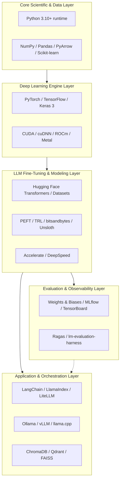
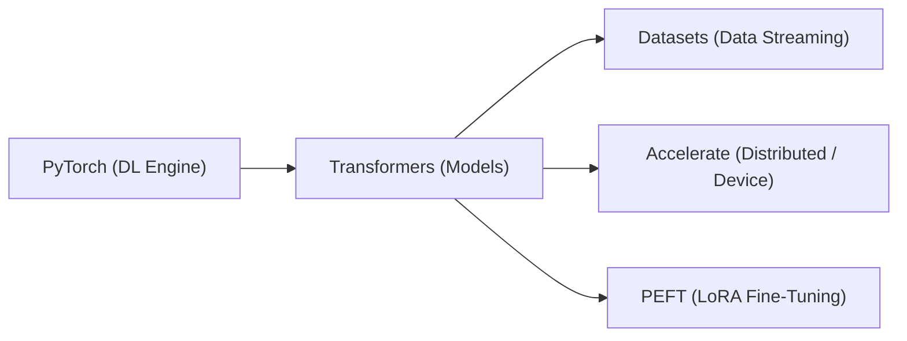

# Chapter 12: Python Libraries & Frameworks for LLMs

> **Part of the LLM Educational Handbook** — A comprehensive reference guide for students and practitioners navigating the modern artificial intelligence software stack.

## Prerequisites

Before reading this chapter, you should:
- Have a working knowledge of Python (functions, object-oriented programming, packages, virtual environments)
- Understand foundational machine learning and deep learning concepts (tensors, loss functions, backpropagation) covered in [Chapter 2](../02-machine-learning-fundamentals/README.md) and [Chapter 3](../03-deep-learning-fundamentals/README.md)
- Be familiar with basic LLM and Transformer principles introduced in [Chapter 5](../05-understanding-llms/README.md) and [Chapter 6](../06-transformer-architecture/README.md)

---

## Table of Contents

1. [The LLM Python Ecosystem Overview](#1-the-llm-python-ecosystem-overview)
2. [Core Scientific Computing](#2-core-scientific-computing)
   - [Python 3.10+](#python-310)
   - [NumPy](#numpy)
   - [Pandas](#pandas)
   - [Matplotlib](#matplotlib)
   - [Scikit-learn](#scikit-learn)
3. [Deep Learning Frameworks](#3-deep-learning-frameworks)
   - [PyTorch](#pytorch)
   - [TensorFlow 2](#tensorflow-2)
   - [Keras (Keras 3)](#keras-keras-3)
   - [Comparison: PyTorch vs. TensorFlow](#comparison-pytorch-vs-tensorflow)
4. [NLP and Tokenization](#4-nlp-and-tokenization)
   - [NLTK](#nltk)
   - [spaCy](#spacy)
   - [Hugging Face Transformers](#hugging-face-transformers)
   - [Hugging Face Tokenizers](#hugging-face-tokenizers)
   - [SentencePiece](#sentencepiece)
5. [LLM Training and Fine-Tuning](#5-llm-training-and-fine-tuning)
   - [Hugging Face Datasets](#hugging-face-datasets)
   - [Accelerate](#accelerate)
   - [PEFT (Parameter-Efficient Fine-Tuning)](#peft-parameter-efficient-fine-tuning)
   - [TRL (Transformer Reinforcement Learning)](#trl-transformer-reinforcement-learning)
   - [bitsandbytes](#bitsandbytes)
   - [DeepSpeed](#deepspeed)
   - [Axolotl](#axolotl)
   - [Unsloth](#unsloth)
6. [LLM Application Development](#6-llm-application-development)
   - [LangChain](#langchain)
   - [LlamaIndex](#llamaindex)
   - [Ollama Python SDK](#ollama-python-sdk)
   - [vLLM](#vllm)
   - [llama.cpp (llama-cpp-python)](#llamacpp-llama-cpp-python)
   - [LiteLLM](#litellm)
7. [Vector Databases and Retrieval](#7-vector-databases-and-retrieval)
   - [FAISS](#faiss)
   - [ChromaDB](#chromadb)
   - [Qdrant](#qdrant)
   - [Weaviate](#weaviate)
   - [Pinecone](#pinecone)
   - [Comparison: Vector Database Selection Matrix](#comparison-vector-database-selection-matrix)
8. [Experiment Tracking and Evaluation](#8-experiment-tracking-and-evaluation)
   - [MLflow](#mlflow)
   - [Weights & Biases (wandb)](#weights--biases-wandb)
   - [TensorBoard](#tensorboard)
   - [Ragas](#ragas)
   - [lm-evaluation-harness](#lm-evaluation-harness)
9. [Data Processing and Web Scraping](#9-data-processing-and-web-scraping)
   - [BeautifulSoup4](#beautifulsoup4)
   - [Requests](#requests)
   - [Scrapy](#scrapy)
   - [PyArrow](#pyarrow)
10. [Important Architecture Comparisons](#10-important-architecture-comparisons)
    - [LangChain vs. LlamaIndex](#langchain-vs-llamaindex)
    - [ChromaDB vs. FAISS vs. Qdrant](#chromadb-vs-faiss-vs-qdrant)
11. [Environment Setup & Best Practices](#11-environment-setup--best-practices)
    - [The Golden Rule: Never Install Everything at Once](#the-golden-rule-never-install-everything-at-once)
    - [Recommended Core LLM Stack](#recommended-core-llm-stack)
    - [Operating System & Hardware Gotchas](#operating-system--hardware-gotchas)
    - [Hands-on: Creating a Clean Environment](#hands-on-creating-a-clean-environment)
12. [Summary](#12-summary)

---

## 1. The LLM Python Ecosystem Overview

Python is the undisputed lingua franca of artificial intelligence, machine learning, and Large Language Models. However, building, training, and deploying modern LLMs requires much more than a single library. Instead, the ecosystem is composed of specialized layers, ranging from hardware abstractions and tensor math up to agentic orchestration frameworks.



Every library in this chapter addresses a specific part of this pipeline. As an engineer or researcher, your task is to choose the right combination of tools for your target application without introducing unnecessary dependencies or version conflicts.

---

## 2. Core Scientific Computing

Before handling multi-billion parameter neural networks, every data point starts as an array, a table, or a matrix. These fundamental tools power data preparation, mathematical manipulation, and model diagnostics.

---

### Python 3.10+

#### 1. What It Is and Problem Solved
Python 3.10+ provides the modern runtime, syntax, and typing foundation required by cutting-edge deep learning libraries. While older Python releases (like 3.7 or 3.8) are officially deprecated, modern AI libraries require Python 3.10, 3.11, or 3.12 for structural pattern matching, enhanced error tracebacks, union syntax (`int | str`), and optimized interpreter performance.

#### 2. Why / When to Use It
Always use Python 3.10 or 3.11 when starting a new LLM project. Python 3.10+ is required by recent releases of PyTorch (2.x), Hugging Face Transformers, vLLM, and LangChain.
> [!TIP]
> While Python 3.12 is actively gaining support, Python 3.10 and 3.11 currently have the widest pre-compiled wheel compatibility for GPU packages (such as `flash-attn` and `bitsandbytes`).

#### 3. Verification Command
```bash
python3 --version
```

#### 4. Code Example
```python
# Demonstrating Python 3.10+ structural pattern matching and union typing
from typing import Union

def parse_model_output(response: dict[str, Union[str, int, float]]) -> str:
    match response:
        case {"status": "success", "text": str(content)}:
            return f"Generated text: {content}"
        case {"status": "error", "code": int(code)}:
            return f"Failed with HTTP error code: {code}"
        case _:
            return "Unknown response payload structure"

sample_response = {"status": "success", "text": "Hello, world from Python 3.10+!"}
print(parse_model_output(sample_response))
```

#### 5. Official Documentation
[https://docs.python.org/3/](https://docs.python.org/3/)

---

### NumPy

#### 1. What It Is and Problem Solved
NumPy (Numerical Python) is the foundational library for scientific computing in Python. It provides high-performance $N$-dimensional array objects (`ndarray`), vectorization, broadcasting semantics, and basic linear algebra routines implemented in C and Fortran.

#### 2. Why / When to Use It
Use NumPy whenever you manipulate numerical embeddings, calculate vector cosine similarities, transform token distributions, or perform matrix algebra outside of a GPU tensor framework. PyTorch and TensorFlow tensors can convert to and from NumPy arrays with zero-copy memory overhead.

#### 3. Install Command
```bash
pip install numpy
```

#### 4. Working Code Example
```python
import numpy as np

# 1. Array creation: 3 vectors of dimension 4 (simulating 3 token embeddings)
embeddings = np.array([
    [0.15, 0.82, -0.31, 0.44],
    [0.91, -0.12, 0.05, 0.62],
    [0.05, 0.79, -0.28, 0.40]
])

# 2. Broadcasting: Subtract mean embedding vector for centering
mean_vector = np.mean(embeddings, axis=0) # shape: (4,)
centered_embeddings = embeddings - mean_vector # (3, 4) - (4,) broadcasts automatically

# 3. Matrix Multiplication: Calculate token-to-token similarity gram matrix (A @ A.T)
similarity_matrix = np.dot(centered_embeddings, centered_embeddings.T)

print("Original Shape:", embeddings.shape)
print("Centered Embeddings:\n", centered_embeddings)
print("Dot Product Similarity Matrix:\n", similarity_matrix)
```

#### 5. Official Documentation
[https://numpy.org/doc/stable/](https://numpy.org/doc/stable/)

---

### Pandas

#### 1. What It Is and Problem Solved
Pandas provides high-level data structures (`DataFrame` and `Series`) and data analysis tools. It simplifies reading tabular data, CSVs, JSON lines, and Parquet files, performing joins, aggregations, filtering, and cleaning training corpora.

#### 2. Why / When to Use It
Use Pandas for exploratory data analysis (EDA), cleaning instruction-tuning datasets, auditing prompt-response pairs, inspecting dataset distributions, and calculating token length statistics.

#### 3. Install Command
```bash
pip install pandas
```

#### 4. Working Code Example
```python
import pandas as pd
import io

# Simulated CSV content representing an instruction fine-tuning dataset
csv_data = """prompt,response,tokens
"What is a transformer?","An attention-based deep neural network architecture.",120
"Explain LoRA.","Low-Rank Adaptation is a parameter-efficient fine-tuning technique.",95
"Who created PyTorch?","Facebook AI Research (FAIR), now Meta AI.",45
"Write a broken function.","def foo(): pass",15
"""

# 1. Load CSV data into a DataFrame
df = pd.read_csv(io.StringIO(csv_data))

# 2. Filter rows with token count greater than 40
filtered_df = df[df["tokens"] > 40]

# 3. Summary statistics of token distribution
stats = filtered_df["tokens"].describe()

print("Filtered DataFrame (Token count > 40):")
print(filtered_df[["prompt", "tokens"]])
print("\nDescriptive Statistics:")
print(stats)
```

#### 5. Official Documentation
[https://pandas.pydata.org/docs/](https://pandas.pydata.org/docs/)

---

### Matplotlib

#### 1. What It Is and Problem Solved
Matplotlib is the premier 2D plotting library for Python. It provides fine-grained control over figures, axes, line styles, histograms, heatmaps, and publication-ready charts.

#### 2. Why / When to Use It
Use Matplotlib to visualize training and validation loss curves, learning rate decay schedules, attention maps, and model benchmark comparisons.

#### 3. Install Command
```bash
pip install matplotlib
```

#### 4. Working Code Example
```python
import matplotlib.pyplot as plt

epochs = list(range(1, 11))
train_loss = [3.82, 2.95, 2.41, 1.98, 1.65, 1.42, 1.25, 1.12, 1.04, 0.98]
val_loss   = [3.89, 3.01, 2.50, 2.10, 1.80, 1.62, 1.50, 1.45, 1.43, 1.44]

plt.figure(figsize=(8, 4.5))
plt.plot(epochs, train_loss, label="Training Loss", color="royalblue", marker="o", linewidth=2)
plt.plot(epochs, val_loss, label="Validation Loss", color="crimson", marker="s", linestyle="--", linewidth=2)

plt.title("LLM Fine-Tuning Loss Curve (10 Epochs)", fontsize=14)
plt.xlabel("Epoch", fontsize=11)
plt.ylabel("Cross-Entropy Loss", fontsize=11)
plt.grid(True, linestyle=":", alpha=0.6)
plt.legend(fontsize=11)
plt.tight_layout()

# Save figure to file without needing a display server
plt.savefig("loss_curve.png", dpi=150)
print("Loss curve saved successfully as 'loss_curve.png'.")
```

#### 5. Official Documentation
[https://matplotlib.org/stable/contents.html](https://matplotlib.org/stable/contents.html)

---

### Scikit-learn

#### 1. What It Is and Problem Solved
Scikit-learn is the standard library for classical machine learning in Python. It includes implementations for classification, regression, clustering, dimensionality reduction (PCA, t-SNE), data preprocessing, and model evaluation metrics.

#### 2. Why / When to Use It
In LLM systems, Scikit-learn is essential for splitting dataset splits (`train_test_split`), building lightweight classification probes on top of frozen LLM embeddings, computing evaluation metrics (`accuracy_score`, `f1_score`, `roc_auc_score`), and running cosine distance calculations.

#### 3. Install Command
```bash
pip install scikit-learn
```

#### 4. Working Code Example
```python
from sklearn.model_selection import train_test_split
from sklearn.linear_model import LogisticRegression
from sklearn.metrics import accuracy_score
import numpy as np

# Synthetic embedding features (100 samples, 16 dimensions) and binary sentiment labels
np.random.seed(42)
X_embeddings = np.random.randn(100, 16)
y_labels = np.random.choice([0, 1], size=100)

# 1. Split into train and test sets
X_train, X_test, y_train, y_test = train_test_split(
    X_embeddings, y_labels, test_size=0.25, random_state=42
)

# 2. Train a lightweight classification probe
classifier = LogisticRegression()
classifier.fit(X_train, y_train)

# 3. Predict and compute accuracy
predictions = classifier.predict(X_test)
acc = accuracy_score(y_test, predictions)

print(f"Test Accuracy of Embedding Probe: {acc * 100:.2f}%")
```

#### 5. Official Documentation
[https://scikit-learn.org/stable/](https://scikit-learn.org/stable/)

---

## 3. Deep Learning Frameworks

Deep learning frameworks provide dynamic computation graphs, automatic differentiation (`autograd`), and native acceleration on GPUs, TPUs, and Apple Silicon.

---

### PyTorch

#### 1. What It Is and Problem Solved
PyTorch is an open-source machine learning framework created by Meta AI and maintained by the PyTorch Foundation under the Linux Foundation. It provides dynamic computational graphs (eager execution), GPU-accelerated tensor arithmetic, and an intuitive Python-first object-oriented interface.

#### 2. Why / When to Use It
PyTorch is the undisputed industry and research standard for Large Language Models. Nearly all major modern LLM architectures—including LLaMA, Mistral, GPT-NeoX, Falcon, and Qwen—are designed and open-sourced first in PyTorch. Use it for model research, custom transformer modules, pre-training, and fine-tuning.

#### 3. Install Command
```bash
# CPU version
pip install torch
# For CUDA 12.1 enabled GPUs, use:
# pip install torch --index-url https://download.pytorch.org/whl/cu121
```

#### 4. Working Code Example
```python
import torch
import torch.nn as nn
import torch.optim as optim

# 1. Define a tiny 2-layer Feed-Forward Network module
class TinyMLP(nn.Module):
    def __init__(self, input_dim: int, hidden_dim: int, output_dim: int):
        super().__init__()
        self.fc1 = nn.Linear(input_dim, hidden_dim)
        self.relu = nn.ReLU()
        self.fc2 = nn.Linear(hidden_dim, output_dim)

    def forward(self, x: torch.Tensor) -> torch.Tensor:
        return self.fc2(self.relu(self.fc1(x)))

# 2. Initialize model, loss function, and optimizer
model = TinyMLP(input_dim=8, hidden_dim=16, output_dim=2)
criterion = nn.CrossEntropyLoss()
optimizer = optim.AdamW(model.parameters(), lr=1e-3)

# 3. Synthetic inputs and target classes
inputs = torch.randn(4, 8)       # Batch size 4, feature dim 8
targets = torch.tensor([0, 1, 1, 0]) # Target classes

# 4. Forward pass, loss calculation, backward pass, and optimizer step
optimizer.zero_grad()            # Clear gradients from previous step
outputs = model(inputs)          # Forward pass
loss = criterion(outputs, targets)
loss.backward()                  # Backward pass (computes dLoss/dW via autograd)
optimizer.step()                 # Update weights: W = W - lr * grad

print(f"Step Loss: {loss.item():.4f}")
print("Output logits shape:", outputs.shape)
```

#### 5. Official Documentation
[https://pytorch.org/docs/stable/](https://pytorch.org/docs/stable/)

---

### TensorFlow 2

#### 1. What It Is and Problem Solved
TensorFlow 2 is Google's comprehensive end-to-end open-source machine learning platform. It emphasizes robust production deployment, cross-platform export (TFLite, TF.js, TensorFlow Serving), and hardware acceleration across Google Cloud TPUs.

#### 2. Why / When to Use It
Use TensorFlow 2 when your organization has mature TensorFlow Serving infrastructure, when deploying to resource-constrained mobile/embedded platforms via TensorFlow Lite, or when training large distributed models across Google Cloud TPU pods.

#### 3. Install Command
```bash
pip install tensorflow
```

#### 4. Working Code Example
```python
import tensorflow as tf
import numpy as np

# 1. Create synthetic data
X = np.random.randn(64, 10).astype(np.float32)
y = np.random.randint(0, 2, size=(64, 1)).astype(np.float32)

# 2. Build a simple Sequential model
model = tf.keras.Sequential([
    tf.keras.layers.Dense(16, activation='relu', input_shape=(10,)),
    tf.keras.layers.Dense(1, activation='sigmoid')
])

# 3. Compile the model
model.compile(
    optimizer=tf.keras.optimizers.Adam(learning_rate=0.01),
    loss=tf.keras.losses.BinaryCrossentropy(),
    metrics=['accuracy']
)

# 4. Train the model
history = model.fit(X, y, epochs=3, batch_size=16, verbose=0)
print("Training completed. Final loss:", history.history['loss'][-1])
```

#### 5. Official Documentation
[https://www.tensorflow.org/api_docs](https://www.tensorflow.org/api_docs)

---

### Keras (Keras 3)

#### 1. What It Is and Problem Solved
Keras is a high-level deep learning API designed for human beings, minimizing cognitive load through modularity and consistent interfaces. With **Keras 3**, Keras is a multi-backend framework capable of running on top of **PyTorch**, **JAX**, and **TensorFlow** interchangeably without code modifications.

#### 2. Why / When to Use It
Use Keras 3 when you want to write backend-agnostic neural network layers or models that your team can run on PyTorch for training, JAX for TPU research, and TensorFlow for serving.

#### 3. Install Command
```bash
pip install keras
```

#### 4. Working Code Example
```python
import os
# Optional: Choose backend before importing keras ('torch', 'jax', or 'tensorflow')
os.environ["KERAS_BACKEND"] = "torch"

import keras
from keras import layers
import numpy as np

# 1. Define model architecture using Keras Functional API
inputs = keras.Input(shape=(32,))
x = layers.Dense(64, activation="relu")(inputs)
x = layers.Dropout(0.2)(x)
outputs = layers.Dense(10, activation="softmax")(x)
model = keras.Model(inputs=inputs, outputs=outputs)

# 2. Compile model
model.compile(
    optimizer=keras.optimizers.Adam(learning_rate=1e-3),
    loss="sparse_categorical_crossentropy",
    metrics=["accuracy"]
)

# 3. Fit on dummy data
dummy_x = np.random.randn(100, 32).astype("float32")
dummy_y = np.random.randint(0, 10, size=(100, 1))

model.fit(dummy_x, dummy_y, epochs=2, batch_size=32, verbose=0)
print(f"Keras 3 Model successfully trained using backend: {keras.config.backend()}")
```

#### 5. Official Documentation
[https://keras.io/](https://keras.io/)

---

### Comparison: PyTorch vs. TensorFlow

| Dimension | PyTorch | TensorFlow 2 / Keras |
| :--- | :--- | :--- |
| **Primary Philosophy** | Pythonic, dynamic, research-first | Production-oriented, unified graph & serving |
| **LLM Community Dominance** | **~90%+** of open-source LLM repos | Significant in enterprise, minority in LLMs |
| **Execution Paradigm** | Eager execution default; `torch.compile` for graph | Eager default; `@tf.function` for static graph |
| **Hardware Strengths** | NVIDIA CUDA GPUs, Apple MPS, AMD ROCm | Google TPUs (XLA), TFLite mobile engines |
| **Debugging Experience** | Native Python debuggers (`pdb`, `breakpoint()`) | Eager is easy; graph mode can be opaque |
| **Recommended For** | Fine-tuning LLMs, novel architectures, research | Cross-platform mobile deployment, enterprise TF pipelines |

---

## 4. NLP and Tokenization

Before text can be fed into an LLM, it must be normalized, segmented, and transformed into numeric token identifiers.

---

### NLTK (Natural Language Toolkit)

#### 1. What It Is and Problem Solved
NLTK is one of the oldest and most comprehensive educational NLP libraries for Python. It provides rule-based tokenizers, stopword corpuses, stemming algorithms, part-of-speech taggers, and chunkers.

#### 2. Why / When to Use It
Use NLTK for teaching classical NLP algorithms, quick rule-based text cleaning, stopword filtering, and linguistic analysis of training datasets.

#### 3. Install Command
```bash
pip install nltk
```

#### 4. Working Code Example
```python
import nltk
from nltk.tokenize import word_tokenize
from nltk.corpus import stopwords
from nltk.stem import PorterStemmer

# Download required lightweight assets
nltk.download('punkt', quiet=True)
nltk.download('stopwords', quiet=True)

raw_text = "Transformers are revolutionizing natural language processing tasks."

# 1. Tokenization
tokens = word_tokenize(raw_text.lower())

# 2. Stopword removal
stop_words = set(stopwords.words('english'))
filtered_tokens = [w for w in tokens if w.isalnum() and w not in stop_words]

# 3. Stemming
stemmer = PorterStemmer()
stemmed_tokens = [stemmer.stem(w) for w in filtered_tokens]

print("Original Tokens:", tokens)
print("Filtered Tokens:", filtered_tokens)
print("Stemmed Tokens: ", stemmed_tokens)
```

#### 5. Official Documentation
[https://www.nltk.org/](https://www.nltk.org/)

---

### spaCy

#### 1. What It Is and Problem Solved
spaCy is an industrial-strength NLP library built in Cython for speed and efficiency. It provides pre-trained convolutional and transformer-based pipelines for named entity recognition (NER), dependency parsing, and lemmatization.

#### 2. Why / When to Use It
Use spaCy when extracting real-world entities (names, organizations, locations, dates) from unstructured documents before indexing into a vector database, or when creating synthetic training data filters.

#### 3. Install Command
```bash
pip install spacy
# Download small English model
python -m spacy download en_core_web_sm
```

#### 4. Working Code Example
```python
import spacy

# Load lightweight pre-trained pipeline
nlp = spacy.load("en_core_web_sm")

doc = nlp("Sundar Pichai announced that Google is investing in generative AI in Mountain View.")

# 1. Named Entity Recognition (NER)
print("Named Entities:")
for ent in doc.ents:
    print(f" - {ent.text:<15} ({ent.label_}: {spacy.explain(ent.label_)})")

# 2. Lemmatization and Part-of-Speech tagging
print("\nTokens & Lemmas:")
for token in doc[:5]:
    print(f" - {token.text:<10} Lemma: {token.lemma_:<10} POS: {token.pos_}")
```

#### 5. Official Documentation
[https://spacy.io/](https://spacy.io/)

---

### Hugging Face Transformers

#### 1. What It Is and Problem Solved
Hugging Face `transformers` is the cornerstone library of the modern LLM revolution. It provides thousands of pre-trained model implementations (causal LM, masked LM, seq2seq, vision-language) with a unified, high-level API.

#### 2. Why / When to Use It
Use `transformers` whenever you want to load, download, run inference on, or fine-tune open-weight LLMs (like GPT-2, LLaMA-3, Mistral, Gemma, Phi-3, and BERT).

#### 3. Install Command
```bash
pip install transformers torch
```

#### 4. Working Code Example
```python
from transformers import AutoTokenizer, AutoModelForCausalLM, pipeline
import torch

# Use a tiny model for fast, reproducible local execution
model_name = "distilbert/distilgpt2"

# 1. Using the high-level pipeline abstraction
generator = pipeline("text-generation", model=model_name, device="cpu")
result = generator("Artificial Intelligence is", max_new_tokens=20, do_sample=True, top_k=50)
print("Pipeline Output:\n", result[0]["generated_text"])

# 2. Using explicit Tokenizer and Model classes
tokenizer = AutoTokenizer.from_pretrained(model_name)
model = AutoModelForCausalLM.from_pretrained(model_name)

inputs = tokenizer("The future of computing is", return_tensors="pt")
with torch.no_grad():
    output_tokens = model.generate(**inputs, max_new_tokens=15, pad_token_id=tokenizer.eos_token_id)

decoded = tokenizer.decode(output_tokens[0], skip_special_tokens=True)
print("\nExplicit Model Generate Output:\n", decoded)
```

#### 5. Official Documentation
[https://huggingface.co/docs/transformers/index](https://huggingface.co/docs/transformers/index)

---

### Hugging Face Tokenizers

#### 1. What It Is and Problem Solved
Implemented in Rust, Hugging Face `tokenizers` provides blazing fast tokenization. It can tokenize gigabytes of text in seconds, supporting Byte-Pair Encoding (BPE), WordPiece, and Unigram algorithms.

#### 2. Why / When to Use It
Use `tokenizers` when training a new tokenizer from scratch on a domain-specific dataset (such as medical records, legal text, or code) or when tokenization speed is the bottleneck in your pre-training pipeline.

#### 3. Install Command
```bash
pip install tokenizers
```

#### 4. Working Code Example
```python
from tokenizers import Tokenizer
from tokenizers.models import BPE
from tokenizers.trainers import BpeTrainer
from tokenizers.pre_tokenizers import Whitespace

# 1. Initialize an empty BPE tokenizer
tokenizer = Tokenizer(BPE(unk_token="[UNK]"))
tokenizer.pre_tokenizer = Whitespace()

# 2. Train tokenizer on an in-memory sample corpus
corpus = [
    "Large language models understand natural language.",
    "Language models predict the next token based on context.",
    "Transformers rely on the self-attention mechanism."
]
trainer = BpeTrainer(special_tokens=["[UNK]", "[CLS]", "[SEP]", "[PAD]", "[MASK]"], vocab_size=100)
tokenizer.train_from_iterator(corpus, trainer=trainer)

# 3. Encode new text
encoded = tokenizer.encode("Large language transformers predict tokens.")
print("Vocab size:", tokenizer.get_vocab_size())
print("Tokens:    ", encoded.tokens)
print("Token IDs: ", encoded.ids)
```

#### 5. Official Documentation
[https://huggingface.co/docs/tokenizers/index](https://huggingface.co/docs/tokenizers/index)

---

### SentencePiece

#### 1. What It Is and Problem Solved
SentencePiece is an unsupervised text tokenizer and detokenizer developed by Google. It treats raw text as an unbroken input stream (including whitespace), making it language-independent and eliminating language-specific pre-tokenization logic.

#### 2. Why / When to Use It
SentencePiece is the underlying tokenizer engine for prominent models including LLaMA, ALBERT, T5, and Gemma. Use it when maintaining compatibility with models that expect SentencePiece `.model` binary token files.

#### 3. Install Command
```bash
pip install sentencepiece
```

#### 4. Working Code Example
```python
import sentencepiece as spm
import io

# 1. Train a tiny SentencePiece model directly from Python
corpus = (
    "Machine learning models require tokenization.\n"
    "SentencePiece handles whitespace directly as a symbol.\n"
    "Subword units solve out-of-vocabulary challenges.\n"
)

# Train and output model to temporary file
spm.SentencePieceTrainer.train(
    sentence_iterator=iter(corpus.splitlines()),
    model_prefix='m_test',
    vocab_size=60,
    model_type='bpe',
    character_coverage=1.0
)

# 2. Load the trained model and encode text
sp = spm.SentencePieceProcessor()
sp.load('m_test.model')

pieces = sp.encode_as_pieces("Machine learning subword units.")
ids = sp.encode_as_ids("Machine learning subword units.")

print("SentencePiece Subwords:", pieces)
print("SentencePiece IDs:     ", ids)
```

#### 5. Official Documentation
[https://github.com/google/sentencepiece](https://github.com/google/sentencepiece)

---

## 5. LLM Training and Fine-Tuning

Training or fine-tuning models with billions of parameters requires specialized tools that manage data streaming, distribute computational tensors across multiple GPUs, and compress weights into low-bit representations.

---

### Hugging Face Datasets

#### 1. What It Is and Problem Solved
Hugging Face `datasets` is a lightweight library designed to download, process, and stream massive datasets with memory-mapping (Arrow format) under the hood. It ensures your machine doesn't run out of RAM even when processing multi-terabyte datasets.

#### 2. Why / When to Use It
Use `datasets` for all LLM pre-training and fine-tuning pipelines. It provides instant access to thousands of public datasets on the Hugging Face Hub with zero-copy caching and parallelized mapping.

#### 3. Install Command
```bash
pip install datasets
```

#### 4. Working Code Example
```python
from datasets import load_dataset

# 1. Load a small public dataset (wikitext)
dataset = load_dataset("wikitext", "wikitext-2-raw-v1", split="train[:50]")

# 2. Filter out blank lines
non_empty = dataset.filter(lambda example: len(example["text"].strip()) > 0)

# 3. Map a transformation (compute character length)
processed = non_empty.map(lambda example: {"char_length": len(example["text"])})

# 4. Convert top 3 rows to a Pandas DataFrame for easy viewing
df_preview = processed.select(range(3)).to_pandas()
print(df_preview[["text", "char_length"]])
```

#### 5. Official Documentation
[https://huggingface.co/docs/datasets/index](https://huggingface.co/docs/datasets/index)

---

### Accelerate

#### 1. What It Is and Problem Solved
Hugging Face `accelerate` simplifies writing PyTorch training scripts that run seamlessly on a single CPU, single GPU, multiple GPUs (DistributedDataParallel / FSDP), or TPUs, without changing a single line of your model execution logic.

#### 2. Why / When to Use It
Use `accelerate` whenever you write custom PyTorch loops for training or fine-tuning LLMs. It replaces boilerplate code for device placement, mixed-precision training (FP16/BF16), and gradient accumulation.

#### 3. Install Command
```bash
pip install accelerate
```

#### 4. Working Code Example
```python
from accelerate import Accelerator
import torch
import torch.nn as nn
from torch.utils.data import DataLoader, TensorDataset

# 1. Initialize the Accelerator object
accelerator = Accelerator()

# 2. Standard PyTorch model, optimizer, and DataLoader
model = nn.Linear(10, 2)
optimizer = torch.optim.SGD(model.parameters(), lr=0.01)
dataset = TensorDataset(torch.randn(32, 10), torch.randint(0, 2, (32,)))
dataloader = DataLoader(dataset, batch_size=8)

# 3. Prepare all components for distributed / accelerated execution
model, optimizer, dataloader = accelerator.prepare(model, optimizer, dataloader)

# 4. Standard training loop using accelerator.backward()
for batch_x, batch_y in dataloader:
    optimizer.zero_grad()
    outputs = model(batch_x)
    loss = nn.functional.cross_entropy(outputs, batch_y)
    
    # Replaces loss.backward() to handle mixed precision and multi-GPU automatically
    accelerator.backward(loss)
    optimizer.step()

print(f"Accelerate training step ran on device: {accelerator.device}")
```

#### 5. Official Documentation
[https://huggingface.co/docs/accelerate/index](https://huggingface.co/docs/accelerate/index)

---

### PEFT (Parameter-Efficient Fine-Tuning)

#### 1. What It Is and Problem Solved
Full fine-tuning of an 8B or 70B parameter model requires updating all model weights, necessitating enormous GPU VRAM. PEFT freezes the original pre-trained parameters and trains a tiny fraction (typically 0.1% to 1%) of additional parameters using methods like **LoRA** (Low-Rank Adaptation), Prefix Tuning, and Prompt Tuning.

#### 2. Why / When to Use It
Always use PEFT when fine-tuning modern LLMs on consumer or single-node GPUs. With LoRA, you can fine-tune an 8B model on a single 16GB or 24GB GPU instead of needing an 8x80GB A100 cluster.

#### 3. Install Command
```bash
pip install peft
```

#### 4. Working Code Example
```python
from transformers import AutoModelForCausalLM
from peft import LoraConfig, get_peft_model, TaskType

# 1. Load base pre-trained model (using tiny distilgpt2 for illustration)
model = AutoModelForCausalLM.from_pretrained("distilbert/distilgpt2")

# 2. Configure Low-Rank Adaptation (LoRA)
lora_config = LoraConfig(
    task_type=TaskType.CAUSAL_LM,
    r=8,                     # Rank of decomposition matrices
    lora_alpha=32,           # Scaling factor
    lora_dropout=0.05,       # Dropout rate for LoRA layers
    target_modules=["c_attn"] # Modules to adapt (for GPT-2 style attention)
)

# 3. Wrap model with PEFT
peft_model = get_peft_model(model, lora_config)

# 4. Inspect trainable parameters
peft_model.print_trainable_parameters()
```

#### 5. Official Documentation
[https://huggingface.co/docs/peft/index](https://huggingface.co/docs/peft/index)

---

### TRL (Transformer Reinforcement Learning)

#### 1. What It Is and Problem Solved
TRL is a full-stack library providing training abstractions for post-training LLMs: Supervised Fine-Tuning (SFT), Direct Preference Optimization (DPO), and Reinforcement Learning from Human Feedback (RLHF / PPO).

#### 2. Why / When to Use It
Use TRL when you want to turn a pre-trained base model into an instruction-following assistant using `SFTTrainer` or align it with user preferences using `DPOTrainer`.

#### 3. Install Command
```bash
pip install trl
```

#### 4. Working Code Example
```python
from transformers import AutoTokenizer, AutoModelForCausalLM
from datasets import Dataset
from trl import SFTTrainer, SFTConfig

# 1. Model and Tokenizer
model_id = "distilbert/distilgpt2"
tokenizer = AutoTokenizer.from_pretrained(model_id)
tokenizer.pad_token = tokenizer.eos_token
model = AutoModelForCausalLM.from_pretrained(model_id)

# 2. Sample instruction dataset
data = {
    "text": [
        "Instruction: Summarize AI.\nResponse: AI is machine intelligence.",
        "Instruction: What is 2+2?\nResponse: 2 + 2 equals 4."
    ]
}
train_dataset = Dataset.from_dict(data)

# 3. Configure and run SFTTrainer
training_args = SFTConfig(
    output_dir="./sft_output",
    max_steps=1,
    per_device_train_batch_size=2,
    logging_steps=1,
    report_to="none"
)

trainer = SFTTrainer(
    model=model,
    train_dataset=train_dataset,
    dataset_text_field="text",
    args=training_args
)

print("SFTTrainer initialized successfully with dataset field 'text'.")
```

#### 5. Official Documentation
[https://huggingface.co/docs/trl/index](https://huggingface.co/docs/trl/index)

---

### bitsandbytes

#### 1. What It Is and Problem Solved
`bitsandbytes` is a lightweight Python wrapper around custom CUDA kernels for 8-bit and 4-bit precision matrix operations. It provides 8-bit optimizers (Adam8bit) and enables loading LLMs in 4-bit precision (NormalFloat4 / NF4) via QLoRA.

#### 2. Why / When to Use It
Use `bitsandbytes` when you have limited GPU memory. A 7B parameter model in standard 16-bit float requires ~14GB–16GB VRAM just to load weights. Loaded in 4-bit via `bitsandbytes`, it requires under 5GB VRAM.

#### 3. Install Command
```bash
pip install bitsandbytes
```

#### 4. Working Code Example
```python
from transformers import AutoModelForCausalLM, BitsAndBytesConfig
import torch

# Configure 4-bit QLoRA Quantization
bnb_config = BitsAndBytesConfig(
    load_in_4bit=True,
    bnb_4bit_quant_type="nf4",               # NormalFloat4 data format
    bnb_4bit_compute_dtype=torch.float16,    # Computation precision
    bnb_4bit_use_double_quant=True           # Nested quantization to save more memory
)

print("BitsAndBytesConfig created:")
print(bnb_config.to_dict())

# Usage pattern when loading an actual model (requires CUDA GPU):
# model = AutoModelForCausalLM.from_pretrained(
#     "meta-llama/Meta-Llama-3-8B",
#     quantization_config=bnb_config,
#     device_map="auto"
# )
```

#### 5. Official Documentation
[https://huggingface.co/docs/bitsandbytes/main](https://huggingface.co/docs/bitsandbytes/main)

---

### DeepSpeed

#### 1. What It Is and Problem Solved
DeepSpeed is an extreme-scale distributed optimization library developed by Microsoft. It implements the **ZeRO** (Zero Redundancy Optimizer) family of algorithms (ZeRO-1, ZeRO-2, ZeRO-3) which shard optimizer states, gradients, and model parameters across hundreds or thousands of GPUs.

#### 2. Why / When to Use It
Use DeepSpeed when training models that exceed the memory capacity of a single GPU, or when scaling training across multi-node GPU clusters. It is integrated natively into Hugging Face `Trainer`.

#### 3. Install Command
```bash
pip install deepspeed
```

#### 4. Working Code / Configuration Overview
DeepSpeed is typically controlled via a JSON configuration passed to training scripts:
```python
# sample_deepspeed_config.py
deepspeed_config = {
    "train_batch_size": "auto",
    "fp16": {
        "enabled": True
    },
    "zero_optimization": {
        "stage": 2,                      # ZeRO-Stage 2: Shard gradients & optimizer states
        "allgather_partitions": True,
        "allgather_bucket_size": 2e8,
        "overlap_comm": True,
        "cpu_offload": False
    }
}
print("DeepSpeed Stage 2 Config loaded. Ready for distributed execution.")
```

#### 5. Official Documentation
[https://www.deepspeed.ai/](https://www.deepspeed.ai/)

---

### Axolotl

#### 1. What It Is and Problem Solved
Axolotl is a streamlined, config-driven framework for fine-tuning LLMs. Instead of writing custom Python scripts for tokenization, packing, LoRA, and distributed setups, you define your entire fine-tuning run in a single YAML file.

#### 2. Why / When to Use It
Use Axolotl when you want a battle-tested, production-ready recipe for fine-tuning open-source models with support for FlashAttention, sample packing, multi-GPU FSDP/DeepSpeed, and popular dataset formats.

#### 3. Install Command
```bash
pip install axolotl
```

#### 4. Usage Overview (YAML Configuration)
```yaml
# config.yaml (Axolotl fine-tuning recipe)
base_model: meta-llama/Meta-Llama-3-8B
model_type: LlamaForCausalLM
tokenizer_type: AutoTokenizer

load_in_8bit: false
load_in_4bit: true

datasets:
  - path: vicgalle/alpaca-gpt4
    type: alpaca

adapter: lora
lora_r: 16
lora_alpha: 32
lora_dropout: 0.05
lora_target_linear: true

sequence_len: 4096
sample_packing: true
flash_attention: true
learning_rate: 0.0002
```
To run the fine-tuning job:
```bash
accelerate launch -m axolotl.cli.train config.yaml
```

#### 5. Official Documentation
[https://github.com/axolotl-ai-cloud/axolotl](https://github.com/axolotl-ai-cloud/axolotl)

---

### Unsloth

#### 1. What It Is and Problem Solved
Unsloth is an ultra-fast LLM fine-tuning library that rewires PyTorch autograd kernels in manual OpenAI Triton code. It speeds up fine-tuning by **2x to 5x** and reduces GPU VRAM consumption by up to **70%** with zero loss in mathematical accuracy.

#### 2. Why / When to Use It
Use Unsloth when fine-tuning LLaMA-3, Mistral, Gemma, or Phi on single consumer GPUs (like RTX 3090/4090 or Google Colab T4 instances) where speed and memory efficiency are paramount.

#### 3. Install Command
```bash
pip install unsloth
```

#### 4. Working Code Example
```python
# Unsloth typical fine-tuning bootstrap pattern
try:
    from unsloth import FastLanguageModel
    import torch

    max_seq_length = 2048
    model, tokenizer = FastLanguageModel.from_pretrained(
        model_name="unsloth/llama-3-8b-bnb-4bit",
        max_seq_length=max_seq_length,
        load_in_4bit=True
    )

    # Add LoRA adapters directly through Unsloth's optimized method
    model = FastLanguageModel.get_peft_model(
        model,
        r=16,
        target_modules=["q_proj", "k_proj", "v_proj", "o_proj", "gate_proj", "up_proj", "down_proj"],
        lora_alpha=16,
        lora_dropout=0, # Unsloth supports 0 dropout for maximum speed
        bias="none",
        use_gradient_checkpointing="unsloth"
    )
    print("Unsloth FastLanguageModel initialized with optimized Triton kernels.")
except ImportError:
    print("Unsloth is designed for Linux CUDA environments with Triton.")
```

#### 5. Official Documentation
[https://github.com/unslothai/unsloth](https://github.com/unslothai/unsloth)

---

## 6. LLM Application Development

Once models are trained or downloaded, application frameworks enable developers to build Retrieval-Augmented Generation (RAG) pipelines, agents, local tools, and high-throughput production servers.

---

### LangChain

#### 1. What It Is and Problem Solved
LangChain is an extensive application development framework designed to connect LLMs with external data sources, computation engines, and tools through standardized chains, memory constructs, and agent abstractions (LangGraph).

#### 2. Why / When to Use It
Use LangChain when building multi-step reasoning applications, conversational agents with external tool calling (search, calculators, APIs), or complex workflows requiring broad third-party integrations.

#### 3. Install Command
```bash
pip install langchain langchain-core
```

#### 4. Working Code Example
```python
from langchain_core.prompts import PromptTemplate
from langchain_core.runnables import RunnableLambda

# 1. Create a prompt template
prompt = PromptTemplate(
    template="Explain {concept} to a college student in one concise sentence.",
    input_variables=["concept"]
)

# 2. Mock model invocation runnable (simulating an LLM call)
mock_llm = RunnableLambda(lambda text: f"Mock Response: {text.strip()}")

# 3. Combine into a LangChain Runnable Expression Language (LCEL) chain
chain = prompt | mock_llm

# 4. Invoke the chain
result = chain.invoke({"concept": "Attention Mechanism"})
print(result)
```

#### 5. Official Documentation
[https://python.langchain.com/docs/](https://python.langchain.com/docs/)

---

### LlamaIndex

#### 1. What It Is and Problem Solved
LlamaIndex (formerly GPT Index) is a specialized data framework tailored specifically for building state-of-the-art **Retrieval-Augmented Generation (RAG)** systems. It provides data connectors for hundreds of file formats, flexible document chunking strategies, indexing abstractions, and query engines.

#### 2. Why / When to Use It
Use LlamaIndex when your primary objective is querying private data (PDFs, Notion, SQL databases, codebase repositories). It is cleaner, more focused, and superior to LangChain for advanced search and retrieval architectures.

#### 3. Install Command
```bash
pip install llama-index llama-index-core
```

#### 4. Working Code Example
```python
from llama_index.core import Document, VectorStoreIndex
from llama_index.core.embeddings import MockEmbedding
from llama_index.core import Settings

# 1. Use mock embeddings to run locally without external API keys
Settings.embed_model = MockEmbedding(embed_dim=8)
Settings.llm = None # Disable live LLM call for offline indexing test

# 2. Create in-memory documents
documents = [
    Document(text="PyTorch was created by Meta AI and is the most popular framework for LLMs."),
    Document(text="LlamaIndex specializes in data ingestion, indexing, and RAG pipelines.")
]

# 3. Build Vector Store Index
index = VectorStoreIndex.from_documents(documents)

# 4. Build retriever
retriever = index.as_retriever(similarity_top_k=1)
nodes = retriever.retrieve("Which library is built for RAG?")

print("Retrieved Document Node:")
for node in nodes:
    print(" - Score:", node.score)
    print(" - Content:", node.text)
```

#### 5. Official Documentation
[https://docs.llamaindex.ai/](https://docs.llamaindex.ai/)

---

### Ollama Python SDK

#### 1. What It Is and Problem Solved
Ollama is a popular tool for running open-source LLMs (LLaMA-3, Mistral, Phi-3) locally on macOS, Linux, and Windows. The official Python library gives programmatic access to the local Ollama daemon.

#### 2. Why / When to Use It
Use Ollama when building offline applications, running local student lab assignments, or developing desktop privacy-first AI tools without incurring cloud API costs.

#### 3. Install Command
```bash
pip install ollama
```

#### 4. Working Code Example
```python
import ollama

# Note: Requires the Ollama desktop service running (`ollama serve`)
try:
    # 1. Chat completion call
    response = ollama.chat(
        model='llama3',
        messages=[{'role': 'user', 'content': 'What is quantization in one sentence?'}]
    )
    print("Ollama Response:", response['message']['content'])
except Exception as e:
    print(f"Ollama local daemon not reachable ({e}). Ensure `ollama serve` is running.")
```

#### 5. Official Documentation
[https://github.com/ollama/ollama-python](https://github.com/ollama/ollama-python)

---

### vLLM

#### 1. What It Is and Problem Solved
vLLM is a high-throughput, memory-efficient LLM serving engine created at UC Berkeley. It invented **PagedAttention**, an algorithm that manages Attention Key-Value (KV) cache memory in virtual memory pages, preventing memory fragmentation and increasing serving throughput by **2x to 4x** compared to Hugging Face.

#### 2. Why / When to Use It
Use vLLM when deploying LLMs to production serving endpoints, hosting self-hosted OpenAI-compatible inference servers, or performing massive offline batch generation.

#### 3. Install Command
```bash
pip install vllm
```

#### 4. Working Code Example
```python
# Offline batch inference example with vLLM
try:
    from vllm import LLM, SamplingParams

    # 1. Set sampling parameters
    sampling_params = SamplingParams(temperature=0.7, top_p=0.95, max_tokens=32)

    # 2. Initialize LLM engine (automatically applies PagedAttention)
    llm = LLM(model="facebook/opt-125m") # Lightweight open model

    # 3. Batch generate outputs
    prompts = [
        "Explain the theory of relativity.",
        "What is the capital of France?"
    ]
    outputs = llm.generate(prompts, sampling_params)

    for output in outputs:
        print(f"Prompt: {output.prompt}")
        print(f"Output: {output.outputs[0].text.strip()}\n")
except Exception as e:
    print(f"vLLM requires a compatible Linux environment and GPU accelerator ({e}).")
```

#### 5. Official Documentation
[https://docs.vllm.ai/](https://docs.vllm.ai/)

---

### llama.cpp (llama-cpp-python)

#### 1. What It Is and Problem Solved
`llama.cpp` is a pure C/C++ inference engine developed by Georgi Gerganov with minimal dependencies and first-class AVX/NEON/Metal CPU acceleration. `llama-cpp-python` provides Python bindings for running quantized `.gguf` format models directly on consumer laptops.

#### 2. Why / When to Use It
Use `llama.cpp` when running LLMs on consumer laptops without discrete GPUs, on Apple Silicon Macs, or on edge devices like Raspberry Pi.

#### 3. Install Command
```bash
pip install llama-cpp-python
```

#### 4. Working Code Example
```python
try:
    from llama_cpp import Llama

    # 1. Initialize engine with a local GGUF format model file
    # llm = Llama(model_path="./models/llama-3-8b.Q4_K_M.gguf", n_ctx=2048)
    
    # 2. Run inference
    # output = llm(
    #     "Q: Name three primary colors. A:",
    #     max_tokens=32,
    #     stop=["Q:", "\n"]
    # )
    # print(output["choices"][0]["text"])
    print("llama-cpp-python installed and ready to load .gguf quantized model weights.")
except ImportError:
    print("llama-cpp-python not installed.")
```

#### 5. Official Documentation
[https://llama-cpp-python.readthedocs.io/](https://llama-cpp-python.readthedocs.io/)

---

### LiteLLM

#### 1. What It Is and Problem Solved
LiteLLM provides a unified OpenAI-standard interface to call over 100+ different LLM APIs—including Anthropic Claude, OpenAI GPT-4o, Google Gemini, AWS Bedrock, Mistral, Groq, and Ollama—using the identical input/output format.

#### 2. Why / When to Use It
Use LiteLLM to eliminate vendor lock-in. Switching models or setting up automatic fallback routines (e.g., fall back to Claude if GPT-4 errors out) takes only a single configuration change.

#### 3. Install Command
```bash
pip install litellm
```

#### 4. Working Code Example
```python
import litellm

# Mock or test invocation using litellm's completion interface
try:
    # LiteLLM automatically maps model parameters regardless of provider
    response = litellm.completion(
        model="ollama/llama3", # Or 'gpt-4o', 'claude-3-5-sonnet-20241022', etc.
        messages=[{"role": "user", "content": "Hello world!"}],
        mock_response="Hello! I am an LLM responding through LiteLLM's unified API."
    )
    print("Standardized Output:")
    print(response.choices[0].message.content)
except Exception as e:
    print(f"LiteLLM call error: {e}")
```

#### 5. Official Documentation
[https://docs.litellm.ai/](https://docs.litellm.ai/)

---

## 7. Vector Databases and Retrieval

Retrieval-Augmented Generation depends on vector databases to index, store, and perform Approximate Nearest Neighbor (ANN) search over high-dimensional text embeddings.

---

### FAISS

#### 1. What It Is and Problem Solved
FAISS (Facebook AI Similarity Search) is an open-source C++ library with Python bindings developed by Meta AI. It provides extremely optimized algorithms for searching dense vectors in spaces that may not fit in RAM, supporting GPU acceleration and vector quantization (IVF, PQ).

#### 2. Why / When to Use It
Use FAISS for high-performance in-memory vector similarity search when you don't need a full database server (e.g., no multi-user access or rich metadata filtering).

#### 3. Install Command
```bash
# CPU version
pip install faiss-cpu
# For GPU systems:
# pip install faiss-gpu
```

#### 4. Working Code Example
```python
import faiss
import numpy as np

# 1. Vector dimension and synthetic dataset
d = 64                           # Dimension of embeddings
nb = 1000                        # Database size (1000 vectors)
nq = 3                           # Number of query vectors

np.random.seed(1234)
xb = np.random.random((nb, d)).astype('float32') # Database vectors
xq = np.random.random((nq, d)).astype('float32') # Query vectors

# 2. Build index using Euclidean distance (L2)
index = faiss.IndexFlatL2(d)
print("Index initialized. Is trained?", index.is_trained)

# 3. Add vectors to the index
index.add(xb)
print("Total vectors indexed:", index.ntotal)

# 4. Search for the 4 nearest neighbors (k=4)
k = 4
distances, indices = index.search(xq, k)

print("\nQuery results (Indices of nearest neighbors):")
print(indices)
print("\nDistances to nearest neighbors:")
print(distances)
```

#### 5. Official Documentation
[https://github.com/facebookresearch/faiss](https://github.com/facebookresearch/faiss)

---

### ChromaDB

#### 1. What It Is and Problem Solved
ChromaDB is an open-source, developer-friendly embedding database designed to be embedded directly into Python applications or run as a standalone server. It handles embedding generation, storage, and metadata filtering out of the box.

#### 2. Why / When to Use It
Use ChromaDB for prototypes, local hackathons, and desktop applications. It is the easiest vector database to get started with because it requires zero server setup.

#### 3. Install Command
```bash
pip install chromadb
```

#### 4. Working Code Example
```python
import chromadb

# 1. Initialize in-memory ephemeral client
client = chromadb.Client()

# 2. Create or retrieve collection
collection = client.create_collection(name="quickstart_docs")

# 3. Add documents directly (Chroma will embed them automatically using default model)
collection.add(
    documents=[
        "Chroma is an open-source embedding database.",
        "PyTorch is a machine learning framework for Python.",
        "Retrieval Augmented Generation combines search with LLMs."
    ],
    metadatas=[{"category": "database"}, {"category": "ml"}, {"category": "ai"}],
    ids=["doc1", "doc2", "doc3"]
)

# 4. Query by semantic similarity
results = collection.query(
    query_texts=["What database should I use for embeddings?"],
    n_results=2
)

print("ChromaDB Query Results:")
for doc, meta, dist in zip(results['documents'][0], results['metadatas'][0], results['distances'][0]):
    print(f" - [{meta['category']}] (Dist: {dist:.3f}) {doc}")
```

#### 5. Official Documentation
[https://docs.trychroma.com/](https://docs.trychroma.com/)

---

### Qdrant

#### 1. What It Is and Problem Solved
Qdrant is an enterprise-grade vector similarity search engine written in Rust. It offers an easy-to-use API with advanced payload-based filtering, quantization, multi-tenancy, and distributed clustering.

#### 2. Why / When to Use It
Use Qdrant when deploying production RAG systems that require filtering vectors by complex metadata attributes (e.g., user ID, date ranges, tenant permissions) without sacrificing vector search latency.

#### 3. Install Command
```bash
pip install qdrant-client
```

#### 4. Working Code Example
```python
from qdrant_client import QdrantClient
from qdrant_client.models import Distance, VectorParams, PointStruct, Filter, FieldCondition, MatchValue

# 1. Initialize local in-memory instance
client = QdrantClient(":memory:")

# 2. Create a collection
client.create_collection(
    collection_name="text_embeddings",
    vectors_config=VectorParams(size=4, distance=Distance.COSINE)
)

# 3. Upsert points with payload metadata
points = [
    PointStruct(id=1, vector=[0.05, 0.61, 0.76, 0.17], payload={"topic": "nlp", "year": 2024}),
    PointStruct(id=2, vector=[0.19, 0.81, 0.24, 0.11], payload={"topic": "vision", "year": 2023}),
    PointStruct(id=3, vector=[0.03, 0.58, 0.79, 0.15], payload={"topic": "nlp", "year": 2022})
]
client.upsert(collection_name="text_embeddings", points=points)

# 4. Search with payload filter
search_result = client.query_points(
    collection_name="text_embeddings",
    query=[0.04, 0.60, 0.75, 0.16],
    query_filter=Filter(
        must=[FieldCondition(key="topic", match=MatchValue(value="nlp"))]
    ),
    limit=2
)

print("Qdrant Search Matches (Filtered by topic='nlp'):")
for hit in search_result.points:
    print(f" - ID: {hit.id}, Score: {hit.score:.4f}, Payload: {hit.payload}")
```

#### 5. Official Documentation
[https://qdrant.tech/documentation/](https://qdrant.tech/documentation/)

---

### Weaviate

#### 1. What It Is and Problem Solved
Weaviate is an open-source, cloud-native, schema-first vector database. It stores both objects and vectors, allowing users to combine vector search with structured search through a GraphQL or REST interface.

#### 2. Why / When to Use It
Use Weaviate when your data model has strict schemas, relationships, or multi-modal objects (images + text) and you want built-in vectorization modules directly on the database engine.

#### 3. Install Command
```bash
pip install weaviate-client
```

#### 4. Working Overview
```python
import weaviate

# Connect to a local or cloud Weaviate instance
# client = weaviate.connect_to_local()
print("Weaviate client installed. Supports hybrid search, schema enforcement, and multi-modal indexing.")
```

#### 5. Official Documentation
[https://weaviate.io/developers/weaviate](https://weaviate.io/developers/weaviate)

---

### Pinecone

#### 1. What It Is and Problem Solved
Pinecone is a managed, serverless cloud vector database. It removes all operational complexity (cluster sizing, sharding, replication, upgrades) and offers low-latency search at massive scale with pay-per-use billing.

#### 2. Why / When to Use It
Use Pinecone when your team wants a turnkey, zero-maintenance cloud vector database with SLA guarantees and does not want to manage local or cloud database infrastructure.

#### 3. Install Command
```bash
pip install pinecone-client
```

#### 4. Working Overview
```python
from pinecone import Pinecone

# Example initialization with API key:
# pc = Pinecone(api_key="YOUR_API_KEY")
# index = pc.Index("my-rag-index")
print("Pinecone client ready for managed serverless vector search.")
```

#### 5. Official Documentation
[https://docs.pinecone.io/](https://docs.pinecone.io/)

---

### Comparison: Vector Database Selection Matrix

| Feature | FAISS | ChromaDB | Qdrant | Weaviate | Pinecone |
| :--- | :--- | :--- | :--- | :--- | :--- |
| **Deployment Mode** | In-memory library | Embedded / Server | Server / Cloud / In-memory | Server / Cloud | Cloud-only managed |
| **Primary Language** | C++ | Python | Rust | Go | Proprietary Cloud |
| **Setup Complexity** | Very Low | Minimal (zero-conf) | Low (Docker/pip) | Medium | Zero (Managed) |
| **Metadata Filtering** | Limited / Manual | Basic | **Advanced (Fast)** | Advanced (GraphQL) | Full metadata filter |
| **Persistence** | File export (`write_index`) | SQLite / DuckDB | RocksDB / Disk-backed | Custom storage engine | Managed Cloud |
| **Best For** | Academic research, fast indexing | Prototypes, local apps | **Production RAG systems** | Complex schemas, multi-modal | Enterprise zero-maintenance |

---

## 8. Experiment Tracking and Evaluation

Training and fine-tuning LLMs is expensive. Systematic experiment tracking and standardized evaluation benchmarks are essential to monitor progress and prevent regressions.

---

### MLflow

#### 1. What It Is and Problem Solved
MLflow is an open-source platform managed by the Linux Foundation for managing the end-to-end machine learning lifecycle. It tracks hyperparameters, metrics, code versions, and model artifacts with a centralized model registry.

#### 2. Why / When to Use It
Use MLflow when your organization requires an on-premise or self-hosted model registry and experiment tracking server with no external data sharing.

#### 3. Install Command
```bash
pip install mlflow
```

#### 4. Working Code Example
```python
import mlflow
import tempfile

# 1. Start an experiment tracking run
with mlflow.start_run(run_name="llama-lora-finetune"):
    # 2. Log hyperparameters
    mlflow.log_param("learning_rate", 2e-4)
    mlflow.log_param("lora_rank", 16)
    mlflow.log_param("batch_size", 8)
    
    # 3. Log metrics across iterations
    for step, loss in enumerate([2.45, 1.89, 1.42, 1.15]):
        mlflow.log_metric("train_loss", loss, step=step)
        
    # 4. Log an artifact (e.g. model card or sample output)
    with tempfile.NamedTemporaryFile("w", delete=False, suffix=".txt") as f:
        f.write("Model fine-tuned on instruction dataset.")
        temp_name = f.name
    mlflow.log_artifact(temp_name, artifact_path="model_card")

print("MLflow experiment run logged successfully.")
```

#### 5. Official Documentation
[https://mlflow.org/docs/latest/index.html](https://mlflow.org/docs/latest/index.html)

---

### Weights & Biases (wandb)

#### 1. What It Is and Problem Solved
Weights & Biases (`wandb`) is the gold standard cloud-based developer platform for deep learning experiment tracking, system metric monitoring (GPU temperature, VRAM usage), and hyperparameter sweeps.

#### 2. Why / When to Use It
Use `wandb` for serious fine-tuning and pre-training runs. It integrates automatically into Hugging Face `Trainer` with a single flag (`report_to="wandb"`).

#### 3. Install Command
```bash
pip install wandb
```

#### 4. Working Code Example
```python
import wandb

# Initialize in offline mode for local demonstration
wandb.init(project="llm-handbook-demo", mode="offline")

# Log metrics during training
for epoch in range(1, 4):
    wandb.log({
        "epoch": epoch,
        "train/loss": 2.5 / epoch,
        "eval/perplexity": 12.4 / epoch
    })

wandb.finish()
print("WandB offline run completed.")
```

#### 5. Official Documentation
[https://docs.wandb.ai/](https://docs.wandb.ai/)

---

### TensorBoard

#### 1. What It Is and Problem Solved
TensorBoard is TensorFlow's visualization toolkit, also fully supported by PyTorch via `torch.utils.tensorboard`. It provides interactive loss and metric graphs, weight histogram visualizers, and text generation logging.

#### 2. Why / When to Use It
Use TensorBoard when you want an entirely free, open-source, local visualization dashboard without needing cloud accounts or internet connectivity.

#### 3. Install Command
```bash
pip install tensorboard
```

#### 4. Working Code Example
```python
from torch.utils.tensorboard import SummaryWriter
import shutil

log_dir = "./tb_logs"
writer = SummaryWriter(log_dir=log_dir)

# Log scalar loss values
for step in range(10):
    writer.add_scalar("Loss/train", 1.0 / (step + 1), step)
    writer.add_scalar("LearningRate", 0.001 * (0.95 ** step), step)

writer.close()
print(f"TensorBoard summary written to {log_dir}. Run `tensorboard --logdir={log_dir}` to view.")
shutil.rmtree(log_dir) # cleanup
```

#### 5. Official Documentation
[https://www.tensorflow.org/tensorboard](https://www.tensorflow.org/tensorboard)

---

### Ragas

#### 1. What It Is and Problem Solved
Ragas (Retrieval Augmented Generation Assessment) is a framework for evaluating RAG pipelines. Instead of manual subjective grading, Ragas computes automated metrics: **Faithfulness** (is the answer grounded in context?), **Answer Relevancy** (does it answer the prompt?), and **Context Precision/Recall**.

#### 2. Why / When to Use It
Use Ragas during RAG development to systematically evaluate chunking strategies, embedding models, and prompt modifications before deploying to production.

#### 3. Install Command
```bash
pip install ragas
```

#### 4. Working Overview
```python
# Overview of Ragas evaluation pattern
try:
    from ragas.metrics import faithfulness, answer_relevancy
    print("Ragas metrics loaded: faithfulness, answer_relevancy ready for RAG dataset audit.")
except ImportError:
    print("Ragas library available via `pip install ragas`.")
```

#### 5. Official Documentation
[https://docs.ragas.io/](https://docs.ragas.io/)

---

### lm-evaluation-harness

#### 1. What It Is and Problem Solved
Developed by EleutherAI, `lm-evaluation-harness` (`lm-eval`) is the definitive benchmarking suite for Large Language Models. It powers the Hugging Face Open LLM Leaderboard and covers over 60 standard academic benchmarks (MMLU, GSM8k, HellaSwag, ARC, TruthfulQA).

#### 2. Why / When to Use It
Use `lm-evaluation-harness` to run reproducible, standard benchmark evaluations on your fine-tuned models to verify whether training improved reasoning or caused catastrophic forgetting.

#### 3. Install Command
```bash
pip install lm-eval
```

#### 4. Working Overview
```bash
# Run standard evaluation CLI command
lm_eval --model hf \
    --model_args pretrained=distilbert/distilgpt2 \
    --tasks hellaswag,arc_easy \
    --device cpu \
    --batch_size 8
```

#### 5. Official Documentation
[https://github.com/EleutherAI/lm-evaluation-harness](https://github.com/EleutherAI/lm-evaluation-harness)

---

## 9. Data Processing and Web Scraping

Pre-training and fine-tuning datasets originate from digital documents across the web. These tools facilitate extraction, parsing, and serialization.

---

### BeautifulSoup4

#### 1. What It Is and Problem Solved
BeautifulSoup4 (`bs4`) is a Python library for pulling structured data out of HTML and XML documents. It creates parse trees from dirty, malformed HTML markup effortlessly.

#### 2. Why / When to Use It
Use BeautifulSoup4 to strip HTML tags, script blocks, and styling from web pages, converting raw web dumps into clean natural language text for training corpora.

#### 3. Install Command
```bash
pip install beautifulsoup4
```

#### 4. Working Code Example
```python
from bs4 import BeautifulSoup

html_doc = """
<html>
  <head><title>LLM Documentation</title></head>
  <body>
    <h1>Chapter 12: Libraries</h1>
    <p class="summary">Python powers modern AI through specialized libraries.</p>
    <p>Transformers enable attention-based language generation.</p>
    <script>console.log("analytics");</script>
  </body>
</html>
"""

# 1. Parse HTML
soup = BeautifulSoup(html_doc, "html.parser")

# 2. Clean out script tags
for s in soup(["script", "style"]):
    s.decompose()

# 3. Extract text paragraphs
paragraphs = [p.get_text() for p in soup.find_all("p")]
print("Extracted Clean Paragraphs:")
for p in paragraphs:
    print(" -", p)
```

#### 5. Official Documentation
[https://www.crummy.com/software/BeautifulSoup/bs4/doc/](https://www.crummy.com/software/BeautifulSoup/bs4/doc/)

---

### Requests

#### 1. What It Is and Problem Solved
Requests is the gold standard HTTP library for Python, built for human developers. It abstracts network sockets, query parameters, encoding, and connection pooling.

#### 2. Why / When to Use It
Use Requests to download raw dataset archives, query REST API endpoints, fetch remote documents, and test custom LLM model servers.

#### 3. Install Command
```bash
pip install requests
```

#### 4. Working Code Example
```python
import requests

# Querying a public metadata endpoint
response = requests.get(
    "https://api.github.com/repos/huggingface/transformers",
    headers={"User-Agent": "LLM-Handbook-Student"}
)

if response.status_code == 200:
    data = response.json()
    print("Repository:", data.get("full_name"))
    print("Stars:     ", data.get("stargazers_count"))
    print("Description:", data.get("description"))
else:
    print(f"Request returned status code: {response.status_code}")
```

#### 5. Official Documentation
[https://requests.readthedocs.io/](https://requests.readthedocs.io/)

---

### Scrapy

#### 1. What It Is and Problem Solved
Scrapy is an asynchronous, high-throughput web crawling and scraping framework. Unlike simple HTTP request scripts, Scrapy handles rate-limiting, proxies, URL deduplication, and recursive link extraction across millions of domains.

#### 2. Why / When to Use It
Use Scrapy when engineering massive web crawls to build proprietary pre-training datasets or web-scale knowledge bases.

#### 3. Install Command
```bash
pip install scrapy
```

#### 4. Working Overview
```python
# Minimal Scrapy Spider definition
import scrapy

class TextDatasetSpider(scrapy.Spider):
    name = "text_spider"
    start_urls = ["https://en.wikipedia.org/wiki/Artificial_intelligence"]

    def parse(self, response):
        paragraphs = response.css('p::text').getall()
        yield {"url": response.url, "content": " ".join(paragraphs)[:200]}

print("Scrapy Spider defined. Execute with: scrapy runspider spider.py -o output.jsonl")
```

#### 5. Official Documentation
[https://scrapy.org/](https://scrapy.org/)

---

### PyArrow

#### 1. What It Is and Problem Solved
Apache PyArrow is the Python library for Apache Arrow, a cross-language columnar in-memory data format. It provides lightning-fast Parquet file reading and writing, zero-copy interprocess memory sharing, and efficient nested data structures.

#### 2. Why / When to Use It
PyArrow is the underlying engine for Hugging Face `datasets`. Use it directly when saving and loading tokenized datasets, serializing embedding matrices, or working with large-scale Parquet partitions.

#### 3. Install Command
```bash
pip install pyarrow
```

#### 4. Working Code Example
```python
import pyarrow as pa
import pyarrow.parquet as pq
import tempfile
import os

# 1. Create an Arrow Table with token arrays
tokens_data = pa.array([[101, 2054, 102], [101, 1037, 3075, 102]])
labels_data = pa.array([1, 0])
table = pa.Table.from_arrays([tokens_data, labels_data], names=["token_ids", "label"])

# 2. Write to Parquet file
temp_dir = tempfile.mkdtemp()
parquet_path = os.path.join(temp_dir, "tokens.parquet")
pq.write_table(table, parquet_path)

# 3. Read back from Parquet
read_table = pq.read_table(parquet_path)
print("PyArrow Parquet Readback:")
print(read_table.to_pandas())

# Cleanup
os.remove(parquet_path)
os.rmdir(temp_dir)
```

#### 5. Official Documentation
[https://arrow.apache.org/docs/python/index.html](https://arrow.apache.org/docs/python/index.html)

---

## 10. Important Architecture Comparisons

### LangChain vs. LlamaIndex

Students often ask: *"Should I use LangChain or LlamaIndex?"* While they have overlapping features, their core architectural focus is distinct:

| Dimension | LangChain | LlamaIndex |
| :--- | :--- | :--- |
| **Core Philosophy** | General-purpose orchestration & multi-agent systems | Data ingestion, indexing, and specialized RAG |
| **Data Connectors** | Good, but often wrappers around generic tools | Exceptional native document readers and chunkers |
| **RAG Performance** | Requires significant custom assembly | Out-of-the-box advanced RAG (reranking, node parsing) |
| **Tool Calling & Agents** | Extensive ecosystem (LangGraph) | Workflows & agents are present, but RAG remains core focus |
| **Learning Curve** | Moderate to steep (large surface area) | Gentle for search & retrieval tasks |
| **Recommendation** | Use for **complex agents** with varied tools and logic | Use when building a **RAG system over private documents** |

> [!TIP]
> **Can you use both together?** Yes! A very common production pattern is to use **LlamaIndex** to build the retrieval engine, and expose it as a tool inside a **LangChain** or **LangGraph** conversational agent.

---

### ChromaDB vs. FAISS vs. Qdrant

| Feature | ChromaDB | FAISS | Qdrant |
| :--- | :--- | :--- | :--- |
| **Type** | Embedded Vector Store | In-memory Algorithm Library | Production Vector Database |
| **Persistence** | Embedded SQLite / Local files | Raw binary index dump | Transactional disk storage (RocksDB) |
| **Filtering Capability** | Basic key-value equality | Minimal without custom code | **Rich boolean filters & payload index** |
| **Scale Limit** | ~100k to 500k vectors | Billions (with GPU & clustering) | Billions (with horizontal distributed nodes) |
| **Ideal Project** | Weekend projects, local student labs | Research benchmarks, raw vector search | Production multi-user applications |

---

## 11. Environment Setup & Best Practices

### The Golden Rule: Never Install Everything at Once

> [!CAUTION]
> **Avoid "Dependency Hell":** Do **NOT** run `pip install` with every library listed in this chapter into a single global environment.
>
> Many advanced AI libraries have conflicting binary dependencies:
> - `bitsandbytes` requires specific CUDA toolkits and has native Linux binary dependencies.
> - `vLLM` compiles custom CUDA kernels that require exact PyTorch and CUDA version matches.
> - `tensorflow` and `torch` can conflict over shared C++ runtime symbols.
> - Web scrapers (`scrapy`) pull in complex networking stacks (`twisted`) unnecessary for model training.

---

### Recommended Core LLM Stack

For 80% of student coursework, fine-tuning experiments, and LLM research, stick to this lean, battle-tested core stack:



```bash
pip install torch transformers datasets accelerate peft
```

---

### Operating System & Hardware Gotchas

1. **Linux (Ubuntu 22.04 / Debian / RHEL):**
   - The gold standard for LLM training and serving.
   - Native support for `bitsandbytes`, `vLLM`, `DeepSpeed`, and `FlashAttention`.
2. **macOS (Apple Silicon M1/M2/M3/M4):**
   - Use PyTorch with Apple's Metal Performance Shaders (`mps` device).
   - `llama.cpp` and `ollama` run with hardware acceleration.
   - `bitsandbytes` CUDA kernels and `vLLM` are **not** supported natively.
3. **Windows 11:**
   - Supported for basic PyTorch and Hugging Face inference.
   - For serious fine-tuning or quantization (`bitsandbytes`, `deepspeed`), always use **WSL2 (Windows Subsystem for Linux)** with NVIDIA CUDA drivers passed through.

---

### Hands-on: Creating a Clean Environment

Always create an isolated virtual environment for each project:

#### 1. Setup Virtual Environment
```bash
# Create a clean virtual environment using Python 3.10 or 3.11
python3 -m venv llm-env

# Activate the virtual environment
# On Linux / macOS:
source llm-env/bin/activate

# On Windows (cmd.exe):
# llm-env\Scripts\activate.bat
```

#### 2. Verify Pip and Wheel Tools
```bash
pip install --upgrade pip setuptools wheel
```

#### 3. Install Purpose-Specific Subsets

##### Option A: Core LLM Fine-Tuning & Modeling
```bash
pip install torch transformers datasets accelerate peft bitsandbytes trl
```

##### Option B: RAG & Application Development
```bash
pip install llama-index chromadb langchain litellm requests pydantic
```

##### Option C: High-Throughput Production Serving (Linux + CUDA)
```bash
pip install vllm ray
```

---

## 12. Summary

The Python AI ecosystem provides an unmatched toolset for Large Language Models. By understanding which tool belongs to which layer—from low-level tensor computation with NumPy and PyTorch, to model fine-tuning with PEFT and TRL, and retrieval with Qdrant and LlamaIndex—you can design clean, performant, and maintainable AI applications.

Keep your dependencies modular, use virtual environments, and leverage open-source models with confidence!

---

[← Previous Chapter](../11-datasets-and-data-processing/README.md) | [🏠 Home](../../README.md) | [Next Chapter →](../13-fine-tuning-llms/README.md)
