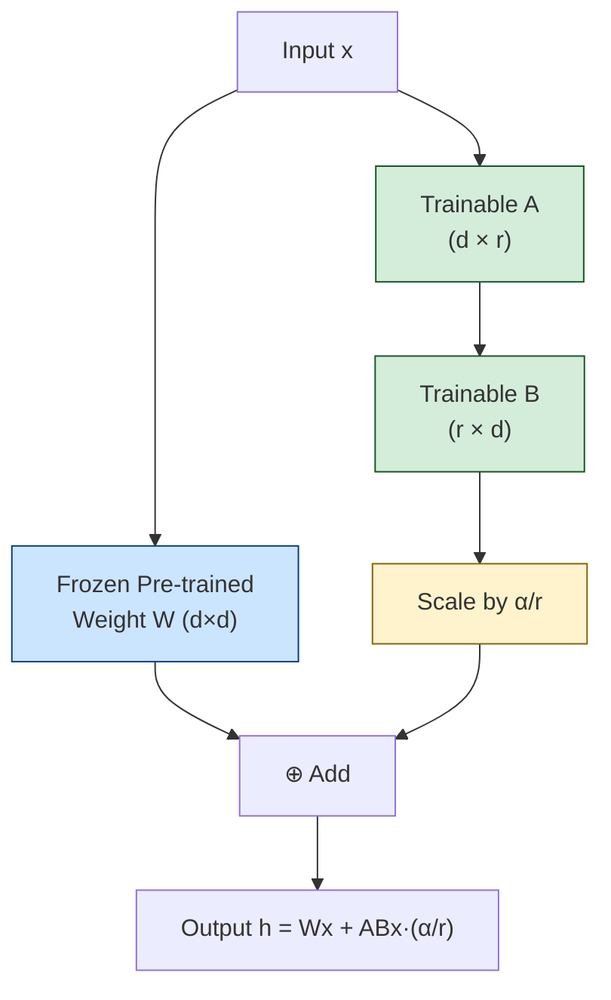
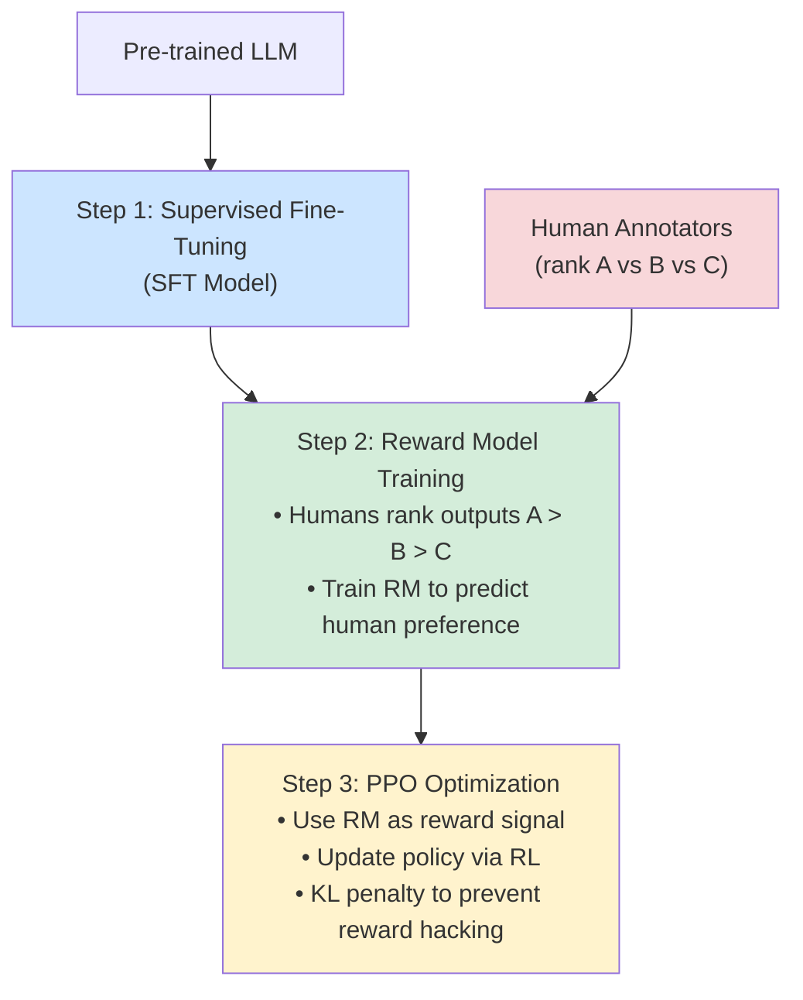
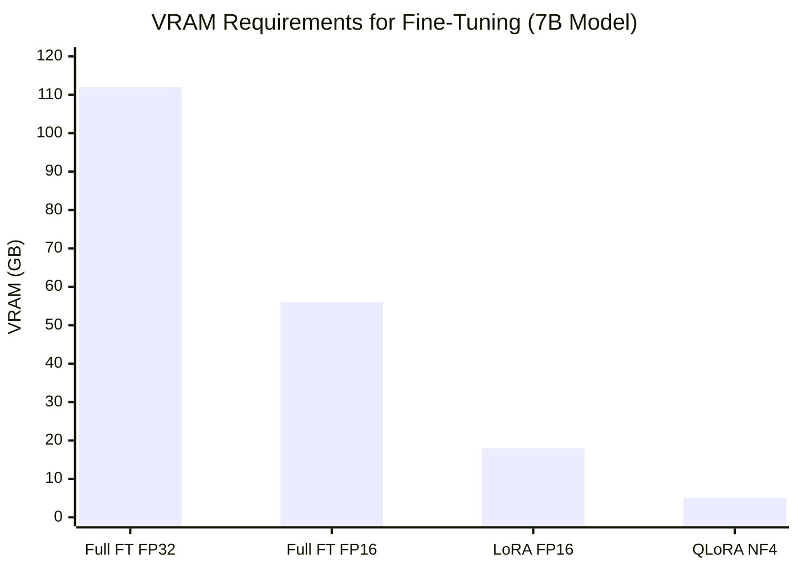
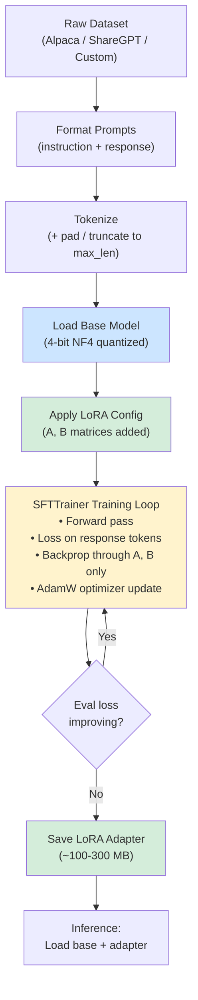

# Chapter 13: Fine-Tuning Large Language Models

> **Prerequisites:** Chapters 5–7 (Transformers, Attention, Pre-training), Chapter 10 (Prompt Engineering), Chapter 12 (Training at Scale)

---

## Table of Contents

1. [Why Fine-Tune?](#1-why-fine-tune)
2. [Fine-Tuning vs Prompting vs RAG](#2-fine-tuning-vs-prompting-vs-rag)
3. [Full Fine-Tuning](#3-full-fine-tuning)
4. [Supervised Fine-Tuning (SFT)](#4-supervised-fine-tuning-sft)
5. [Parameter-Efficient Fine-Tuning (PEFT)](#5-parameter-efficient-fine-tuning-peft)
6. [Instruction Tuning](#6-instruction-tuning)
7. [Domain-Specific Fine-Tuning](#7-domain-specific-fine-tuning)
8. [RLHF: Reinforcement Learning from Human Feedback](#8-rlhf-reinforcement-learning-from-human-feedback)
9. [DPO: Direct Preference Optimization](#9-dpo-direct-preference-optimization)
10. [Hardware Requirements](#10-hardware-requirements)
11. [Complete QLoRA Fine-Tuning Code Example](#11-complete-qlora-fine-tuning-code-example)
12. [Summary](#12-summary)

---

## 1. Why Fine-Tune?

A **pre-trained LLM** (like LLaMA, Mistral, or GPT-4) has learned enormous general-purpose knowledge from internet-scale text. But general knowledge isn't always enough:

| Problem | Example |
|---|---|
| Wrong tone | Model writes casually; your app needs formal legal language |
| Missing domain knowledge | Base model hallucinates drug dosages; you need medical precision |
| Wrong format | Model returns prose; your app needs structured JSON |
| Instruction-following | Base model completes text; you want it to follow commands |

### Why Not Train from Scratch?

Training a 7B-parameter model from scratch requires:
- **~$1–5 million** in compute costs
- **Terabytes** of curated training data
- **Weeks** of GPU cluster time
- Huge ML engineering teams

Fine-tuning achieves **80–95% of the benefit** at **0.1–1% of the cost**, by starting from a checkpoint that already understands language and adapting it to your task.

### The Three Levers

```
Pre-trained Model
       │
       ├─── 1. Prompting         (zero/few-shot, no training)
       ├─── 2. Fine-Tuning       (update weights on your data)
       └─── 3. RAG               (augment context at inference)
```

---

## 2. Fine-Tuning vs Prompting vs RAG

| Dimension | Prompting | RAG | Fine-Tuning |
|---|---|---|---|
| **Training required** | ❌ None | ❌ None (embedding only) | ✅ Yes |
| **Custom knowledge** | Limited (context window) | ✅ Dynamic retrieval | ✅ Baked into weights |
| **Latency** | Low | Medium (retrieval adds ~100–500 ms) | Low |
| **Cost** | Per-token API cost | Storage + retrieval + LLM | Upfront training + inference |
| **Knowledge updates** | Edit the prompt | Update the vector store | Retrain |
| **Behavior/style change** | Hard | Hard | ✅ Easy |
| **Factual grounding** | ⚠️ Hallucination risk | ✅ Grounded in documents | ⚠️ Can still hallucinate |
| **Best for** | Quick prototypes | Knowledge-heavy QA | Style, format, domain specialization |

**Rule of thumb:**
- Use **prompting** when: you want general-purpose behavior and have good examples
- Use **RAG** when: you need up-to-date or large private document knowledge
- Use **fine-tuning** when: you need consistent tone/style, instruction-following, or domain expertise baked in

---

## 3. Full Fine-Tuning

In **full fine-tuning**, every parameter in the model is updated during training via standard backpropagation and gradient descent — identical to pre-training, but on a much smaller, task-specific dataset.

```
Pre-trained weights W (frozen during pre-training)
       ↓
Load checkpoint
       ↓
Run forward pass on fine-tuning data
       ↓
Compute loss (cross-entropy)
       ↓
Backpropagate → update ALL weights W
       ↓
Save fine-tuned checkpoint
```

### Challenges of Full Fine-Tuning

| Challenge | Description |
|---|---|
| **Memory** | 7B model needs ~28 GB VRAM (FP32) just for weights — plus optimizer states (Adam needs 2× weights) |
| **Catastrophic forgetting** | Model "forgets" general capabilities while learning new task |
| **Overfitting** | Small fine-tuning datasets → model memorizes instead of generalizing |
| **Cost** | Multiple expensive GPUs for days |

This is why **PEFT (Parameter-Efficient Fine-Tuning)** methods like LoRA and QLoRA dominate in practice.

---

## 4. Supervised Fine-Tuning (SFT)

**Supervised Fine-Tuning** is fine-tuning on pairs of **(instruction, response)** to teach a model to follow instructions. This is the most common first step in creating a chat model from a base model.

### Dataset Formats

#### Alpaca Format
```json
{
  "instruction": "Translate the following English text to French.",
  "input": "Hello, how are you?",
  "output": "Bonjour, comment allez-vous?"
}
```
- `instruction`: what the model should do
- `input`: optional additional context
- `output`: the desired response

#### ChatML Format (used by OpenAI, Mistral, etc.)
```
<|im_start|>system
You are a helpful assistant.<|im_end|>
<|im_start|>user
What is the capital of France?<|im_end|>
<|im_start|>assistant
The capital of France is Paris.<|im_end|>
```

#### ShareGPT Format
```json
{
  "conversations": [
    {"from": "human", "value": "What is 2 + 2?"},
    {"from": "gpt",   "value": "2 + 2 = 4."},
    {"from": "human", "value": "What about 3 + 3?"},
    {"from": "gpt",   "value": "3 + 3 = 6."}
  ]
}
```
Supports **multi-turn conversations** natively — better for training chat models.

### SFT Loss Function

The loss is **cross-entropy computed on response tokens only** — the model is not penalized for getting instruction tokens "wrong" (since those are given, not generated):

```
Input:  [INST] What is the capital of France? [/INST] The capital of France is Paris.
                ←────────────── MASK ──────────────────→ ←──── LOSS COMPUTED HERE ────→
```

This avoids the model wasting capacity learning to predict the question it was asked.

```python
# Conceptual SFT loss
def sft_loss(logits, labels, response_mask):
    """
    logits:        (batch, seq_len, vocab_size)
    labels:        (batch, seq_len)          — token IDs
    response_mask: (batch, seq_len)          — 1 for response tokens, 0 for prompt
    """
    loss = cross_entropy(logits, labels, reduction='none')  # (batch, seq_len)
    loss = (loss * response_mask).sum() / response_mask.sum()
    return loss
```

---

## 5. Parameter-Efficient Fine-Tuning (PEFT)

PEFT methods update **a tiny fraction of parameters** while keeping most model weights frozen. This slashes memory and compute requirements drastically.

### 5.1 LoRA (Low-Rank Adaptation)

**Key insight:** Weight updates during fine-tuning tend to be **low-rank**. Rather than updating the full weight matrix W (d×d), we can approximate the update ΔW as a product of two small matrices.

#### The Math

For a weight matrix **W ∈ ℝ^(d×d)**:

```
Instead of learning:    W' = W + ΔW       (d² params to update)
LoRA learns:            W' = W + A·B      (only 2×d×r params)

Where:
  A ∈ ℝ^(d×r)   — "down-projection"  (trained, initialized randomly)
  B ∈ ℝ^(r×d)   — "up-projection"    (trained, initialized to zero)
  r ≪ d          — the "rank" (typically 8, 16, or 32)
```

**At init:** B=0, so A·B=0 and the model starts identical to pre-trained weights.  
**After training:** A·B ≠ 0 and captures the task-specific adaptation.

#### Parameter Savings

| Method | Parameters for d=4096 layer |
|---|---|
| Full fine-tuning | 4096 × 4096 = **16.7M** |
| LoRA (r=8) | 2 × 4096 × 8 = **65K** |
| LoRA (r=16) | 2 × 4096 × 16 = **131K** |
| LoRA (r=32) | 2 × 4096 × 32 = **262K** |

That's **~250× fewer trainable parameters** at r=8!

#### LoRA Architecture Diagram



#### LoRA Hyperparameters

| Parameter | Typical Values | Effect |
|---|---|---|
| `r` (rank) | 8, 16, 32 | Higher r → more capacity, more params |
| `alpha` (α) | 16, 32 (often = 2×r) | Scaling factor; effective LR ~ α/r |
| `target_modules` | `q_proj, v_proj` (minimum); `all-linear` (maximum) | Which layers get LoRA adapters |
| `dropout` | 0.05–0.1 | Regularization on adapter |

### 5.2 QLoRA: 4-bit Base Model + LoRA

**QLoRA** (Quantized LoRA) makes fine-tuning a 7B model possible on a single consumer GPU with 8–16 GB VRAM by combining:

1. **4-bit quantization (NF4)** of the frozen base model weights → ~4× memory reduction
2. **LoRA adapters** trained in full BF16/FP16 precision
3. **Double quantization** of the quantization constants → further ~0.4 bits/param savings
4. **Paged optimizers** to handle GPU memory spikes

```
Base model (7B):
  FP32:  28 GB VRAM  →  Impossible on consumer GPU
  FP16:  14 GB VRAM  →  Tight on A100/4090
  NF4:    3.5 GB VRAM  →  Fits on 8 GB GPU!

+ LoRA adapters (r=16, all-linear):  ~200 MB
+ Optimizer states (AdamW):          ~800 MB
─────────────────────────────────────────────
Total QLoRA (7B, r=16):              ~4.5 GB  ✅
```

> [!NOTE]
> QLoRA was introduced by Dettmers et al. (2023) and enabled researchers without expensive cloud budgets to fine-tune production-quality models on a single RTX 3090 or 4090.

---

## 6. Instruction Tuning

**Instruction tuning** (a form of SFT) trains models to follow natural-language instructions. The landmark example is **Stanford Alpaca** (2023).

### Stanford Alpaca Approach

1. Start with **LLaMA-7B** (base, text-completion model)
2. Use **GPT-3.5-turbo** (text-davinci-003) to generate 52,000 instruction-following examples via **Self-Instruct**
3. Fine-tune LLaMA-7B on those 52K examples using standard SFT
4. Result: **Alpaca-7B** — a capable instruction-following model, trained for **~$600**

**Self-Instruct pipeline:**
```
Seed instructions (175 hand-written)
         ↓
GPT-3.5 generates new instruction + input + output
         ↓
Filter for quality and diversity
         ↓
Add to dataset, repeat
         ↓
52K instruction-output pairs
```

This "distillation from a stronger model" approach is now standard for creating instruction datasets cheaply.

---

## 7. Domain-Specific Fine-Tuning

Fine-tuning on domain data gives models deep expertise in specialized fields.

| Domain | Example Models | Key Dataset Types |
|---|---|---|
| **Medical** | Med-PaLM 2, MedLLaMA | PubMed papers, clinical notes, medical QA |
| **Legal** | LegalBERT, Lexlms | Court opinions, contracts, legal textbooks |
| **Code** | CodeLlama, StarCoder | GitHub repos, documentation, code+docstring pairs |
| **Finance** | FinGPT, BloombergGPT | SEC filings, earnings calls, financial news |
| **Science** | Galactica, SciGLM | ArXiv papers, scientific datasets |

### Best Practices for Domain Fine-Tuning

1. **Continue pre-training first** (domain-adaptive pre-training) on raw domain text
2. **Then SFT** on instruction-formatted domain data
3. **Use domain-specific evaluation** benchmarks (MedQA, HumanEval, etc.)
4. **Watch for catastrophic forgetting** — the model may lose general capabilities

---

## 8. RLHF: Reinforcement Learning from Human Feedback

RLHF is how models like ChatGPT and Claude learn to be **helpful, harmless, and honest**. Pure SFT teaches format and instruction-following; RLHF teaches *quality* from human judgment.

### The Three-Step Pipeline



#### Step 1: SFT
- Fine-tune base LLM on high-quality demonstration data (human-written ideal responses)
- Result: **SFT model** — follows instructions but doesn't necessarily align with preferences

#### Step 2: Reward Model
- Collect comparison data: same prompt, two (or more) model outputs; human ranks them
- Train a **reward model (RM)** to predict the preferred output given (prompt, response)
- RM output: a scalar score — higher = better (more human-preferred)

```
Prompt: "Explain quantum entanglement"
Output A: [2-paragraph clear explanation]      → RM score: 8.2
Output B: [one-sentence vague answer]          → RM score: 3.1
Human said: A > B  ✓ (RM learned correctly)
```

#### Step 3: PPO Optimization
- Use **Proximal Policy Optimization (PPO)** to update the SFT model
- Maximize RM score while adding a **KL divergence penalty** to prevent drifting too far from SFT model (reward hacking)
- Objective: `r(x, y) - β * KL(π_θ || π_SFT)`

### Challenges of RLHF
- **Expensive:** Human labeling at scale costs millions
- **Reward hacking:** Model learns to game RM (verbosity, sycophancy)
- **Instability:** PPO is notoriously finicky to tune
- **RM brittleness:** RM is imperfect and can be fooled

---

## 9. DPO: Direct Preference Optimization

**DPO** (Rafailov et al., 2023) simplifies RLHF by eliminating the separate reward model and PPO loop entirely.

### Key Insight

The optimal policy under RLHF can be derived analytically. DPO re-parameterizes the RL objective so the model itself is the reward model — no separate RM needed.

### DPO Loss

```
L_DPO = -E[(x, y_w, y_l)] log σ(β log(π_θ(y_w|x)/π_ref(y_w|x))
                                 - β log(π_θ(y_l|x)/π_ref(y_l|x)))

Where:
  y_w = "winner" (preferred response)
  y_l = "loser" (dispreferred response)
  π_ref = frozen reference model (SFT checkpoint)
  β = KL penalty coefficient (typically 0.1–0.5)
```

**In English:** DPO increases the probability of preferred responses and decreases the probability of dispreferred responses, relative to the reference model.

### DPO vs RLHF Comparison

| Aspect | RLHF (PPO) | DPO |
|---|---|---|
| Reward model | Separate trained RM | Implicit in policy |
| Training stability | ⚠️ Unstable (RL) | ✅ Stable (supervised) |
| Complexity | High (3 models) | Low (2 models: policy + ref) |
| Memory | 3–4× model copies | 2× model copies |
| Performance | Slightly higher ceiling | Competitive, easier |
| Adoption | ChatGPT, early Claude | Zephyr, many open models |

---

## 10. Hardware Requirements



### Detailed Hardware Table

| Method | Model Size | Min VRAM | Recommended GPU | Approx. Cost/hr |
|---|---|---|---|---|
| Full fine-tuning | 7B | 112 GB (FP32) | 8× A100 80GB | $25–50 |
| Full fine-tuning | 7B | 56 GB (FP16) | 4× A100 40GB | $12–25 |
| LoRA | 7B | 18 GB | RTX 4090 / A10G | $1–3 |
| QLoRA | 7B | 5–6 GB | RTX 3080 10GB | $0.3–1 |
| QLoRA | 13B | 10–12 GB | RTX 3090 24GB | $0.5–1.5 |
| QLoRA | 70B | 48 GB | 2× A100 40GB | $6–15 |
| LoRA | 7B | 16 GB | A100 40GB (cloud) | $1–2 |

> [!TIP]
> For most student/research projects, **QLoRA with a 7B model on a free Colab A100** (via Colab Pro) or **Kaggle T4 GPU** is the most accessible starting point.

---

## 11. Complete QLoRA Fine-Tuning Code Example

This is a **fully runnable** fine-tuning script using the HuggingFace ecosystem:
- `transformers` — model loading
- `peft` — LoRA adapters
- `trl` — SFTTrainer (handles data formatting, loss masking)
- `bitsandbytes` — 4-bit quantization

```python
# =============================================================================
# QLoRA Fine-Tuning Example
# Fine-tune Mistral-7B-v0.1 on a custom instruction dataset
#
# Install dependencies:
#   pip install transformers peft trl bitsandbytes accelerate datasets
# =============================================================================

import torch
from transformers import (
    AutoModelForCausalLM,
    AutoTokenizer,
    BitsAndBytesConfig,
    TrainingArguments,
)
from peft import LoraConfig, get_peft_model, TaskType
from trl import SFTTrainer, DataCollatorForCompletionOnlyLM
from datasets import Dataset

# ---------------------------------------------------------------------------
# 1. Configuration
# ---------------------------------------------------------------------------
MODEL_NAME = "mistralai/Mistral-7B-v0.1"   # Base model from HuggingFace Hub
OUTPUT_DIR = "./mistral-7b-finetuned"
MAX_SEQ_LENGTH = 1024

# ---------------------------------------------------------------------------
# 2. BitsAndBytes 4-bit quantization config (QLoRA)
# ---------------------------------------------------------------------------
bnb_config = BitsAndBytesConfig(
    load_in_4bit=True,              # Load weights in 4-bit (NF4 format)
    bnb_4bit_use_double_quant=True, # Double quantization: quantize the quantization constants
    bnb_4bit_quant_type="nf4",      # NormalFloat4: best for normally distributed weights
    bnb_4bit_compute_dtype=torch.bfloat16,  # Compute in BF16 for numerical stability
)

# ---------------------------------------------------------------------------
# 3. Load tokenizer
# ---------------------------------------------------------------------------
tokenizer = AutoTokenizer.from_pretrained(MODEL_NAME, trust_remote_code=True)
tokenizer.pad_token = tokenizer.eos_token  # Mistral has no pad token by default
tokenizer.padding_side = "right"           # Pad on right for causal LM

# ---------------------------------------------------------------------------
# 4. Load model with 4-bit quantization
# ---------------------------------------------------------------------------
model = AutoModelForCausalLM.from_pretrained(
    MODEL_NAME,
    quantization_config=bnb_config,
    device_map="auto",          # Automatically distribute across available GPUs
    trust_remote_code=True,
    torch_dtype=torch.bfloat16,
)

# Disable model caching (incompatible with gradient checkpointing)
model.config.use_cache = False
model.config.pretraining_tp = 1  # Tensor parallelism factor (1 = no tensor parallelism)

# ---------------------------------------------------------------------------
# 5. LoRA Configuration
# ---------------------------------------------------------------------------
lora_config = LoraConfig(
    r=16,                        # Rank — higher = more capacity, more params
    lora_alpha=32,               # Scaling factor (effective LR = alpha/r = 2.0)
    target_modules=[             # Which attention projection matrices to adapt
        "q_proj",                # Query projection
        "k_proj",                # Key projection
        "v_proj",                # Value projection
        "o_proj",                # Output projection
        "gate_proj",             # FFN gate
        "up_proj",               # FFN up projection
        "down_proj",             # FFN down projection
    ],
    lora_dropout=0.05,           # Dropout on adapter layers (regularization)
    bias="none",                 # Don't adapt bias terms
    task_type=TaskType.CAUSAL_LM,
)

# Apply LoRA adapters to the model
model = get_peft_model(model, lora_config)

# Check how many parameters are trainable
model.print_trainable_parameters()
# Output: trainable params: 83,886,080 || all params: 7,325,913,088 || trainable%: 1.1451

# ---------------------------------------------------------------------------
# 6. Prepare Dataset
# ---------------------------------------------------------------------------

# Example: a tiny dataset in Alpaca format (replace with your own)
raw_data = [
    {
        "instruction": "Summarize the following text in one sentence.",
        "input": "Machine learning is a type of artificial intelligence that enables computers "
                 "to learn from data and improve their performance over time without being "
                 "explicitly programmed.",
        "output": "Machine learning is an AI approach where computers learn and improve "
                  "from experience without explicit programming."
    },
    {
        "instruction": "Convert the temperature from Celsius to Fahrenheit.",
        "input": "100 degrees Celsius",
        "output": "100°C is equal to 212°F, calculated using the formula F = (C × 9/5) + 32."
    },
    {
        "instruction": "Write a Python function to reverse a string.",
        "input": "",
        "output": "def reverse_string(s):\n    return s[::-1]\n\n"
                  "# Example usage:\nprint(reverse_string('hello'))  # Output: 'olleh'"
    },
]

def format_alpaca_prompt(example):
    """Format a single example into Alpaca instruction format."""
    if example["input"]:
        text = (
            f"### Instruction:\n{example['instruction']}\n\n"
            f"### Input:\n{example['input']}\n\n"
            f"### Response:\n{example['output']}"
        )
    else:
        text = (
            f"### Instruction:\n{example['instruction']}\n\n"
            f"### Response:\n{example['output']}"
        )
    return {"text": text}

# Build HuggingFace Dataset
dataset = Dataset.from_list(raw_data)
dataset = dataset.map(format_alpaca_prompt)

# Split into train/eval
dataset = dataset.train_test_split(test_size=0.1, seed=42)
train_dataset = dataset["train"]
eval_dataset = dataset["test"]

print(f"Train samples: {len(train_dataset)}")
print(f"Eval samples:  {len(eval_dataset)}")

# ---------------------------------------------------------------------------
# 7. Training Arguments
# ---------------------------------------------------------------------------
training_args = TrainingArguments(
    output_dir=OUTPUT_DIR,
    num_train_epochs=3,
    per_device_train_batch_size=4,     # Batch size per GPU
    per_device_eval_batch_size=4,
    gradient_accumulation_steps=4,     # Effective batch = 4 × 4 = 16
    gradient_checkpointing=True,       # Trade compute for memory — recompute activations
    optim="paged_adamw_32bit",         # QLoRA paged optimizer (handles OOM spikes)
    learning_rate=2e-4,                # Typical LoRA learning rate
    lr_scheduler_type="cosine",        # Cosine annealing decay
    warmup_ratio=0.03,                 # 3% of steps for linear warmup
    logging_steps=10,
    evaluation_strategy="steps",
    eval_steps=50,
    save_strategy="steps",
    save_steps=100,
    save_total_limit=3,                # Keep only the 3 best checkpoints
    load_best_model_at_end=True,
    metric_for_best_model="eval_loss",
    fp16=False,
    bf16=True,                         # BF16 training (better than FP16 for NaN stability)
    max_grad_norm=0.3,                 # Gradient clipping
    report_to="none",                  # Set to "wandb" for experiment tracking
    dataloader_pin_memory=False,
)

# ---------------------------------------------------------------------------
# 8. SFTTrainer — handles formatting and response-only loss masking
# ---------------------------------------------------------------------------
trainer = SFTTrainer(
    model=model,
    args=training_args,
    train_dataset=train_dataset,
    eval_dataset=eval_dataset,
    dataset_text_field="text",         # Column name containing the formatted prompt
    tokenizer=tokenizer,
    max_seq_length=MAX_SEQ_LENGTH,
    packing=False,                     # Set True to pack short examples — faster but complex
)

# ---------------------------------------------------------------------------
# 9. Train!
# ---------------------------------------------------------------------------
print("Starting training...")
trainer.train()

# ---------------------------------------------------------------------------
# 10. Save the LoRA adapter (NOT the full model — only the small delta weights)
# ---------------------------------------------------------------------------
trainer.save_model(OUTPUT_DIR)
tokenizer.save_pretrained(OUTPUT_DIR)
print(f"LoRA adapter saved to {OUTPUT_DIR}")

# ---------------------------------------------------------------------------
# 11. Inference with the fine-tuned model
# ---------------------------------------------------------------------------
from peft import PeftModel

# Load base model (quantized)
base_model = AutoModelForCausalLM.from_pretrained(
    MODEL_NAME,
    quantization_config=bnb_config,
    device_map="auto",
    torch_dtype=torch.bfloat16,
)

# Load LoRA adapter on top
ft_model = PeftModel.from_pretrained(base_model, OUTPUT_DIR)
ft_model.eval()

def generate_response(instruction, input_text="", max_new_tokens=256):
    """Generate a response using the fine-tuned model."""
    if input_text:
        prompt = (
            f"### Instruction:\n{instruction}\n\n"
            f"### Input:\n{input_text}\n\n"
            f"### Response:\n"
        )
    else:
        prompt = f"### Instruction:\n{instruction}\n\n### Response:\n"

    inputs = tokenizer(prompt, return_tensors="pt").to("cuda")

    with torch.no_grad():
        outputs = ft_model.generate(
            **inputs,
            max_new_tokens=max_new_tokens,
            temperature=0.7,
            do_sample=True,
            top_p=0.9,
            repetition_penalty=1.1,
            eos_token_id=tokenizer.eos_token_id,
        )

    # Decode only the generated tokens (not the prompt)
    generated = outputs[0][inputs["input_ids"].shape[1]:]
    return tokenizer.decode(generated, skip_special_tokens=True)

# Test inference
response = generate_response(
    instruction="Explain what a neural network is.",
    input_text=""
)
print("Model response:", response)
```

### Fine-Tuning Pipeline Overview



---

## 12. Summary

| Concept | Key Takeaway |
|---|---|
| Fine-tuning | Adapt pre-trained model to specific task/style/domain |
| SFT | Train on (instruction, response) pairs; loss on response only |
| LoRA | Freeze W, train A·B; 100–1000× fewer parameters |
| QLoRA | 4-bit base model + LoRA → 7B fine-tuning on 8 GB VRAM |
| RLHF | SFT → Reward Model → PPO; trains quality via human preferences |
| DPO | Simpler RLHF alternative; no separate RM needed |
| Instruction tuning | Teach model to follow natural language instructions |

> [!IMPORTANT]
> The standard modern recipe for fine-tuning an open-source LLM is: **QLoRA + SFT → DPO**. This gives instruction-following + human preference alignment at a fraction of full fine-tuning cost.

---

[← Chapter 12: Training at Scale](../12-training-at-scale/README.md) | [🏠 Home](../../README.md) | [Chapter 14: RAG and Vector Databases →](../14-rag-and-vector-databases/README.md)
