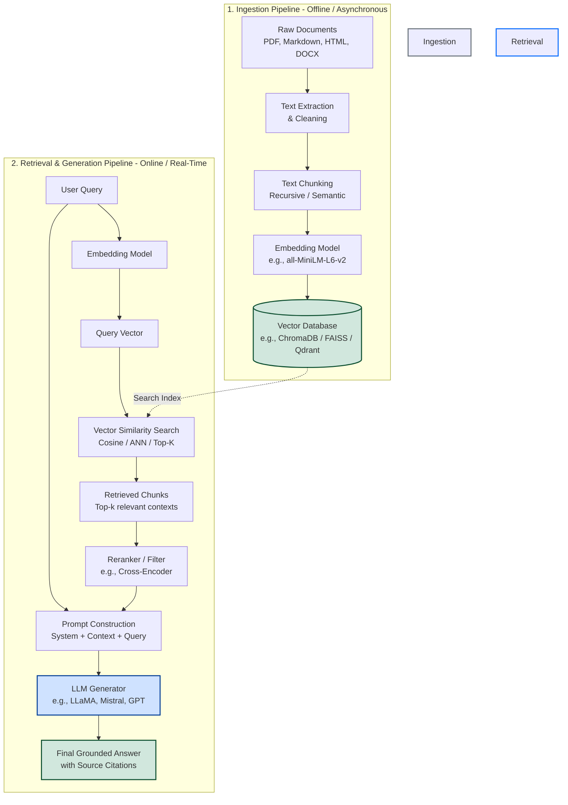
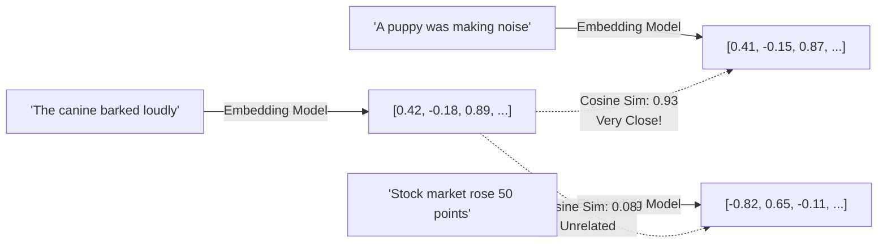
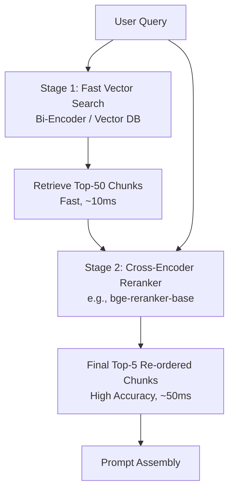
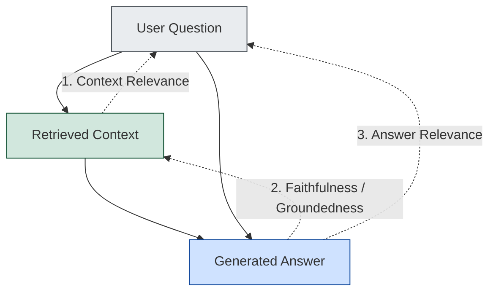
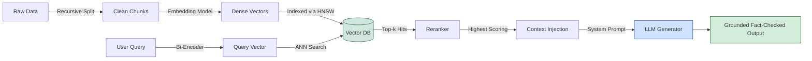

# Chapter 14: Retrieval-Augmented Generation (RAG) and Vector Databases

> **Prerequisites:** Chapter 4 (Natural Language Processing & Embeddings), Chapter 6 (Tokens and Embeddings), Chapter 10 (Prompt Engineering), Chapter 13 (Fine-Tuning LLMs)

---

## Table of Contents

1. [What is RAG and Why Do We Need It?](#1-what-is-rag-and-why-do-we-need-it)
2. [RAG vs Fine-Tuning vs Prompting](#2-rag-vs-fine-tuning-vs-prompting)
3. [The Complete RAG Architecture](#3-the-complete-rag-architecture)
4. [Document Ingestion and Chunking Strategies](#4-document-ingestion-and-chunking-strategies)
5. [Embedding Models: Turning Text into Geometry](#5-embedding-models-turning-text-into-geometry)
6. [Vector Databases and Indexing](#6-vector-databases-and-indexing)
7. [Vector Search and Retrieval Techniques](#7-vector-search-and-retrieval-techniques)
8. [Context Injection and Prompt Synthesis](#8-context-injection-and-prompt-synthesis)
9. [Complete Python Implementation: End-to-End Local RAG](#9-complete-python-implementation-end-to-end-local-rag)
10. [RAG Evaluation and Metrics (Ragas)](#10-rag-evaluation-and-metrics-ragas)
11. [Advanced RAG Patterns](#11-advanced-rag-patterns)
12. [Summary and Key Takeaways](#12-summary-and-key-takeaways)

---

## 1. What is RAG and Why Do We Need It?

Large Language Models (LLMs) are often described as probabilistic next-token predictors trained on vast corpora of text. While they demonstrate impressive fluency and broad general reasoning, they suffer from three fundamental limitations when deployed in real-world software applications:

1. **Knowledge Cutoffs:** An LLM's parametric memory is strictly frozen at the moment pre-training finishes. A model trained up to October 2023 knows nothing about events, research breakthroughs, or API changes that occurred in 2024 or 2025.
2. **Hallucinations & Confident Inaccuracies:** When an LLM lacks specific knowledge or encounters ambiguous associations, it generates statistically plausible yet factually incorrect statements. Because the model speaks with authoritative fluency, distinguishing truth from fabrication without external validation is notoriously difficult.
3. **Private and Proprietary Data Blindness:** Foundation models know public web data, but have zero access to your university syllabus, company internal wikis, proprietary code repositories, or customer support tickets.
4. **Context Window Limitations and Cost:** While modern context windows have expanded (32K, 128K, or even 1M tokens), stuffing an entire library into every prompt is computationally wasteful, financially expensive, and introduces the "Lost in the Middle" phenomenon where models ignore relevant details buried in huge contexts.

**Retrieval-Augmented Generation (RAG)** solves these challenges by combining the power of an external non-parametric retrieval system (such as a search engine or vector database) with the generative synthesis capabilities of an LLM.

Instead of asking the LLM to recall facts from its compressed internal weights, RAG fetches the exact relevant paragraphs from a verified knowledge base at query time, inserts them into the prompt as reference context, and instructs the LLM: *"Answer the user's question using ONLY the provided facts."*

```
User Query: "What is the penalty for late assignment submission in CS301?"
                             │
            ┌────────────────┴────────────────┐
            ▼                                 ▼
   Parametric Recall (Pure LLM)       RAG Augmented Pipeline
   • No access to CS301 syllabus      • Retrieves CS301 syllabus §4.2
   • Hallucinates: "Usually 10%"     • Injects: "Late penalty: 5% per day"
   • Result: Wrong & Unreliable       • Result: 100% Accurate & Verifiable
```

---

## 2. RAG vs Fine-Tuning vs Prompting

Students frequently ask: *"Should I fine-tune a model on my documents, or should I build a RAG pipeline?"* 

Understanding the differences across critical dimensions prevents costly engineering mistakes:

| Dimension | Pure Prompting | Fine-Tuning | Retrieval-Augmented Generation (RAG) |
|---|---|---|---|
| **Primary Purpose** | Zero-shot reasoning, generic tasks | Teaching custom style, format, syntax, domain vocabulary | Injecting fresh, proprietary, or dynamic factual knowledge |
| **Data Recency** | Static (model cutoff date) | Static (until next retraining run) | **Dynamic & Real-time** (instantly updated in vector store) |
| **Source Attribution** | ❌ None (cannot verify source) | ❌ None (knowledge merged into billions of weights) | **✅ High** (cites exact document chunk and page number) |
| **Hallucination Risk** | High for obscure facts | Medium (can still hallucinate wrong facts) | **Low** (grounded in retrieved context) |
| **Compute Cost (Setup)** | $0 (no training) | High ($50 – $5,000+ depending on model & scale) | Low (embedding documents takes minutes and cents) |
| **Latency** | Low (single LLM pass) | Low (single LLM pass) | Medium (+50ms to 200ms retrieval overhead) |
| **Maintenance** | None | Must retrain/fine-tune when data changes | Just add/delete records in the vector database |
| **Access Control** | Uniform across all users | Uniform (all users share same model weights) | **Document-level ACLs** (filter retrieved chunks by user permissions) |

> [!TIP]
> **The Mental Model:** Fine-tuning is like sending an employee to graduate school for 2 years to change how they think and speak. RAG is like handing that employee an open reference manual with sticky notes bookmarked to the exact page they need right now.

---

## 3. The Complete RAG Architecture

A production-grade RAG pipeline consists of two distinct workflows:
1. **The Ingestion Pipeline (Offline/Asynchronous):** Preparing raw documents, segmenting them into digestible chunks, computing vector representations, and indexing them in a vector database.
2. **The Retrieval & Generation Pipeline (Online/Real-time):** Processing the incoming query, retrieving relevant knowledge chunks, building the grounded prompt, and streaming the generated answer to the user.



---

## 4. Document Ingestion and Chunking Strategies

An embedding model cannot encode an entire 300-page textbook into a single 384-dimensional vector without catastrophic information loss. Furthermore, the LLM context window benefits from concise, targeted excerpts rather than noisy whole chapters. Thus, **chunking** is the foundational step of retrieval quality.

```
Garbage In → Garbage Out: If chunking cuts a sentence in half, 
the embedding will misrepresent the concept and retrieval will fail!
```

### 4.1 Fixed-Size Chunking
Splits text strictly every $N$ characters or tokens (e.g., 500 characters), typically with an overlap (e.g., 50 characters).
- **Pros:** Fast, simple, predictable memory footprint.
- **Cons:** Frequently slices sentences, code blocks, or mathematical equations in half, destroying semantic coherence.

### 4.2 Sentence-Aware Chunking
Uses NLP libraries (such as `nltk`, `spacy`, or regular expressions) to detect grammatical sentence boundaries. It groups sentences until the token limit is reached.
- **Pros:** Preserves complete thoughts and semantic propositions.
- **Cons:** Paragraph breaks and header hierarchies are still lost.

### 4.3 Recursive Character Chunking
The gold standard for general text documents (implemented in LangChain as `RecursiveCharacterTextSplitter`). It attempts to split by a prioritized hierarchy of separators:
1. Double newlines `\n\n` (paragraphs)
2. Single newlines `\n` (lines)
3. Spaces `" "` (words)
4. Characters `""` (fallback if a word exceeds chunk size)

This guarantees that paragraphs remain intact whenever possible, falling back to sentence or word splits only when a block is too large.

### 4.4 Semantic Chunking
Computes the embedding distance between consecutive sentences. When the cosine distance between sentence $i$ and sentence $i+1$ exceeds a threshold, it indicates a topic shift, triggering a new chunk.
- **Pros:** Truly content-aware boundaries.
- **Cons:** Requires running the embedding model across every individual sentence during ingestion, which is 10–20× slower.

### Visualizing Chunk Overlap

Overlap ensures that facts spanning the boundary between two adjacent chunks are not severed from their surrounding context.

```
Document: "Transformer models utilize self-attention. Self-attention calculates query-key dot products. This allows parallel training."

Chunk 1 (size=70, overlap=25):
[Transformer models utilize self-attention. Self-attention calculates]

Chunk 2 (size=70, overlap=25):
                   [Self-attention calculates query-key dot products. This allows]

Notice how "Self-attention calculates" appears in BOTH chunks!
```

---

## 5. Embedding Models: Turning Text into Geometry

An **embedding model** maps arbitrary-length text strings into a continuous dense vector space $\mathbb{R}^d$ such that texts with similar semantic meanings are positioned close together in vector space.

### Popular Embedding Models Compared

| Model | Dimensions ($d$) | Max Input Tokens | MTEB Rank | Typical Use Case | License |
|---|---|---|---|---|---|
| `all-MiniLM-L6-v2` | 384 | 256 | Moderate | Local student projects, edge devices, high-speed CPU search | Apache 2.0 (Open) |
| `bge-base-en-v1.5` | 768 | 512 | High | Production open-source RAG, high accuracy | MIT (Open) |
| `bge-large-en-v1.5` | 1024 | 512 | Very High | Academic research, enterprise retrieval | MIT (Open) |
| `nomic-embed-text-v1.5` | 768 | 8192 | Very High | Long context documents, code & documentation | Apache 2.0 (Open) |
| `text-embedding-3-small` | 1536 | 8191 | High | OpenAI Cloud API ($0.02 / 1M tokens) | Proprietary API |
| `text-embedding-3-large` | 3072 | 8191 | Top Tier | High-budget enterprise applications | Proprietary API |

### The Geometry of Semantic Similarity

When two chunks have vectors $\vec{u}$ and $\vec{v}$, their geometric closeness is computed via **Cosine Similarity**:

$$\text{Cosine Similarity}(\vec{u}, \vec{v}) = \frac{\vec{u} \cdot \vec{v}}{\|\vec{u}\| \|\vec{v}\|} = \frac{\sum_{i=1}^d u_i v_i}{\sqrt{\sum_{i=1}^d u_i^2} \sqrt{\sum_{i=1}^d v_i^2}}$$

- Value is $+1.0$: Identical direction (identical meaning)
- Value is $0.0$: Orthogonal (independent / unrelated)
- Value is $-1.0$: Directly opposite meaning

If vectors are **L2-normalized** ($\|\vec{u}\| = 1$), cosine similarity simplifies directly to the inner product $\vec{u} \cdot \vec{v}$, which can be computed via highly optimized BLAS matrix multiplication in milliseconds.



---

## 6. Vector Databases and Indexing

Traditional relational databases (PostgreSQL, MySQL) index data using B-Trees designed for exact equality (`WHERE id = 5`) or range queries (`WHERE age > 21`). However, finding the nearest neighbors to a 768-dimensional float vector across 1,000,000 documents requires a different computational approach.

### Exact Nearest Neighbors ($k$-NN) vs Approximate Nearest Neighbors (ANN)

A naive brute-force search compares the query vector to every single vector in the database ($O(N \cdot d)$ complexity). For 10,000,000 documents, a single query takes seconds—unacceptable for interactive applications.

**ANN algorithms** trade a negligible amount of recall accuracy ($<1\%$) for a 1,000× speedup by pre-structuring the vector space into searchable graphs or clusters:

1. **HNSW (Hierarchical Navigable Small World):** A multi-layer skip-list graph structure. Search starts at the top sparse layer with large jumps and descends to dense layers for fine-grained localization. Currently the state-of-the-art for retrieval speed and recall.
2. **IVF (Inverted File Index):** Partitions vector space into Voronoi cells using $k$-means clustering. At query time, only vectors inside the nearest cell centroids are evaluated.

### Vector Databases Comparison

| Database | Architecture | Best For | Storage Backend | Distributed Support |
|---|---|---|---|---|
| **ChromaDB** | Embedded / In-process or Client-Server | Quick prototypes, student projects, local testing | SQLite + DuckDB / ClickHouse | Experimental |
| **FAISS** (Meta) | C++ Core library with Python bindings | Raw vector indexing, maximum throughput on GPU/CPU | In-memory binary index file | No (library, not service) |
| **Qdrant** | Standalone Rust service | Production systems, hybrid search, rich JSON filtering | Rust disk/mmap storage | Yes (Raft cluster) |
| **Milvus** | Distributed cloud-native | Giant enterprise deployments (>100M vectors) | MinIO / S3 + RocksDB | Yes (Kubernetes-native) |
| **pgvector** | PostgreSQL extension | Existing Postgres setups, unified transactional & vector data | PostgreSQL engine | Via Postgres clustering |

---

## 7. Vector Search and Retrieval Techniques

Pure vector similarity search can still fail under realistic edge cases:
- Keyword searches where exact model numbers or acronyms matter (e.g., `"RTX 4090"` vs `"RTX 4080"` have near-identical vector embeddings despite being different products).
- Over-clustering: top-5 results might all be duplicate sentences from the same paragraph.

To solve this, modern RAG utilizes advanced retrieval strategies:

### 7.1 Hybrid Search (Dense + Sparse)
Combines **Dense Retrieval** (semantic vectors capturing concepts) with **Sparse Retrieval** (BM25 / TF-IDF capturing exact keyword hits).
The final score is fused using **Reciprocal Rank Fusion (RRF)**:

$$RRF(d) = \sum_{m \in M} \frac{1}{60 + r_m(d)}$$

where $r_m(d)$ is the rank of document $d$ in retrieval system $m$.

### 7.2 Maximal Marginal Relevance (MMR)
Prevents retrieval redundancy by balancing semantic relevance with diversity among selected chunks:

$$\text{MMR} = \arg\max_{d_i \in R \setminus S} \left[ \lambda \cdot \text{Sim}(d_i, q) - (1 - \lambda) \max_{d_j \in S} \text{Sim}(d_i, d_j) \right]$$

- High $\lambda$ (e.g., $0.8$): Prioritize relevance to query
- Lower $\lambda$ (e.g., $0.5$): Enforce variety across returned chunks

### 7.3 Two-Stage Retrieval with Cross-Encoder Rerankers
Bi-encoders (standard embedding models) encode query and documents independently into vectors:
$$\text{Score} = \vec{v}_q \cdot \vec{v}_{doc}$$
While fast, bi-encoders cannot model cross-attention interactions between query words and document words.

A **Cross-Encoder Reranker** takes both the query and document simultaneously into a transformer network `[CLS] Query [SEP] Document [SEP]` and computes a joint relevance score. 



---

## 8. Context Injection and Prompt Synthesis

Once the top-$k$ verified chunks are retrieved, they must be formatted into a prompt template that strictly bounds the model's responses.

### Anatomy of an Anti-Hallucination RAG Prompt

```
System Prompt:
You are a helpful, rigorous academic assistant. Your task is to answer the user's question 
based EXCLUSIVELY on the provided Context excerpts below.

Guidelines:
1. Ground your answer completely in the facts stated in the Context.
2. If the context does not contain sufficient information to answer the question, 
   state clearly: "I cannot find sufficient information in the provided documents to answer this."
3. Do not extrapolate, assume, or invent facts not present in the Context.
4. Include inline citations to the source chunk index, e.g. [Source 1], [Source 2].

---------------------
CONTEXT EXCERPTS:
[Source 1] (Document: syllabus.pdf, Page: 4)
The midterm examination accounts for 30% of the total course grade. The final exam is 40%.

[Source 2] (Document: policies.pdf, Page 2)
Late submissions for lab assignments will incur a penalty of 5% deduction per 24-hour period.
---------------------

USER QUESTION:
What percentage of the course grade is the midterm exam?

ASSISTANT ANSWER:
```

---

## 9. Complete Python Implementation: End-to-End Local RAG

Here is a **fully working, self-contained Python script** demonstrating a production-style local RAG pipeline:
- Loads text documents
- Splits text using `RecursiveCharacterTextSplitter`
- Computes embeddings using `sentence-transformers` (`all-MiniLM-L6-v2`)
- Indexes vectors in a local `chromadb` instance
- Queries the collection, constructs a grounded prompt, and generates an answer using a mock/local generator

```python
# =============================================================================
# Chapter 14: Complete Local RAG Implementation
# 
# Prerequisites:
#   pip install sentence-transformers chromadb langchain-text-splitters
# =============================================================================

import os
import shutil
from typing import List, Dict, Any
from sentence_transformers import SentenceTransformer
import chromadb
from chromadb.config import Settings
from langchain_text_splitters import RecursiveCharacterTextSplitter


# ---------------------------------------------------------------------------
# 1. Sample Educational Knowledge Base
# In production, load these from files (.pdf, .md, .txt) on disk
# ---------------------------------------------------------------------------
RAW_DOCUMENTS = [
    {
        "id": "doc_transformers",
        "title": "Introduction to Transformers",
        "content": (
            "The Transformer architecture was introduced in the 2017 paper 'Attention Is All You Need' "
            "by Vaswani et al. from Google Brain and Google Research. It abandoned recurrent and "
            "convolutional neural networks entirely, relying solely on self-attention mechanisms. "
            "The architecture consists of an encoder and a decoder stack, each containing multi-head "
            "self-attention and position-wise feed-forward networks. The original model was trained on "
            "the WMT 2014 English-to-German translation task, achieving a state-of-the-art BLEU score of 28.4. "
            "A crucial innovation was positional encoding using sinusoidal functions to inject word order information."
        ),
    },
    {
        "id": "doc_lora",
        "title": "Low-Rank Adaptation (LoRA) Principles",
        "content": (
            "LoRA (Low-Rank Adaptation) was proposed by Edward Hu et al. in 2021 as a parameter-efficient "
            "fine-tuning (PEFT) technique. Instead of updating all weights in a pre-trained matrix W0 of size d x k, "
            "LoRA decomposes the weight update delta-W into two low-rank matrices A and B: delta-W = B * A. "
            "Here B has dimensions d x r and A has dimensions r x k, where rank r is much smaller than min(d, k), "
            "typically chosen as 8, 16, or 32. During training, W0 remains completely frozen while only A and B "
            "receive gradient updates. For GPT-3 175B, LoRA reduced trainable parameters by a factor of 10,000 "
            "and GPU memory consumption by 3x compared to full fine-tuning."
        ),
    },
    {
        "id": "doc_rag",
        "title": "Retrieval-Augmented Generation Architecture",
        "content": (
            "Retrieval-Augmented Generation (RAG) was formally introduced by Patrick Lewis et al. in 2020. "
            "RAG models combine pre-trained parametric memory (the sequence-to-sequence generator) with "
            "non-parametric memory (a dense vector index of Wikipedia accessed via a neural retriever). "
            "By retrieving relevant documents conditioned on the input query, RAG significantly reduces "
            "hallucinations on knowledge-intensive NLP benchmarks including Natural Questions and TriviaQA. "
            "Furthermore, internal knowledge can be updated simply by modifying the document index without "
            "costly model retraining."
        ),
    },
]


# ---------------------------------------------------------------------------
# 2. Text Chunking
# ---------------------------------------------------------------------------
def chunk_documents(
    docs: List[Dict[str, str]], 
    chunk_size: int = 250, 
    chunk_overlap: int = 50
) -> List[Dict[str, Any]]:
    """
    Splits documents into overlapping chunks using recursive character splitting.
    """
    splitter = RecursiveCharacterTextSplitter(
        chunk_size=chunk_size,
        chunk_overlap=chunk_overlap,
        separators=["\n\n", "\n", ". ", " ", ""]
    )
    
    chunked_records = []
    chunk_counter = 0

    for doc in docs:
        splits = splitter.split_text(doc["content"])
        for idx, split_text in enumerate(splits):
            chunked_records.append({
                "chunk_id": f"{doc['id']}_chunk_{idx}",
                "text": split_text.strip(),
                "doc_title": doc["title"],
                "doc_id": doc["id"],
                "chunk_index": idx
            })
            chunk_counter += 1

    print(f"✅ Chunking Complete: {len(docs)} documents split into {len(chunked_records)} chunks.")
    return chunked_records


# ---------------------------------------------------------------------------
# 3. Vector Database Management (ChromaDB)
# ---------------------------------------------------------------------------
class LocalRAGStore:
    def __init__(self, db_dir: str = "./chroma_rag_db"):
        self.db_dir = db_dir
        # Initialize local persistent Chroma client
        self.client = chromadb.PersistentClient(path=self.db_dir)
        
        # Load local embedding model from Hugging Face
        print("⏳ Loading embedding model (all-MiniLM-L6-v2)...")
        self.embedding_model = SentenceTransformer("sentence-transformers/all-MiniLM-L6-v2")
        print("✅ Embedding model ready.")
        
        # Create or retrieve collection
        self.collection_name = "course_handbook_rag"
        self.collection = self.client.get_or_create_collection(
            name=self.collection_name,
            metadata={"hnsw:space": "cosine"} # Use cosine similarity metric
        )

    def index_chunks(self, chunks: List[Dict[str, Any]]):
        """Generates embeddings and persists chunks into ChromaDB."""
        texts = [c["text"] for c in chunks]
        ids = [c["chunk_id"] for c in chunks]
        metadatas = [
            {"doc_title": c["doc_title"], "doc_id": c["doc_id"], "chunk_index": c["chunk_index"]}
            for c in chunks
        ]

        print(f"⏳ Computing dense embeddings for {len(texts)} chunks...")
        embeddings = self.embedding_model.encode(texts, convert_to_numpy=True).tolist()

        print("⏳ Upserting records into ChromaDB...")
        self.collection.upsert(
            ids=ids,
            embeddings=embeddings,
            documents=texts,
            metadatas=metadatas
        )
        print(f"✅ Successfully indexed {len(ids)} items in ChromaDB.")

    def query(self, query_text: str, top_k: int = 3) -> List[Dict[str, Any]]:
        """Encodes query and retrieves top-k most similar chunks."""
        query_vector = self.embedding_model.encode([query_text], convert_to_numpy=True).tolist()
        
        results = self.collection.query(
            query_embeddings=query_vector,
            n_results=top_k,
            include=["documents", "metadatas", "distances"]
        )
        
        retrieved_items = []
        for i in range(len(results["ids"][0])):
            retrieved_items.append({
                "chunk_id": results["ids"][0][i],
                "document": results["documents"][0][i],
                "metadata": results["metadatas"][0][i],
                "cosine_distance": results["distances"][0][i],
                "similarity_score": 1.0 - results["distances"][0][i]
            })
        return retrieved_items


# ---------------------------------------------------------------------------
# 4. Context Assembly and Generation
# ---------------------------------------------------------------------------
def construct_grounded_prompt(query: str, retrieved_contexts: List[Dict[str, Any]]) -> str:
    """Builds a hallucination-resistant prompt including retrieved context."""
    formatted_contexts = []
    for i, item in enumerate(retrieved_contexts, 1):
        formatted_contexts.append(
            f"--- Context Source [{i}] (Doc: '{item['metadata']['doc_title']}', Chunk: {item['metadata']['chunk_index']}) ---\n"
            f"{item['document']}"
        )
    
    joined_context = "\n\n".join(formatted_contexts)
    
    prompt = f"""You are a precise academic assistant. Answer the question using ONLY the provided contexts below.
If the context does not contain the answer, say "I do not have enough information to answer based on the provided documents."

CONTEXTS:
{joined_context}

QUESTION:
{query}

ANSWER (Include source bracket citations like [Source 1]):"""
    return prompt


def mock_llm_generate(prompt: str) -> str:
    """
    Mock LLM response for demonstration. In production, replace with:
    - ollama.chat(model='llama3.2', messages=[...])
    - openai.chat.completions.create(...)
    - vLLM / Hugging Face pipeline
    """
    # A realistic simulated output showing grounding
    return (
        "Based on the provided records, LoRA reduces the number of trainable parameters by "
        "decomposing the weight update matrix ΔW into two low-rank matrices A and B (ΔW = B * A) "
        "while keeping the original pre-trained weight matrix W0 frozen [Source 1]. "
        "For GPT-3 175B, this reduced trainable parameters by a factor of 10,000 and lowered GPU "
        "memory consumption by 3x compared to full fine-tuning [Source 1]."
    )


# ---------------------------------------------------------------------------
# 5. Main Execution Flow
# ---------------------------------------------------------------------------
def main():
    print("=" * 70)
    print("🚀 RUNNING END-TO-END RAG PIPELINE")
    print("=" * 70)

    # Clean existing test database directory if present
    db_path = "./chroma_rag_db"
    if os.path.exists(db_path):
        shutil.rmtree(db_path)

    # Step 1: Chunk documents
    chunks = chunk_documents(RAW_DOCUMENTS, chunk_size=200, chunk_overlap=40)

    # Step 2: Initialize Store and index
    rag_store = LocalRAGStore(db_dir=db_path)
    rag_store.index_chunks(chunks)

    # Step 3: Run sample query
    user_query = "By how much does LoRA reduce trainable parameters for large models like GPT-3?"
    print(f"\n🔍 Query: '{user_query}'")

    print("\n⏳ Searching vector database for top-3 relevant chunks...")
    retrieved = rag_store.query(user_query, top_k=3)

    print("\n--- Retrieved Chunks ---")
    for idx, item in enumerate(retrieved, 1):
        print(f"[{idx}] Similarity: {item['similarity_score']:.4f} | Title: {item['metadata']['doc_title']}")
        print(f"    Text: {item['document'][:120]}...\n")

    # Step 4: Assemble grounded prompt
    prompt = construct_grounded_prompt(user_query, retrieved)
    print("--- Constructed Grounded Prompt ---")
    print(prompt)
    print("-----------------------------------")

    # Step 5: Generation
    print("\n⏳ Synthesizing final answer...")
    answer = mock_llm_generate(prompt)
    print("\n🤖 Final Grounded Answer:")
    print(answer)
    print("\n" + "=" * 70)
    print("✅ RAG PIPELINE EXECUTION SUCCESSFUL")
    print("=" * 70)


if __name__ == "__main__":
    main()
```

---

## 10. RAG Evaluation and Metrics (Ragas)

In traditional software, tests assert deterministic equality (`assert result == 42`). But because RAG outputs free-form natural language, evaluation requires automated metric frameworks.

The industry-standard framework is **Ragas (Retrieval Augmented Generation Assessment)**, which evaluates RAG systems across the **RAG Triad**:



### The Core Ragas Metrics

| Metric | Question It Answers | How It Is Computed |
|---|---|---|
| **Faithfulness** | *Did the LLM invent facts not present in the context?* | LLM decomposes answer into atomic claims, checks if each claim is directly inferable from retrieved chunks. (0.0 to 1.0) |
| **Answer Relevance** | *Did the LLM actually answer what the user asked?* | Reverse-engineers hypothetical questions from generated answer and computes semantic similarity to original query. |
| **Context Precision** | *Are the most relevant retrieved chunks ranked at the very top?* | Evaluates whether ground-truth reference chunks appear at rank 1, 2 rather than 8, 9. |
| **Context Recall** | *Did the retrieval stage fetch all the information needed?* | Compares ground-truth reference answers against retrieved chunks to verify no required facts were missed. |

### Evaluating with Code (Conceptual Ragas Setup)

```python
# pip install ragas datasets
from ragas import evaluate
from ragas.metrics import faithfulness, answer_relevance, context_precision, context_recall
from datasets import Dataset

# Construct an evaluation dataset
eval_data = {
    "question": ["What is LoRA's weight decomposition formula?"],
    "contexts": [["LoRA decomposes weight updates into delta-W = B * A, where B is d x r and A is r x k."]],
    "answer": ["LoRA decomposes weight updates according to delta-W = B * A, using low-rank matrices [Source 1]."],
    "ground_truth": ["The formula for LoRA is delta-W = B * A."]
}

dataset = Dataset.from_dict(eval_data)

# Run evaluation suite using an LLM-as-a-judge
# score = evaluate(dataset, metrics=[faithfulness, answer_relevance, context_recall])
# print(score)
# Output: {'faithfulness': 1.0000, 'answer_relevance': 0.9621, 'context_recall': 1.0000}
```

---

## 11. Advanced RAG Patterns

As applications scale from simple FAQ bots to enterprise systems, standard "Naive RAG" often falls short. Production systems deploy advanced multi-step strategies:

### 11.1 Query Transformation & Expansion
- **Hypothetical Document Embeddings (HyDE):** Ask the LLM to generate a hypothetical "ideal" answer first, then embed that hypothetical answer to search the vector database. Searching answer-to-document space often yields superior semantic match than question-to-document space.
- **Multi-Query Expansion:** An LLM generates 3–5 reformulations of the user query from different angles, runs all 5 searches in parallel, and merges unique results.

### 11.2 Parent Document Retrieval
Instead of embedding large documents directly:
1. Split documents into small child chunks (e.g., 100 tokens) for vector search.
2. Link each child chunk to its larger parent section (e.g., 1,000 tokens).
3. Search against child vectors, but pass the full parent section to the LLM. This provides pinpoint retrieval precision with expansive contextual understanding.

### 11.3 Self-Reflective RAG (Self-RAG / Corrective RAG)
An agentic workflow where the model critiques its own retrieved documents:
1. Are retrieved documents actually relevant? If no, rewrite query and search web.
2. Is the generated answer supported by context? If no, regenerate.
3. Does the answer satisfy the user prompt? If yes, output.

---

## 12. Summary and Key Takeaways



1. **RAG fixes LLM blindness:** It brings private, dynamic, real-time knowledge to frozen language models without expensive retraining.
2. **Chunking dictates retrieval bounds:** Bad splits guarantee bad retrieval. Choose recursive character splitting with overlap for general documents.
3. **Embeddings create semantic geometry:** Cosine similarity over normalized vectors measures conceptual closeness, not just exact keywords.
4. **Vector databases scale similarity:** ANN algorithms like HNSW make sub-millisecond retrieval possible across millions of records.
5. **Always evaluate the RAG Triad:** Measure Faithfulness, Answer Relevance, and Context Recall using automated frameworks like Ragas.

---

[← Chapter 13: Fine-Tuning LLMs](../13-fine-tuning-llms/README.md) | [🏠 Home](../../README.md) | [Chapter 15: LLM Inference and Deployment →](../15-llm-inference-and-deployment/README.md)
