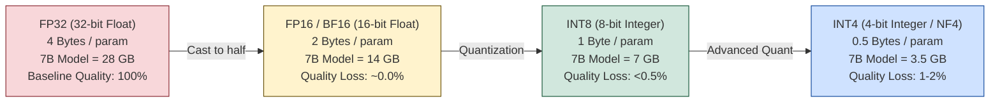
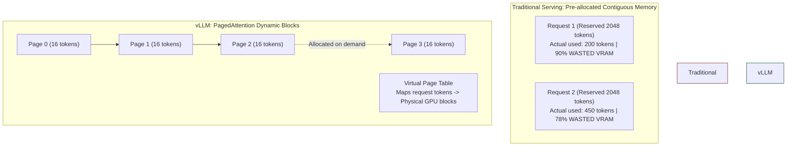
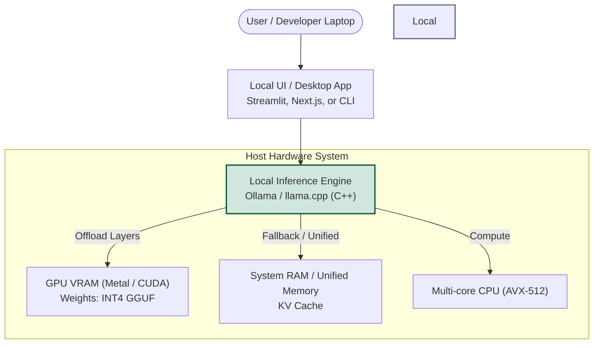
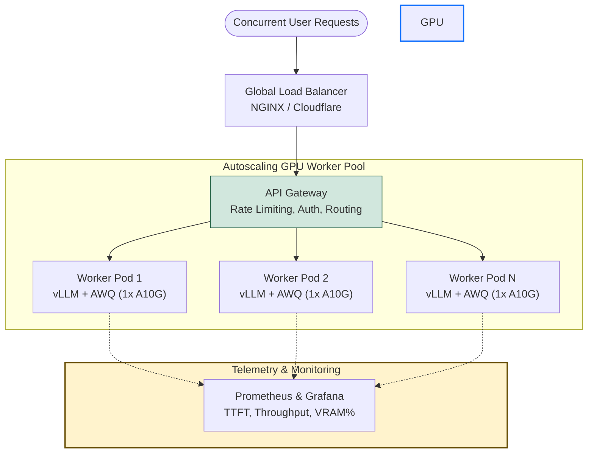

# Chapter 15: LLM Inference and Deployment

> **Prerequisites:** Chapter 5 (Transformer Architecture), Chapter 8 (Attention Mechanism & KV Cache), Chapter 12 (Training & Hardware), Chapter 13 (Fine-Tuning LLMs)

---

## Table of Contents

1. [Inference vs Training: Fundamental Differences](#1-inference-vs-training-fundamental-differences)
2. [Local vs Cloud Deployment](#2-local-vs-cloud-deployment)
3. [Hardware Landscape: GPUs, CPUs, and Apple Silicon](#3-hardware-landscape-gpus-cpus-and-apple-silicon)
4. [Model Quantization: Squeezing Giant Models into Small Memory](#4-model-quantization-squeezing-giant-models-into-small-memory)
   - [Precision Formats: FP32 down to INT4](#precision-formats-fp32-down-to-int4)
   - [Modern Quantization Formats: GGUF, AWQ, GPTQ, NF4](#modern-quantization-formats-gguf-awq-gptq-nf4)
5. [Local Inference Engines](#5-local-inference-engines)
   - [Ollama: Frictionless Local Serving](#ollama-frictionless-local-serving)
   - [llama.cpp and llama-cpp-python](#llamacpp-and-llama-cpp-python)
   - [vLLM and PagedAttention](#vllm-and-pagedattention)
6. [High-Performance Model Serving Concepts](#6-high-performance-model-serving-concepts)
   - [The KV Cache and Prefix Caching](#the-kv-cache-and-prefix-caching)
   - [Continuous Batching vs Static Batching](#continuous-batching-vs-static-batching)
   - [Streaming Responses via Server-Sent Events (SSE)](#streaming-responses-via-server-sent-events-sse)
   - [Standardized OpenAI-Compatible APIs](#standardized-openai-compatible-apis)
7. [Production Deployment and Operations](#7-production-deployment-and-operations)
   - [Docker Containerization](#docker-containerization)
   - [Load Balancing and Auto-Scaling](#load-balancing-and-auto-scaling)
   - [Telemetry: Latency, TTFT, and Token Throughput](#telemetry-latency-ttft-and-token-throughput)
8. [Architectural Blueprints](#8-architectural-blueprints)
9. [Summary and Best Practices](#9-summary-and-best-practices)

---

## 1. Inference vs Training: Fundamental Differences

When building AI systems, students frequently assume inference is just "training without backpropagation." While technically true at the tensor operation level, the operational, memory, and performance characteristics are fundamentally distinct:

| Characteristic | Model Training | Model Inference |
|---|---|---|
| **Primary Goal** | Optimize model parameters (weights) | Generate responses from fixed weights |
| **Data Flow** | Forward pass **+ Backward pass** | **Forward pass only** (autoregressive generation) |
| **Compute Profile** | **Compute-bound** (FLOP-heavy matrix multiplications) | **Memory-bandwidth bound** (loading weights for each token) |
| **State Retained** | Model weights + Gradients + Optimizer states (Adam) + Activations | Model weights + Key-Value (KV) Cache |
| **Memory Footprint** | Massive: ~16–20 bytes per parameter (FP16/Adam) | Small: ~0.5–2 bytes per parameter (quantized) + KV Cache |
| **Execution Pattern** | Massive batch sizes processed over days/weeks | Low latency (per-user request), sequential token-by-token generation |
| **Hardware Setup** | Multi-GPU / Multi-node clusters (A100, H100) | Single GPU, consumer PC, laptop, or edge device |

### Why Inference is Memory-Bandwidth Bound

In autoregressive text generation, the LLM generates tokens sequentially:
1. To predict token $t+1$, the model must read all billions of parameters from VRAM into the compute cores (tensor cores).
2. It performs matrix-vector products for that single token.
3. It emits token $t+1$.
4. Repeat.

If a 7B parameter model in FP16 weighs 14 GB, generating 1 token requires streaming 14 GB from VRAM into the GPU cores.
On an RTX 4090 with **1,008 GB/s** memory bandwidth:

$$\text{Theoretical Max Speed} = \frac{1,008 \text{ GB/s}}{14 \text{ GB/token}} \approx 72 \text{ tokens/second}$$

Notice that the computation speed of the tensor cores is barely the bottleneck; the bottleneck is **how fast memory can be transferred across the memory bus**. This reality makes **model compression and quantization** the cornerstone of fast inference.

---

## 2. Local vs Cloud Deployment

Deploying an LLM involves choosing between hosted cloud APIs, self-managed cloud instances, and local execution:

| Dimension | Cloud API (e.g., OpenAI, Anthropic, Groq) | Self-Hosted Cloud (AWS, GCP, RunPod, Lambda) | Local Execution (Mac, Linux/Windows Desktop) |
|---|---|---|---|
| **Privacy & Security** | Data sent over external network; vendor terms apply | Fully private within your cloud VPC | **100% Private & Air-gapped**; data never leaves hardware |
| **Setup Complexity** | Zero (just an API key) | Moderate to High (Kubernetes, Docker, GPU drivers) | Low (install Ollama or llama.cpp) |
| **Hardware Costs** | $0 capital expenditure; pay per token | Hourly GPU rental ($0.50–$4.50/hr per GPU) | One-time hardware purchase |
| **Internet Dependency** | Mandatory (fails offline) | Mandatory | **Works completely offline** |
| **Latency** | Network round-trip (100–300ms) + generation | Cloud datacenter latency + generation | **Zero network latency**; instant local response |
| **Model Customization** | Restricted to vendor base models / adapters | Full control: any open weights, custom kernels | Full control: any GGUF or open-weights model |
| **Scalability** | Near infinite (handled by provider) | Elastic autoscaling via clusters | Fixed to local hardware capacity |

---

## 3. Hardware Landscape: GPUs, CPUs, and Apple Silicon

Running inference efficiently requires matching your model size with the appropriate hardware architecture.

### 3.1 Dedicated GPUs (NVIDIA)
NVIDIA GPUs remain the industry standard due to **Tensor Cores**, high memory bandwidth, and the mature **CUDA** software ecosystem.
- **Consumer GPUs (RTX 3060, 4070, 4080, 4090):** Offer 12 GB to 24 GB of ultra-fast GDDR6X VRAM. Ideal for running quantized 7B, 8B, and 14B models at high speeds (50–120 tokens/sec).
- **Data Center GPUs (A10G, A100, H100, H200):** Feature high-capacity High-Bandwidth Memory (HBM2e/HBM3) offering 40 GB to 141 GB VRAM per card and bandwidth exceeding **3.3 TB/s**. Required for unquantized 70B+ models and multi-user concurrent serving.

### 3.2 Apple Silicon (Unified Memory Architecture)
Apple's M-series chips (M1/M2/M3/M4 Pro, Max, and Ultra) utilize a **Unified Memory Architecture (UMA)** where the CPU and GPU share the exact same physical pool of high-speed RAM.
- A Mac Studio with an M2 Ultra can have up to **192 GB of Unified Memory**.
- Because memory is unified, a 192 GB Mac can load a 120-billion parameter quantized model directly into memory without requiring an enterprise GPU cluster.
- While memory bandwidth (up to 800 GB/s on Ultra) is lower than an H100 (3,350 GB/s), it provides unmatched affordability for large local models.

### 3.3 CPUs with AVX-512 and AMX
Modern x86_64 CPUs (Intel Xeon, AMD EPYC, Ryzen) and ARM CPUs can run inference via optimized libraries like `llama.cpp` using SIMD vector instructions (AVX-512, AMX).
- System RAM bandwidth (DDR5 ~60–80 GB/s) is 10× slower than GPU VRAM (~800–1000 GB/s).
- Expect 5–15 tokens/sec for 7B models on modern CPUs. Sufficient for background tasks, batch jobs, or student prototyping without a GPU.

---

## 4. Model Quantization: Squeezing Giant Models into Small Memory

### Precision Formats: FP32 down to INT4

In standard machine learning, weights are stored as 32-bit single-precision floating-point numbers (**FP32**). Quantization converts these continuous floating-point values into lower-bit representations, dramatically reducing memory footprint while preserving task performance.



#### Memory and Quality Tradeoffs Table

| Format | Bits per Weight | Memory for 7B Model | Memory for 70B Model | Perplexity Degradation | Recommended Hardware |
|---|---|---|---|---|---|
| **FP32** | 32 bits (4 B) | 28 GB | 280 GB | 0% (Reference) | High-end Multi-GPU Cluster |
| **FP16 / BF16** | 16 bits (2 B) | 14 GB | 140 GB | ~0% (Indistinguishable) | A100 / Dual RTX 4090 |
| **INT8 (8-bit)** | 8 bits (1 B) | 7 GB | 70 GB | < 0.1% | 12GB–16GB Consumer GPU |
| **INT4 (4-bit)** | 4 bits (0.5 B) | 3.5–4.5 GB | 35–40 GB | ~1–2% (Negligible) | 8GB VRAM GPU or Laptop |
| **INT2 (2-bit)** | 2 bits (0.25 B) | ~2 GB | ~20 GB | Significant (>15%) | Experimental research only |

### Modern Quantization Formats: GGUF, AWQ, GPTQ, NF4

Not all 4-bit quantizations are identical. Different algorithms optimize for different hardware and execution styles:

| Quantization Format | Tooling Ecosystem | Target Hardware | Quantization Strategy | When to Choose |
|---|---|---|---|---|
| **GGUF** (formerly GGML) | `llama.cpp`, Ollama, LM Studio | CPU, Apple Silicon, Consumer GPU (partial offload) | Block-wise round-to-nearest integer with dynamic scaling | **Universal Choice for Local Desktop & Mac Inference** |
| **AWQ** (Activation-aware Weight Quantization) | vLLM, Hugging Face, TensorRT-LLM | NVIDIA GPUs | Protects the 1% most salient weights based on activation magnitude | **Best for high-throughput GPU serving**; higher accuracy than GPTQ |
| **GPTQ** | AutoGPTQ, vLLM, ExLlamaV2 | NVIDIA GPUs | Second-order Taylor series error minimization on layer weights | High-speed dedicated GPU serving when AWQ unavailable |
| **bitsandbytes NF4** | `transformers`, `peft` | NVIDIA GPUs | NormalFloat format designed for zero-mean, unit-variance Gaussian weights | **Standard for QLoRA fine-tuning** (less optimized for high-speed serving) |

---

## 5. Local Inference Engines

Let's explore the three dominant tools used to run LLMs locally and in production.

### 5.1 Ollama: Frictionless Local Serving

**Ollama** wraps `llama.cpp` in an intuitive, Docker-like CLI and provides an out-of-the-box local REST API.

#### Installation & Quick Start
```bash
# Linux / macOS install
curl -fsSL https://ollama.com/install.sh | sh

# Pull and run a model (e.g. Llama 3.2 3B or Mistral 7B)
ollama run llama3.2

# List local downloaded models
ollama list
```

#### Calling Ollama via Python SDK
```python
# pip install ollama
import ollama

response = ollama.chat(
    model="llama3.2",
    messages=[
        {"role": "system", "content": "You are a concise academic tutor."},
        {"role": "user", "content": "Explain why KV cache saves compute during inference in two sentences."},
    ],
    options={
        "temperature": 0.2,
        "top_p": 0.9,
    }
)

print(response["message"]["content"])
```

#### Streaming Responses with Ollama
```python
import ollama

stream = ollama.chat(
    model="llama3.2",
    messages=[{"role": "user", "content": "Write a short poem about neural networks."}],
    stream=True,
)

print("Streaming output: ", end="", flush=True)
for chunk in stream:
    print(chunk["message"]["content"], end="", flush=True)
print()
```

---

### 5.2 llama.cpp and llama-cpp-python

**llama.cpp** (written in pure C/C++ by Georgi Gerganov) is the engine that sparked the local open-source LLM revolution. It has zero external dependencies and provides extreme optimization for Apple Silicon (Metal) and CPU architectures (AVX-512).

`llama-cpp-python` provides high-performance Python bindings with GPU offloading support:

```python
# Installation with CUDA support:
# CMAKE_ARGS="-DGGML_CUDA=on" pip install llama-cpp-python

from llama_cpp import Llama

# Load quantized GGUF model directly
llm = Llama(
    model_path="./models/mistral-7b-instruct-v0.2.Q4_K_M.gguf",
    n_ctx=2048,           # Context window size
    n_gpu_layers=33,      # Number of layers to offload to GPU (-1 = ALL layers)
    n_threads=8,          # Number of CPU threads to use
    verbose=False
)

# Run inference
output = llm(
    "Q: What is the primary difference between FP16 and INT4 quantization?\nA: ",
    max_tokens=128,
    stop=["Q:", "\n\n"],
    echo=False
)

print(output["choices"][0]["text"].strip())
```

---

### 5.3 vLLM and PagedAttention

In high-concurrency production environments, standard serving engines waste up to **60–80% of GPU memory** due to KV cache fragmentation. 

**vLLM** (Woosuk Kwon et al., UC Berkeley) introduced **PagedAttention**, an algorithm inspired by virtual memory paging in operating systems. It stores the KV cache in non-contiguous memory blocks, eliminating memory waste and enabling massive continuous batching.



#### High-Throughput Offline Batch Inference with vLLM
```python
# pip install vllm
from vllm import LLM, SamplingParams

prompts = [
    "Explain quantum computing in one sentence.",
    "What is the capital of Japan?",
    "Write a Python function to check for prime numbers.",
    "Summarize the theory of general relativity."
]

sampling_params = SamplingParams(temperature=0.7, top_p=0.95, max_tokens=100)

# Initialize model (vLLM automatically uses PagedAttention and CUDA kernels)
llm = LLM(model="mistralai/Mistral-7B-Instruct-v0.2", tensor_parallel_size=1)

# Generate outputs in high-throughput batch
outputs = llm.generate(prompts, sampling_params)

for output in outputs:
    prompt = output.prompt
    generated_text = output.outputs[0].text
    print(f"\nPrompt: {prompt}\nResponse: {generated_text.strip()}")
```

#### Launching an OpenAI-Compatible API Server with vLLM
vLLM includes a production server that drops in as a replacement for the OpenAI API:

```bash
python3 -m vllm.entrypoints.openai.api_server \
    --model mistralai/Mistral-7B-Instruct-v0.2 \
    --port 8000 \
    --gpu-memory-utilization 0.90 \
    --max-model-len 4096
```

---

## 6. High-Performance Model Serving Concepts

### 6.1 The KV Cache and Prefix Caching

During autoregressive generation, each attention layer calculates $Q, K, V$ matrices. Because earlier tokens do not change, recomputing their $K$ and $V$ tensors at every step is wasteful. The **KV Cache** stores previous token representations in VRAM:

```
Step 1: Input "The"      -> Compute K("The"), V("The") -> Store in Cache
Step 2: Input "dog"      -> Compute K("dog"), V("dog") -> Store in Cache -> Read "The" from Cache
Step 3: Input "barked"   -> Compute K("barked"), V("barked") -> Store -> Read "The", "dog" from Cache
```

#### Prefix Caching (Prompt Caching)
If 1,000 users query a system with the exact same 2,000-token system prompt or documentation context (common in RAG and agent systems), **Prefix Caching** reuses the precomputed KV cache across multiple concurrent requests.
- First request: 2,000 tokens evaluated ($T = 150\text{ ms}$).
- Subsequent requests: 2,000 tokens retrieved from cache ($T = 1\text{ ms}$).

### 6.2 Continuous Batching vs Static Batching
- **Static Batching:** Requests are grouped together. If Request A generates 20 tokens and Request B generates 500 tokens, the GPU sits idle waiting for Request B before accepting new work.
- **Continuous (Iteration-level) Batching:** As soon as Request A emits its end-of-sequence (`<eos>`) token at step 20, a new incoming request is slotted into that exact batch slice on the very next token iteration. This achieves **200–400% higher GPU utilization**.

### 6.3 Streaming Responses via Server-Sent Events (SSE)
Waiting 8 seconds for an entire 400-word response produces a poor user experience. Streaming delivers tokens chunk-by-chunk using HTTP Server-Sent Events (`text/event-stream`), dropping **Time-to-First-Token (TTFT)** down to 100–300 milliseconds.

```python
# Conceptual FastAPI SSE streaming endpoint
from fastapi import FastAPI
from fastapi.responses import StreamingResponse
import asyncio
import json

app = FastAPI()

async def token_generator(prompt: str):
    tokens = ["Deep", " Learning", " powers", " modern", " intelligent", " systems."]
    for token in tokens:
        await asyncio.sleep(0.05)  # Simulate generation latency
        # Server-Sent Event data packet format
        payload = {"choices": [{"delta": {"content": token}}]}
        yield f"data: {json.dumps(payload)}\n\n"
    yield "data: [DONE]\n\n"

@app.post("/v1/chat/completions")
async def chat_endpoint():
    return StreamingResponse(token_generator("test"), media_type="text/event-stream")
```

---

## 7. Production Deployment and Operations

### 7.1 Docker Containerization

Deploying LLMs across heterogeneous cloud environments requires reproducible container environments bundled with specific CUDA driver toolkits.

```dockerfile
# Production Dockerfile for vLLM Server
FROM vllm/vllm-openai:latest

# Expose standard OpenAI API port
EXPOSE 8000

# Set environment variables
ENV MODEL_NAME="mistralai/Mistral-7B-Instruct-v0.2"
ENV MAX_MODEL_LEN=4096
ENV GPU_MEMORY_UTILIZATION=0.92

# Entrypoint to serve model with OpenAI-compatible API
ENTRYPOINT python3 -m vllm.entrypoints.openai.api_server \
    --model ${MODEL_NAME} \
    --port 8000 \
    --max-model-len ${MAX_MODEL_LEN} \
    --gpu-memory-utilization ${GPU_MEMORY_UTILIZATION}
```

Build and run with GPU acceleration:
```bash
docker build -t custom-vllm-server .
docker run --gpus all -p 8000:8000 --ipc=host custom-vllm-server
```

### 7.2 Telemetry: The 4 Golden Metrics of LLM Serving

When monitoring production LLM deployments (via Prometheus, Grafana, or Datadog), track these four vital metrics:


1. **Time-to-First-Token (TTFT):** Duration between the user sending a prompt and seeing the first generated character. Dominated by the prompt processing phase (prefill). Target: `< 300 ms`.
2. **Time-per-Output-Token (TPOT) / Inter-Token Latency:** Average time taken to generate each subsequent token. Dominated by memory bandwidth during decoding. Target: `20–50 ms/token` (20–50 tokens/sec).
3. **Throughput (Tokens/Second):** The cumulative number of tokens the cluster generates across all concurrent users. Target: `> 1,000 tokens/sec` per node.
4. **KV Cache Usage Percentage:** Percentage of allocated GPU memory occupied by cached sequences. If this hits 100%, incoming requests will queue or be rejected.

---

## 8. Architectural Blueprints

### Blueprint A: Local / Edge Deployment Architecture



### Blueprint B: High-Throughput Cloud Deployment Architecture



---

## 9. Summary and Best Practices

| Scenario | Recommended Stack | Quantization | Target Latency |
|---|---|---|---|
| **Student Project / Local Laptop** | Ollama + Streamlit / CLI | GGUF (Q4_K_M) | 20–50 tokens/sec |
| **Mac Studio / Apple Silicon** | `llama.cpp` / Ollama with Metal | GGUF (Q4_K_M or Q8_0) | 30–80 tokens/sec |
| **Single GPU Cloud Server (Production)** | vLLM + FastAPI | AWQ / GPTQ (4-bit) | 80–120 tokens/sec |
| **Enterprise High-Concurrency Service** | vLLM Cluster + Triton Inference Server | AWQ / FP8 | 1,000+ tokens/sec batch throughput |

### Core Rules of LLM Deployment:
1. **Never serve unquantized models in production without clear justification:** INT4/AWQ cuts memory costs by 70% with negligible loss in accuracy.
2. **Always enable streaming:** Delivering tokens via Server-Sent Events transforms perceived latency from seconds to milliseconds.
3. **Use PagedAttention for multi-user services:** Deploying standard Hugging Face pipelines for multi-user APIs wastes GPU memory; vLLM or TGI should be standard for multi-tenant services.
4. **Monitor TTFT and TPOT separately:** Prefill latency (TTFT) and decode latency (TPOT) have completely different hardware bottlenecks.

---

[← Chapter 14: RAG and Vector Databases](../14-rag-and-vector-databases/README.md) | [🏠 Home](../../README.md) | [Chapter 16: Building AI Applications →](../16-building-ai-applications/README.md)
