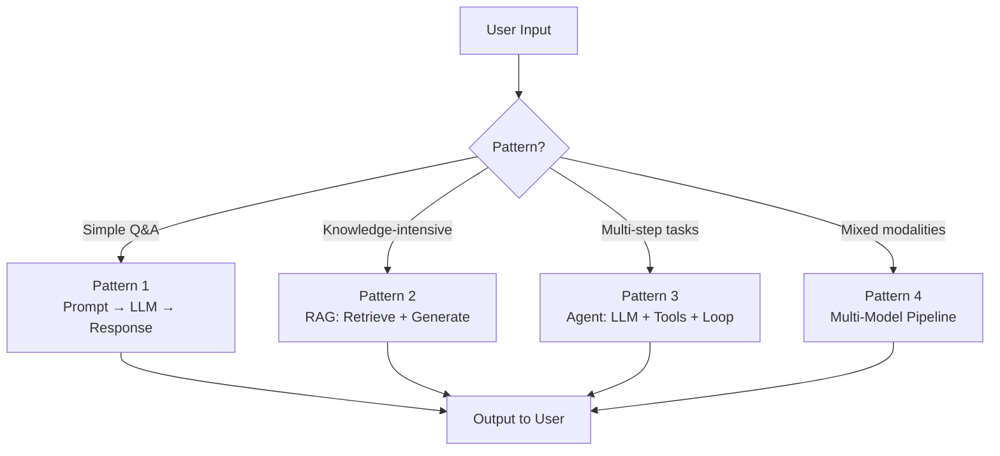
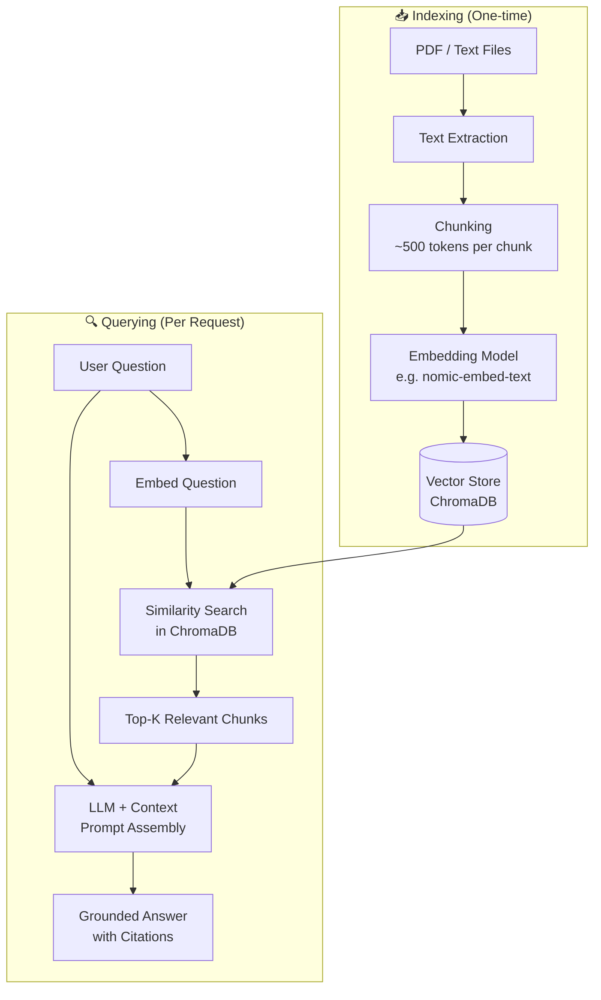
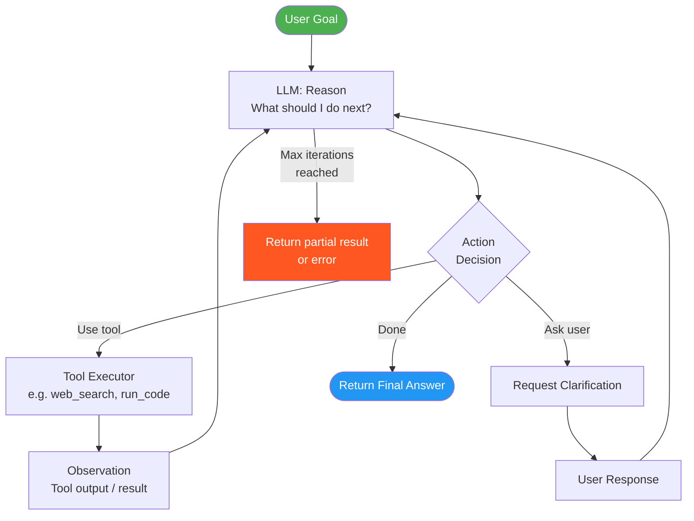

# Chapter 16: Building AI Applications with LLMs

> **Prerequisites:** Chapters 1–15 — especially transformer architecture (Ch. 5), fine-tuning (Ch. 12), embeddings (Ch. 9), and RAG concepts (Ch. 13).

This chapter bridges theory and practice. You will learn how to design and build real AI-powered applications — from simple chatbots to document Q&A systems and autonomous agents — using modern Python libraries and local or cloud-hosted LLMs.

---

## Table of Contents

1. [Application Architecture Patterns](#1-application-architecture-patterns)
2. [Prompt Engineering Fundamentals](#2-prompt-engineering-fundamentals)
3. [Building a Conversational Chatbot with Memory](#3-building-a-conversational-chatbot-with-memory)
4. [Building a Document Q&A System](#4-building-a-document-qa-system)
5. [LLM API Integration](#5-llm-api-integration)
6. [Building an AI Code Assistant](#6-building-an-ai-code-assistant)
7. [Summary & Key Takeaways](#7-summary--key-takeaways)

---

## 1. Application Architecture Patterns

Modern LLM applications follow a small set of well-understood architectural patterns. Knowing which pattern fits your use case is the first design decision.

### Pattern 1 — Simple Prompt → LLM → Response (Chatbot)

The simplest possible architecture: a user sends a message, the LLM returns a reply.

```
User Input ──► [LLM] ──► Response
```

**Best for:** FAQ bots, text summarization, one-shot translation, creative writing assistants.

**Limitations:** No memory between turns. No external knowledge. Output quality is bounded by training data.

### Pattern 2 — Retrieval-Augmented Generation (RAG)

The LLM is grounded in real documents. A retrieval step fetches relevant context before generation.

```
User Query ──► [Retriever] ──► Relevant Chunks ──┐
                                                   ▼
                                            [LLM + Context] ──► Grounded Response
```

**Best for:** Customer support with knowledge bases, document Q&A, enterprise search.

**Advantages:** Answers are traceable to sources; reduces hallucinations; knowledge can be updated without retraining.

### Pattern 3 — Agent Pattern (LLM + Tools + Loop)

The LLM reasons about what tool to call next, executes it, observes the result, and repeats until the task is done.

```
User Goal ──► [LLM] ──► Tool Call ──► [Tool Executor] ──► Observation ──► [LLM] ──► ...
```

Tools can be: web search, code execution, database queries, APIs, calculators, file I/O.

**Best for:** Research assistants, software engineering agents, data analysis, multi-step workflows.

### Pattern 4 — Multi-Model Pipeline

Different models handle different subtasks optimally.

```
Input ──► [Small Classifier] ──► Route ──► [Specialized Model A] ──► Merge ──► Output
                                       └──► [Specialized Model B] ──┘
```

**Examples:** Route simple queries to a fast small model; complex ones to a large model. Use a vision model for images, a text model for captions.



---

## 2. Prompt Engineering Fundamentals

The quality of your prompt is often the biggest lever you have on output quality — before you even consider fine-tuning.

### 2.1 Zero-Shot Prompting

No examples are provided. You just describe the task.

```
Translate to French: Hello, how are you?
```

Works well when the task is common in training data and unambiguous.

### 2.2 Few-Shot Prompting

Provide 2–5 examples of the input/output format before the actual task. This helps the model infer the expected pattern.

```
Sentiment: "I love this product!" → Positive
Sentiment: "This is terrible."    → Negative
Sentiment: "It's okay I guess."   → Neutral

Sentiment: "Best purchase ever!"  → ???
```

**Guidelines for few-shot examples:**
- Choose diverse examples (cover edge cases)
- Keep the format consistent
- Order examples from simple to complex
- Use real, representative inputs

### 2.3 Chain-of-Thought (CoT) Prompting

Add "Let's think step by step" or show intermediate reasoning in your examples. This dramatically improves performance on math, logic, and multi-step reasoning tasks.

```
Q: Roger has 5 tennis balls. He buys 2 more cans, each with 3 balls. How many does he have?

A: Let's think step by step.
   Roger starts with 5 balls.
   2 cans × 3 balls = 6 new balls.
   5 + 6 = 11 balls total.
   The answer is 11.
```

**Why it works:** Forcing intermediate steps activates the model's ability to do sequential reasoning rather than directly predicting a final answer.

### 2.4 System Prompts

Most modern LLMs support a **system prompt** — a privileged message that sets the assistant's role, constraints, and output format before the user speaks.

```
SYSTEM: You are a helpful Python tutor for beginners. 
        Always explain concepts using simple analogies.
        When showing code, add a comment for every line.
        Never write more than 10 lines of code per answer.
        Format all code using Python syntax highlighting.

USER: What is a list comprehension?
```

**System prompt best practices:**
- Define the **role** clearly ("You are a...")
- Specify **constraints** ("Never...", "Always...")
- Specify **output format** ("Respond in JSON", "Use bullet points")
- State the **audience** ("for a 10-year-old", "for senior engineers")
- Keep it concise — overly long system prompts dilute instructions

### 2.5 Prompt Template Best Practices

| Practice | Bad | Good |
|---|---|---|
| Be specific | "Summarize this." | "Summarize this in 3 bullet points, each under 20 words." |
| Use delimiters | Mix instructions and input | Wrap input in `<text>...</text>` tags |
| Handle edge cases | Assume input is well-formed | "If the input is empty, respond with 'No input provided.'" |
| Output format | Hope for JSON | "Respond with valid JSON: `{\"answer\": ..., \"confidence\": ...}`" |
| Avoid ambiguity | "Make it better" | "Fix grammar errors and reduce word count by 20%." |

---

## 3. Building a Conversational Chatbot with Memory

A stateless LLM has no memory — every call starts fresh. To build a coherent multi-turn chatbot, you must manage conversation history yourself.

### 3.1 Conversation History Management

The pattern: maintain a list of messages (alternating user/assistant turns) and pass the full list on every API call.

```
messages = [
    {"role": "system",    "content": "You are a friendly tutor."},
    {"role": "user",      "content": "What is a neural network?"},
    {"role": "assistant", "content": "A neural network is..."},
    {"role": "user",      "content": "Can you give an example?"},
    # → LLM sees full context and responds coherently
]
```

### 3.2 Sliding Window for Context Limits

LLMs have a finite context window (e.g., 4K, 8K, 128K tokens). Long conversations eventually exceed it. Strategies:

| Strategy | Description | Trade-off |
|---|---|---|
| **Sliding window** | Keep only the last N turns | May lose early context |
| **Summarization** | Summarize old turns into one message | Lossy but compact |
| **Retrieval** | Store turns in a vector DB; retrieve relevant ones | Complex but scalable |

### 3.3 Python: Simple Chatbot with Sliding Window

```python
# pip install ollama
# Requires Ollama running locally: ollama serve
# Pull a model first: ollama pull llama3.2

import ollama

def chat(model: str = "llama3.2", max_turns: int = 10):
    """Simple conversational chatbot with sliding window memory."""
    system_prompt = {
        "role": "system",
        "content": (
            "You are a helpful, concise assistant. "
            "Answer questions clearly and ask if you need clarification."
        ),
    }
    history = []  # Stores (user, assistant) message pairs

    print(f"Chatbot started (model={model}). Type 'quit' to exit.\n")

    while True:
        user_input = input("You: ").strip()
        if user_input.lower() in ("quit", "exit", "q"):
            print("Goodbye!")
            break
        if not user_input:
            continue

        # Add user message
        history.append({"role": "user", "content": user_input})

        # Apply sliding window: keep only the last max_turns messages
        # Always prepend the system prompt
        window = history[-(max_turns * 2):]  # 2 messages per turn
        messages = [system_prompt] + window

        # Call the LLM
        response = ollama.chat(model=model, messages=messages)
        assistant_message = response["message"]["content"]

        # Add assistant reply to history
        history.append({"role": "assistant", "content": assistant_message})

        print(f"\nAssistant: {assistant_message}\n")


if __name__ == "__main__":
    chat()
```

**Key points:**
- `history` grows with each turn, but we slice it to `max_turns * 2` before each API call
- The system prompt is always prepended fresh
- Ollama's `ollama.chat()` is compatible with the OpenAI message format

### 3.4 Managing Context Window Limits

To measure how many tokens you are using:

```python
# pip install tiktoken
import tiktoken

def count_tokens(messages: list[dict], model: str = "gpt-4o") -> int:
    """Count tokens in a message list (OpenAI-compatible)."""
    enc = tiktoken.encoding_for_model(model)
    total = 0
    for msg in messages:
        # Every message has ~4 tokens of overhead
        total += 4
        total += len(enc.encode(msg.get("content", "")))
    total += 2  # Reply priming
    return total


# Usage
messages = [
    {"role": "system", "content": "You are a helpful assistant."},
    {"role": "user",   "content": "What is the meaning of life?"},
]
print(f"Token count: {count_tokens(messages)}")
```

---

## 4. Building a Document Q&A System

The classic RAG application: users can ask natural-language questions about their own documents.

### 4.1 Architecture



### 4.2 Python: Full Document Q&A with LangChain

```python
# pip install langchain langchain-community langchain-chroma
# pip install sentence-transformers pypdf ollama

from pathlib import Path
from langchain_community.document_loaders import PyPDFLoader, TextLoader
from langchain.text_splitter import RecursiveCharacterTextSplitter
from langchain_community.embeddings import OllamaEmbeddings
from langchain_chroma import Chroma
from langchain_community.llms import Ollama
from langchain.chains import RetrievalQA
from langchain.prompts import PromptTemplate


# ── 1. Load Documents ──────────────────────────────────────────────────────────
def load_documents(doc_path: str) -> list:
    """Load PDF or plain text files from a path."""
    path = Path(doc_path)
    documents = []

    if path.is_file():
        if path.suffix == ".pdf":
            loader = PyPDFLoader(str(path))
        else:
            loader = TextLoader(str(path))
        documents = loader.load()
    elif path.is_dir():
        for file in path.glob("**/*"):
            if file.suffix == ".pdf":
                documents.extend(PyPDFLoader(str(file)).load())
            elif file.suffix in (".txt", ".md"):
                documents.extend(TextLoader(str(file)).load())

    print(f"Loaded {len(documents)} document pages/sections.")
    return documents


# ── 2. Chunk Documents ─────────────────────────────────────────────────────────
def chunk_documents(documents: list, chunk_size: int = 500, overlap: int = 50) -> list:
    """Split documents into overlapping chunks."""
    splitter = RecursiveCharacterTextSplitter(
        chunk_size=chunk_size,
        chunk_overlap=overlap,
        separators=["\n\n", "\n", ". ", " ", ""],
    )
    chunks = splitter.split_documents(documents)
    print(f"Created {len(chunks)} chunks.")
    return chunks


# ── 3. Build Vector Store ──────────────────────────────────────────────────────
def build_vector_store(chunks: list, persist_dir: str = "./chroma_db") -> Chroma:
    """Create ChromaDB vector store from document chunks."""
    embeddings = OllamaEmbeddings(model="nomic-embed-text")
    # Pull embedding model first: ollama pull nomic-embed-text

    vector_store = Chroma.from_documents(
        documents=chunks,
        embedding=embeddings,
        persist_directory=persist_dir,
    )
    print(f"Vector store created with {vector_store._collection.count()} embeddings.")
    return vector_store


# ── 4. Build QA Chain ──────────────────────────────────────────────────────────
def build_qa_chain(vector_store: Chroma, model: str = "llama3.2") -> RetrievalQA:
    """Assemble the retrieval + generation chain."""
    llm = Ollama(model=model)
    retriever = vector_store.as_retriever(search_kwargs={"k": 4})

    prompt_template = PromptTemplate(
        input_variables=["context", "question"],
        template="""You are a helpful assistant. Use ONLY the following context to answer the question.
If the answer is not in the context, say "I don't have that information in the provided documents."

Context:
{context}

Question: {question}

Answer:""",
    )

    qa_chain = RetrievalQA.from_chain_type(
        llm=llm,
        chain_type="stuff",
        retriever=retriever,
        return_source_documents=True,
        chain_type_kwargs={"prompt": prompt_template},
    )
    return qa_chain


# ── 5. Interactive Q&A Loop ────────────────────────────────────────────────────
def interactive_qa(qa_chain: RetrievalQA):
    """Run an interactive Q&A loop."""
    print("\nDocument Q&A System ready. Type 'quit' to exit.\n")
    while True:
        question = input("Question: ").strip()
        if question.lower() in ("quit", "exit", "q"):
            break
        if not question:
            continue

        result = qa_chain.invoke({"query": question})
        print(f"\nAnswer: {result['result']}")

        # Show sources
        sources = result.get("source_documents", [])
        if sources:
            print("\nSources:")
            for i, doc in enumerate(sources[:3], 1):
                source = doc.metadata.get("source", "unknown")
                page = doc.metadata.get("page", "?")
                snippet = doc.page_content[:100].replace("\n", " ")
                print(f"  [{i}] {source} (page {page}): {snippet}...")
        print()


# ── Main ───────────────────────────────────────────────────────────────────────
if __name__ == "__main__":
    import sys

    doc_path = sys.argv[1] if len(sys.argv) > 1 else "./documents"

    docs = load_documents(doc_path)
    chunks = chunk_documents(docs)
    store = build_vector_store(chunks)
    chain = build_qa_chain(store)
    interactive_qa(chain)
```

**Usage:**
```bash
python rag_qa.py ./my_documents/
# Then ask: "What does the document say about refund policy?"
```

---

## 5. LLM API Integration

### 5.1 OpenAI-Compatible API Pattern

The OpenAI Chat Completions API has become the de facto standard. Ollama, vLLM, LM Studio, Groq, Mistral, and many others expose the same interface.

```python
# pip install openai
# Works with: OpenAI, Ollama (base_url="http://localhost:11434/v1"),
#             vLLM, LM Studio, Groq, Anyscale, Together AI

from openai import OpenAI

# For OpenAI:
# client = OpenAI(api_key="sk-...")

# For Ollama (local):
client = OpenAI(
    base_url="http://localhost:11434/v1",
    api_key="ollama",  # required by the client but not used by Ollama
)

response = client.chat.completions.create(
    model="llama3.2",
    messages=[
        {"role": "system", "content": "You are a helpful assistant."},
        {"role": "user",   "content": "Explain gradient descent in one paragraph."},
    ],
    temperature=0.7,
    max_tokens=256,
)

print(response.choices[0].message.content)
```

### 5.2 Streaming Responses

Streaming allows the UI to display text as it generates, dramatically improving perceived latency.

```python
# pip install openai
import sys
from openai import OpenAI
import time


def streaming_chat(
    prompt: str,
    model: str = "llama3.2",
    base_url: str = "http://localhost:11434/v1",
    max_retries: int = 3,
    retry_delay: float = 2.0,
) -> str:
    """Stream a chat response with error handling and retries."""
    client = OpenAI(base_url=base_url, api_key="ollama")

    for attempt in range(1, max_retries + 1):
        try:
            stream = client.chat.completions.create(
                model=model,
                messages=[
                    {"role": "system", "content": "You are a helpful assistant."},
                    {"role": "user",   "content": prompt},
                ],
                stream=True,            # Enable streaming
                temperature=0.7,
                max_tokens=1024,
            )

            full_response = []
            print("Assistant: ", end="", flush=True)

            for chunk in stream:
                # Each chunk contains a delta (partial text)
                delta = chunk.choices[0].delta
                if delta.content:
                    print(delta.content, end="", flush=True)
                    full_response.append(delta.content)

            print()  # Newline after streaming completes
            return "".join(full_response)

        except Exception as e:
            if attempt < max_retries:
                print(f"\n[Retry {attempt}/{max_retries}] Error: {e}. Waiting {retry_delay}s...")
                time.sleep(retry_delay)
                retry_delay *= 2  # Exponential backoff
            else:
                print(f"\nFailed after {max_retries} attempts: {e}")
                raise


# Example usage
if __name__ == "__main__":
    user_prompt = " ".join(sys.argv[1:]) or "What is backpropagation?"
    streaming_chat(user_prompt)
```

### 5.3 Error Handling and Rate Limiting

| Error Type | HTTP Status | Strategy |
|---|---|---|
| Rate limit | 429 | Exponential backoff (2s → 4s → 8s) |
| Server error | 500, 503 | Retry up to 3 times |
| Context too long | 400 | Trim history, reduce max_tokens |
| Auth failure | 401 | Fail fast, don't retry |
| Timeout | - | Set `timeout` parameter, retry once |

```python
import time
from openai import OpenAI, RateLimitError, APIStatusError, APITimeoutError

def robust_completion(client: OpenAI, messages: list, model: str, max_retries: int = 3) -> str:
    """LLM call with comprehensive error handling."""
    for attempt in range(max_retries):
        try:
            response = client.chat.completions.create(
                model=model,
                messages=messages,
                timeout=30.0,       # Fail after 30s
            )
            return response.choices[0].message.content

        except RateLimitError:
            wait = 2 ** attempt      # 1s, 2s, 4s
            print(f"Rate limited. Waiting {wait}s...")
            time.sleep(wait)

        except APITimeoutError:
            print(f"Request timed out (attempt {attempt + 1})")
            if attempt == max_retries - 1:
                raise

        except APIStatusError as e:
            if e.status_code in (500, 503):
                time.sleep(2 ** attempt)
            else:
                raise  # Don't retry auth errors, bad requests, etc.

    raise RuntimeError(f"Failed after {max_retries} attempts")
```

---

## 6. Building an AI Code Assistant

### 6.1 Code Generation System Prompt

The system prompt is the most important part of a code assistant. Here is a production-quality template:

```python
CODE_ASSISTANT_SYSTEM_PROMPT = """You are an expert software engineer and coding assistant.

CAPABILITIES:
- Write clean, correct, idiomatic code in any programming language
- Explain code clearly with inline comments
- Debug errors and suggest fixes
- Refactor code for readability and performance
- Write unit tests

RULES:
1. Always specify the programming language in code blocks
2. Include necessary imports at the top
3. Add a brief docstring or comment explaining what the code does
4. If the user's request is ambiguous, ask ONE clarifying question
5. When fixing bugs, explain what was wrong and why the fix works
6. Never write code that could cause harm (e.g., malware, exploits)

OUTPUT FORMAT:
- Code in fenced code blocks with language specifier
- Explanation in plain text before the code block
- If multiple approaches exist, present the simplest first
"""
```

### 6.2 Code Review Assistant

```python
# pip install openai
from openai import OpenAI


CODE_REVIEW_PROMPT = """You are a senior software engineer conducting a code review.

Analyze the provided code for:
1. **Bugs** — logic errors, off-by-one errors, null pointer risks
2. **Security** — SQL injection, XSS, hardcoded secrets, unvalidated input
3. **Performance** — unnecessary loops, N+1 queries, memory leaks
4. **Readability** — naming, comments, function length, complexity
5. **Best practices** — idiomatic usage, SOLID principles, error handling

Format your review as:
## Summary
[One paragraph overall assessment]

## Issues Found
| Severity | Line | Issue | Suggestion |
|---|---|---|---|
...

## Positive Aspects
[What was done well]

## Revised Code (if changes are significant)
(Provide updated code snippet here)
"""


def review_code(code: str, language: str = "Python", model: str = "llama3.2") -> str:
    """Submit code for AI-powered review."""
    client = OpenAI(base_url="http://localhost:11434/v1", api_key="ollama")

    fence = chr(96) * 3
    user_message = f"Please review this {language} code:\n\n{fence}{language.lower()}\n{code}\n{fence}"

    response = client.chat.completions.create(
        model=model,
        messages=[
            {"role": "system", "content": CODE_REVIEW_PROMPT},
            {"role": "user",   "content": user_message},
        ],
        temperature=0.3,   # Lower temp for more consistent, analytical output
        max_tokens=2048,
    )
    return response.choices[0].message.content


# Demo
if __name__ == "__main__":
    sample_code = '''
def get_user(user_id):
    query = "SELECT * FROM users WHERE id = " + user_id  # Bug: SQL injection!
    result = db.execute(query)
    return result[0]  # Bug: no check if result is empty
'''
    review = review_code(sample_code)
    print(review)
```

### 6.3 Agent Loop Diagram



---

## 7. Summary & Key Takeaways

| Concept | Key Insight |
|---|---|
| **Architecture patterns** | Choose Simple → RAG → Agent based on complexity; don't over-engineer |
| **Prompt engineering** | Few-shot + CoT + clear system prompt = dramatic quality improvement |
| **Memory management** | Sliding window is simplest; summarization scales further |
| **RAG** | Chunk size ~500 tokens, 10–20% overlap, top-k=4 retrieval is a solid starting point |
| **Streaming** | Always stream in production UIs — dramatically improves perceived speed |
| **Error handling** | Exponential backoff for rate limits; fail fast on auth errors |
| **Code assistant** | System prompt quality > model size for most coding tasks |

### What to Try Next

- Build a chatbot over your own notes or documents
- Add tool use to a chatbot (web search, calculator)
- Experiment with different chunk sizes and measure retrieval quality
- Deploy your RAG app with FastAPI + a simple React frontend (see Chapter 19)

---

[← Chapter 15: Deploying LLMs](../15-deploying-llms/README.md) | [🏠 Home](../../README.md) | [Chapter 17: Evaluation and Benchmarking →](../17-evaluation-and-benchmarking/README.md)
