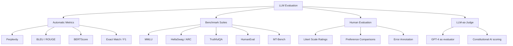
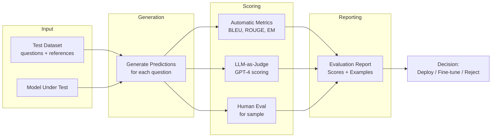

# Chapter 17: Evaluation and Benchmarking of LLMs

> **Prerequisites:** Chapters 1–16 — especially language model fundamentals (Ch. 5–8), fine-tuning (Ch. 12), and building applications (Ch. 16).

Evaluating LLMs is one of the hardest open problems in AI. A model can produce fluent, confident text that is completely wrong. This chapter teaches you how to measure what LLMs actually do well — and where they fail.

---

## Table of Contents

1. [Why Evaluation is Hard](#1-why-evaluation-is-hard)
2. [Types of Evaluation](#2-types-of-evaluation)
3. [Automatic Metrics](#3-automatic-metrics)
4. [Benchmark Suites](#4-benchmark-suites)
5. [Human Evaluation](#5-human-evaluation)
6. [LLM-as-Judge](#6-llm-as-judge)
7. [Python: Computing Metrics](#7-python-computing-metrics)
8. [Building Your Own Evaluation Pipeline](#8-building-your-own-evaluation-pipeline)
9. [Summary & Key Takeaways](#9-summary--key-takeaways)

---

## 1. Why Evaluation is Hard

### The Core Problem

Traditional software has deterministic outputs — you can write a unit test that checks `add(2, 3) == 5`. LLM outputs are:

- **Open-ended:** There are infinitely many valid answers to "Explain quantum entanglement."
- **Context-dependent:** Quality depends on the audience, purpose, and application.
- **Multi-dimensional:** An answer can be factually correct but poorly written, or beautifully written but subtly wrong.
- **Stochastic:** The same prompt can yield different outputs on repeated calls (temperature > 0).

### Fluency ≠ Correctness

LLMs are trained to predict the next token — they learn to produce text that *sounds right*, not text that *is right*. This creates the hallucination problem: a model writes a confident, grammatically perfect paragraph containing fabricated citations, wrong dates, or invented facts.

> **Example:** Ask an LLM "What papers did [obscure researcher] publish?" — it may invent plausible-sounding paper titles that do not exist.

### Confident ≠ Truthful

Models don't have an internal uncertainty signal the way a human does. They produce text with the same confident tone whether they are summarizing well-established physics or making something up.

### The Metric Gap

Every evaluation metric measures a *proxy* for quality, not quality itself:
- BLEU measures n-gram overlap — not meaning
- Perplexity measures fluency — not factual accuracy
- Benchmark scores measure narrow task subsets — not real-world usefulness

---

## 2. Types of Evaluation



| Method | Cost | Speed | Scalability | Validity |
|---|---|---|---|---|
| Automatic metrics | Very low | Very fast | Unlimited | Low–Medium |
| Benchmarks | Low | Fast | High | Medium |
| Human evaluation | High | Slow | Limited | High |
| LLM-as-judge | Medium | Fast | High | Medium–High |

---

## 3. Automatic Metrics

### 3.1 Perplexity

**What it measures:** How "surprised" the model is by text — a proxy for fluency and language model quality.

**Formula:**

```
Perplexity(W) = exp( -1/N × Σ log P(wᵢ | w₁, ..., wᵢ₋₁) )
```

Where:
- `N` = number of tokens
- `P(wᵢ | ...)` = the model's predicted probability for token `wᵢ`

**Intuition:** A perfectly fluent model assigns high probability to every token → low cross-entropy → low perplexity. Random text has high perplexity.

**Use cases:**
- Comparing language model quality on the same domain
- Detecting out-of-distribution inputs
- Monitoring model degradation after fine-tuning

**Limitations:**
- Perplexity is model-relative — you can only compare perplexity from the *same* model on different texts
- Low perplexity ≠ correct or truthful text
- Perplexity on training data is not useful (models memorize it)

### 3.2 BLEU Score

**BLEU** (Bilingual Evaluation Understudy) was developed for machine translation in 2002. It measures n-gram overlap between generated text and reference text.

**Formula:**

```
BLEU = BP × exp( Σₙ wₙ × log pₙ )
```

Where:
- `BP` = Brevity Penalty (penalizes short outputs): `min(1, exp(1 - r/c))` where `r` = reference length, `c` = candidate length
- `pₙ` = modified n-gram precision for n-grams of size n
- `wₙ` = weight (usually 1/4 for n=1,2,3,4)

**Example:**

```
Reference:  "The cat sat on the mat"
Generated:  "The cat is on the mat"

1-gram matches: the, cat, on, the, mat → 5/6
2-gram matches: the cat, on the, the mat → 3/5
```

**Limitations:**
- Doesn't capture meaning — "The cat sat" and "A feline rested" have zero BLEU overlap despite same meaning
- Sensitive to tokenization
- Doesn't penalize repetition well
- Poor correlation with human judgments for open-ended generation

### 3.3 ROUGE

**ROUGE** (Recall-Oriented Understudy for Gisting Evaluation) is primarily used for **summarization** evaluation.

| Variant | What it measures |
|---|---|
| **ROUGE-1** | Unigram (single word) overlap |
| **ROUGE-2** | Bigram (two-word phrase) overlap |
| **ROUGE-L** | Longest Common Subsequence (LCS) — captures word order |
| **ROUGE-S** | Skip-bigram overlap (allows gaps between matched words) |

**ROUGE-1 F1 formula:**

```
Precision = |overlap| / |generated words|
Recall    = |overlap| / |reference words|
F1        = 2 × Precision × Recall / (Precision + Recall)
```

**When to use ROUGE:**
- Automatic summarization evaluation (ROUGE-L and ROUGE-2 most common)
- News headline generation
- As one signal among many — never as the sole metric

### 3.4 BERTScore

BERTScore addresses the core weakness of BLEU/ROUGE by using **semantic similarity** rather than surface overlap.

**How it works:**
1. Encode generated tokens using BERT (or RoBERTa, DeBERTa)
2. Encode reference tokens using the same model
3. Compute cosine similarity between each generated token and the best-matching reference token
4. Average similarities → Precision, Recall, F1

**Why it's better:**
- "The cat sat" and "A feline rested" score high (semantically similar)
- Robust to paraphrasing
- Better correlation with human judgments than BLEU/ROUGE

**Trade-off:** Requires running a BERT model → slower and more resource-intensive.

### 3.5 Exact Match (EM) and F1 for QA

For question answering tasks (like SQuAD):

```
Exact Match = 1 if predicted_answer == ground_truth else 0

Token F1 = harmonic mean of:
  Precision = common_tokens / predicted_tokens
  Recall    = common_tokens / ground_truth_tokens
```

**Example:**
```
Ground truth: "Marie Curie"
Prediction A: "Marie Curie"           → EM=1, F1=1.0
Prediction B: "Marie Curie (1867)"    → EM=0, F1=0.67
Prediction C: "Curie"                 → EM=0, F1=0.67
```

---

## 4. Benchmark Suites

Benchmarks are standardized test sets that allow apples-to-apples model comparison. Here are the most widely used:

### 4.1 MMLU — Massive Multitask Language Understanding

- **What:** 57 academic subjects — from elementary math to medical ethics, law, history, computer science, and more
- **Format:** 4-choice multiple choice questions
- **Size:** ~15,000 test questions
- **What it tests:** Breadth of world knowledge, reasoning, reading comprehension
- **Limitation:** Saturating for the strongest models; some questions have contested answers

```
Example question (Medical):
A 65-year-old man presents with chest pain radiating to his left arm.
The most likely diagnosis is:
(A) Pulmonary embolism
(B) Myocardial infarction ← correct
(C) Aortic dissection
(D) Pericarditis
```

### 4.2 HellaSwag — Commonsense Reasoning

- **What:** Complete a scenario with the most plausible continuation
- **Format:** 4-choice multiple choice
- **What it tests:** Commonsense reasoning about everyday physical events
- **Notable:** GPT-2 scored ~40% (barely above chance); modern LLMs score 85–95%+

### 4.3 ARC — AI2 Reasoning Challenge

- **Two sets:** ARC-Easy (grade school) and ARC-Challenge (harder, requires reasoning chains)
- **What it tests:** Science questions that require multi-step reasoning
- **Why it matters:** Separates models that "look up" answers from those that reason

### 4.4 TruthfulQA

- **What:** 817 questions designed to elicit false answers that humans often believe
- **Goal:** Measure tendency to repeat common misconceptions and myths
- **Format:** Generation + true/false categories
- **Example:** "What happens if you swallow gum?" (Common myth: it stays in your stomach for 7 years)
- **Limitation:** Questions are static; models may be trained to ace it specifically

### 4.5 HumanEval — Code Generation

- **What:** 164 programming problems with unit tests
- **Format:** Given a function signature + docstring, complete the implementation
- **Metric:** pass@k — fraction of problems solved with k attempts
- **What it tests:** Practical coding ability, not just code-looking text

### 4.6 MT-Bench — Multi-Turn Conversation Quality

- **What:** 80 multi-turn conversation scenarios across 8 categories (math, coding, reasoning, roleplay, writing, etc.)
- **Scoring:** GPT-4 rates each response 1–10
- **Why it matters:** Tests instruction following across conversation turns, not just one-shot responses

### 4.7 LMSYS Chatbot Arena

- **What:** Live side-by-side human preference battles between anonymized models
- **Format:** Users chat with two unknown models and vote for the better response
- **Result:** Elo rating system (like chess) → real-world user preference ranking
- **Why it's valuable:** Direct human preference signal, adversarial prompts from real users

| Benchmark | Focus | Format | Limitation |
|---|---|---|---|
| MMLU | Knowledge breadth | MCQ | Saturating; static |
| HellaSwag | Commonsense | MCQ | Mostly saturated |
| ARC-Challenge | Science reasoning | MCQ | Narrow domain |
| TruthfulQA | Truthfulness | Generation | Static, gameable |
| HumanEval | Coding | Code+tests | Only Python, limited |
| MT-Bench | Multi-turn quality | LLM-judged | GPT-4 biases |
| Chatbot Arena | User preference | Human vote | Slow, noisy |

---

## 5. Human Evaluation

Despite its cost, human evaluation remains the gold standard for assessing generation quality.

### 5.1 Likert Scale Ratings

Annotators rate responses on a 1–5 scale across multiple dimensions:

| Dimension | 1 (Poor) | 3 (Acceptable) | 5 (Excellent) |
|---|---|---|---|
| **Factual accuracy** | Contains false claims | Mostly correct | Fully accurate |
| **Helpfulness** | Doesn't address the question | Partially helpful | Fully helpful |
| **Coherence** | Contradictory/incoherent | Mostly coherent | Perfectly coherent |
| **Safety** | Harmful content | Borderline | Safe and appropriate |

**Best practices:**
- Use at least 3 independent annotators per item
- Compute inter-annotator agreement (Cohen's κ or Fleiss' κ)
- Provide clear annotation guidelines with examples
- Include attention checks (obvious-answer questions) to filter lazy annotators

### 5.2 Preference Comparisons (A vs B)

Show annotators two responses to the same prompt. Ask: "Which is better?"

**Advantages over Likert:**
- Easier for humans to judge (relative is easier than absolute)
- Directly captures the pairwise preference signal used in RLHF training
- Less susceptible to individual scale calibration differences

**Example interface:**

```
Prompt: Explain black holes to a 10-year-old.

Response A: [Model X output]
Response B: [Model Y output]

Which response is better? ○ A  ○ B  ○ Tie
```

### 5.3 Error Annotation

Annotators label specific errors in model outputs:

| Error type | Example |
|---|---|
| Factual error | Wrong date, invented citation |
| Logical inconsistency | Contradicts itself within the response |
| Instruction not followed | Asked for 3 bullet points, gave 7 |
| Hallucinated entity | Named a person who doesn't exist |
| Unsafe content | Harmful, biased, or offensive text |

### 5.4 Challenges of Human Evaluation

| Challenge | Impact | Mitigation |
|---|---|---|
| **Cost** | $5–50 per annotation × thousands of examples | Use crowdsourcing carefully; LLM-as-judge for filtering |
| **Annotator inconsistency** | Different people, different standards | Detailed guidelines, training, agreement metrics |
| **Annotator fatigue** | Quality drops after ~1 hour | Shorter sessions, mandatory breaks |
| **Position bias** | Prefer the first option | Randomize order |
| **Expertise gap** | Lay annotators can't judge technical content | Recruit domain experts for specialized tasks |

---

## 6. LLM-as-Judge

Using a strong LLM (typically GPT-4) to evaluate the outputs of a weaker or different LLM.

### 6.1 How It Works

```python
# Example: GPT-4 evaluating a weaker model's response

JUDGE_PROMPT = """You are an expert evaluator. Rate the following response on a scale of 1-10.

Criteria:
- Factual accuracy (0-4 points)
- Helpfulness (0-3 points)
- Clarity and conciseness (0-3 points)

Question: {question}
Response: {response}

Output your rating as JSON: {{"score": <1-10>, "reasoning": "<brief explanation>"}}
"""
```

### 6.2 Known Biases in LLM-as-Judge

| Bias | Description | Mitigation |
|---|---|---|
| **Positional bias** | Prefers the first response in A/B comparisons | Swap order; average both orderings |
| **Verbosity bias** | Prefers longer, more detailed responses | Instruct judge to ignore length |
| **Self-preference** | GPT-4 rates GPT-4 outputs higher | Use different judge than evaluated model |
| **Format bias** | Prefers responses with bullet points, headers | Normalize formatting before judging |
| **Sycophancy** | Agrees with any position in the prompt | Instruct judge to focus on facts only |

### 6.3 When to Trust LLM-as-Judge

- ✅ Filtering obviously bad outputs at scale
- ✅ Preference ranking across many models
- ✅ Catching safety violations and policy breaches
- ⚠️ Fine-grained quality assessment (use human evaluation instead)
- ❌ Factual accuracy in highly technical domains
- ❌ Tasks where the judge model has the same blind spots as the evaluated model

---

## 7. Python: Computing Metrics

```python
# pip install sacrebleu rouge-score torch transformers bert-score

# ─────────────────────────────────────────────────────────────────────────────
# 1. BLEU Score with sacrebleu
# ─────────────────────────────────────────────────────────────────────────────
from sacrebleu.metrics import BLEU

def compute_bleu(hypotheses: list[str], references: list[list[str]]) -> dict:
    """
    Compute corpus-level BLEU score.

    Args:
        hypotheses: List of generated sentences.
        references: List of reference lists (one list per reference set).
                    For single reference: [["ref1", "ref2", ...]]
    """
    bleu = BLEU(effective_order=True)
    result = bleu.corpus_score(hypotheses, references)
    return {
        "bleu": result.score,
        "precisions": result.precisions,  # 1,2,3,4-gram precisions
        "bp": result.bp,                  # Brevity penalty
    }


# ─────────────────────────────────────────────────────────────────────────────
# 2. ROUGE Score with rouge-score
# ─────────────────────────────────────────────────────────────────────────────
from rouge_score import rouge_scorer

def compute_rouge(hypotheses: list[str], references: list[str]) -> dict:
    """
    Compute ROUGE-1, ROUGE-2, ROUGE-L for a list of hypothesis/reference pairs.
    """
    scorer = rouge_scorer.RougeScorer(
        ["rouge1", "rouge2", "rougeL"], use_stemmer=True
    )
    aggregated = {"rouge1": [], "rouge2": [], "rougeL": []}

    for hyp, ref in zip(hypotheses, references):
        scores = scorer.score(ref, hyp)
        for key in aggregated:
            aggregated[key].append(scores[key].fmeasure)

    # Average across the dataset
    return {
        key: round(sum(vals) / len(vals), 4)
        for key, vals in aggregated.items()
    }


# ─────────────────────────────────────────────────────────────────────────────
# 3. Simple Perplexity Calculation
# ─────────────────────────────────────────────────────────────────────────────
import torch
import math
from transformers import AutoModelForCausalLM, AutoTokenizer


def compute_perplexity(text: str, model_name: str = "gpt2") -> float:
    """
    Compute perplexity of a text string using a causal language model.
    Lower = more fluent/expected by the model.
    """
    tokenizer = AutoTokenizer.from_pretrained(model_name)
    model = AutoModelForCausalLM.from_pretrained(model_name)
    model.eval()

    encodings = tokenizer(text, return_tensors="pt")
    input_ids = encodings.input_ids

    with torch.no_grad():
        outputs = model(input_ids, labels=input_ids)
        # outputs.loss = mean negative log-likelihood per token
        neg_log_likelihood = outputs.loss

    perplexity = torch.exp(neg_log_likelihood).item()
    return perplexity


# ─────────────────────────────────────────────────────────────────────────────
# 4. Evaluate a Model on a Custom Dataset
# ─────────────────────────────────────────────────────────────────────────────
from openai import OpenAI


def evaluate_model_on_dataset(
    dataset: list[dict],
    model: str = "llama3.2",
    base_url: str = "http://localhost:11434/v1",
) -> dict:
    """
    Evaluate an LLM on a custom QA dataset.

    Dataset format:
        [{"question": "...", "reference_answer": "..."}, ...]

    Returns aggregated ROUGE and exact match scores.
    """
    client = OpenAI(base_url=base_url, api_key="ollama")

    hypotheses = []
    references = []

    for item in dataset:
        # Get model prediction
        response = client.chat.completions.create(
            model=model,
            messages=[
                {"role": "system", "content": "Answer the question concisely and accurately."},
                {"role": "user",   "content": item["question"]},
            ],
            max_tokens=256,
            temperature=0.0,  # Greedy for reproducibility
        )
        prediction = response.choices[0].message.content.strip()
        hypotheses.append(prediction)
        references.append(item["reference_answer"])

    # Exact match
    exact_matches = [
        1 if h.lower() == r.lower() else 0
        for h, r in zip(hypotheses, references)
    ]

    # ROUGE
    rouge_scores = compute_rouge(hypotheses, references)

    # BLEU
    bleu_scores = compute_bleu(hypotheses, [references])

    return {
        "num_examples": len(dataset),
        "exact_match": round(sum(exact_matches) / len(exact_matches), 4),
        "rouge1": rouge_scores["rouge1"],
        "rouge2": rouge_scores["rouge2"],
        "rougeL": rouge_scores["rougeL"],
        "bleu": round(bleu_scores["bleu"], 2),
        "predictions": list(zip(
            [d["question"] for d in dataset],
            hypotheses,
            references,
        )),
    }


# ─────────────────────────────────────────────────────────────────────────────
# Example Usage
# ─────────────────────────────────────────────────────────────────────────────
if __name__ == "__main__":
    sample_dataset = [
        {
            "question": "What is the capital of France?",
            "reference_answer": "Paris",
        },
        {
            "question": "Who wrote Romeo and Juliet?",
            "reference_answer": "William Shakespeare",
        },
        {
            "question": "What is the chemical symbol for water?",
            "reference_answer": "H2O",
        },
    ]

    print("=== Model Evaluation ===")
    results = evaluate_model_on_dataset(sample_dataset)
    print(f"Examples: {results['num_examples']}")
    print(f"Exact Match: {results['exact_match']:.1%}")
    print(f"ROUGE-1 F1: {results['rouge1']:.4f}")
    print(f"ROUGE-L F1: {results['rougeL']:.4f}")
    print(f"BLEU:        {results['bleu']:.2f}")
    print("\nPredictions:")
    for q, pred, ref in results["predictions"]:
        print(f"  Q: {q}")
        print(f"  Predicted: {pred}")
        print(f"  Reference: {ref}")
        print()
```

---

## 8. Building Your Own Evaluation Pipeline

### 8.1 Pipeline Architecture



### 8.2 Evaluation Best Practices

| Practice | Why It Matters |
|---|---|
| **Use held-out test sets** | Never evaluate on training or validation data |
| **Report confidence intervals** | Small test sets have high variance |
| **Disaggregate by category** | A model may excel at math but fail at coding |
| **Include failure examples** | Numbers alone hide failure modes |
| **Version your eval datasets** | Benchmarks change; comparisons must be apples-to-apples |
| **Combine multiple metrics** | No single metric tells the whole story |
| **Test for regressions** | Re-evaluate after every fine-tuning run |

---

## 9. Summary & Key Takeaways

| Concept | Key Insight |
|---|---|
| **Evaluation is hard** | Fluency ≠ correctness; confidence ≠ truthfulness |
| **Perplexity** | Measures fluency; only comparable within same model |
| **BLEU / ROUGE** | Surface overlap — fast but weak correlation with quality |
| **BERTScore** | Semantic similarity — better but slower |
| **MMLU / HumanEval** | Standardized benchmarks for knowledge + coding |
| **TruthfulQA** | Specifically measures tendency to hallucinate myths |
| **Human eval** | Gold standard but expensive; use sampling strategies |
| **LLM-as-judge** | Scalable and reasonable; watch for positional/verbosity bias |
| **Chatbot Arena** | Most ecologically valid — real users, real tasks |

### Recommended Evaluation Stack (Starting Point)

1. **ROUGE-L** for summarization tasks
2. **pass@1 on HumanEval** for coding tasks
3. **Exact match + F1** for QA tasks
4. **LLM-as-judge** (GPT-4 or Claude) for open-ended generation
5. **Human evaluation** on a 100-example sample before major releases

---

[← Chapter 16: Building AI Applications](../16-building-ai-applications/README.md) | [🏠 Home](../../README.md) | [Chapter 18: LLM Security and Ethics →](../18-llm-security-and-ethics/README.md)
