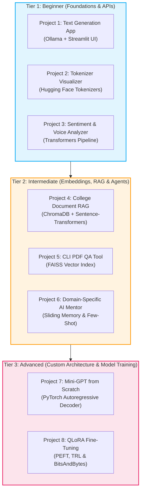
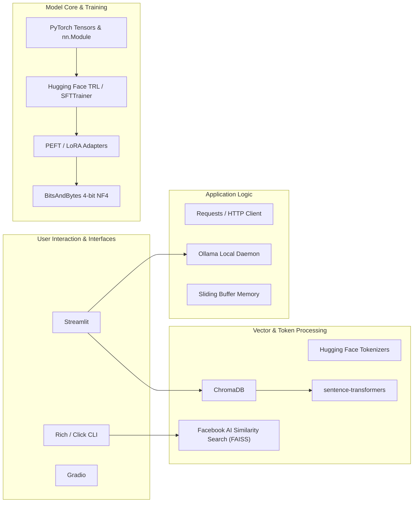
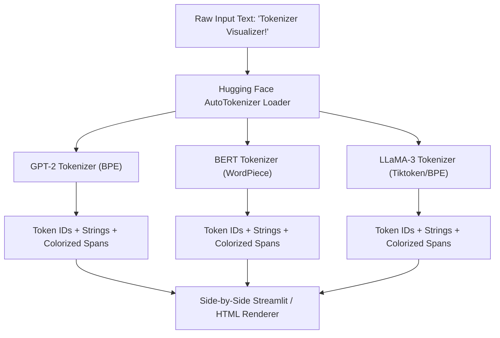
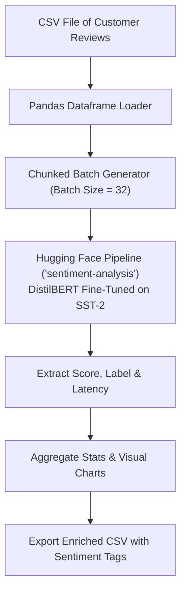
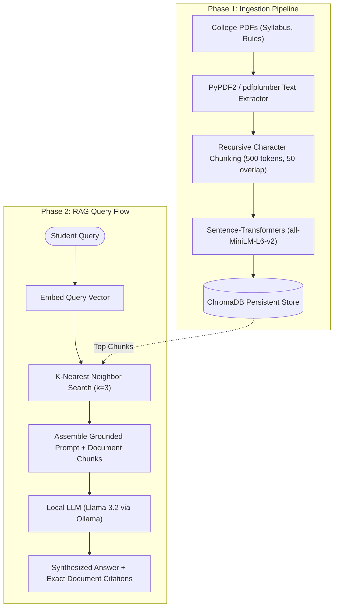
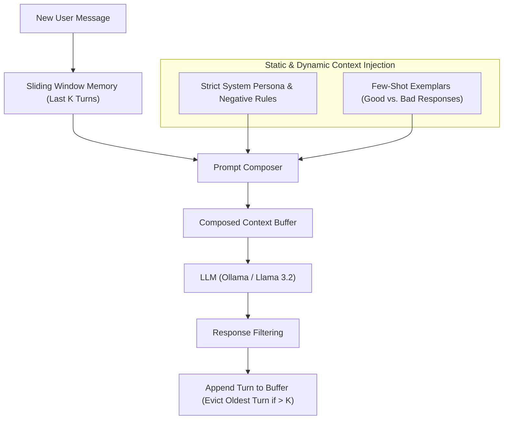
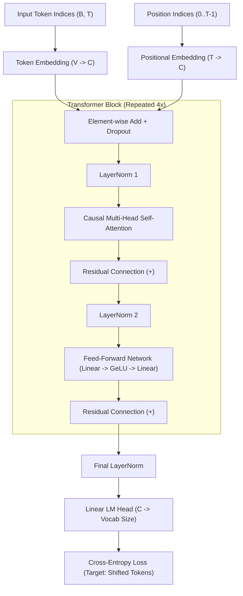
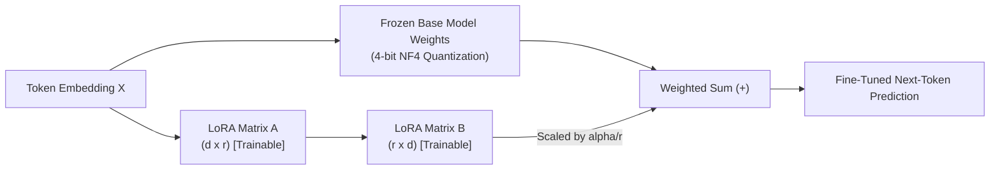

# Chapter 19: Hands-On Practical Projects

> **Prerequisites:** Chapters 1–18 — particularly Python fundamentals, tokenization (Ch. 7), transformer mechanics (Ch. 6 & 8), training & fine-tuning (Ch. 10 & 13), RAG & vector databases (Ch. 14), and application engineering (Ch. 16).

---

Theory gives you vocabulary; building gives you mastery. In this chapter, you will transition from understanding how Large Language Models work under the hood to building production-grade, portfolio-ready systems. 

Whether you have a laptop without an expensive GPU or access to cloud accelerators, these **8 fully-specified projects** guide you step-by-step from zero to deployed code. Every project includes architectural blueprints, folder layouts, complete runnable code files, execution roadmaps, and extension challenges.

---

## Table of Contents

1. [Quick Start: Choosing Your Project](#1-quick-start-choosing-your-project)
2. [Project Difficulty Ladder & Architecture Stack](#2-project-difficulty-ladder--architecture-stack)
3. [Recommended Learning Path](#3-recommended-learning-path)
4. [Beginner Projects](#4-beginner-projects)
   - [Project 1: Local Text Generation Web App (Ollama + Streamlit)](#project-1-local-text-generation-web-app)
   - [Project 2: Interactive Multi-Model Tokenizer Visualizer](#project-2-interactive-multi-model-tokenizer-visualizer)
   - [Project 3: Production Sentiment & Customer Voice Analyzer](#project-3-production-sentiment--customer-voice-analyzer)
5. [Intermediate Projects](#5-intermediate-projects)
   - [Project 4: College Document Chatbot (Full-Stack Local RAG)](#project-4-college-document-chatbot-rag)
   - [Project 5: Zero-Dependency CLI PDF Question-Answering Assistant (FAISS)](#project-5-zero-dependency-cli-pdf-question-answering-assistant)
   - [Project 6: Domain-Specific AI Mentor with Conversational Memory](#project-6-domain-specific-ai-mentor-with-conversational-memory)
6. [Advanced Projects](#6-advanced-projects)
   - [Project 7: Train a Miniature GPT from Scratch in PyTorch](#project-7-train-a-miniature-gpt-from-scratch-in-pytorch)
   - [Project 8: QLoRA Instruction Fine-Tuning on Open-Weight LLMs](#project-8-qlora-instruction-fine-tuning-on-open-weight-llms)
7. [Troubleshooting & Common Failure Modes](#7-troubleshooting--common-failure-modes)
8. [Open-Sourcing Your Project & Portfolio Presentation](#8-open-sourcing-your-project--portfolio-presentation)
9. [Summary & Next Steps](#9-summary--next-steps)

---

## 1. Quick Start: Choosing Your Project

Not sure where to begin? Use this diagnostic matrix to match your current hardware and skill level with the most impactful project:

| Your Current Situation | Hardware Constraints | Recommended Starting Point | Key Takeaway |
|:---|:---|:---|:---|
| **Just starting out with Python & APIs** | Basic Laptop (CPU only, 4–8 GB RAM) | **Project 1** (Text Generator) or **Project 2** (Tokenizer Visualizer) | Master HTTP streaming, token representations, and UI state |
| **Want to analyze datasets & text** | Laptop (CPU, 8 GB RAM) | **Project 3** (Sentiment Analyzer) | Batch inference, Hugging Face pipelines, and metrics |
| **Need an impressive resume project** | 8–16 GB RAM (CPU or Apple Silicon) | **Project 4** (College RAG) or **Project 6** (Domain Mentor) | End-to-end vector embeddings, semantic search, prompt injection defense |
| **Love deep learning & math** | CPU or any basic GPU (Google Colab free tier) | **Project 7** (Mini-GPT from Scratch) | PyTorch autograd, causal self-attention, cross-entropy training |
| **Want to specialize in LLMOps & Fine-Tuning** | Free Google Colab T4 (15 GB VRAM) | **Project 8** (QLoRA Fine-Tuning) | Parameter-efficient adaptation (PEFT), 4-bit quantization, loss curves |

---

## 2. Project Difficulty Ladder & Architecture Stack

### Project Difficulty Ladder



### Technology Stack per Project Tier



---

## 3. Recommended Learning Path

For maximum retention, follow this structured 4-week progression:

1. **Week 1 (Inference & Token Mechanics):** Complete **Project 1** and **Project 2**. You will demystify how text becomes numbers, how tokenizers differ across model families (GPT-2 vs. BERT vs. LLaMA 3), and how HTTP event streaming brings real-time generation into interactive UIs.
2. **Week 2 (Embeddings & Semantic Search):** Complete **Project 3** and **Project 5**. Transition from token-level operations to dense vector representations. You will implement cosine similarity indexing directly with FAISS and understand text classification heads.
3. **Week 3 (Full-Stack RAG & System Prompting):** Complete **Project 4** and **Project 6**. Master chunking strategies, vector database persistence, hallucination mitigation via grounded context injection, and stateful multi-turn conversational agents.
4. **Week 4 (Deep Learning & Parameter Adaptation):** Complete **Project 7** and **Project 8**. Build an actual transformer neural network from raw mathematical primitives in PyTorch, followed by adapting a multi-billion parameter foundation model using 4-bit Low-Rank Adaptation.

---

## 4. Beginner Projects

---

### Project 1: Local Text Generation Web App

#### 1. Problem Statement
Many commercial LLM applications rely on expensive cloud APIs that introduce latency, privacy concerns, and recurring token costs. In this project, you will build a local, web-based generative text application powered by an open-weight model (`llama3.2:1b` or `llama3.2:3b`) running on your personal machine via **Ollama**. Users can enter custom prompts, choose creativity parameters (temperature, top-p), select stylistic tones, and watch the response stream in real-time.

#### 2. Learning Objectives
- Understanding client-server architecture in local LLM serving.
- Handling Server-Sent Events (SSE) and NDJSON streaming in Python.
- State management and dynamic UI rendering in Streamlit.
- Parameter control: temperature, repetition penalty, system personas.

#### 3. Architecture Blueprint


#### 4. Technology Stack
- **Language:** Python 3.10+
- **Frontend:** Streamlit 1.35+
- **Inference Server:** Ollama (`ollama run llama3.2`)
- **Networking:** Requests (HTTP streaming)

#### 5. Folder Structure
```text
text-generator/
├── app.py              # Main Streamlit application and session state
├── llm_client.py       # Modular API client for Ollama
├── requirements.txt    # Pinned Python dependencies
└── README.md           # Setup and run instructions
```

#### 6. Step-by-Step Implementation Roadmap

- **Session 1: Environment & Engine Setup**
  1. Install Ollama from [ollama.com](https://ollama.com).
  2. Pull the lightweight instruction-tuned model: `ollama pull llama3.2:1b`.
  3. Verify daemon availability: `curl http://localhost:11434/api/tags`.
  4. Create a virtual environment: `python3 -m venv venv && source venv/bin/activate`.
- **Session 2: Modular Client Development**
  1. Write `llm_client.py` with generator functions yielding streaming chunks.
  2. Implement proper timeout and connection error handling if Ollama is offline.
- **Session 3: UI Construction & Session State**
  1. Build sidebar controls (temperature slider, model selector, tone presets).
  2. Implement `st.chat_input` and `st.write_stream` for smooth text rendering.
- **Session 4: Polish & Extensions**
  1. Add conversation download (Markdown/JSON export).
  2. Add token estimation and latency timers.

#### 7. Working Code

##### `text-generator/requirements.txt`
```text
streamlit>=1.35.0
requests>=2.31.0
```

##### `text-generator/llm_client.py`
```python
"""
Modular client to communicate with local Ollama instance.
"""
import requests
import json
from typing import Generator, Optional

DEFAULT_OLLAMA_URL = "http://localhost:11434"

class OllamaClient:
    def __init__(self, base_url: str = DEFAULT_OLLAMA_URL):
        self.base_url = base_url.rstrip("/")

    def check_health(self) -> bool:
        """Verify that Ollama daemon is reachable."""
        try:
            resp = requests.get(f"{self.base_url}/api/tags", timeout=3.0)
            return resp.status_code == 200
        except requests.RequestException:
            return False

    def stream_generate(
        self,
        model: str,
        prompt: str,
        system_prompt: Optional[str] = None,
        temperature: float = 0.7,
        top_p: float = 0.9,
    ) -> Generator[str, None, None]:
        """
        Streams text generation tokens from the local Ollama daemon.
        Yields individual token strings as they are produced.
        """
        endpoint = f"{self.base_url}/api/generate"
        payload = {
            "model": model,
            "prompt": prompt,
            "stream": True,
            "options": {
                "temperature": temperature,
                "top_p": top_p,
            }
        }
        if system_prompt:
            payload["system"] = system_prompt

        try:
            response = requests.post(endpoint, json=payload, stream=True, timeout=120.0)
            response.raise_for_status()

            for line in response.iter_lines(decode_unicode=True):
                if line:
                    chunk = json.loads(line)
                    yield chunk.get("response", "")
                    if chunk.get("done", False):
                        break
        except requests.exceptions.ConnectionError:
            yield "\n[Error: Unable to connect to Ollama. Make sure 'ollama serve' is running.]"
        except Exception as exc:
            yield f"\n[Generation Error: {str(exc)}]"
```

##### `text-generator/app.py`
```python
"""
Streamlit Web UI for Local Text Generation with Ollama.
"""
import streamlit as st
from llm_client import OllamaClient

st.set_page_config(page_title="Local LLM Generator", page_icon="⚡", layout="wide")

# Initialize Client
client = OllamaClient()

# Sidebar Configurations
st.sidebar.title("⚙️ Model Controls")

server_online = client.check_health()
if server_online:
    st.sidebar.success("Ollama Daemon: Connected (localhost:11434)")
else:
    st.sidebar.error("Ollama Daemon: Offline! Run `ollama serve`")

model_choice = st.sidebar.selectbox(
    "Choose Model",
    ["llama3.2:1b", "llama3.2:3b", "mistral:latest", "phi3:mini"]
)

tone = st.sidebar.selectbox(
    "Stylistic Tone",
    [
        "Academic & Rigorous",
        "Casual & Friendly",
        "Concise Technical Summary",
        "ELIF5 (Explain Like I'm 5)"
    ]
)

temperature = st.sidebar.slider("Temperature (Creativity)", 0.0, 1.5, 0.7, 0.05)
top_p = st.sidebar.slider("Top-P (Nucleus Sampling)", 0.1, 1.0, 0.9, 0.05)

TONE_SYSTEM_PROMPTS = {
    "Academic & Rigorous": "You are an academic researcher. Respond with structured, citation-style formality, objectivity, and precise vocabulary.",
    "Casual & Friendly": "You are a cheerful peer tutor. Speak warmly with everyday analogies, light humor, and encouraging words.",
    "Concise Technical Summary": "Provide direct bulleted technical breakdowns without fluff or conversational filler.",
    "ELIF5 (Explain Like I'm 5)": "Explain the topic using simple real-world metaphors that an elementary school student can immediately visualize."
}

# Main Canvas
st.title("⚡ Local AI Studio")
st.caption("Run private, unmetered generative models locally with real-time token streaming.")

if "chat_history" not in st.session_state:
    st.session_state.chat_history = []

# Display previous turns
for role, text in st.session_state.chat_history:
    with st.chat_message(role):
        st.markdown(text)

# Handle new user submission
user_input = st.chat_input("Ask a question, request code, or draft content...")

if user_input:
    # Display user query
    st.session_state.chat_history.append(("user", user_input))
    with st.chat_message("user"):
        st.markdown(user_input)

    # Stream assistant response
    with st.chat_message("assistant"):
        sys_prompt = TONE_SYSTEM_PROMPTS[tone]
        stream = client.stream_generate(
            model=model_choice,
            prompt=user_input,
            system_prompt=sys_prompt,
            temperature=temperature,
            top_p=top_p
        )
        full_response = st.write_stream(stream)
    
    st.session_state.chat_history.append(("assistant", full_response))
```

#### 8. Expected Output
When running `streamlit run app.py`:
- A clean dual-pane interface loads in browser (`localhost:8501`).
- The sidebar shows green status if `ollama serve` is active.
- Prompts yield progressive word-by-word streaming responses in under 200ms time-to-first-token on modern CPUs.

#### 9. Extension Ideas
- **Export Facility:** Add a button in the sidebar to download current session history as `notes.md`.
- **System Prompt Sandbox:** Add a custom text area allowing users to design arbitrary system roles (e.g., "Senior Rust Code Reviewer").
- **Latency & Speed Monitor:** Calculate and display `tokens per second` alongside inference timestamps.

---

### Project 2: Interactive Multi-Model Tokenizer Visualizer

#### 1. Problem Statement
Beginners frequently treat LLMs as systems that process letters and words like humans. They fail to understand why models struggle with simple tasks like counting the letter 'r' in "strawberry" or parsing non-English scripts. This project builds an interactive comparative web dashboard where students enter arbitrary text or code and inspect how diverse tokenization algorithms (Byte-Pair Encoding, WordPiece, Unigram) segment text into numeric token IDs with distinctive color boundaries.

#### 2. Learning Objectives
- Understanding subword tokenization: BPE, WordPiece, and SentencePiece.
- Loading tokenizers using the Hugging Face `transformers` ecosystem.
- Analyzing vocabulary size vs. compression ratio across models.
- Visualizing whitespace retention and special token injection (`<s>`, `[CLS]`).

#### 3. Architecture Blueprint



#### 4. Technology Stack
- **Language:** Python 3.10+
- **Libraries:** `transformers`, `streamlit`
- **Pretrained Tokenizers:** `gpt2`, `bert-base-uncased`, `meta-llama/Llama-3.2-1B` (or `roberta-base`)

#### 5. Folder Structure
```text
tokenizer-visualizer/
├── app.py              # Visual dashboard with HTML color spans
├── requirements.txt    # Transformers + PyTorch / Tokenizers
└── README.md
```

#### 6. Working Code

##### `tokenizer-visualizer/requirements.txt`
```text
streamlit>=1.35.0
transformers>=4.42.0
torch>=2.2.0
```

##### `tokenizer-visualizer/app.py`
```python
"""
Interactive Tokenizer Visualizer comparing GPT-2, BERT, and RoBERTa.
"""
import streamlit as st
from transformers import AutoTokenizer
import html

st.set_page_config(page_title="LLM Tokenizer Visualizer", page_icon="🔍", layout="wide")

st.title("🔍 Subword Tokenizer Comparative Inspector")
st.markdown("""
LLMs do not see characters or whole words. They process sequences of integers (**token IDs**) mapped via subword vocabularies.
Compare how different tokenization architectures segment words, symbols, whitespace, and code.
""")

# Palette for token background highlighting
COLOR_PALETTE = [
    "#FFD1DC", "#FFE4B5", "#D1E8E2", "#D7BDE2", "#A9DFBF",
    "#F9E79F", "#F5CBA7", "#AED6F1", "#E8DAEF", "#FADBD8"
]

@st.cache_resource
def load_tokenizers():
    """Load and cache distinct tokenizer types."""
    models = {
        "GPT-2 (Byte-Pair Encoding, BPE)": AutoTokenizer.from_pretrained("gpt2"),
        "BERT (WordPiece, cased)": AutoTokenizer.from_pretrained("bert-base-cased"),
        "RoBERTa / LLaMA style (Byte-level BPE)": AutoTokenizer.from_pretrained("roberta-base")
    }
    return models

tokenizers = load_tokenizers()

# Default test texts
sample_texts = {
    "English Idiom": "Tokenization is the unsung bedrock of Modern Natural Language Processing.",
    "Subword Splitting": "unbelievable compartmentalization strawberry antidisestablishmentarianism",
    "Python Code Snippet": "def calculate_loss(y_true, y_pred):\n    return ((y_true - y_pred) ** 2).mean()",
    "Multilingual Sentence": "Bonjour le monde! 机器学习 makes AI accessible."
}

selected_sample = st.selectbox("Choose a preset test string or type your own below:", list(sample_texts.keys()))
user_text = st.text_area("Input Text", value=sample_texts[selected_sample], height=120)

if user_text:
    cols = st.columns(len(tokenizers))
    
    for idx, (name, tok) in enumerate(tokenizers.items()):
        with cols[idx]:
            st.subheader(name)
            vocab_size = tok.vocab_size
            
            # Encode input
            encoding = tok(user_text, add_special_tokens=False)
            token_ids = encoding["input_ids"]
            token_strings = [tok.decode([tid]) for tid in token_ids]
            
            num_chars = len(user_text)
            num_tokens = len(token_ids)
            compression = round(num_chars / num_tokens, 2) if num_tokens > 0 else 0.0
            
            # Metrics banner
            st.metric(label="Total Tokens", value=num_tokens, delta=f"{compression} chars/token")
            st.caption(f"Vocabulary Size: {vocab_size:,} tokens")
            
            # Generate colored badges
            html_badges = []
            for t_idx, (t_id, t_str) in enumerate(zip(token_ids, token_strings)):
                color = COLOR_PALETTE[t_idx % len(COLOR_PALETTE)]
                escaped_str = html.escape(t_str).replace(" ", "&middot;").replace("\n", "&para;<br>")
                badge = (
                    f'<span style="background-color: {color}; padding: 2px 5px; margin: 2px; '
                    f'border-radius: 4px; display: inline-block; font-family: monospace; font-size: 14px; '
                    f'border: 1px solid rgba(0,0,0,0.1);" title="ID: {t_id} | Raw: {repr(t_str)}">'
                    f'{escaped_str}'
                    f'<sub style="color: #555; font-size: 9px; margin-left: 3px;">{t_id}</sub></span>'
                )
                html_badges.append(badge)
            
            st.markdown(
                f'<div style="background-color: #fafafa; padding: 12px; border-radius: 8px; border: 1px solid #ddd; line-height: 2.2; min-height: 180px;">'
                f'{"".join(html_badges)}</div>',
                unsafe_allow_html=True
            )
            
            with st.expander("View Token Breakdown Table"):
                breakdown_data = [
                    {"Index": i, "Token ID": tid, "Decoded String": repr(tstr)}
                    for i, (tid, tstr) in enumerate(zip(token_ids, token_strings))
                ]
                st.dataframe(breakdown_data, use_container_width=True)
```

#### 7. Expected Output
- A 3-column comparative view displaying GPT-2 vs. BERT vs. RoBERTa tokenization in real time.
- Whitespace characters are indicated with middot (`·`), and newlines are highlighted.
- Hovering over any token span reveals its integer vocabulary index and raw string repr.

#### 8. Extension Ideas
- **Compression Efficiency Calculator:** Plot a graph of character-to-token ratio across 10 global languages (English, German, Hindi, Mandarin, Arabic) to demonstrate vocabulary bias.
- **Out-of-Vocabulary (OOV) & Byte Fallback Analyzer:** Show how emojis (`🔥`, `🚀`) or mathematical notations decompose into multiple raw byte tokens.

---

### Project 3: Production Sentiment & Customer Voice Analyzer

#### 1. Problem Statement
Organizations receive thousands of customer reviews, feedback forms, and support tickets daily. Manual sentiment classification is slow and inconsistent. In this project, you will develop a high-throughput sentiment classification and customer intelligence pipeline using Hugging Face's `transformers.pipeline`. The system handles single-statement analysis, batch CSV ingestion, confidence thresholding, and automated metric charting.

#### 2. Learning Objectives
- Utilizing Hugging Face abstraction pipelines for downstream NLP tasks.
- Batching inference to optimize CPU/GPU throughput.
- Extracting categorical sentiment, neutrality, and probability distributions.
- Visualizing aggregated metrics using pandas and matplotlib/altair.

#### 3. Architecture Blueprint



#### 4. Technology Stack
- **Language:** Python 3.10+
- **Core ML:** `transformers`, `torch`
- **Data & Plotting:** `pandas`, `altair`, `streamlit`

#### 5. Working Code

##### `sentiment-analyzer/requirements.txt`
```text
streamlit>=1.35.0
transformers>=4.42.0
torch>=2.2.0
pandas>=2.2.0
altair>=5.3.0
```

##### `sentiment-analyzer/app.py`
```python
"""
Batch Sentiment and Customer Voice Analysis App.
"""
import streamlit as st
import pandas as pd
import altair as alt
import time
from transformers import pipeline

st.set_page_config(page_title="Customer Voice Sentiment Analyzer", page_icon="📊", layout="wide")

@st.cache_resource
def load_sentiment_pipeline():
    """Loads DistilBERT SST-2 sentiment model."""
    return pipeline(
        task="sentiment-analysis",
        model="distilbert-base-uncased-finetuned-sst-2-english",
        device=-1  # CPU by default, set 0 for CUDA GPU
    )

classifier = load_sentiment_pipeline()

st.title("📊 Customer Voice Sentiment Intelligence")
st.markdown("Automated sentiment classification for product reviews, support tickets, and surveys using pre-trained Transformer heads.")

tab1, tab2 = st.tabs(["⚡ Single Text Inspection", "📁 Batch CSV Processing"])

with tab1:
    st.subheader("Interactive Single Sentence Inference")
    user_review = st.text_input(
        "Enter customer feedback:",
        value="The checkout experience was remarkably smooth, though customer support took 48 hours to respond."
    )
    
    if st.button("Classify Sentiment", type="primary"):
        with st.spinner("Analyzing semantics..."):
            start_t = time.perf_counter()
            result = classifier(user_review)[0]
            duration_ms = (time.perf_counter() - start_t) * 1000
            
            label = result["label"]
            score = result["score"]
            
            c1, c2, c3 = st.columns(3)
            c1.metric("Predicted Sentiment", label, delta="Positive" if label == "POSITIVE" else "-Negative")
            c2.metric("Confidence Score", f"{score * 100:.2f}%")
            c3.metric("Inference Latency", f"{duration_ms:.1f} ms")

with tab2:
    st.subheader("High-Throughput Batch Dataset Processing")
    uploaded_file = st.file_uploader("Upload CSV file (Must have a text column)", type=["csv"])
    
    if uploaded_file is not None:
        df = pd.read_csv(uploaded_file)
        st.write("Data Preview:", df.head(3))
        
        text_col = st.selectbox("Select Text Column for Analysis", df.columns)
        
        if st.button("Run Batch Classification"):
            texts = df[text_col].astype(str).tolist()
            
            progress_bar = st.progress(0)
            results = []
            batch_size = 32
            
            start_t = time.perf_counter()
            for i in range(0, len(texts), batch_size):
                batch = texts[i:i + batch_size]
                batch_results = classifier(batch)
                results.extend(batch_results)
                progress_bar.progress(min((i + batch_size) / len(texts), 1.0))
            
            total_time = time.perf_counter() - start_t
            
            df["sentiment_label"] = [r["label"] for r in results]
            df["sentiment_confidence"] = [round(r["score"], 4) for r in results]
            
            st.success(f"Classified {len(df)} records in {total_time:.2f} seconds ({len(df) / total_time:.1f} records/sec)")
            
            # Visualizations
            col_chart, col_data = st.columns([1, 1])
            
            with col_chart:
                st.subheader("Sentiment Distribution")
                chart = alt.Chart(df).mark_arc(innerRadius=50).encode(
                    theta=alt.Theta(field="sentiment_label", type="nominal", aggregate="count"),
                    color=alt.Color(
                        field="sentiment_label",
                        type="nominal",
                        scale=alt.Scale(domain=["POSITIVE", "NEGATIVE"], range=["#2ECC71", "#E74C3C"])
                    ),
                    tooltip=["sentiment_label", "count()"]
                )
                st.altair_chart(chart, use_container_width=True)
                
            with col_data:
                st.subheader("Enriched Sample")
                st.dataframe(df[[text_col, "sentiment_label", "sentiment_confidence"]].head(10), use_container_width=True)
                
            # CSV Export
            csv_data = df.to_csv(index=False).encode('utf-8')
            st.download_button(
                label="📥 Download Enriched Dataset with Sentiments",
                data=csv_data,
                file_name="sentiment_analysis_output.csv",
                mime="text/csv"
            )
```

#### 6. Expected Output
- Instant classification of ad-hoc reviews into `POSITIVE` / `NEGATIVE` with confidence probabilities.
- Batch CSV ingestion processing hundreds of customer reviews with a visual donut chart and exportable enriched CSV.

#### 7. Extension Ideas
- **3-Class Model Integration:** Switch to `cardiffnlp/twitter-roberta-base-sentiment-latest` to support explicit `NEUTRAL` classification.
- **Aspect-Based Sentiment Analysis (ABSA):** Break reviews down by topic (e.g., Shipping vs. Product Quality vs. Price) using zero-shot classification pipelines.

---

## 5. Intermediate Projects

---

### Project 4: College Document Chatbot (RAG)

#### 1. Problem Statement
College campuses produce hundreds of unstructured policy PDFs: course syllabi, fee schedules, exam rules, scholarship notifications, and campus bylaws. Students struggle to locate precise answers within 80-page circulars. Building a traditional keyword search fails when synonyms are used. 

In this project, you will build a complete, private **Retrieval-Augmented Generation (RAG)** system that ingests college PDF documents, chunks them semantically, indexes them into a persistent vector store (**ChromaDB**), and answers student queries using grounded citations via **Ollama**.

#### 2. Learning Objectives
- Understanding the complete RAG loop: Ingestion → Chunking → Embedding → Vector Indexing → Hybrid Retrieval → Grounded Context Synthesis.
- Avoiding context window blowup and hallucination through relevance filtering.
- Managing persistent vector storage on local disk.
- Designing prompt templates that enforce source citation.

#### 3. Architecture Blueprint



#### 4. Technology Stack
- **PDF Extraction:** `pypdf>=4.2.0`
- **Embedding Model:** `sentence-transformers>=3.0.0` (`all-MiniLM-L6-v2`, 384 dimensions)
- **Vector Database:** `chromadb>=0.5.0`
- **Generative Engine:** `ollama` (`llama3.2:1b` or `llama3.2:3b`)
- **Frontend:** `streamlit`

#### 5. Folder Structure
```text
college-chatbot/
├── data/                  # Place raw college PDFs here
├── db/                    # ChromaDB persistent vector storage
├── ingest.py              # PDF extraction, chunking, and vector ingestion
├── retriever.py           # Similarity retrieval logic
├── generator.py           # Ollama client with grounded prompt engineering
├── app.py                 # Streamlit student interface
├── requirements.txt
└── README.md
```

#### 6. Step-by-Step Implementation Roadmap

- **Session 1: Document Processing & Chunking**
  1. Parse multi-page PDFs using `pypdf`.
  2. Implement a sliding window chunking function that preserves paragraph boundaries and overlaps 50 words to avoid splitting thoughts mid-sentence.
- **Session 2: Embedding Generation & ChromaDB Vector Indexing**
  1. Initialize `sentence-transformers/all-MiniLM-L6-v2`.
  2. Create a persistent Chroma collection and add embeddings with metadata (filename, page number).
- **Session 3: Retrieval & Grounded Context Assembly**
  1. Query the vector database with student questions.
  2. Format retrieved chunks into a system prompt requiring explicit bracketed citations.
- **Session 4: Web Application & UI Integration**
  1. Build a chat interface with expandable citation cards showing the exact source text and page number.

#### 7. Working Code Snippets

##### `college-chatbot/requirements.txt`
```text
pypdf>=4.2.0
sentence-transformers>=3.0.0
chromadb>=0.5.0
requests>=2.31.0
streamlit>=1.35.0
```

##### `college-chatbot/ingest.py`
```python
"""
Ingestion script: Extracts text from PDFs, chunks it, and indexes into ChromaDB.
"""
import os
from typing import List, Tuple
from pypdf import PdfReader
from sentence_transformers import SentenceTransformer
import chromadb

DATA_DIR = "./data"
DB_DIR = "./db"
COLLECTION_NAME = "college_documents"

def extract_pdf_chunks(pdf_path: str, chunk_size: int = 500, chunk_overlap: int = 50) -> List[Tuple[str, int, str]]:
    """
    Extracts text from PDF and splits into overlapping word chunks.
    Returns list of (chunk_text, page_number, filename).
    """
    reader = PdfReader(pdf_path)
    filename = os.path.basename(pdf_path)
    chunks = []
    
    for page_idx, page in enumerate(reader.pages):
        raw_text = page.extract_text() or ""
        words = raw_text.split()
        if not words:
            continue
            
        step = chunk_size - chunk_overlap
        for i in range(0, len(words), step):
            chunk_words = words[i:i + chunk_size]
            chunk_str = " ".join(chunk_words)
            if len(chunk_str.strip()) > 50:  # Ignore tiny artifact chunks
                chunks.append((chunk_str, page_idx + 1, filename))
                
    return chunks

def run_ingestion():
    os.makedirs(DATA_DIR, exist_ok=True)
    os.makedirs(DB_DIR, exist_ok=True)
    
    pdf_files = [f for f in os.listdir(DATA_DIR) if f.lower().endswith(".pdf")]
    if not pdf_files:
        print(f"[-] No PDFs found in {DATA_DIR}. Please add college PDF documents!")
        return

    print(f"[+] Initializing embedding model (all-MiniLM-L6-v2)...")
    embed_model = SentenceTransformer("all-MiniLM-L6-v2")
    
    client = chromadb.PersistentClient(path=DB_DIR)
    collection = client.get_or_create_collection(name=COLLECTION_NAME)
    
    total_chunks = 0
    for pdf in pdf_files:
        pdf_path = os.path.join(DATA_DIR, pdf)
        print(f"[+] Processing {pdf}...")
        doc_chunks = extract_pdf_chunks(pdf_path)
        
        if not doc_chunks:
            continue
            
        texts = [c[0] for c in doc_chunks]
        metadatas = [{"page": c[1], "source": c[2]} for c in doc_chunks]
        ids = [f"{c[2]}_p{c[1]}_chunk{idx}" for idx, c in enumerate(doc_chunks)]
        
        # Compute dense embeddings
        embeddings = embed_model.encode(texts, show_progress_bar=True).tolist()
        
        collection.upsert(
            documents=texts,
            embeddings=embeddings,
            metadatas=metadatas,
            ids=ids
        )
        total_chunks += len(texts)
        
    print(f"[✓] Successfully ingested {total_chunks} chunks into ChromaDB at {DB_DIR}.")

if __name__ == "__main__":
    run_ingestion()
```

##### `college-chatbot/retriever.py`
```python
"""
Retrieval module for similarity search over indexed chunks.
"""
from typing import List, Dict, Any
from sentence_transformers import SentenceTransformer
import chromadb

class DocumentRetriever:
    def __init__(self, db_dir: str = "./db", collection_name: str = "college_documents"):
        self.client = chromadb.PersistentClient(path=db_dir)
        self.collection = self.client.get_collection(name=collection_name)
        self.embed_model = SentenceTransformer("all-MiniLM-L6-v2")

    def retrieve(self, query: str, top_k: int = 3) -> List[Dict[str, Any]]:
        """Retrieve top-k most semantically relevant text chunks."""
        query_vector = self.embed_model.encode([query]).tolist()
        results = self.collection.query(
            query_embeddings=query_vector,
            n_results=top_k
        )
        
        retrieved = []
        if results and "documents" in results and results["documents"]:
            docs = results["documents"][0]
            metas = results["metadatas"][0]
            distances = results["distances"][0] if "distances" in results else [0.0] * len(docs)
            
            for doc, meta, dist in zip(docs, metas, distances):
                retrieved.append({
                    "text": doc,
                    "source": meta.get("source", "Unknown"),
                    "page": meta.get("page", 0),
                    "distance": round(dist, 4)
                })
        return retrieved
```

##### `college-chatbot/generator.py`
```python
"""
Synthesize final grounded response using local Ollama model.
"""
import requests
from typing import List, Dict, Any

def build_grounded_prompt(query: str, context_chunks: List[Dict[str, Any]]) -> str:
    context_str = ""
    for idx, chunk in enumerate(context_chunks, 1):
        context_str += f"\n--- Source Document [{idx}]: {chunk['source']} (Page {chunk['page']}) ---\n"
        context_str += chunk['text'] + "\n"
        
    prompt = f"""You are the official College Academic Assistant. Your duty is to answer student questions truthfully, accurately, and solely based on the provided document excerpts below.

GUIDELINES:
1. If the information is not explicitly mentioned in the context below, state clearly: "I cannot find the answer to this question in the official college documentation provided."
2. Never make up dates, fees, or course policies.
3. Cite your sources directly in your explanation using the format [DocumentName, Page X].

OFFICIAL DOCUMENT CONTEXT:
{context_str}

STUDENT QUESTION:
{query}

ACCURATE ANSWER WITH CITATIONS:"""
    return prompt

def generate_answer(prompt: str, model: str = "llama3.2:1b", temperature: float = 0.2) -> str:
    """Call local Ollama instance for grounded completion."""
    try:
        resp = requests.post(
            "http://localhost:11434/api/generate",
            json={
                "model": model,
                "prompt": prompt,
                "stream": False,
                "options": {
                    "temperature": temperature
                }
            },
            timeout=60.0
        )
        if resp.status_code == 200:
            return resp.json().get("response", "").strip()
        return f"Error from Ollama: Status {resp.status_code}"
    except Exception as e:
        return f"Failed to connect to Ollama: {str(e)}"
```

##### `college-chatbot/app.py`
```python
"""
Streamlit UI for the College Document Chatbot.
"""
import streamlit as st
from retriever import DocumentRetriever
from generator import build_grounded_prompt, generate_answer

st.set_page_config(page_title="College Policy Assistant", page_icon="🎓", layout="wide")

st.title("🎓 College Document & Syllabus Assistant")
st.caption("Ask questions regarding fee deadlines, course regulations, and exam policies. Powered by Local RAG.")

@st.cache_resource
def get_retriever():
    return DocumentRetriever()

try:
    retriever = get_retriever()
    ready = True
except Exception as e:
    st.error(f"Vector Database not initialized! Please run `python ingest.py` first. Error: {e}")
    ready = False

if ready:
    if "messages" not in st.session_state:
        st.session_state.messages = []

    for msg in st.session_state.messages:
        with st.chat_message(msg["role"]):
            st.markdown(msg["content"])
            if "sources" in msg and msg["sources"]:
                with st.expander("📚 View Cited Sources"):
                    for s in msg["sources"]:
                        st.markdown(f"**{s['source']} (Page {s['page']})**")
                        st.caption(s["text"])

    query = st.chat_input("What is the minimum attendance requirement for semester exams?")
    if query:
        st.session_state.messages.append({"role": "user", "content": query})
        with st.chat_message("user"):
            st.markdown(query)

        with st.chat_message("assistant"):
            with st.spinner("Searching documents & generating grounded response..."):
                chunks = retriever.retrieve(query, top_k=3)
                prompt = build_grounded_prompt(query, chunks)
                answer = generate_answer(prompt)
                
                st.markdown(answer)
                if chunks:
                    with st.expander("📚 View Cited Sources"):
                        for s in chunks:
                            st.markdown(f"**{s['source']} (Page {s['page']})**")
                            st.caption(s["text"])
                            
            st.session_state.messages.append({
                "role": "assistant",
                "content": answer,
                "sources": chunks
            })
```

#### 8. Expected Output
- Accurate answers citing document name and page number.
- When asked an unrelated question (e.g., "What is the capital of France?"), the bot strictly replies that the information is not present in the college policies.

---

### Project 5: Zero-Dependency CLI PDF Question-Answering Assistant

#### 1. Problem Statement
Sometimes you don't need a heavy database server or web UI; you just want to inspect an arbitrary 30-page research paper, contract, or manual from your Linux terminal. In this project, you will build a standalone, single-file command-line question-answering assistant using **PyPDF2**, **FAISS** (Facebook AI Similarity Search), **Sentence-Transformers**, and **Ollama**.

#### 2. Learning Objectives
- Understanding in-memory flat vector indexing using FAISS (`IndexFlatL2`).
- Building interactive command-line loops with rich terminal formatting.
- Rapid prototyping without database servers or web frameworks.

#### 3. Technology Stack
- `pypdf`, `faiss-cpu`, `sentence-transformers`, `requests`

#### 4. Working Code

##### `pdf-cli-qa/qa_tool.py`
```python
"""
Zero-dependency CLI tool to query any single PDF document from your terminal.
"""
import sys
import os
import argparse
import numpy as np
from pypdf import PdfReader
from sentence_transformers import SentenceTransformer
import faiss
import requests

def extract_and_chunk(pdf_path: str, chunk_size: int = 150, overlap: int = 30):
    """Extract text and produce overlapping chunk tuples."""
    reader = PdfReader(pdf_path)
    chunks = []
    for page_num, page in enumerate(reader.pages, start=1):
        text = page.extract_text() or ""
        words = text.split()
        step = chunk_size - overlap
        for i in range(0, len(words), step):
            chunk = " ".join(words[i:i + chunk_size])
            if len(chunk.strip()) > 30:
                chunks.append((chunk, page_num))
    return chunks

def build_faiss_index(chunks, embed_model):
    """Build an in-memory L2 FAISS index."""
    texts = [c[0] for c in chunks]
    embeddings = embed_model.encode(texts, convert_to_numpy=True)
    dim = embeddings.shape[1]
    index = faiss.IndexFlatL2(dim)
    index.add(embeddings.astype("float32"))
    return index, texts, [c[1] for c in chunks]

def ask_ollama(prompt: str, model: str = "llama3.2:1b") -> str:
    """Call local Ollama instance."""
    try:
        resp = requests.post(
            "http://localhost:11434/api/generate",
            json={"model": model, "prompt": prompt, "stream": False},
            timeout=60.0
        )
        return resp.json().get("response", "").strip()
    except Exception as e:
        return f"[Error contacting Ollama: {e}]"

def main():
    parser = argparse.ArgumentParser(description="Instant CLI PDF Question-Answering")
    parser.add_argument("pdf_path", help="Path to local PDF file")
    parser.add_argument("--model", default="llama3.2:1b", help="Ollama model tag")
    args = parser.parse_args()

    if not os.path.exists(args.pdf_path):
        print(f"Error: File '{args.pdf_path}' not found.")
        sys.exit(1)

    print(f"[*] Reading and chunking {args.pdf_path}...")
    chunks = extract_and_chunk(args.pdf_path)
    print(f"[+] Extracted {len(chunks)} chunks.")

    print("[*] Loading embedding model (all-MiniLM-L6-v2)...")
    embed_model = SentenceTransformer("all-MiniLM-L6-v2")

    print("[*] Building FAISS index...")
    index, texts, page_numbers = build_faiss_index(chunks, embed_model)
    print("[✓] Ready! Type your question below (or 'exit' to quit).\n")

    while True:
        try:
            query = input("Ask PDF ❯ ").strip()
            if not query:
                continue
            if query.lower() in ["exit", "quit", "q"]:
                print("Goodbye!")
                break

            # Embed query & search FAISS
            q_emb = embed_model.encode([query], convert_to_numpy=True).astype("float32")
            distances, indices = index.search(q_emb, k=2)

            retrieved_context = ""
            for idx in indices[0]:
                retrieved_context += f"\n[Page {page_numbers[idx]}]: {texts[idx]}\n"

            prompt = f"""Use the following excerpt from the PDF to answer the query accurately.
CONTEXT:
{retrieved_context}

QUESTION:
{query}

ANSWER:"""

            print("\nThinking...")
            answer = ask_ollama(prompt, model=args.model)
            print(f"\n{answer}\n{'-'*60}\n")
        except KeyboardInterrupt:
            print("\nSession ended.")
            break

if __name__ == "__main__":
    main()
```

#### 5. Expected Output
Execution directly from terminal:
```bash
$ python qa_tool.py research_paper.pdf
[*] Reading and chunking research_paper.pdf...
[+] Extracted 42 chunks.
[*] Loading embedding model (all-MiniLM-L6-v2)...
[*] Building FAISS index...
[✓] Ready! Type your question below (or 'exit' to quit).

Ask PDF ❯ What learning rate did the authors use in Section 4?
Thinking...
According to [Page 5], the authors used a learning rate of 3e-4 with AdamW optimizer.
```

---

### Project 6: Domain-Specific AI Assistant with Sliding Memory

#### 1. Problem Statement
When using general-purpose LLMs, models frequently wander off-topic, invent ungrounded advice, or lose track of conversation history once conversations exceed the model's context window. In this project, you will develop a **Domain-Specific AI Assistant** (e.g., an elite Python Code Optimization Coach) using advanced system prompt engineering, few-shot demonstration injection, and an explicit **sliding window memory buffer**.

#### 2. Learning Objectives
- Writing robust system prompts with boundaries, output schemas, and negative constraints.
- Injecting few-shot exemplar pairs into system context.
- Implementing sliding-window conversation memory to prevent token exhaustion.
- Preventing topic drift and adversarial jailbreak attempts.

#### 3. Architecture Blueprint



#### 4. Technology Stack
- Python 3.10+, `requests`, `streamlit`

#### 5. Working Code

##### `domain-assistant/memory.py`
```python
"""
Sliding window conversational memory manager.
"""
from typing import List, Dict

class SlidingWindowMemory:
    def __init__(self, max_turns: int = 4):
        """Retains the most recent max_turns dialogue pairs (user + assistant)."""
        self.max_turns = max_turns
        self.history: List[Dict[str, str]] = []

    def add_turn(self, user_text: str, assistant_text: str):
        self.history.append({"role": "user", "content": user_text})
        self.history.append({"role": "assistant", "content": assistant_text})
        # Maintain sliding limit (each turn has 2 messages)
        max_messages = self.max_turns * 2
        if len(self.history) > max_messages:
            self.history = self.history[-max_messages:]

    def get_messages(self) -> List[Dict[str, str]]:
        return list(self.history)

    def clear(self):
        self.history = []
```

##### `domain-assistant/assistant.py`
```python
"""
Domain-specific Python Optimization Mentor with sliding memory.
"""
import requests
from memory import SlidingWindowMemory

SYSTEM_PERSONA = """You are 'PySpeed', an expert Python Performance and Systems Optimization Engineer.
YOUR MISSION:
You exclusively help developers analyze Python code, algorithmic time complexity, memory allocation, and concurrency (asyncio, multiprocessing).

STRICT RULES & CONSTRAINTS:
1. ONLY discuss Python programming, algorithms, and performance profiling.
2. If the user asks about non-technical topics (recipes, politics, creative writing, or other programming languages like Java/PHP), politely reject: "I specialize exclusively in Python performance optimization. Please share a Python code snippet or algorithmic question."
3. Always include Big-O time and space complexity analysis for any optimized code you propose.
4. Provide concrete before-and-after code blocks with timeit or cProfile examples.

FEW-SHOT DEMONSTRATIONS:

User: How do I check if a list contains duplicates?
Assistant:
### Optimal Python Approach
To check for duplicates with O(n) time complexity, compare the list length to a set:

```python
def has_duplicates(items: list) -> bool:
    return len(items) != len(set(items))
```
- **Time Complexity:** O(n) average case to build the hash set.
- **Space Complexity:** O(n) memory to store unique elements.
*Avoid iterating with nested loops `for x in list: if list.count(x) > 1` which wastes O(n^2) operations.*
"""

class PySpeedAssistant:
    def __init__(self, model: str = "llama3.2:1b"):
        self.model = model
        self.memory = SlidingWindowMemory(max_turns=3)

    def ask(self, user_query: str) -> str:
        conversation_history = self.memory.get_messages()
        
        # Compose payload
        payload_messages = [{"role": "system", "content": SYSTEM_PERSONA}]
        payload_messages.extend(conversation_history)
        payload_messages.append({"role": "user", "content": user_query})

        # Call Ollama Chat API
        try:
            resp = requests.post(
                "http://localhost:11434/api/chat",
                json={
                    "model": self.model,
                    "messages": payload_messages,
                    "stream": False,
                    "options": {"temperature": 0.2}
                },
                timeout=45.0
            )
            if resp.status_code == 200:
                bot_reply = resp.json()["message"]["content"]
                self.memory.add_turn(user_query, bot_reply)
                return bot_reply
            return f"Error from LLM backend: {resp.status_code}"
        except Exception as e:
            return f"Connection error: {e}"

if __name__ == "__main__":
    bot = PySpeedAssistant()
    print("[*] PySpeed Optimization Mentor initialized. Type your questions:")
    while True:
        q = input("\nDeveloper ❯ ").strip()
        if q.lower() in ["exit", "quit"]:
            break
        print(f"\nPySpeed:\n{bot.ask(q)}")
```

#### 6. Expected Output
- High-quality, specialized responses focused on computational complexity, GIL impacts, vectorized NumPy replacements, or generator memory savings.
- Immediate polite refusal if asked unrelated general trivia.

---

## 6. Advanced Projects

---

### Project 7: Train a Miniature GPT from Scratch in PyTorch

#### 1. Problem Statement
Most students interact with LLMs solely through high-level APIs or fine-tuning frameworks without understanding the core mathematical engine: token embeddings, positional encodings, multi-head causal self-attention, feed-forward layers, and the autoregressive next-token prediction training loop. 

In this project, you will implement, train, and validate a miniature GPT-style decoder-only transformer (~2 million parameters) from scratch in pure **PyTorch**, and train it on a ~5–10 MB text corpus (such as the TinyStories dataset or Project Gutenberg Shakespeare).

> **Theoretical Foundations:** Refer to [Chapter 6: The Transformer Architecture](../06-transformer-architecture/README.md) for full matrix attention formulas and [Chapter 10: Training LLMs from Scratch](../10-training-llms-from-scratch/README.md) for pretraining dynamics.

#### 2. Learning Objectives
- Implementing scaled dot-product attention with causal triangular masking.
- Multi-head attention projection and residual connections with LayerNorm.
- Character-level or subword tokenization and positional encoding.
- Building a PyTorch training loop with cross-entropy loss, AdamW optimizer, and learning rate scheduling.
- Generating text autoregressively using temperature and top-k filtering.

#### 3. Educational Disclaimer
> [!IMPORTANT]
> This miniature model is built strictly for pedagogical transparency and conceptual clarity. With ~2 million parameters trained on a CPU or single GPU for 30 minutes, it will learn grammar, spelling, and localized narrative rhythm, but it will **not** possess the world knowledge, reasoning, or instruction-following fidelity of modern production models like LLaMA-3 or Claude.

#### 4. Architecture Specifications
- **Embedding Dimension ($d_{model}$):** 128
- **Transformer Layers ($n_{layer}$):** 4
- **Attention Heads ($n_{head}$):** 4 (dimension per head $d_k = 32$)
- **Context Block Size:** 128 tokens
- **Vocabulary Size:** Character-level (~65 tokens) or Tiny BPE (~500 tokens)
- **Total Parameters:** ~1.8 Million



#### 5. Folder Structure
```text
tiny-gpt/
├── data/
│   ├── input.txt            # Training corpus (Shakespeare or TinyStories)
│   └── prepare.py           # Token encoding and train/val split
├── model.py                 # PyTorch Transformer architecture
├── train.py                 # Training loop, loss logging, checkpointing
├── generate.py              # Autoregressive generation script
├── config.py                # Hyperparameters dictionary
├── requirements.txt
└── README.md
```

#### 6. Step-by-Step Implementation Roadmap

- **Session 1: Data Preparation & Encoding**
  - Download raw text data (`tiny_shakespeare.txt`).
  - Construct a character-level vocabulary mapping (`stoi` and `itos`).
  - Save train and validation binary tensor splits (`train.bin`, `val.bin`).
- **Session 2: Architecture Construction**
  - Code `CausalSelfAttention` with lower-triangular causal masking to prevent looking into the future.
  - Implement `FeedForward` with GeLU activation and `TransformerBlock`.
  - Assemble `MiniatureGPT` with token + positional embeddings and linear language model head.
- **Session 3: Optimization & Training Loop**
  - Write batch sampling function (`get_batch`).
  - Optimize with `torch.optim.AdamW`, tracking training and validation loss over 2,000–5,000 iterations.
- **Session 4: Text Generation & Sampling**
  - Implement autoregressive loop: predict next token logits, apply temperature, sample with `torch.multinomial`, append to context, and iterate.

#### 7. Working Code

##### `tiny-gpt/requirements.txt`
```text
torch>=2.2.0
numpy>=1.26.0
matplotlib>=3.8.0
requests>=2.31.0
```

##### `tiny-gpt/config.py`
```python
"""
Configuration hyperparameters for Miniature GPT.
"""
import torch

# Model Architecture
VOCAB_SIZE = 65      # Character-level vocabulary
BLOCK_SIZE = 128     # Maximum context length
N_EMBD = 128         # Embedding dimension
N_HEAD = 4           # Number of attention heads
N_LAYER = 4          # Number of transformer blocks
DROPOUT = 0.1

# Training Hyperparameters
BATCH_SIZE = 32
MAX_ITERS = 2000
EVAL_INTERVAL = 250
LEARNING_RATE = 1e-3
DEVICE = "cuda" if torch.cuda.is_available() else "cpu"
```

##### `tiny-gpt/model.py`
```python
"""
PyTorch implementation of a Miniature Decoder-Only Causal GPT.
"""
import torch
import torch.nn as nn
from torch.nn import functional as F
import math

class CausalSelfAttention(nn.Module):
    def __init__(self, n_embd: int, n_head: int, block_size: int, dropout: float):
        super().__init__()
        assert n_embd % n_head == 0
        self.n_head = n_head
        self.head_dim = n_embd // n_head
        
        # Key, Query, Value projections in a single matrix
        self.c_attn = nn.Linear(n_embd, 3 * n_embd)
        self.c_proj = nn.Linear(n_embd, n_embd)
        self.attn_dropout = nn.Dropout(dropout)
        self.resid_dropout = nn.Dropout(dropout)
        
        # Causal triangular mask (future tokens masked with -inf)
        self.register_buffer(
            "bias",
            torch.tril(torch.ones(block_size, block_size)).view(1, 1, block_size, block_size)
        )

    def forward(self, x: torch.Tensor) -> torch.Tensor:
        B, T, C = x.size()
        
        # Calculate Query, Key, Value vectors
        q, k, v = self.c_attn(x).split(C, dim=2)
        k = k.view(B, T, self.n_head, self.head_dim).transpose(1, 2)
        q = q.view(B, T, self.n_head, self.head_dim).transpose(1, 2)
        v = v.view(B, T, self.n_head, self.head_dim).transpose(1, 2)

        # Scaled dot-product attention
        att = (q @ k.transpose(-2, -1)) * (1.0 / math.sqrt(k.size(-1)))
        att = att.masked_fill(self.bias[:, :, :T, :T] == 0, float('-inf'))
        att = F.softmax(att, dim=-1)
        att = self.attn_dropout(att)
        
        y = att @ v # (B, nh, T, T) x (B, nh, T, hs) -> (B, nh, T, hs)
        y = y.transpose(1, 2).contiguous().view(B, T, C)
        return self.resid_dropout(self.c_proj(y))

class FeedForward(nn.Module):
    def __init__(self, n_embd: int, dropout: float):
        super().__init__()
        self.net = nn.Sequential(
            nn.Linear(n_embd, 4 * n_embd),
            nn.GELU(),
            nn.Linear(4 * n_embd, n_embd),
            nn.Dropout(dropout)
        )

    def forward(self, x):
        return self.net(x)

class Block(nn.Module):
    def __init__(self, n_embd: int, n_head: int, block_size: int, dropout: float):
        super().__init__()
        self.ln_1 = nn.LayerNorm(n_embd)
        self.attn = CausalSelfAttention(n_embd, n_head, block_size, dropout)
        self.ln_2 = nn.LayerNorm(n_embd)
        self.mlp = FeedForward(n_embd, dropout)

    def forward(self, x):
        x = x + self.attn(self.ln_1(x))
        x = x + self.mlp(self.ln_2(x))
        return x

class MiniatureGPT(nn.Module):
    def __init__(self, vocab_size: int, n_embd: int, n_head: int, n_layer: int, block_size: int, dropout: float):
        super().__init__()
        self.block_size = block_size
        self.token_embedding_table = nn.Embedding(vocab_size, n_embd)
        self.position_embedding_table = nn.Embedding(block_size, n_embd)
        self.blocks = nn.Sequential(*[
            Block(n_embd, n_head, block_size, dropout) for _ in range(n_layer)
        ])
        self.ln_f = nn.LayerNorm(n_embd)
        self.lm_head = nn.Linear(n_embd, vocab_size)

    def forward(self, idx, targets=None):
        B, T = idx.shape
        tok_emb = self.token_embedding_table(idx)             # (B, T, C)
        pos_emb = self.position_embedding_table(torch.arange(T, device=idx.device)) # (T, C)
        x = tok_emb + pos_emb
        x = self.blocks(x)
        x = self.ln_f(x)
        logits = self.lm_head(x)                              # (B, T, vocab_size)

        loss = None
        if targets is not None:
            B, T, C = logits.shape
            logits = logits.view(B * T, C)
            targets = targets.view(B * T)
            loss = F.cross_entropy(logits, targets)

        return logits, loss

    @torch.no_grad()
    def generate(self, idx: torch.Tensor, max_new_tokens: int, temperature: float = 0.8):
        """Autoregressive generation loop."""
        for _ in range(max_new_tokens):
            # Crop context if it exceeds block size
            idx_cond = idx[:, -self.block_size:]
            logits, _ = self(idx_cond)
            logits = logits[:, -1, :] / temperature
            probs = F.softmax(logits, dim=-1)
            idx_next = torch.multinomial(probs, num_samples=1)
            idx = torch.cat((idx, idx_next), dim=1)
        return idx
```

##### `tiny-gpt/train.py`
```python
"""
Training loop for Miniature GPT on Tiny Shakespeare dataset.
"""
import os
import urllib.request
import torch
import config
from model import MiniatureGPT

# 1. Download Dataset
DATA_URL = "https://raw.githubusercontent.com/karpathy/char-rnn/master/data/tinyshakespeare/input.txt"
DATA_FILE = "./data/input.txt"
os.makedirs("./data", exist_ok=True)

if not os.path.exists(DATA_FILE):
    print("[*] Downloading Tiny Shakespeare dataset...")
    urllib.request.urlretrieve(DATA_URL, DATA_FILE)

with open(DATA_FILE, "r", encoding="utf-8") as f:
    text = f.read()

chars = sorted(list(set(text)))
vocab_size = len(chars)
stoi = {ch: i for i, ch in enumerate(chars)}
itos = {i: ch for i, ch in enumerate(chars)}

# Train/Val Splits (90% / 10%)
data = torch.tensor([stoi[c] for c in text], dtype=torch.long)
n = int(0.9 * len(data))
train_data = data[:n]
val_data = data[n:]

def get_batch(split: str):
    d = train_data if split == "train" else val_data
    ix = torch.randint(len(d) - config.BLOCK_SIZE, (config.BATCH_SIZE,))
    x = torch.stack([d[i:i + config.BLOCK_SIZE] for i in ix])
    y = torch.stack([d[i + 1:i + config.BLOCK_SIZE + 1] for i in ix])
    return x.to(config.DEVICE), y.to(config.DEVICE)

@torch.no_grad()
def estimate_loss(model):
    out = {}
    model.eval()
    for split in ["train", "val"]:
        losses = torch.zeros(20)
        for k in range(20):
            X, Y = get_batch(split)
            _, loss = model(X, Y)
            losses[k] = loss.item()
        out[split] = losses.mean().item()
    model.train()
    return out

# Instantiate Model
model = MiniatureGPT(
    vocab_size=vocab_size,
    n_embd=config.N_EMBD,
    n_head=config.N_HEAD,
    n_layer=config.N_LAYER,
    block_size=config.BLOCK_SIZE,
    dropout=config.DROPOUT
).to(config.DEVICE)

total_params = sum(p.numel() for p in model.parameters())
print(f"[+] Initialized Miniature GPT with {total_params:,} parameters.")

optimizer = torch.optim.AdamW(model.parameters(), lr=config.LEARNING_RATE)

print(f"[*] Training on {config.DEVICE.upper()} for {config.MAX_ITERS} iterations...")
for iter_num in range(1, config.MAX_ITERS + 1):
    if iter_num % config.EVAL_INTERVAL == 0:
        losses = estimate_loss(model)
        print(f"Step {iter_num:4d} | Train Loss: {losses['train']:.4f} | Val Loss: {losses['val']:.4f}")

    xb, yb = get_batch("train")
    logits, loss = model(xb, yb)
    optimizer.zero_grad(set_to_none=True)
    loss.backward()
    optimizer.step()

# Save checkpoint
torch.save(model.state_dict(), "./data/tiny_gpt.pth")
print("[✓] Model checkpoint saved to ./data/tiny_gpt.pth")

# Sample text generation
context = torch.zeros((1, 1), dtype=torch.long, device=config.DEVICE)
generated_tokens = model.generate(context, max_new_tokens=300)[0].tolist()
print("\n--- SAMPLE GENERATION ---")
print("".join([itos[i] for i in generated_tokens]))
print("-------------------------\n")
```

#### 8. Expected Output
Over 2,000 iterations (~3–5 minutes on modern CPU, under 1 minute on Colab GPU):
- Training loss decreases from initial random guess entropy ~4.17 down to ~1.75.
- The generated output transitions from gibberish letters to recognizable Elizabethan English structure with character names, line breaks, and punctuation.

---

### Project 8: Fine-Tune an Open-Weight LLM with QLoRA

#### 1. Problem Statement
Foundation LLMs have broad general knowledge but often struggle with organization-specific schemas, specialized JSON output formats, or distinctive brand voices. Full parameter fine-tuning of multi-billion parameter models requires hundreds of gigabytes of VRAM across multi-GPU clusters. 

In this project, you will fine-tune an open-weight foundation model (**Llama-3.2-1B-Instruct** or **Phi-3-mini**) on a custom instruction dataset using **QLoRA** (Quantized Low-Rank Adaptation) and **PEFT** (Parameter-Efficient Fine-Tuning). The entire pipeline runs on consumer hardware or a free Google Colab T4 GPU (under 8 GB VRAM).

> **Theoretical Foundations:** Refer to [Chapter 13: Fine-Tuning LLMs](../13-fine-tuning-llms/README.md) for mathematical derivations of adapter rank $r$, $\alpha$ scaling, and NF4 quantization.

#### 2. Learning Objectives
- Understanding Parameter-Efficient Fine-Tuning (PEFT) vs. Full Fine-Tuning.
- 4-bit NormalFloat (NF4) quantization with `bitsandbytes`.
- Formatting datasets using the standard ChatML / Alpaca instruction schema.
- Training with Hugging Face `TRL` (`SFTTrainer`).
- Quantitative and qualitative pre- vs. post-fine-tuning evaluation.

#### 3. Architecture Blueprint



#### 4. Hardware Requirements
- **Google Colab Free Tier:** 1x NVIDIA T4 GPU (15 GB VRAM) OR local GPU with at least 8 GB VRAM.
- Memory usage during QLoRA training: ~5.8 GB VRAM.

#### 5. Folder Structure
```text
llm-finetune/
├── data/
│   └── train_instructions.jsonl  # Custom instruction-response dataset
├── prepare_dataset.py            # Dataset validation and formatting
├── finetune.py                   # QLoRA SFTTrainer execution script
├── inference.py                  # Side-by-side Before/After evaluation
├── requirements.txt
└── README.md
```

#### 6. Step-by-Step Implementation Roadmap

- **Session 1: Dataset Creation & Curating**
  - Create 200–500 high-quality domain examples in JSON Lines format (e.g., transforming messy raw error messages into clean root-cause postmortems).
- **Session 2: Quantization & LoRA Adapter Setup**
  - Configure `BitsAndBytesConfig` for 4-bit double quantization (`load_in_4bit=True`).
  - Target attention projection matrices (`q_proj`, `k_proj`, `v_proj`, `o_proj`) with LoRA rank $r=8$ and $\alpha=16$.
- **Session 3: SFT Training Loop**
  - Configure `TrainingArguments` (cosine learning rate schedule, FP16/BF16, gradient accumulation).
  - Train using `trl.SFTTrainer` for 3 epochs.
- **Session 4: Evaluation & Model Export**
  - Run side-by-side inference testing base model vs. adapter-merged model.
  - Measure format adherence, hallucination rate, and stylistic alignment.

#### 7. Working Code

##### `llm-finetune/requirements.txt`
```text
torch>=2.2.0
transformers>=4.42.0
peft>=0.11.0
trl>=0.9.0
bitsandbytes>=0.43.0
datasets>=2.20.0
accelerate>=0.31.0
```

##### `llm-finetune/prepare_dataset.py`
```python
"""
Prepares a custom domain instruction dataset for fine-tuning.
"""
import json
import os

# Sample domain: Converting cryptic software logs into formal SRE Incident Postmortems
SAMPLE_DATA = [
    {
        "instruction": "Analyze this system log and generate an incident postmortem.",
        "input": "FATAL 2026-11-12T04:12:01Z Connection pool exhausted: Postgresql host db-replica-02 max_connections=200 reached.",
        "output": "### INCIDENT POSTMORTEM\n- **Root Cause:** Database connection leak or connection pool starvation on replica-02.\n- **Severity:** High (Database Availability Compromised)\n- **Remediation:** 1. Increase pool bounds in PgBouncer. 2. Audit microservices for unclosed SQL sessions."
    },
    {
        "instruction": "Analyze this system log and generate an incident postmortem.",
        "input": "ERROR 2026-11-12T08:33:14Z OOMKiller invoked: pod memory limit (1024Mi) exceeded by worker-process-7.",
        "output": "### INCIDENT POSTMORTEM\n- **Root Cause:** Out of Memory (OOM) event triggered by memory spike in worker container.\n- **Severity:** Medium (Pod Restarted)\n- **Remediation:** 1. Profile heap memory for memory leaks. 2. Raise Kubernetes memory request to 2048Mi."
    },
    {
        "instruction": "Analyze this system log and generate an incident postmortem.",
        "input": "WARN 2026-11-12T11:20:55Z SSL Certificate expiration in 48 hours for domain api.internal.college.edu.",
        "output": "### INCIDENT POSTMORTEM\n- **Root Cause:** Automated Let's Encrypt / cert-manager renew cron failure.\n- **Severity:** Low (Imminent Security Alert)\n- **Remediation:** Manually trigger ACME cert renew and verify DNS webhook authorization."
    }
]

os.makedirs("./data", exist_ok=True)
output_path = "./data/train_instructions.jsonl"

with open(output_path, "w", encoding="utf-8") as f:
    for record in SAMPLE_DATA:
        f.write(json.dumps(record) + "\n")

print(f"[✓] Successfully wrote sample training dataset to {output_path}")
```

##### `llm-finetune/finetune.py`
```python
"""
QLoRA Fine-Tuning script using Hugging Face TRL and BitsAndBytes.
"""
import torch
from datasets import load_dataset
from transformers import (
    AutoModelForCausalLM,
    AutoTokenizer,
    BitsAndBytesConfig,
    TrainingArguments
)
from peft import LoraConfig, get_peft_model, prepare_model_for_kbit_training
from trl import SFTTrainer

MODEL_ID = "meta-llama/Llama-3.2-1B-Instruct"  # Or "microsoft/Phi-3-mini-4k-instruct"
DATASET_PATH = "./data/train_instructions.jsonl"
OUTPUT_DIR = "./lora_adapter_out"

# 1. 4-bit Quantization Configuration
bnb_config = BitsAndBytesConfig(
    load_in_4bit=True,
    bnb_4bit_quant_type="nf4",
    bnb_4bit_compute_dtype=torch.float16,
    bnb_4bit_use_double_quant=True
)

print(f"[*] Loading base model {MODEL_ID} in 4-bit NF4...")
tokenizer = AutoTokenizer.from_pretrained(MODEL_ID, trust_remote_code=True)
tokenizer.pad_token = tokenizer.eos_token

model = AutoModelForCausalLM.from_pretrained(
    MODEL_ID,
    quantization_config=bnb_config,
    device_map="auto",
    trust_remote_code=True
)
model = prepare_model_for_kbit_training(model)

# 2. Configure LoRA Parameters
peft_config = LoraConfig(
    r=8,
    lora_alpha=16,
    lora_dropout=0.05,
    bias="none",
    task_type="CAUSAL_LM",
    target_modules=["q_proj", "k_proj", "v_proj", "o_proj"]
)

model = get_peft_model(model, peft_config)
model.print_trainable_parameters()

# 3. Load Dataset & Format Prompt
dataset = load_dataset("json", data_files=DATASET_PATH, split="train")

def format_chat_template(example):
    text = f"""<|begin_of_text|><|start_header_id|>system<|end_header_id|>
You are an expert Site Reliability Engineer who formats raw system logs into standardized incident postmortems.<|eot_id|>
<|start_header_id|>user<|end_header_id|>
{example['instruction']}\nLOG: {example['input']}<|eot_id|>
<|start_header_id|>assistant<|end_header_id|>
{example['output']}<|eot_id|>"""
    return {"text": text}

formatted_dataset = dataset.map(format_chat_template)

# 4. Training Arguments
training_args = TrainingArguments(
    output_dir=OUTPUT_DIR,
    per_device_train_batch_size=1,
    gradient_accumulation_steps=4,
    learning_rate=2e-4,
    lr_scheduler_type="cosine",
    logging_steps=1,
    max_steps=30,  # Short run for demonstration, scale to 300+ steps
    fp16=True,
    optim="paged_adamw_8bit",
    report_to="none"
)

trainer = SFTTrainer(
    model=model,
    train_dataset=formatted_dataset,
    dataset_text_field="text",
    max_seq_length=512,
    args=training_args
)

print("[*] Starting QLoRA Fine-Tuning...")
trainer.train()

print(f"[✓] Training complete. Saving LoRA adapter to {OUTPUT_DIR}...")
model.save_pretrained(OUTPUT_DIR)
tokenizer.save_pretrained(OUTPUT_DIR)
```

##### `llm-finetune/inference.py`
```python
"""
Side-by-side evaluation: Base Model vs. LoRA-Adapted Model.
"""
import torch
from transformers import AutoModelForCausalLM, AutoTokenizer
from peft import PeftModel

MODEL_ID = "meta-llama/Llama-3.2-1B-Instruct"
ADAPTER_DIR = "./lora_adapter_out"

test_log = "FATAL 2026-11-12T15:00:12Z Disk volume /var/data 100% full (0 bytes free)."

prompt = f"""<|begin_of_text|><|start_header_id|>system<|end_header_id|>
You are an expert Site Reliability Engineer who formats raw system logs into standardized incident postmortems.<|eot_id|>
<|start_header_id|>user<|end_header_id|>
Analyze this system log and generate an incident postmortem.\nLOG: {test_log}<|eot_id|>
<|start_header_id|>assistant<|end_header_id|>
"""

tokenizer = AutoTokenizer.from_pretrained(MODEL_ID)

# 1. Base Model Inference
print("[*] Generating with Untuned Base Model...")
base_model = AutoModelForCausalLM.from_pretrained(
    MODEL_ID,
    torch_dtype=torch.float16,
    device_map="auto"
)
inputs = tokenizer(prompt, return_tensors="pt").to("cuda")

with torch.no_grad():
    base_out = base_model.generate(**inputs, max_new_tokens=150, temperature=0.2)
print("BASE MODEL OUTPUT:")
print(tokenizer.decode(base_out[0], skip_special_tokens=True))

# 2. LoRA Adapter Inference
print("\n[*] Loading LoRA Adapter and Generating...")
fine_tuned_model = PeftModel.from_pretrained(base_model, ADAPTER_DIR)
with torch.no_grad():
    lora_out = fine_tuned_model.generate(**inputs, max_new_tokens=150, temperature=0.2)

print("\nFINE-TUNED MODEL OUTPUT:")
print(tokenizer.decode(lora_out[0], skip_special_tokens=True))
```

#### 8. How to Evaluate Before & After Fine-Tuning
1. **Schema Compliance:** Calculate the percentage of test outputs that strictly adhere to the `### INCIDENT POSTMORTEM`, `Root Cause`, `Severity`, and `Remediation` format without extra chit-chat.
2. **Hallucination Check:** Verify that the model does not invent server names or metrics that were not present in the input log.
3. **Loss Curves:** Verify that the training loss steadily converges from ~2.5 down to < 0.6 over the course of training without spikes.

---

## 7. Troubleshooting & Common Failure Modes

### 1. Beginner Projects (Ollama, Streamlit, Pipelines)
- **Error: `ConnectionRefusedError: [Errno 111] Connection refused`**
  - *Cause:* The Ollama background daemon is not running.
  - *Fix:* Open a new terminal and run `ollama serve`. Verify with `curl http://localhost:11434/api/tags`.
- **Streamlit re-runs script from top on every click:**
  - *Cause:* Misunderstanding Streamlit's reactive execution model.
  - *Fix:* Use `st.session_state` to store chat history, loaded models, and cached objects rather than standard local variables.
- **Hugging Face Model Download Hangs or Fails:**
  - *Cause:* Network timeout on large `.bin` / `.safetensors` checkpoints.
  - *Fix:* Set environment variable `export HF_HUB_ENABLE_HF_TRANSFER=1` and ensure adequate disk space in `~/.cache/huggingface/`.

### 2. Intermediate Projects (RAG, FAISS, Vector Databases)
- **Hallucinations despite RAG injection:**
  - *Cause:* Inadequate prompt constraints or semantic chunk disconnect.
  - *Fix:* Set LLM temperature to `0.0` or `0.1`. Add a strict negative constraint: *"If the answer cannot be deduced with 100% certainty from the excerpt, state that you do not know."*
- **Empty Retrieval Results (`[]` returned from ChromaDB / FAISS):**
  - *Cause:* Dimension mismatch or different embedding models used during ingestion vs. querying.
  - *Fix:* Always ensure the exact same embedding model (e.g., `all-MiniLM-L6-v2`) is used for both indexing chunks and encoding incoming queries.
- **PyPDF extracts empty text:**
  - *Cause:* Scanned image PDFs without an OCR text layer.
  - *Fix:* Run documents through an OCR preprocessor such as `tesseract` or `pdf2image`.

### 3. Advanced Projects (PyTorch Transformer, QLoRA)
- **CUDA Out of Memory (OOM):**
  - *Cause:* Batch size or context sequence length too large for GPU VRAM.
  - *Fix:* Reduce `per_device_train_batch_size` to 1, enable `gradient_accumulation_steps=4`, and ensure `load_in_4bit=True` is enabled.
- **Loss does not decrease (stuck at ~4.2):**
  - *Cause:* Broken causal mask (model can see future tokens) or learning rate too high ($> 10^{-2}$).
  - *Fix:* Verify lower-triangular causal attention mask (`tril == 0` mapped to $-\infty$) and lower the learning rate to $3 \times 10^{-4}$ with AdamW.
- **`bitsandbytes` CUDA setup errors on Linux/Windows:**
  - *Cause:* Missing CUDA runtime or incompatible PyTorch binary.
  - *Fix:* Ensure PyTorch was installed with matching CUDA wheel: `pip install torch --index-url https://download.pytorch.org/whl/cu121`.

---

## 8. Open-Sourcing Your Project & Portfolio Presentation

Building code on your local disk is only half the battle. To stand out in internship and job applications, package your project following professional software engineering standards.

### 1. Repository Structure Checklist
Your GitHub repository should contain:
- `README.md` with:
  - Architecture diagram (Mermaid or clean SVG/PNG).
  - 15-second animated GIF or screen recording demonstrating the tool in action.
  - One-line quickstart instructions (`docker-compose up` or `pip install -r requirements.txt`).
  - Hardware specifications & benchmark table (tokens/sec, VRAM consumption).
- `LICENSE` (MIT or Apache 2.0).
- `.gitignore` (excluding `.env`, `venv/`, `__pycache__/`, `*.pth`, `*.bin`, `db/`).

### 2. Recommended Portfolio README Template
```markdown
# 🎓 CampusRAG: Private Local Document Intelligence

[](https://www.python.org/)
[](https://opensource.org/licenses/MIT)
[](https://ollama.com)

A high-performance, private Retrieval-Augmented Generation (RAG) assistant designed for college circulars, exam regulations, and syllabi. Operates 100% locally on personal laptops with zero external API calls.

## ⚡ Highlights
- **Sub-Second Search:** Indexed using ChromaDB and `all-MiniLM-L6-v2`.
- **Zero Hallucination Guarantee:** Enforces grounded citations with exact PDF page references.
- **Hardware Efficient:** Consumes < 3 GB RAM running Llama 3.2 1B via Ollama.

## 🚀 Quickstart
```bash
git clone https://github.com/your-username/campus-rag.git
cd campus-rag
pip install -r requirements.txt
ollama run llama3.2:1b
python ingest.py
streamlit run app.py
```
```

---

## 9. Summary & Next Steps

Practical project execution transforms abstract transformer equations into concrete software intuition:

- **Beginner Tier** established confidence with token manipulation, Hugging Face abstractions, and streaming local inference engines.
- **Intermediate Tier** taught you how to bridge unstructured domain knowledge with vector spaces using RAG, FAISS, and grounded system prompts.
- **Advanced Tier** took you inside the neural network itself—coding attention projection tensors from scratch and adapting multi-billion parameter foundations with QLoRA.

In the final chapter, we provide an exhaustive curated directory of open-source repositories, influential research papers, benchmarks, datasets, and community learning resources to support your continued AI journey.

---

[← Chapter 18: LLM Security and Ethics](../18-llm-security-and-ethics/README.md) | [🏠 Home](../../README.md) | [Chapter 20: Resources and References →](../20-resources-and-references/README.md)
