# 🗺️ Handbook Architecture Diagrams & Visual Reference

> **Comprehensive Visual Guide to Large Language Models and Generative AI**  
> *Every diagram is rendered using Mermaid syntax with complete architectural explanations.*

---

## 📑 Table of Diagrams

1. [AI to LLM Hierarchy](#1-ai-to-llm-hierarchy)
2. [Machine Learning Workflow](#2-machine-learning-workflow)
3. [Neural Network Architecture](#3-neural-network-architecture)
4. [NLP Processing Pipeline](#4-nlp-processing-pipeline)
5. [Tokenization Workflow](#5-tokenization-workflow)
6. [Embedding Vector Generation](#6-embedding-vector-generation)
7. [The Complete Transformer Architecture](#7-the-complete-transformer-architecture)
8. [Self-Attention Mechanism](#8-self-attention-mechanism)
9. [Query-Key-Value (QKV) Computation Flow](#9-query-key-value-qkv-computation-flow)
10. [End-to-End LLM Inference Pipeline](#10-end-to-end-llm-inference-pipeline)
11. [LLM Pretraining Lifecycle](#11-llm-pretraining-lifecycle)
12. [Dataset Preprocessing & Filtering Pipeline](#12-dataset-preprocessing--filtering-pipeline)
13. [Fine-Tuning Workflow (Pretraining → SFT → RLHF/DPO)](#13-fine-tuning-workflow)
14. [LoRA (Low-Rank Adaptation) Matrix Decomposition](#14-lora-low-rank-adaptation-architecture)
15. [Retrieval-Augmented Generation (RAG) Architecture](#15-retrieval-augmented-generation-rag-architecture)
16. [Vector Database Indexing & Similarity Retrieval](#16-vector-database-indexing--similarity-retrieval)
17. [Production LLM Application Architecture](#17-production-llm-application-architecture)
18. [Local LLM Deployment Architecture](#18-local-llm-deployment-architecture)

---

## 1. AI to LLM Hierarchy

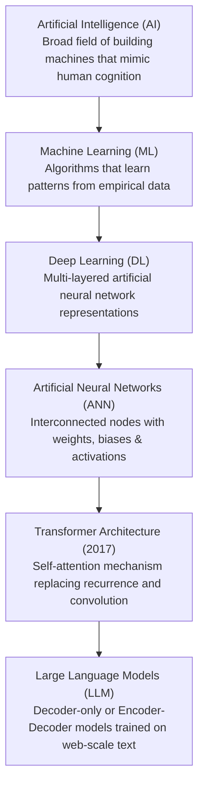

### Explanation
This conceptual taxonomy illustrates the nested specialization of modern AI systems. Artificial Intelligence represents the overarching umbrella. Machine Learning is a specific paradigm where algorithms deduce statistical patterns from data rather than relying on hand-crafted symbolic rules. Deep Learning is a subset of ML utilizing stacked representation layers. Transformers represent a specific deep learning architecture introduced by Vaswani et al. in 2017 that discarded recurrent loops in favor of parallel self-attention. LLMs are billions-parameter instances of transformer models trained on massive text corpora for generative language modeling.

---

## 2. Machine Learning Workflow

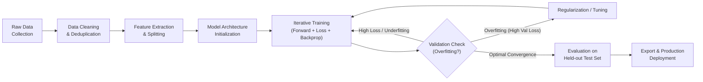

### Explanation
The end-to-end machine learning lifecycle is an iterative optimization loop. Raw data is collected, sanitized, and partitioned into training (typically 80%), validation (10%), and test (10%) splits. The model updates its internal weights across multiple epochs by comparing its predictions against ground-truth labels using a loss function. Validation metrics guide regularization (dropout, weight decay) and early stopping before final model freezing and deployment.

---

## 3. Neural Network Architecture

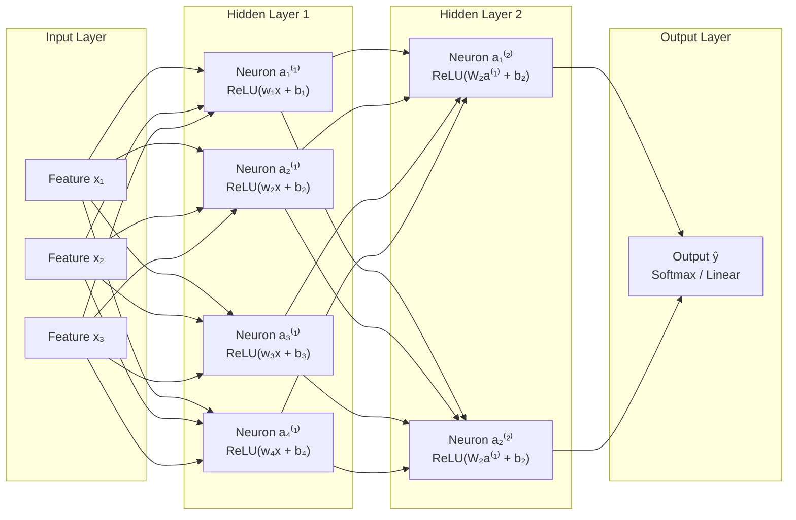

### Explanation
A multi-layer feedforward perceptron consists of an input layer receiving numeric feature vectors, one or more hidden layers executing affine transformations ($z = Wx + b$) followed by non-linear activations ($\sigma(z)$), and an output layer projecting activations into target space (class probabilities via Softmax or continuous values via linear projection). Each connection represents a learnable weight updated via gradient backpropagation.

---

## 4. NLP Processing Pipeline

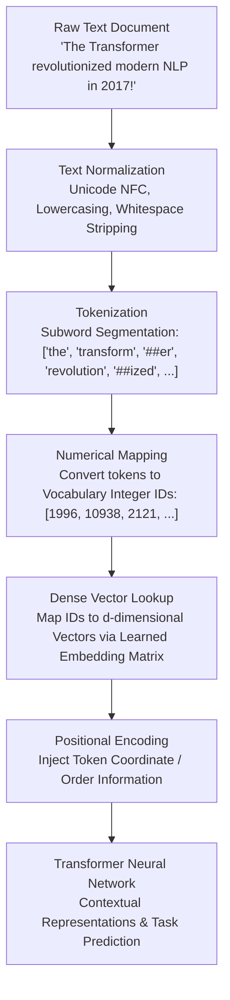

### Explanation
The natural language processing pipeline translates raw, unstructured human character strings into high-dimensional geometric representations that a deep neural network can ingest. Normalization enforces uniform string encoding; tokenization segments text into atomic subword units; vocabulary mapping converts strings into numeric indices; and embedding layers transform discrete indices into dense continuous vector spaces supplemented by sequence position information.

---

## 5. Tokenization Workflow

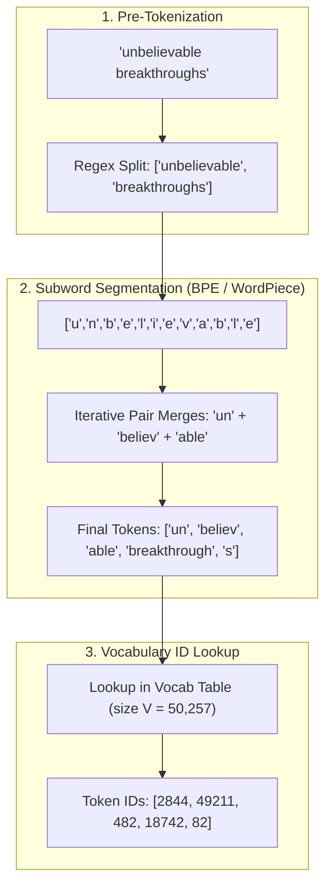

### Explanation
Modern tokenizers strike a mathematical balance between character-level tokenization (tiny vocabularies but computationally prohibitive sequence lengths) and word-level tokenization (out-of-vocabulary errors and exploding dictionary sizes). Algorithms like Byte-Pair Encoding (BPE) iteratively merge high-frequency adjacent byte or character pairs to form subword dictionaries capable of encoding any novel text deterministically.

---

## 6. Embedding Vector Generation

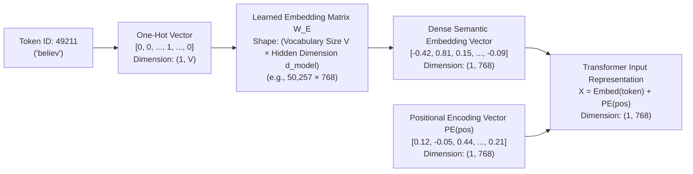

### Explanation
An embedding layer functions as a learned lookup table converting discrete token indices into continuous $d_{\text{model}}$-dimensional vector space. Because transformers process all tokens in parallel without inherent sequential recurrence, an explicit positional encoding vector (sinusoidal or learned) of identical dimensionality is added element-wise to encode order.

---

## 7. The Complete Transformer Architecture

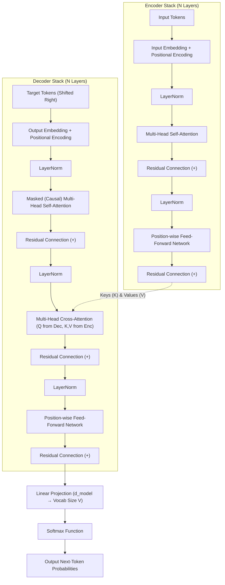

### Explanation
The original transformer consists of an Encoder stack (bidirectional context extraction) and a Decoder stack (autoregressive conditional generation). Modern decoder-only LLMs (like GPT, Llama, and Mistral) dispense with the encoder stack and cross-attention sublayers entirely, retaining only the causal masked self-attention, layer normalization, residual bypasses, and feed-forward networks.

---

## 8. Self-Attention Mechanism

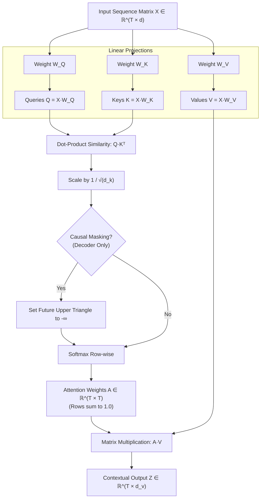

### Explanation
Self-attention maps an input sequence to a contextual sequence by calculating compatibility scores between every token pair. Each token generates a Query ($Q$), a Key ($K$), and a Value ($V$). Dot products between queries and keys calculate raw affinity, which is scaled by $\sqrt{d_k}$ to prevent gradient saturation, causally masked if autoregressive, normalized via Softmax, and multiplied against values to produce context-rich representations.

---

## 9. Query-Key-Value (QKV) Computation Flow

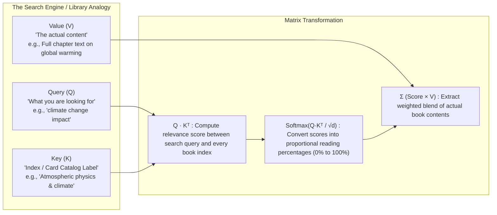

### Explanation
The QKV paradigm mirrors database retrieval. The Query vectors represent what information a specific token position is seeking; the Key vectors advertise what features or semantics that token possesses; and the Value vectors represent the actual semantic content transmitted forward when a Query and Key establish high compatibility.

---

## 10. End-to-End LLM Inference Pipeline

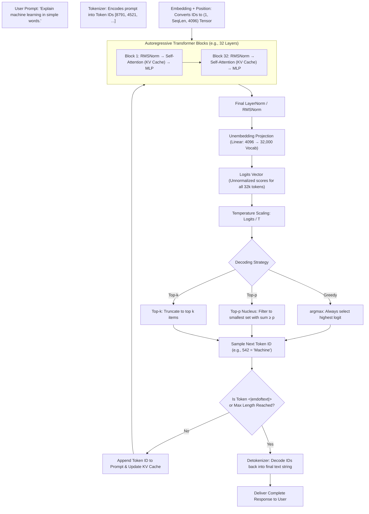

### Explanation
Inference is an autoregressive loop. The user's prompt is tokenized, projected through stacked transformer layers, transformed into unnormalized logits over the vocabulary, and passed to a sampling engine (controlled by temperature, top-k, and top-p). The sampled token is appended to the sequence and fed back into the model until an End-of-Sequence (EOS) token or length limit triggers termination.

---

## 11. LLM Pretraining Lifecycle

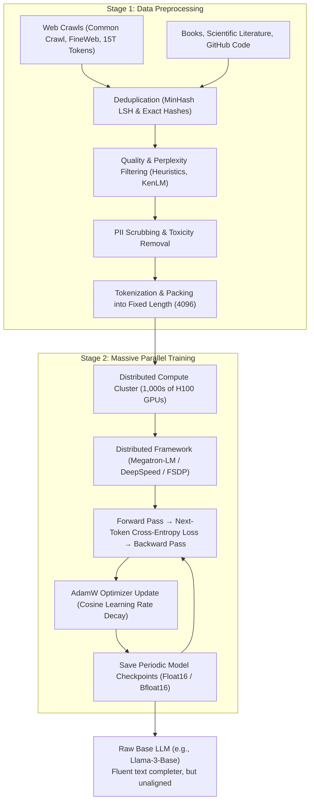

### Explanation
Pretraining transforms random weight initializations into a capable base language model. It ingests trillions of tokens scraped from web documents, books, and code. Data deduplication and quality filtering remove noise before thousands of GPUs optimize next-token cross-entropy loss over months of continuous compute. The resulting base model excels at pattern completion but has not yet learned to behave as an instruction-following assistant.

---

## 12. Dataset Preprocessing & Filtering Pipeline

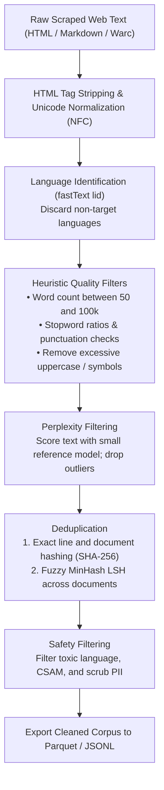

### Explanation
Training data quality dictates model performance (the "Garbage In, Garbage Out" law). Web crawls contain massive repetition, boilerplate HTML, spam, machine translations, and toxic material. This multi-stage pipeline applies strict structural heuristics, language classifiers, n-gram perplexity filters, and MinHash deduplication algorithms to distill trillions of raw web pages into pristine pretraining tokens.

---

## 13. Fine-Tuning Workflow

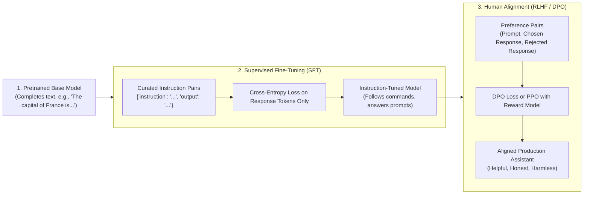

### Explanation
The post-training pipeline turns a text-completer into a user-facing conversational assistant. Supervised Fine-Tuning (SFT) trains the model on curated prompt-response pairs to establish instruction-following habits. Alignment (RLHF or Direct Preference Optimization) guides the model toward human values—penalizing harmful, biased, or deceptive responses while encouraging helpfulness and truthfulness.

---

## 14. LoRA (Low-Rank Adaptation) Architecture

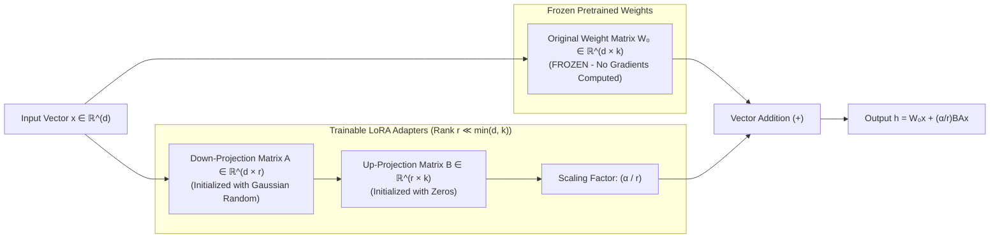

### Explanation
Full fine-tuning requires updating billions of model weights, demanding massive GPU VRAM. LoRA freezes the original weight matrix $W_0$ and injects a low-rank decomposition $BA$, where $r \ll d$. If $d = 4096$ and rank $r = 16$, the trainable parameter count drops by over 99%, allowing an 8B model to be tuned on consumer graphics cards while yielding performance on par with full-parameter tuning.

---

## 15. Retrieval-Augmented Generation (RAG) Architecture

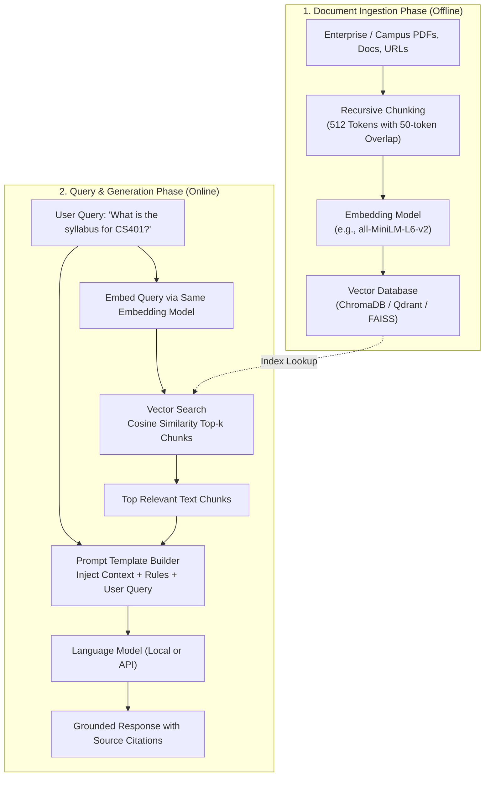

### Explanation
RAG mitigates hallucination and knowledge obsolescence by dynamically retrieving authoritative external records at inference time. Relevant document chunks are converted into dense vector representations and stored in an index. When a user submits a prompt, vector similarity search identifies the most contextually relevant excerpts, which are concatenated into the model's system prompt to ground the generation.

---

## 16. Vector Database Indexing & Similarity Retrieval

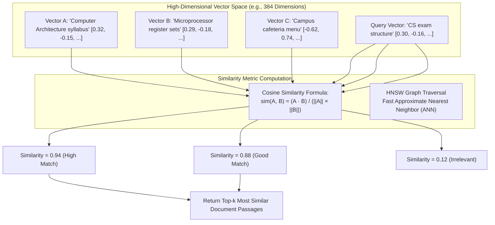

### Explanation
Vector databases organize high-dimensional semantic vectors using Approximate Nearest Neighbor (ANN) graph algorithms such as Hierarchical Navigable Small World (HNSW). Instead of brute-force calculating cosine distance against millions of records, the vector index traverses proximity graphs in logarithmic time $O(\log N)$, retrieving the most semantically related chunks within milliseconds.

---

## 17. Production LLM Application Architecture

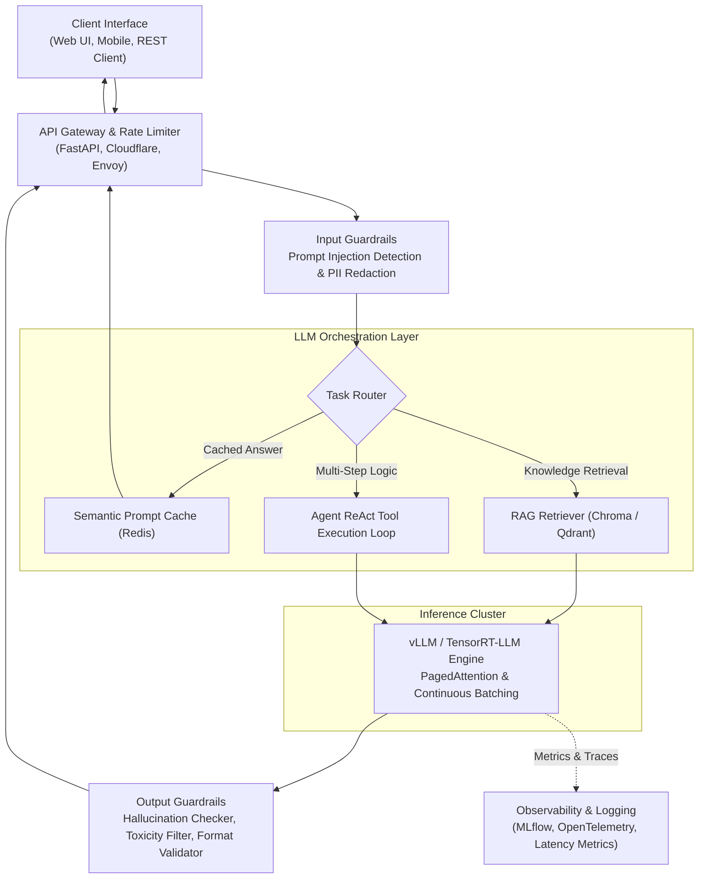

### Explanation
Production LLM systems wrap the raw neural network inside layers of software engineering reliability. API gateways enforce rate limits; input guardrails intercept adversarial prompt injections and sanitize sensitive information; semantic caching servers return instantaneous answers for repeated queries; high-throughput engines like vLLM batch requests dynamically; and output validators ensure regulatory compliance and valid schema output.

---

## 18. Local LLM Deployment Architecture

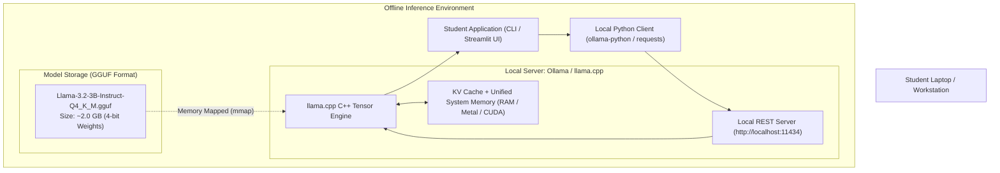

### Explanation
Running modern language models locally without internet connectivity or proprietary APIs is made possible through weight quantization. The C++ engine `llama.cpp` and its wrapper `Ollama` read 4-bit quantized models stored in GGUF format, mapping them directly into available system RAM or GPU memory. The local server exposes a standard REST API that Python scripts can query at zero marginal financial cost and complete data confidentiality.
